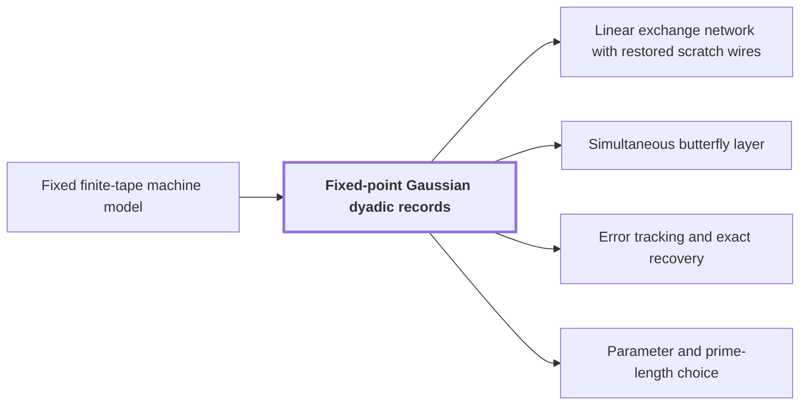

# Fixed-point Gaussian dyadic records

!!! info "Before this page"

    Fixed-point Gaussian dyadic records *is laid out on* [Fixed finite-tape machine model](machine-model.md "A record is laid out on the tapes of the Fixed finite-tape machine model as $2r$ consecutive fixed-width integers, so it is read and moved by ordinary tape scans."). Assumed known: Complex numbers.

!!! abstract "Where this fits"

    - Relied on to show: Complex variant: the tensor product of $H_0=\frac12\begin{pmatrix}1&1\\1&-1\end{pmatrix}$ on one bit of each of $D\le d$ address chunks (each of $K$ bits, selected at a common offset), acting coefficientwise on polynomial records with $r$ complex $p$-bit coefficients, is computed exactly followed by one truncation $Q_p$, in $O(Vd^{\lambda'})$ time with $\lambda'<1$, rather than $D$ whole-array passes. ([Simultaneous butterfly layer](simultaneous-layer.md "The second tape procedure: applying H₀ coefficientwise on the same bit of up to d address chunks in time O(V·d^λ′) for a fixed λ′ < 1, instead of d passes."))
    - Relied on to show: The whole layer can be evaluated exactly: with $\Delta=\lceil C_0d^{C_1}\rceil$, reserving $p+\Delta$ fractional bits and $\Delta+3$ integer and sign bits per real component represents every intermediate coefficient exactly, and this width is $O(p)$ because $\epsilon C_1<1$.
    - Relied on to show: Synthetic transforms over $\mathcal R_r$ on $d-1$ axes of lengths $t_i\in\{2^{\ell-1},2^\ell\}$ with outputs kept in a retained layout $LB$ cost $O(Tp[dK+pK^{\tau-1}+\ell d^{\lambda'}])$ with error less than $\sqrt2\ell\,2^{-p}$. ([Tape layout for synthetic transforms](transform-layout.md "Placing the selected bits of the participating axes at a common offset in K-bit chunks so each round of the synthetic transform is one simultaneous layer, costing less than log t passes."))
    - Relied on to show: On a layout $L$ that places the selected bits of all participating axes of an array of $M=T/r$ polynomial records at a common offset in consecutive $K$-bit chunks, a forward synthetic transform (exact counterpart $LBF_{\boldsymbol t}^-$) and its opposite (exact counterpart $F_{\boldsymbol t}^+B^{-1}L^{-1}$) have error less than $\sqrt2\ell\,2^{-p}$ and cost $O(Tp[dK+pK^{\tau-1}+\ell d^{\lambda'}])$.
    - Relied on to show: For disk-grid polynomials $f,g\in\mathcal R_r$ the exact Gaussian-integer numerators of $fg$, and then $Q_p(fg/r)$, are computed in $O(rp\log(rp))$ time using four integer products by the established multiplier at packing base $B_0=2^{4p}$. ([Signed packing](signed-packing.md "A signed Kronecker substitution that evaluates polynomials with signed coefficients at 2^{4p} to form large integers, multiplies them with the O(n log n) multiplier, and recovers the product coefficients."))
    - Relied on to show: The Fourier transforms of pairwise coprime prime lengths $s_i$ that the integer product needs are computed through power-of-two lengths $t_i$ by Gaussian resampling and Bluestein chirps, with the source and target coordinate permutations left inside the transform identities, so that none is executed as a sort. ([Retained permutation cancellation](retained-permutations.md "Leaving the coordinate permutations of resampling inside the transform identity, so the source permutation cancels across the two forward transforms and the opposite one and none is executed as a sort."))
    - Relied on to show: For coprime $s<t$ with $\theta=t/s-1>p/\alpha^4$ and permutations $(P_su)_j=u_{tj}$, $(P_tv)_k=v_{-sk}$ there are linear contractions $A$, $B_0$ with $P_sF_s=2^{2\alpha^2}B_0P_tF_tA$, computed with error less than $p^2$ in time $O(tp^{3/2+\delta}\alpha)$ without executing $P_s$ or $P_t$. ([Gaussian resampling](gaussian-resampling.md "Re-expressing a Fourier transform of prime length s through a transform of nearby power-of-two length t using Gaussian weights, so that only power-of-two transforms are needed."))
    - Relied on to show: The three ordered numerical maps $\widetilde{\mathsf S}'$, $\widetilde{\mathsf J}'$, $\widetilde{\mathsf D}'$ have errors $16p$, $3p^2/4$, $4$ and times $O(tp^{3/2+\delta}\alpha)$, $O(tp^{3/2+\delta}\alpha)$, $O(tp^{1+\delta})$.
    - Relied on to show: The exact $2n$-bit product of the two inputs is obtained from the radix-digit convolution by the chain: radix digits, Chinese-remainder address map to a product of prime cyclic axes, two forward source transforms (resampling and chirps), pointwise product, opposite transform, rescaling, rounding, and carry propagation, with total error below $1/2$. ([The multiplication algorithm](multiplication-algorithm.md "Digits, then the CRT map, two forward transforms with resampling and chirps, a pointwise product, the opposite transform, rescaling, rounding and carry propagation yield the exact 2n-bit product."))
    - Relied on to show: The computed chirp transform $\widetilde{\mathscr C}$ and the source transform $\widetilde{\mathscr F}$ (apply $\mathcal A$, the chirp transform, $\mathcal B_0$, then multiply by $2^\gamma$) have exact counterparts $QF_{\boldsymbol t}$ and $\mathscr F=2^\gamma\mathcal B_0QF_{\boldsymbol t}\mathcal A=RF_{\boldsymbol s}$.
    - Relied on to show: The algorithm: read radix digits, apply $\Phi$, compute the source transforms $\widetilde{\mathscr F}(u)$, $\widetilde{\mathscr F}(v)$, multiply pointwise, apply the opposite transform, rescale by $S$ and $2^{2b+4}S$, round, undo $\Phi$ and propagate carries to output exactly $2n$ bits.
    - Relied on to show: The error on the recovered integer coefficients is below $1/2$, so rounding gives the exact integer coefficients, and carry propagation yields the exact binary product. ([Error tracking and exact recovery](precision-recovery.md "Each normalized transform and product is a contraction with a bounded rounding error, and the total error on the recovered convolution coefficients is below 1/2, so rounding gives exact integers."))

??? note "Symbols from earlier pages"

    - $r$ — record length: The number of complex coefficients in a polynomial of the ring, always a power of two. (on [Polynomial ring modulo y^r + 1](ring-y.md "Polynomials of degree below r over the complex numbers with y^r = −1, so multiplying by a power of y is a signed shift of the coefficient list."))

A fixed-point Gaussian dyadic record is the number format in which the transform layers keep their polynomial data, chosen so that a whole layer is computed without rounding and rounded once at its end.

A Gaussian dyadic is a complex number whose real and imaginary parts are integer multiples of a negative power of two. Let $p$ be the number of fractional bits, so stored values lie on the grid $2^{-p}\mathbb Z[i]$. Each record is a polynomial in the [Polynomial ring modulo y^r + 1](ring-y.md "Polynomials of degree below r over the complex numbers with y^r = −1, so multiplying by a power of y is a signed shift of the coefficient list."); each of its $r$ coefficients is stored as two signed two's-complement integers, one per real and imaginary part, each read as the integer divided by $2^p$. A record is laid out on the tapes of the [Fixed finite-tape machine model](machine-model.md "The computation model of the main theorem: one fixed finite alphabet and a fixed number of one-dimensional tapes, each head moving at most one cell per step.") as $2r$ consecutive fixed-width integers, so it is read and moved by ordinary tape scans.

Inside a layer, the operations are additions, subtractions, multiplications by $\pm1$ and $\pm i$, and halving, as in $H_0(u,v)=((u+v)/2,(u-v)/2)$. The layer's inputs are disk-valued: each coefficient lies in $2^{-p}\mathbb Z[i]$ and has modulus at most $1$. Let a value computed with $k$ operations in sequence since the layer began be said to have depth $k$. A value of depth $k$ lies in $2^{-(p+k)}\mathbb Z[i]$ and has modulus at most $2^k$. This follows by induction on $k$. At depth $0$ the value is an input, so the claim is the disk-valued hypothesis. Addition or subtraction of values of depths at most $k$ gives a value of depth at most $k+1$, and at most doubles the largest modulus. Halving adds at most one denominator bit. Signs and multiplication by $i$ change neither bound. For example, with $p=2$ and $u=\tfrac34$, the value $u/2=\tfrac38$ needs one more fractional bit than the grid, and loses nothing if that bit is kept.

So the components can be given room in advance. Let $\Delta$ be the number of extra bits reserved, at least the maximal depth reached in the layer. Reserving $p+\Delta$ fractional bits and $\Delta+3$ integer and sign bits per real component represents every intermediate coefficient exactly<cite class="exegenius-ref" data-source="paper" data-locator="§5.4 An explicit guard-width bound" data-quote="represents every intermediate coefficient exactly" title="represents every intermediate coefficient exactly"> (see §5.4 An explicit guard-width bound)</cite>, because the denominator and modulus bounds above then hold at every depth. The parameters keep $\Delta$ small compared with $p$, so each component still has $O(p)$ bits. The intermediate values are exact Gaussian dyadics<cite class="exegenius-ref" data-source="paper" data-locator="§1.1 The two tape operations" data-quote="Intermediate values are exact Gaussian dyadics, whose real and imaginary parts have power-of-two denominators." title="Intermediate values are exact Gaussian dyadics, whose real and imaginary parts have power-of-two denominators."> (see §1.1 The two tape operations)</cite>

Only after the completed layer is one truncation $Q_p$ applied<cite class="exegenius-ref" data-source="paper" data-locator="§1.1 The two tape operations" data-quote="A single truncation follows the completed contractive layer." title="A single truncation follows the completed contractive layer."> (see §1.1 The two tape operations)</cite> The truncation $Q_p$ drops the bits below $2^{-p}$ in each real and imaginary part, returning the record to the $p$-bit grid, with error below $\sqrt2\,2^{-p}$ per complex coefficient. Rounding at every step would add one such error per step; here there is one per layer.

## Connections

Used by:

- [Linear exchange network with restored scratch wires](exchange-network.md "In the complex construction the network keeps its scalars in $\mathbb Z[i,1/2]$, the values of Fixed-point Gaussian dyadic records, and the neighbours of a triple are the distinct triples with even intersection (zero or two).") *keeps its scalars in* Fixed-point Gaussian dyadic records
- [Simultaneous butterfly layer](simultaneous-layer.md "The layer is evaluated in Fixed-point Gaussian dyadic records.") *is evaluated in* Fixed-point Gaussian dyadic records
- [Error tracking and exact recovery](precision-recovery.md "The computation runs on Fixed-point Gaussian dyadic records with $p=6b$ fractional bits, where $b=\lceil\log_2n\rceil$ is the digit width.") *runs on* Fixed-point Gaussian dyadic records
- [Parameter and prime-length choice](parameter-choice.md "Here $b$ is the digit width, $p$ sets the precision of the Fixed-point Gaussian dyadic records, and $d$ is the axis count.") *sets the precision of* Fixed-point Gaussian dyadic records

??? quote "From the sources"

    > Intermediate values are exact Gaussian dyadics,
    >
    > — [Integer multiplication below n log n (OpenAI, 2026)](https://github.com/openai/math/tree/fd4aeeb2ee4fc729c18d98444fed42fd0529eeeb/preprints/Integer-multiplication-below-n-log-n-September-23-2026)

    > A single truncation follows the completed contractive layer.
    >
    > — [Integer multiplication below n log n (OpenAI, 2026)](https://github.com/openai/math/tree/fd4aeeb2ee4fc729c18d98444fed42fd0529eeeb/preprints/Integer-multiplication-below-n-log-n-September-23-2026)
