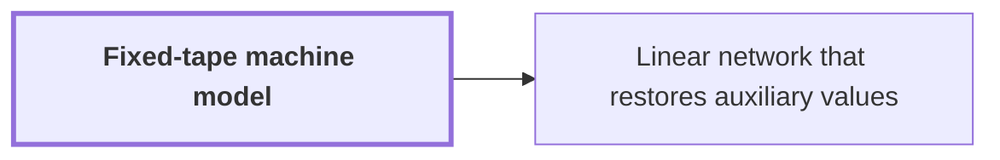

# Fixed-tape machine model

!!! info "Before this page"

    Assumed known: Multitape Turing machine.

!!! abstract "Where this fits"

    - Relied on to show: The subset-intersection network has a total number $s$ of smaller calls with $s<Wm$, where $W$ is its wire count and $m$ the dimension of its label space. ([Subset-intersection network](subset-network.md "A linear network whose subspace labels come from intersection sizes of three-element subsets, so that the total number of smaller calls is less than the number of wires times the dimension."))

The fixed-tape machine model is a Turing machine with one fixed finite alphabet and one fixed finite number of one-dimensional tapes, so neither grows with the input. Its cost is a count of steps of such a machine.

The restriction that matters is on movement.<cite class="exegenius-ref" data-source="paper" data-locator="§2 The machine model and elementary streams" data-quote="A step reads and writes at most one cell on each tape and moves each head by at most one cell." title="A step reads and writes at most one cell on each tape and moves each head by at most one cell."> (see §2 The machine model and elementary streams)</cite> So a value moved from one end of a tape to the other takes one step per cell crossed.

Fixed tracks, meaning several parallel rows of symbols stored in each cell, and finitely many work tapes are harmless for this count.<cite class="exegenius-ref" data-source="paper" data-locator="§2 The machine model and elementary streams" data-quote="Fixed tracks and finitely many work tapes change time by a fixed factor." title="Fixed tracks and finitely many work tapes change time by a fixed factor."> (see §2 The machine model and elementary streams)</cite>

A scan is one pass of a head across a stretch of tape. A field is a block of consecutive digits holding one number. Moving one digit in a fixed radix takes a bounded number of scans, because a digit is one symbol from a fixed alphabet, so the finite control can hold it while the head makes a fixed number of passes. Interchanging fields whose digit counts grow needs more. The control cannot hold a whole field, so each digit must be carried past the other field, and the number of passes grows with the field lengths.

Scans are the unit of cost because a scan takes about as many steps as the cells it crosses, since each step moves a head one cell. Counting scans therefore counts steps up to a constant factor.

## Connections

Used by:

- [Linear network that restores auxiliary values](linear-network.md "It has the fixed structure of a Fixed-tape machine model: its wires and schedule do not depend on the values.") *has the fixed structure of* Fixed-tape machine model

??? quote "From the sources"

    > A machine has one fixed finite alphabet and one fixed finite number of one-dimensional tapes.
    >
    > — [Integer multiplication below n log n (OpenAI, 2026)](https://github.com/openai/math/tree/fd4aeeb2ee4fc729c18d98444fed42fd0529eeeb/preprints/Integer-multiplication-below-n-log-n-September-23-2026)
