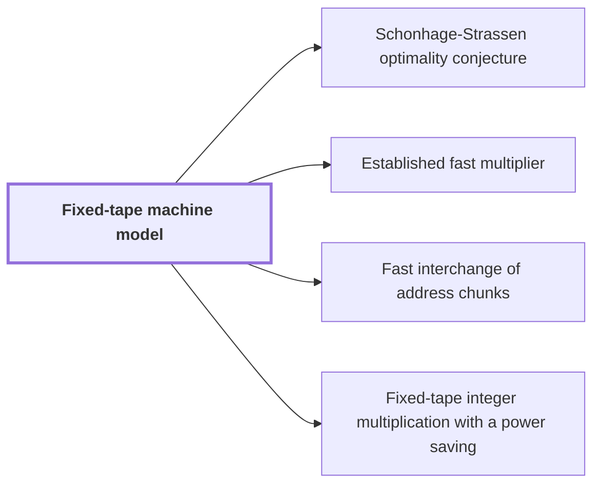

# Fixed-tape machine model

!!! info "Before this page"

    Assumed known: Multitape Turing machine and Big-O notation.

!!! abstract "Where this fits"

    - Relied on to show: The integer product is computed exactly on one fixed-tape machine in $O(n(\lg n)^{1-\kappa})$ worst-case time, for $\kappa=2^{-182}$. ([Fixed-tape integer multiplication with a power saving](fixed-tape-multiplication.md "A deterministic fixed-tape Turing machine that multiplies two n-bit integers exactly in O(n(lg n)^(1−κ)) worst-case time, for a fixed κ = 2^(−182), disproving the n log n optimality conjecture in this model."))

A fixed-tape machine is a multitape Turing machine whose alphabet and number of one-dimensional tapes are fixed before any input is read and do not change with the input length, so one machine must handle inputs of every size. A standard multitape machine may use more tapes, or a larger alphabet, as its input grows; a fixed-tape machine may not. The integer multiplication result of this argument is proved in this model, so its bounds on multiplication cost are claims about such machines.

Running time is measured as usual: the worst case, over all inputs of a given size, of the number of steps the machine takes. Here $n$ is the length in bits of each input.

The step that needs a fixed-tape machine is the existence of one machine that works for all sizes. The paper's main theorem supplies it. It states that there is one deterministic machine with<cite class="exegenius-ref" data-source="paper" data-locator="§1 Introduction" data-quote="a fixed finite alphabet and a fixed finite number of one-dimensional tapes" title="a fixed finite alphabet and a fixed finite number of one-dimensional tapes"> (see §1 Introduction)</cite>, which computes the exact product of two integers for every input size. Because one program serves every $n$, its alphabet and tape count cannot grow with $n$. The theorem also bounds its worst-case time by a constant times $n(\lg n)^{1-\kappa}$, where $\kappa = 2^{-182}$ is a fixed constant, the same for every $n$. So the multiplication bound is a claim about a fixed-tape machine. The proof of the theorem is in the paper.

## Connections

Used by:

- [Schonhage-Strassen optimality conjecture](schonhage-strassen-conjecture.md "The conjecture is posed for multitape machines and is contrasted with the fixed-tape machine model, in which the target result is measured.") *is contrasted with* Fixed-tape machine model
- [Established fast multiplier](multiplier-subroutine.md "Within the argument the multiplier runs on a Fixed-tape machine model.") *runs on* Fixed-tape machine model
- [Fast interchange of address chunks](tape-interchange.md "Fast interchange of address chunks is a procedure that runs on a Fixed-tape machine model and swaps two disjoint, equal-width address fields of an array.") *runs on* Fixed-tape machine model
- [Fixed-tape integer multiplication with a power saving](fixed-tape-multiplication.md "Fixed-tape integer multiplication with a power saving is a deterministic algorithm that runs on one Fixed-tape machine model and multiplies two $n$-bit integers exactly.") *runs on* Fixed-tape machine model

??? quote "From the sources"

    > a fixed finite alphabet and a fixed finite number of one-dimensional tapes
    >
    > — [Integer multiplication below n log n (OpenAI, 2026)](https://github.com/openai/math/tree/fd4aeeb2ee4fc729c18d98444fed42fd0529eeeb/preprints/Integer-multiplication-below-n-log-n-September-23-2026)
