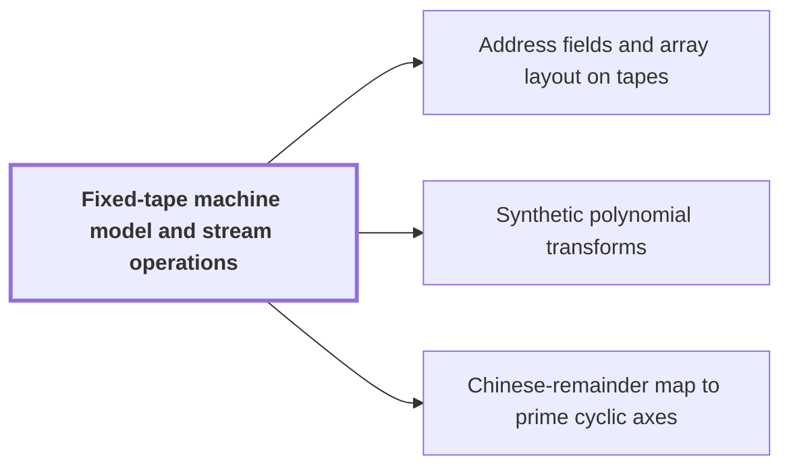

# Fixed-tape machine model and stream operations

!!! info "Before this page"

    Assumed known: Multitape Turing machine and Big-O notation.

!!! abstract "Where this fits"

    - Relied on to show: An $n$-bit integer product is computed by a fixed-tape machine in $O(n(\lg n)^{1-\kappa})$ time, $\kappa=2^{-182}$. ([Integer multiplication in O(n(lg n)^{1-κ}) time](main-theorem.md "Deterministic fixed-tape Turing machine multiplying n-bit integers in O(n(lg n)^{1-κ}), κ=2^{-182}, by reducing to ring convolution with fast address interchanges and simultaneous butterfly layers, disproving the n log n conjecture in this model."))
    - Relied on to show: Each procedure comes from a fixed linear network that exchanges two banks of values with prescribed signs and restores every auxiliary value; rows are distributed among $W$ roles and frames cancel along routes. ([Finite linear network with roles and frames](linear-network-roles.md "Fixed linear network exchanging two banks of values with prescribed signs and restoring auxiliary values; wires have roles, rows are distributed cyclically among roles, and invertible frame operators cancel along routes leaving an endpoint operator."))

A fixed-tape machine is the cost model in which the paper states its integer multiplication bound. Its cost is set by how data moves along the tapes, so the operations to minimize are scans, shifts and permutations of data.

The machine has<cite class="exegenius-ref" data-source="paper" data-locator="§2 The machine model and elementary streams" data-quote="one fixed finite alphabet and one fixed finite number of one-dimensional tapes" title="one fixed finite alphabet and one fixed finite number of one-dimensional tapes"> (see §2 The machine model and elementary streams)</cite>, each with its own head.<cite class="exegenius-ref" data-source="paper" data-locator="§2 The machine model and elementary streams" data-quote="A step reads and writes at most one cell on each tape and moves each head by at most one cell." title="A step reads and writes at most one cell on each tape and moves each head by at most one cell."> (see §2 The machine model and elementary streams)</cite> Moving a value across many cells therefore takes at least as many steps as cells it crosses.

A track is a parallel row of cells on one tape.<cite class="exegenius-ref" data-source="paper" data-locator="§2 The machine model and elementary streams" data-quote="Fixed tracks and finitely many work tapes change time by a fixed factor." title="Fixed tracks and finitely many work tapes change time by a fixed factor."> (see §2 The machine model and elementary streams)</cite> A fixed number of tracks is a larger fixed alphabet, and a finite number of extra tapes can be interleaved into one tape, so each step of the original machine becomes a bounded number of steps on the enlarged one. Adding them therefore keeps asymptotic bounds.

A stream is a sequence of cells that one head reads or writes in order during a scan.<cite class="exegenius-ref" data-source="paper" data-locator="§2 The machine model and elementary streams" data-quote="Every scan includes its counters and the return of its tape heads." title="Every scan includes its counters and the return of its tape heads."> (see §2 The machine model and elementary streams)</cite> An address is the position of an entry in an ordered stream. A field is a contiguous block of digit positions within each address, so interchanging two equal-width fields swaps their contents in every address.

<cite class="exegenius-ref" data-source="paper" data-locator="§2 The machine model and elementary streams" data-quote="We distinguish moving one digit in a fixed radix, which needs a bounded number of scans, from interchanging fields whose numbers of digits grow." title="We distinguish moving one digit in a fixed radix, which needs a bounded number of scans, from interchanging fields whose numbers of digits grow."> (see §2 The machine model and elementary streams)</cite> A radix digit is a fixed-size block of cells, which the finite control can hold, so moving one digit takes a bounded number of scans.

Interchanging whole fields moves blocks across long distances, which is expensive because each step moves a head by one cell. The paper instead realizes the interchange by<cite class="exegenius-ref" data-source="paper" data-locator="§2 The machine model and elementary streams" data-quote="computing XOR combinations of intermediate data streams" title="computing XOR combinations of intermediate data streams"> (see §2 The machine model and elementary streams)</cite>.

A simple XOR combination is the standard identity that two values can be exchanged by three XORs. The first value becomes its XOR with the second, then the second becomes its XOR with the new first, then the first becomes its XOR with the new second. No temporary copy of either value is needed.

## Connections

Used by:

- [Address fields and array layout on tapes](address-fields.md "A layout's cost is measured in the Fixed-tape machine model and stream operations, where each step touches one cell per tape, so moving data is the cost to minimize.") *is measured in* Fixed-tape machine model and stream operations
- [Synthetic polynomial transforms](synthetic-transforms.md "Synthetic transforms are costed on a fixed-tape machine, where the cost is data movement.") *are costed on* Fixed-tape machine model and stream operations
- [Chinese-remainder map to prime cyclic axes](crt-address-map.md "The map's axis moves are costed in the fixed-tape machine model and stream operations, which counts each such step as data movement, since each step touches one cell per tape.") *is costed in* Fixed-tape machine model and stream operations

??? quote "From the sources"

    > A machine has one fixed finite alphabet and one fixed finite number of one-dimensional tapes.
    >
    > — [Integer multiplication below n log n (OpenAI, 2026)](https://github.com/openai/math/tree/fd4aeeb2ee4fc729c18d98444fed42fd0529eeeb/preprints/Integer-multiplication-below-n-log-n-September-23-2026)
