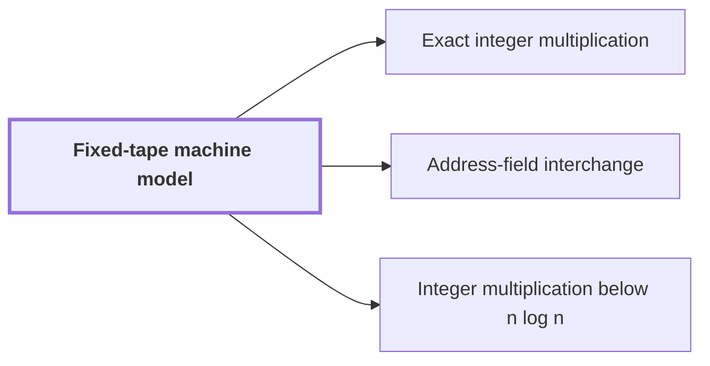

# Fixed-tape machine model

!!! info "Before this page"

    Assumed known: Turing machines and tapes.

!!! abstract "Where this fits"

    - Relied on to show: A deterministic fixed-tape machine multiplies two $n$-bit integers exactly in $O(n(\lg n)^{1-\kappa})$ time, with $\kappa=2^{-182}$, below the $n\lg n$ conjecture in this model. ([Integer multiplication below n log n](main-theorem.md "A deterministic fixed-tape machine that multiplies two n-bit integers exactly in O(n (lg n)^(1−κ)) time with κ = 2^−182, which disproves the n log n optimality conjecture in this model."))
    - Relied on to show: Two disjoint equal address fields of $u$ bits in an array of stored volume $V$ can be interchanged in $O(V u^{\tau})$ time. ([Address-field interchange](address-interchange.md "A tape procedure that swaps two disjoint contiguous address fields of an array in time that grows like a power of the field width, rather than linearly."))
    - Relied on to show: A compatible choice of rational parameters makes every term of the cost table fit the bound of Theorem 1.

A fixed-tape machine is a Turing machine whose alphabet and number of one-dimensional tapes are both fixed in advance, so neither grows with the input. The paper states its main result in this model, and the model fixes what running time means there: the number of steps the machine takes.

A step reads and writes at most one cell on each tape and moves each head by at most one cell. Extra fixed tracks and finitely many work tapes are allowed, since they change running time only by a fixed factor.<cite class="exegenius-ref" data-source="paper" data-locator="§11 A consequence for matrix transposition, p. 8" data-quote="Fixed tracks and finitely many work tapes change time by a fixed factor." title="Fixed tracks and finitely many work tapes change time by a fixed factor."> (see §11 A consequence for matrix transposition, p. 8)</cite>

The paper's constructions are built from scans, where a scan is one pass of the heads along a stretch of tape. It counts each scan's own counters and the return of its heads as part of that scan.<cite class="exegenius-ref" data-source="paper" data-locator="§11 A consequence for matrix transposition, p. 8" data-quote="Every scan includes its counters and the return of its tape heads." title="Every scan includes its counters and the return of its tape heads."> (see §11 A consequence for matrix transposition, p. 8)</cite>

The model separates two kinds of rearrangement. Moving one digit in a fixed radix needs a bounded number of scans; interchanging fields whose digit counts grow is a different case.<cite class="exegenius-ref" data-source="paper" data-locator="§11 A consequence for matrix transposition, p. 8" data-quote="We distinguish moving one digit in a fixed radix, which needs a bounded number of scans, from interchanging fields whose numbers of digits grow." title="We distinguish moving one digit in a fixed radix, which needs a bounded number of scans, from interchanging fields whose numbers of digits grow."> (see §11 A consequence for matrix transposition, p. 8)</cite> The paper does not take such an interchange as primitive. It realizes it from elementary scans and XOR combinations of intermediate data streams.<cite class="exegenius-ref" data-source="paper" data-locator="§11 A consequence for matrix transposition, p. 8" data-quote="The latter permutation will be realized in Section 4 by computing XOR combinations of intermediate data streams." title="The latter permutation will be realized in Section 4 by computing XOR combinations of intermediate data streams."> (see §11 A consequence for matrix transposition, p. 8)</cite>

Let $u$ denote the number of cells in each of two disjoint fields, where a field is a contiguous block of cells. A machine that moves the last cell of a block of three cells to the front uses a fixed sequence of scans whatever the cell contents, so its time is a constant. Swapping two fields of $u$ cells each is different: $u$ can grow with the input, so the same fixed sequence does not apply.

## Connections

Used by:

- [Exact integer multiplication](exact-integer-multiplication.md "In the main result of this wiki, exact integer multiplication is computed by a deterministic fixed-tape machine in time below $n\lg n$.") *is computed by* Fixed-tape machine model
- [Address-field interchange](address-interchange.md "The procedure runs on a Fixed-tape machine model.") *runs on* Fixed-tape machine model
- [Integer multiplication below n log n](main-theorem.md "Integer multiplication below $n\lg n$ is the main theorem: a single deterministic Turing machine that runs in the fixed-tape machine model multiplies two $n$-bit integers exactly, with its logarithmic factor reduced by a fixed power.") *runs in* Fixed-tape machine model

??? quote "From the sources"

    > A machine has one fixed finite alphabet and one fixed finite number of one-dimensional tapes
    >
    > — Integer multiplication below n log n (OpenAI, 2026)
