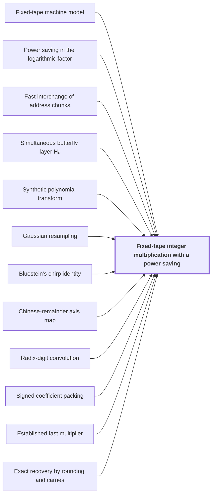

# Fixed-tape integer multiplication with a power saving

!!! info "Before this page"

    Fixed-tape integer multiplication with a power saving *runs on* [Fixed-tape machine model](fixed-tape-model.md "Fixed-tape integer multiplication with a power saving is a deterministic algorithm that runs on one Fixed-tape machine model and multiplies two $n$-bit integers exactly."), *achieves* [Power saving in the logarithmic factor](power-saving.md "It achieves a Power saving in the logarithmic factor, which puts its time below $n\log n$ by a power of $\lg n$."), *carries out its address rearrangements by* [Fast interchange of address chunks](tape-interchange.md "It carries out its address rearrangements by Fast interchange of address chunks, which swaps two equal-width address fields of width $u$."), *is built from simultaneous layers of* [Simultaneous butterfly layer H₀](butterfly-layer.md "Each transform is built from simultaneous layers of Simultaneous butterfly layer H₀ on polynomial records."), *computes its transforms by* [Synthetic polynomial transform](synthetic-transform.md "It computes its transforms by a Synthetic polynomial transform over $\mathbb C[y]/(y^r+1)$."), *rewrites its prime-length transforms by* [Gaussian resampling](gaussian-resampling.md "It rewrites its prime-length transforms by Gaussian resampling."), *reduces the middle transform by* [Bluestein's chirp identity](bluestein.md "It reduces the middle transform by Bluestein's chirp identity."), *places the coefficients on axes by* [Chinese-remainder axis map](crt-axis-map.md "It places the coefficients on axes by the Chinese-remainder axis map."), *reduces multiplication to convolution through* [Radix-digit convolution](radix-digit-convolution.md "It reduces multiplication to convolution through Radix-digit convolution, with $\lceil n/b\rceil$ digits per input."), *packs signed coefficients by* [Signed coefficient packing](signed-packing.md "It packs signed coefficients by Signed coefficient packing, so that polynomial products become integer products."), *computes its shorter products by* [Established fast multiplier](multiplier-subroutine.md "It computes its shorter products by the Established fast multiplier, used as a black box.") and *recovers the exact binary product by* [Exact recovery by rounding and carries](exact-recovery.md "It recovers the exact binary product by Exact recovery by rounding and carries.").

??? note "Symbols from earlier pages"

    - $n$ — input length in bits: The count of bits in each input of the machine, the length in bits of each input. (on [Fixed-tape machine model](fixed-tape-model.md "A multitape Turing machine with one fixed finite alphabet and a fixed finite number of one-dimensional tapes, the same for every input length."))
    - $\kappa$ — fixed exponent saving: A fixed constant equal to $2^{-182}$, the same for every input length $n$. (on [Fixed-tape machine model](fixed-tape-model.md "A multitape Turing machine with one fixed finite alphabet and a fixed finite number of one-dimensional tapes, the same for every input length."))
    - $V$ — stored volume: The number of data units in the array being permuted. (on [Fast interchange of address chunks](tape-interchange.md "A fixed-tape procedure that swaps two disjoint equal-width address fields of an array in time O(V u^τ) for a fixed τ < 1, where V is the stored volume and u the field width, using XOR combinations of intermediate data."))
    - $\tau$ — saving exponent: A fixed exponent below 1 that sets the saving in the cost per unit of width. (on [Fast interchange of address chunks](tape-interchange.md "A fixed-tape procedure that swaps two disjoint equal-width address fields of an array in time O(V u^τ) for a fixed τ < 1, where V is the stored volume and u the field width, using XOR combinations of intermediate data."))
    - $u$ — field width: The number of bits in each of the two address fields H and D. (on [Fast interchange of address chunks](tape-interchange.md "A fixed-tape procedure that swaps two disjoint equal-width address fields of an array in time O(V u^τ) for a fixed τ < 1, where V is the stored volume and u the field width, using XOR combinations of intermediate data."))
    - $y$ — polynomial variable: The formal variable of the ring, whose powers act as roots of unity on the remaining axes. (on [Polynomial ring modulo yʳ + 1](polynomial-ring.md "The ring of complex polynomials of degree less than r, with multiplication reduced modulo y^r + 1; multiplication by a power of y permutes and sign-changes the coefficient list."))
    - $r$ — coefficient count: The number of complex coefficients in each polynomial record, which is a power of two. (on [Polynomial ring modulo yʳ + 1](polynomial-ring.md "The ring of complex polynomials of degree less than r, with multiplication reduced modulo y^r + 1; multiplication by a power of y permutes and sign-changes the coefficient list."))
    - $d$ — recursion depth: The number of levels of recursion used to build an interchange of width $\mu^d$. (on [Fast interchange of address chunks](tape-interchange.md "A fixed-tape procedure that swaps two disjoint equal-width address fields of an array in time O(V u^τ) for a fixed τ < 1, where V is the stored volume and u the field width, using XOR combinations of intermediate data."))
    - $W$ — number of roles: The number of roles, which is the number of fixed wire places in the network. (on [Role streams from a cyclic row split](role-streams.md "Splitting the rows of an array cyclically among the W fixed wire roles of a network, so that each role carries an equal share of the volume and gates act pointwise on matching addresses."))
    - $s$ — smaller call count: The total number of smaller calls, summed over all edges of the network. (on [Rank-saving recursion](recursive-saving.md "A recursive scheme in which an edge matrix of rank a costs a smaller calls and the total number s of smaller calls over W roles satisfies s < Wm, so that multiplying the parameter by m multiplies the cost by less than m per unit volume."))

Fixed-tape integer multiplication with a power saving is a deterministic algorithm that runs on one [Fixed-tape machine model](fixed-tape-model.md "A multitape Turing machine with one fixed finite alphabet and a fixed finite number of one-dimensional tapes, the same for every input length.") and multiplies two $n$-bit integers exactly.

Its worst-case time is $O(n(\lg n)^{1-\kappa})$, with $\kappa=2^{-182}$<cite class="exegenius-ref" data-source="paper" data-locator="" data-quote="$\kappa=2^{-182}$" title="$\kappa=2^{-182}$"> (see Integer multiplication below n log n (OpenAI, 2026))</cite>. It achieves a [Power saving in the logarithmic factor](power-saving.md "A bound of the form n times (lg n) raised to the power 1 − κ for a fixed κ > 0, which is smaller than n log n by a polynomial factor in log n."), which puts its time below $n\log n$ by a power of $\lg n$. It disproves the [Schonhage-Strassen optimality conjecture](schonhage-strassen-conjecture.md "The conjecture that n log n is the optimal order of growth of the time needed to multiply two n-bit integers on a multitape Turing machine.") in this model.

The digit width is $b=\lceil\log_2 n\rceil$ and the precision is $p=6b$<cite class="exegenius-ref" data-source="paper" data-locator="§9.2.1 The padded box and working precision" data-quote="$p=6b$" title="$p=6b$"> (see §9.2.1 The padded box and working precision)</cite>, the number of bits kept after each rounding. The digit width must grow for the rounding error to fall (see below), yet only as $\lg n$, so $p$ is of order $\lg n$. The stored volume $V=\Theta(n)$ holds about $n/b$ records of $p$ bits each.

It reduces multiplication to convolution through [Radix-digit convolution](radix-digit-convolution.md "Writing each n-bit input as a polynomial in 2^b with about n/b nonnegative digits, so that integer multiplication becomes a convolution whose coefficients are bounded by a fixed power of two."), with $\lceil n/b\rceil$ digits per input. It places the coefficients on axes by the [Chinese-remainder axis map](crt-axis-map.md "The bijection sending a coefficient index written in mixed radix with pairwise coprime lengths to coordinates on a product of cyclic axes, which turns one cyclic convolution into a multidimensional one."). It rewrites its prime-length transforms by [Gaussian resampling](gaussian-resampling.md "A rewriting of a Fourier transform of prime length as a transform with power-of-two axis lengths, with source and target coordinate permutations kept inside the transform identity."). It reduces the middle transform by [Bluestein's chirp identity](bluestein.md "An identity writing a Fourier transform as a cyclic convolution sandwiched between pointwise multiplications by chirp sequences exp(−πi s j² / t)."). It computes its transforms by a [Synthetic polynomial transform](synthetic-transform.md "A discrete Fourier transform whose roots of unity are powers of y in the polynomial ring, so that each twiddle multiplication is a signed shift and the transform is computed by simultaneous butterfly layers.") over $\mathbb C[y]/(y^r+1)$. Each transform is built from simultaneous layers of [Simultaneous butterfly layer H₀](butterfly-layer.md "The map H₀(u,v) = ((u+v)/2, (u−v)/2) applied at once to a selected coordinate bit of every chunk, a two-point butterfly acting coefficientwise on polynomial records.") on polynomial records.

It packs signed coefficients by [Signed coefficient packing](signed-packing.md "Encoding a polynomial with signed integer coefficients as one integer by placing coefficients at fixed bit offsets, so that a polynomial product becomes an integer product."), so that polynomial products become integer products. It computes its shorter products by the [Established fast multiplier](multiplier-subroutine.md "The known deterministic O(n log n) multiplication algorithm of Harvey and van der Hoeven, used as a black-box subroutine on shorter integers."), used as a black box. It recovers the exact binary product by [Exact recovery by rounding and carries](exact-recovery.md "Recovering the exact integer coefficients of a convolution by rounding the computed values, whose error is below one half, and then propagating carries in radix 2^b."). It carries out its address rearrangements by [Fast interchange of address chunks](tape-interchange.md "A fixed-tape procedure that swaps two disjoint equal-width address fields of an array in time O(V u^τ) for a fixed τ < 1, where V is the stored volume and u the field width, using XOR combinations of intermediate data."), which swaps two equal-width address fields of width $u$. A swap costs $O(Vu^{\tau})$ time<cite class="exegenius-ref" data-source="paper" data-locator="§1.1 The two tape operations" data-quote="$O(Vu^\tau)$" title="$O(Vu^\tau)$"> (see §1.1 The two tape operations)</cite>, a power of the width.

Rounding errors are a fixed multiple of $2^{-p}$, times a factor growing with the sizes. Undoing the digit scales gives a final coefficient error of at most a constant times

$$2^{2b+4}\cdot 2^{b}\cdot 2^{2b}\cdot 2^{-6b}\cdot 2^{b/4}\cdot b=O(b\,2^{-3b/4}).$$

Here $2^{2b+4}$ reverses the digit scales, $2^{b}$ and $2^{2b}$ bound the record count and its square, $2^{-6b}=2^{-p}$ is the resolution of stored values, and $2^{b/4}$ bounds the remaining factor once $b\ge 2^{24}$. The factor $b$ counts carries. The error is at most $448b\,2^{-3b/4}$, which is below $1/2$ for $b$ beyond a fixed cutoff<cite class="exegenius-ref" data-source="paper" data-locator="§9.7.2 The final integer coefficients" data-quote="448b\,2^{-3b/4}&lt;\frac12" title="448b\,2^{-3b/4}&lt;\frac12"> (see §9.7.2 The final integer coefficients)</cite>. The true coefficients are integers, so the nearest integer to each computed value is the true coefficient<cite class="exegenius-ref" data-source="paper" data-locator="§9.7.2 The final integer coefficients" data-quote="The strict error below $1/2$ makes the nearest integer to" title="The strict error below $1/2$ makes the nearest integer to"> (see §9.7.2 The final integer coefficients)</cite>.

The paper's table bounds the power of $p$ in each of seven dominant costs $V p^{e}$ by $1-2\kappa$<cite class="exegenius-ref" data-source="paper" data-locator="§9.8 The complete time bound" data-quote="Each of the seven displayed powers is at most $1-2\kappa$" title="Each of the seven displayed powers is at most $1-2\kappa$"> (see §9.8 The complete time bound)</cite>. The margin $1-e$ is smallest, $2\kappa$, for the chunk-exchange row<cite class="exegenius-ref" data-source="paper" data-locator="§9.8 The complete time bound" data-quote="2^{-181}=2\kappa" title="2^{-181}=2\kappa"> (see §9.8 The complete time bound)</cite>. So the seven terms sum to $O(Vp^{1-2\kappa}(\log p)^{O(1)})$, and since $(\log p)^{O(1)}\le p^{\kappa}$ for large $p$, the cost is $O(Vp^{1-\kappa})=O(n(\lg n)^{1-\kappa})$.

The width falls by a factor $\varphi$ at each recursion level: at depth $d$ the width is $\varphi^{d}$, where $\varphi$, a fixed integer, is that factor. Each recursive call acts on one role stream of volume $V/W$, and there are $s$ smaller calls, so each level multiplies the cost per unit volume by $s/W$. This factor is below the swap's gain $\varphi^{\tau}$: $s/W<\varphi^{\tau}$<cite class="exegenius-ref" data-source="paper" data-locator="§4.2 Transferring a finite circuit to address permutations" data-quote="$s/W&lt;m^\tau$" title="$s/W&lt;m^\tau$"> (see §4.2 Transferring a finite circuit to address permutations)</cite>. The ratio $(s/W)\varphi^{-\tau}$ stays below $1$ by a fixed margin, which the paper checks. So the sum is at most a constant times its first term, and the cost per unit volume at depth $d$ is $O(\varphi^{d\tau})=O(u^{\tau})$, where $u=\varphi^{d}$ is the width.

## Connections

??? quote "From the sources"

    > We give a deterministic algorithm that multiplies two $n$-bit integers
    >
    > — [Integer multiplication below n log n (OpenAI, 2026)](https://github.com/openai/math/tree/fd4aeeb2ee4fc729c18d98444fed42fd0529eeeb/preprints/Integer-multiplication-below-n-log-n-September-23-2026)
