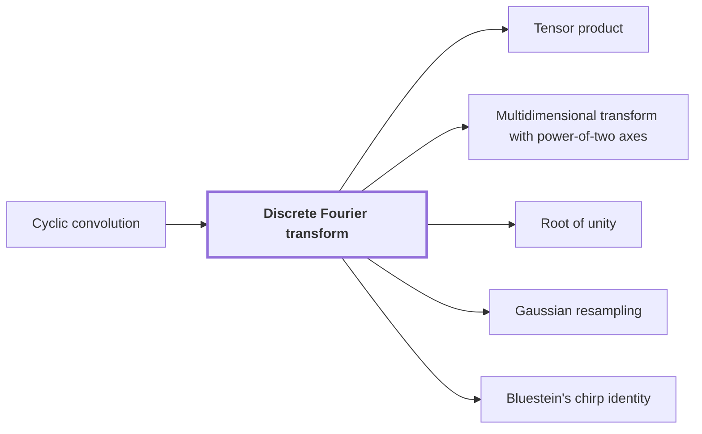

# Discrete Fourier transform

!!! info "Before this page"

    Discrete Fourier transform *turns* [Cyclic convolution](cyclic-convolution.md "It matters because it turns cyclic convolution into entrywise products."). Assumed known: Complex numbers.

!!! abstract "Where this fits"

    - Relied on to show: Each prime-length Fourier transform is expressed through a tensor transform with power-of-two axis lengths, keeping the source and target permutations inside the identity. ([Gaussian resampling](gaussian-resampling.md "A rewriting of a Fourier transform of prime length as a transform with power-of-two axis lengths, with source and target coordinate permutations kept inside the transform identity."))
    - Relied on to show: Gaussian resampling expresses each source Fourier transform through a power-of-two tensor transform.
    - Relied on to show: Bluestein's chirp identity turns the middle transform, with its target permutation, into normalized cyclic convolution. ([Bluestein's chirp identity](bluestein.md "An identity writing a Fourier transform as a cyclic convolution sandwiched between pointwise multiplications by chirp sequences exp(−πi s j² / t)."))

The discrete Fourier transform is the linear map that turns a vector into its Fourier coefficients. It matters because it turns [cyclic convolution](cyclic-convolution.md "The product of two coefficient lists in the ring of polynomials modulo x^S − 1, in which exponents wrap around modulo S.") into entrywise products.

Let $u=(u_0,\dots,u_{q-1})$ be a complex vector of length $q$, where $q$ is the number of entries of $u$. Let $\omega=\exp(-2\pi i/q)$ be a [primitive $q$-th root of unity](roots-of-unity.md "A number whose some positive integer power equals one; here powers of y in the polynomial ring play this role."), so $\omega^q=1$ and no smaller positive power of $\omega$ equals $1$.

The transform of $u$, written $\hat u$, has entries $\hat u_k$, where $j$ indexes the entries of $u$ and $k$ indexes those of $\hat u$, each from $0$ to $q-1$, given by

$$\hat u_k=\frac1q\sum_{j=0}^{q-1}u_j\,\omega^{jk},$$

Let $a$ and $b$ be vectors of length $q$. Let $c$ be their cyclic convolution, $c_l=\sum_{j+r\equiv l\ (\mathrm{mod}\ q)}a_j b_r$, where $r$ indexes the entries of $b$ and $l$ indexes the entries of $c$. Each product $a_jb_r$ appears in $c_l$ for $l\equiv j+r$, and $\omega^{lk}=\omega^{(j+r)k}$ because $\omega^q=1$. Hence

$$\sum_{l=0}^{q-1}c_l\,\omega^{lk}=\sum_{j,r}a_jb_r\,\omega^{(j+r)k}=\Big(\sum_j a_j\omega^{jk}\Big)\Big(\sum_r b_r\omega^{rk}\Big).$$

Here $\hat a$, $\hat b$ and $\hat c$ are the transforms of $a$, $b$ and $c$, each defined by the formula above. Each bracket on the right is $q$ times a transform, and $\hat c_k=\frac1q\sum_l c_l\,\omega^{lk}$, so $\hat c_k=q\,\hat a_k\,\hat b_k$. The transform turns cyclic convolution into entrywise products, up to the factor $q$.

For $q$ a power of two, the fast Fourier transform (FFT) of Cooley and Tukey computes $\hat u$ in $O(q\log q)$ operations: it splits $u$ into its even- and odd-indexed entries and transforms each half at length $q/2$. Let $N(q)$ count the operations on length $q$; splitting gives $N(q)=2N(q/2)+O(q)$, which solves to $O(q\log q)$.

## Connections

Used by:

- [Tensor product](tensor-product.md "The tensor product of one-dimensional transforms is built from one Discrete Fourier transform per axis.") *is built from* Discrete Fourier transform
- [Multidimensional transform with power-of-two axes](multidim-transform.md "The transform applies one Discrete Fourier transform on each axis.") *applies one on each axis* Discrete Fourier transform
- [Root of unity](roots-of-unity.md "A root of unity supplies the twiddle factors of a discrete Fourier transform of length $q$.") *supplies the twiddle factors of* Discrete Fourier transform
- [Gaussian resampling](gaussian-resampling.md "Gaussian resampling rewrites a Discrete Fourier transform of length $s$, the number of its coordinates, as a transform of a longer length $t$, keeping both coordinate permutations inside the transform identity.") *rewrites* Discrete Fourier transform
- [Bluestein's chirp identity](bluestein.md "Bluestein's chirp identity rewrites the discrete Fourier transform of a vector and computes it by a cyclic convolution placed between two pointwise multiplications.") *rewrites* Discrete Fourier transform

??? quote "From the sources"

    > replaces the Fourier transforms needed for
    >
    > — [Integer multiplication below n log n (OpenAI, 2026)](https://github.com/openai/math/tree/fd4aeeb2ee4fc729c18d98444fed42fd0529eeeb/preprints/Integer-multiplication-below-n-log-n-September-23-2026)
