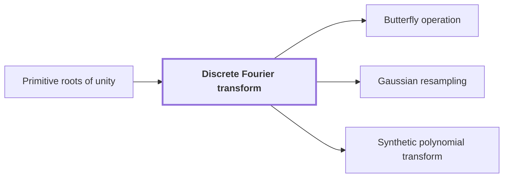

# Discrete Fourier transform

!!! info "Before this page"

    Discrete Fourier transform *is defined using* [Primitive roots of unity](glossary.md#roots-of-unity "The transform is defined using Primitive roots of unity: fix a primitive $n$-th root of unity $\omega$."). Assumed known: Complex numbers.

!!! abstract "Where this fits"

    - Relied on to show: A Fourier transform of prime length is a multidimensional transform whose axis lengths are powers of two. ([Gaussian resampling](gaussian-resampling.md "An identity that expresses a Fourier transform of length given by a prime as a multidimensional transform with power-of-two axis lengths, with the source and target permutations kept in the identity."))
    - Relied on to show: The middle transform, with its target permutation, becomes normalized cyclic convolution. ([Bluestein's chirp identity](bluestein-chirp.md "The identity that converts a Fourier transform into a cyclic convolution by multiplying by chirp factors before and after it."))

??? note "Symbols from earlier pages"

    - $n$ — root order: The order of the root, a positive integer that counts the positions of the transform it labels. (on [Primitive roots of unity](glossary.md#roots-of-unity "A complex number ω is a primitive n-th root of unity when ω^n = 1 and no smaller positive power equals 1."))
    - $\omega$ — primitive root: A primitive $n$-th root of unity, the complex number that labels the positions of a transform. (on [Primitive roots of unity](glossary.md#roots-of-unity "A complex number ω is a primitive n-th root of unity when ω^n = 1 and no smaller positive power equals 1."))

The discrete Fourier transform (DFT, also called the Fourier transform) is the map that sends a sequence to its values at the roots of unity of the same length. The multiplication argument needs it for convolution. Gaussian resampling replaces these transforms by multidimensional transforms whose axis lengths are powers of two.<cite class="exegenius-ref" data-source="paper" data-locator="§1.1 The two tape operations" data-quote="it replaces the Fourier transforms needed for" title="it replaces the Fourier transforms needed for"> (see §1.1 The two tape operations)</cite>

The input sequence is $a = (a_0, \dots, a_{n-1})$, a list of complex numbers, where $n$ is its length. The transform is defined using [Primitive roots of unity](glossary.md#roots-of-unity "A complex number ω is a primitive n-th root of unity when ω^n = 1 and no smaller positive power equals 1."): fix a primitive $n$-th root of unity $\omega$. Here $j$ is the input position, running from $0$ to $n-1$, and $k$ is the output position, running over the same range. On this page $j$ and $k$ are these positions; on the roots-of-unity page they are power exponents, so the meanings differ.

The output sequence is $\hat a = (\hat a_0, \dots, \hat a_{n-1})$, the transform of $a$, with entries given by the formula below.

$$\hat a_k = \sum_{j=0}^{n-1} a_j\,\omega^{jk}, \qquad k = 0, 1, \dots, n-1.$$

Each entry is a polynomial evaluation. Let $p(x) = \sum_{j=0}^{n-1} a_j x^j$ be the polynomial with coefficient list $a$, where $x$ is a formal variable, a placeholder for a number to be substituted. Substituting $x = \omega^k$ gives $p(\omega^k) = \hat a_k$.

Since $\omega$ is primitive, its powers $\omega^0,\dots,\omega^{n-1}$ are distinct, so they are all $n$ roots of $x^n = 1$. Hence $\hat a$ lists $p$ at every $n$-th root of unity.

Example. For $n = 2$, $\omega = -1$ is primitive, and $\hat a_0 = a_0 + a_1$, $\hat a_1 = a_0 - a_1$. For $a = (3, 1)$ this gives $\hat a = (4, 2)$.

Computed term by term, the formula takes about $n^2$ multiplications, since each of the $n$ entries is a sum of $n$ products.

## Connections

Used by:

- [Butterfly operation](butterfly-operation.md "The butterfly is a scaled length-2 case of the discrete Fourier transform.") *is a scaled length-2 case of* Discrete Fourier transform
- [Gaussian resampling](gaussian-resampling.md "Gaussian resampling rewrites the normalized discrete Fourier transform $F_q$ of length $q$ as a transform over power-of-two axes.") *rewrites* Discrete Fourier transform
- [Synthetic polynomial transform](synthetic-transform.md "A synthetic polynomial transform generalizes the discrete Fourier transform to a polynomial ring whose roots of unity are powers of $y$.") *generalizes* Discrete Fourier transform

??? quote "From the sources"

    > it replaces the Fourier transforms needed for
    >
    > — [Integer multiplication below n log n (OpenAI, 2026)](https://github.com/openai/math/tree/fd4aeeb2ee4fc729c18d98444fed42fd0529eeeb/preprints/Integer-multiplication-below-n-log-n-September-23-2026)
