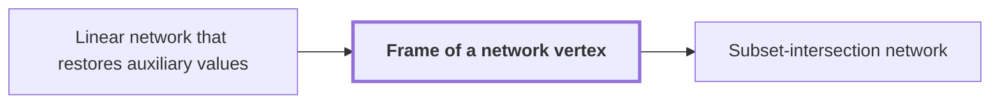

# Frame of a network vertex

!!! info "Before this page"

    Frame of a network vertex *acts on the wires of* [Linear network that restores auxiliary values](linear-network.md "Each frame acts on the wires of a Linear network that restores auxiliary values.").

!!! abstract "Where this fits"

    1. The subset-intersection network has a total number $s$ of smaller calls with $s<Wm$, where $W$ is its wire count and $m$ the dimension of its label space. — how: exchange the two banks with a scalar network whose gates carry subspace labels from triples, then bound the total dimension change of the labels by counting dimension losses ([Subset-intersection network](subset-network.md "A linear network whose subspace labels come from intersection sizes of three-element subsets, so that the total number of smaller calls is less than the number of wires times the dimension."))
    2. **This page:** On every route of the network the operator on each role is $D_{\mathrm{sink}}D_{\mathrm{source}}^{-1}$, so only the endpoint frames determine it.

A frame of a network vertex is an [invertible linear operator](linear-algebra.md "The theory of vector spaces, linear maps, invertible operators, subspaces, and the rank of a linear map.") attached to a vertex of a network that changes how the array on each wire is stored, without changing the logical array it encodes. Frames make the operator on each route through the network depend only on the route's two endpoints. Each frame acts on the wires of a [Linear network that restores auxiliary values](linear-network.md "A fixed network of linear gates that exchanges two banks of values with prescribed signs and returns every auxiliary value to its starting state.").

Let $D_r$ denote the frame at a source, gate or sink $r$: an invertible linear operator on the arrays indexed by the common address set, the addresses that every wire's array is indexed by. The stored array is $D_r g$ when the logical array is $g$, the array the computation means. Along an edge from $r$ to $s$, the operator $D_s D_r^{-1}$ turns the stored array $D_r g$ into $D_s g$.

A pointwise linear gate $G$ with $t$ inputs, where $t$ is the number of its input arrays, commutes with a common frame: $G(D_r g_1,\ldots,D_r g_t)=D_r\,G(g_1,\ldots,g_t)$.

This holds because $G$ combines its inputs with fixed scalar coefficients, and $D_r$ is linear, so $D_r$ moves across the combination.

The scalar routing sends each input role $w$ to $\rho(w)$, the output role assigned to $w$, and multiplies the array by a sign $\varepsilon_w$, which is $+1$ or $-1$ and is fixed by the network. Each edge contributes a frame change and each gate passes its frame through, so the intermediate frames cancel and the route applies

$$\varepsilon_w\,D_{\mathrm{sink}(\rho(w))}\,D_{\mathrm{source}(w)}^{-1},$$

where $\mathrm{source}(w)$ and $\mathrm{sink}(\rho(w))$ are the vertices where the route starts and ends.

So the intermediate frames do not affect the route operator. They can be chosen<cite class="exegenius-ref" data-source="paper" data-locator="§3.2 From scalar values to arrays" data-quote="to make each edge change inexpensive" title="to make each edge change inexpensive"> (see §3.2 From scalar values to arrays)</cite>.

Undoing the role exchange and the signs gives the endpoint operator on every role array. Undoing the exchange reads the output role $\rho(w)$ as the role $w$ again, and undoing the sign multiplies by $\varepsilon_w$ once more, which cancels the sign. The route identity therefore holds for every input role,<cite class="exegenius-ref" data-source="paper" data-locator="§1.2 Linear networks and the recursive saving" data-quote="including the roles that carried auxiliary scalar values" title="including the roles that carried auxiliary scalar values"> (see §1.2 Linear networks and the recursive saving)</cite>.

## Connections

Used by:

- [Subset-intersection network](subset-network.md "The operator on each role is computed from the endpoint frames of the Frame of a network vertex, so only the two ends of a route matter.") *is computed from* Frame of a network vertex

??? quote "From the sources"

    > We call $D_v$ its frame
    >
    > — [Integer multiplication below n log n (OpenAI, 2026)](https://github.com/openai/math/tree/fd4aeeb2ee4fc729c18d98444fed42fd0529eeeb/preprints/Integer-multiplication-below-n-log-n-September-23-2026)
