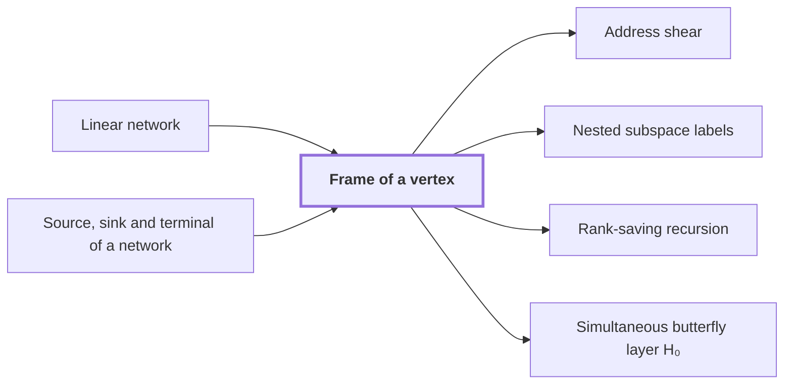

# Frame of a vertex

!!! info "Before this page"

    Frame of a vertex *is attached to a gate of* [Linear network](linear-network.md "A frame of a vertex is an invertible linear operator attached to a gate of a Linear network, or to a Source, sink and terminal of a network of it, that fixes how the array on each wire there is stored.") and *is attached to* [Source, sink and terminal of a network](network-terminal.md "A frame of a vertex is an invertible linear operator attached to a gate of a Linear network, or to a Source, sink and terminal of a network of it, that fixes how the array on each wire there is stored.").

!!! abstract "Where this fits"

    - Relied on to show: Interchanging two equal address fields of width $u$ costs less than linear in $u$ per unit volume. ([Fast interchange of address chunks](tape-interchange.md "A fixed-tape procedure that swaps two disjoint equal-width address fields of an array in time O(V u^τ) for a fixed τ < 1, where V is the stored volume and u the field width, using XOR combinations of intermediate data."))

A frame of a vertex is an invertible linear operator attached to a gate of a [Linear network](linear-network.md "A fixed network of wires with gates that apply fixed linear maps to the values on their wires, used here to exchange two banks of values while restoring all auxiliary values."), or to a [Source, sink and terminal of a network](network-terminal.md "A source or sink of a linear network is an end vertex of a wire, where data enter the network or leave it, and the terminals are the sources and sinks at which the network meets its banks of values.") of it, that fixes how the array on each wire there is stored. It keeps the net effect of a route on each role's array a single operator, which the interchange argument needs. That argument swaps two equal address fields by sending data along routes of the network.

For a vertex $w$, $D_w$ denotes its frame: an invertible linear operator on the space of arrays indexed by the common address set, the fixed finite set of positions that every role's array is indexed by. If $g$ is the logical array on a wire at $w$, the stored array there is $D_w g$. All incidences of one gate share its frame.

Along an edge from a tail vertex $w$ to a head vertex $q$, the frame change $D_q D_w^{-1}$ converts the stored form at $w$ into the stored form at $q$. Applied to $D_w g$ it gives $D_q D_w^{-1} D_w g = D_q g$. For example, if $D_w = I$ and $D_q = 2I$, the change doubles the stored array.

Here $t$ counts the inputs of a gate, $j$ indexes them, and $c_j$ is a fixed scalar. A pointwise linear gate $G$ at vertex $w$ with input arrays $g_1,\ldots,g_t$ outputs $\sum_{j=1}^{t} c_j g_j$ at every address. Since $D_w$ is linear, $\sum_{j=1}^{t} c_j (D_w g_j) = D_w\bigl(\sum_{j=1}^{t} c_j g_j\bigr)$. So $G$ applied to the stored arrays $D_w g_1,\ldots,D_w g_t$ gives $D_w$ applied to its logical output. The gate computes on stored arrays as it would on logical ones.

A route is a chain of vertices $s_0,\ldots,s_r$ with an edge from each $s_{l-1}$ to $s_l$, where $r$ counts the edges and $l$ indexes them; $s_0$ is a source and $s_r$ a sink. The $l$-th edge applies $D_{s_l} D_{s_{l-1}}^{-1}$. Where adjacent factors meet, $D_{s_l}^{-1} D_{s_l} = I$ cancels, so by induction the route reduces to the endpoint operator $D_{s_r} D_{s_0}^{-1}$.<cite class="exegenius-ref" data-source="paper" data-locator="§1.2 Linear networks and the recursive saving" data-quote="Thus the intermediate frames cancel" title="Thus the intermediate frames cancel"> (see §1.2 Linear networks and the recursive saving)</cite>

## Connections

Used by:

- [Address shear](address-shear.md "It acts on fields stored in the frame of a vertex at that terminal, so the $H$ and $D$ it updates are the address fields as they are stored there.") *acts on fields stored in* Frame of a vertex
- [Nested subspace labels](subspace-labels.md "The labels are chosen to make cheap the changes of Frame of a vertex on each edge: the stored array at $w$ is $D_w g$ when the logical array is $g$, and along an edge from $\sigma$ to $\nu$ it changes by $D_\nu D_\sigma^{-1}$.") *make cheap the changes of* Frame of a vertex
- [Rank-saving recursion](recursive-saving.md "The recursion is stated in the frame of a vertex at each end of an edge, where the frame is the invertible linear operator that fixes how the array on that vertex's wires is stored.") *is stated in* Frame of a vertex
- [Simultaneous butterfly layer H₀](butterfly-layer.md "The layer acts on arrays stored in the Frame of a vertex on each wire.") *acts on arrays stored in* Frame of a vertex

??? quote "From the sources"

    > We call $D_v$ its frame
    >
    > — [Integer multiplication below n log n (OpenAI, 2026)](https://github.com/openai/math/tree/fd4aeeb2ee4fc729c18d98444fed42fd0529eeeb/preprints/Integer-multiplication-below-n-log-n-September-23-2026)
