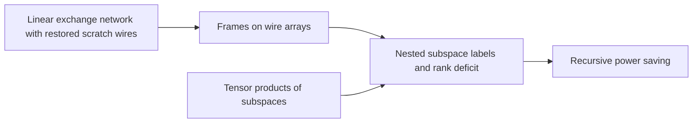

# Frames and Rank Deficit

This part develops the abstract source of the power saving. A [linear exchange network](../exchange-network.md "A fixed network of linear gates on wires holding values that swaps two banks with a prescribed sign while undoing the effect of arbitrary initial scratch values, built from three-element subsets.") with restored scratch wires, [frames on wire arrays](../array-frames.md "Replacing each wire scalar by an array and assigning an invertible operator D_v (a frame) at each gate so the pointwise gate commutes with the frame and only the endpoint frames matter."), [tensor products of subspaces](../tensor-product-of-spaces.md "The space built from two spaces whose dimension is the product of their dimensions, in which operators and bilinear forms act factorwise.") and [nested subspace labels](../subspace-labels.md "Assigning nondegenerate subspaces of an m-dimensional space to gates so adjacent labels are nested; the total dimension change over edges, the number s of smaller calls, is strictly less than W·m.") show that a call at parameter $mf$ needs only $s<Wm$ smaller calls. The [recursive power saving](../rank-recurrence.md "Each call at parameter m·f makes s calls at parameter f on streams of 1/W the volume, so cost per unit volume grows by s/W < m per factor m, giving a power saving.") turns that count into a cost bound.

## Pages

1. [Linear exchange network with restored scratch wires](../exchange-network.md "A fixed network of linear gates on wires holding values that swaps two banks with a prescribed sign while undoing the effect of arbitrary initial scratch values, built from three-element subsets.") — A fixed network of linear gates on wires holding values that swaps two banks with a prescribed sign while undoing the effect of arbitrary initial scratch values, built from three-element subsets.
2. [Frames on wire arrays](../array-frames.md "Replacing each wire scalar by an array and assigning an invertible operator D_v (a frame) at each gate so the pointwise gate commutes with the frame and only the endpoint frames matter.") — Replacing each wire scalar by an array and assigning an invertible operator D_v (a frame) at each gate so the pointwise gate commutes with the frame and only the endpoint frames matter.
3. [Tensor products of subspaces](../tensor-product-of-spaces.md "The space built from two spaces whose dimension is the product of their dimensions, in which operators and bilinear forms act factorwise.") — The space built from two spaces whose dimension is the product of their dimensions, in which operators and bilinear forms act factorwise.
4. [Nested subspace labels and rank deficit](../subspace-labels.md "Assigning nondegenerate subspaces of an m-dimensional space to gates so adjacent labels are nested; the total dimension change over edges, the number s of smaller calls, is strictly less than W·m.") — Assigning nondegenerate subspaces of an m-dimensional space to gates so adjacent labels are nested; the total dimension change over edges, the number s of smaller calls, is strictly less than W·m.
5. [Recursive power saving](../rank-recurrence.md "Each call at parameter m·f makes s calls at parameter f on streams of 1/W the volume, so cost per unit volume grows by s/W < m per factor m, giving a power saving.") — Each call at parameter m·f makes s calls at parameter f on streams of 1/W the volume, so cost per unit volume grows by s/W < m per factor m, giving a power saving.

## Map

Arrows point from a page to the pages that build on it.

