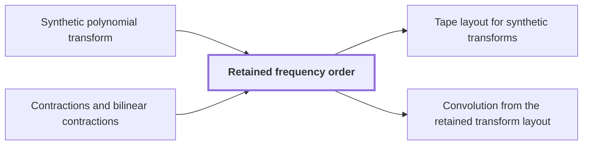

# Retained frequency order

!!! info "Before this page"

    Retained frequency order *orders the outputs of* [Synthetic polynomial transform](synthetic-transform.md "It orders the outputs of the synthetic polynomial transform over $\mathcal R_r=\mathbb C[y]/(y^r+1)$, normed by the largest coefficient modulus."). It also builds on [Contractions and bilinear contractions](contraction-maps.md "A linear map that never increases the norm of a vector, and a bilinear map whose output norm is at most the product of the input norms, so errors in the inputs do not grow beyond a controlled bound.").

!!! abstract "Where this fits"

    1. A single deterministic Turing machine with a fixed finite alphabet and a fixed finite number of one-dimensional tapes multiplies two $n$-bit integers exactly in $O(n(\lg n)^{1-\kappa})$ worst-case time with $\kappa=2^{-182}$, disproving the $n\log n$ optimality conjecture of Sch\"onhage and Strassen in this model. — how: Build two power-saving tape procedures (chunk interchange and simultaneous butterfly layer) from fixed finite linear networks; use them to accelerate the synthetic polynomial transforms and ring convolution; use Gaussian resampling with retained permutations and chirps to reduce the prime-length cyclic convolution of the radix-digit coefficients to those power-of-two transforms; assemble the exact product with a proof that the error is below $1/2$; and total the cost to show a power of $\log n$ is saved. ([Power-saving integer multiplication](main-result.md "A deterministic fixed-tape Turing machine multiplying two n-bit integers exactly in O(n(lg n)^{1−κ}) time with κ = 2^{−182}, disproving the n log n optimality conjecture in this model."))
    2. Synthetic transforms over $\mathcal R_r$ on $d-1$ axes of lengths $t_i\in\{2^{\ell-1},2^\ell\}$ with outputs kept in a retained layout $LB$ cost $O(Tp[dK+pK^{\tau-1}+\ell d^{\lambda'}])$ with error less than $\sqrt2\ell\,2^{-p}$. — how: Use the radix-two synthetic (Nussbaumer) transform, whose twiddles are signed shifts, and lay out the selected bits of all participating axes at a common offset in $K$-bit chunks so that every round is one simultaneous butterfly layer, with fewer than $\log t$ passes. ([Tape layout for synthetic transforms](transform-layout.md "Placing the selected bits of the participating axes at a common offset in K-bit chunks so each round of the synthetic transform is one simultaneous layer, costing less than log t passes."))
    3. **This page:** The synthetic transform $F_t^-$ over $\mathcal R_r=\mathbb C[y]/(y^r+1)$, with roots of unity $\omega_t=y^{2r/t}$, is computed by decimation in frequency with outputs written in bit-reversed order, $B_tF_t^-$; the pointwise product keeps this order and the reverse procedure computes $F_t^+B_t^{-1}$, so no reordering is executed.

??? note "Symbols from earlier pages"

    - $\mathcal R_r$ — negacyclic ring: The ring of polynomials in y modulo y^r+1 over the complex numbers. (on [Phase twist](phase-twist.md "Multiplying coefficient k by e^{πik/r}, which converts the cyclic coordinate modulo x^r − 1 into the negacyclic ring modulo y^r + 1 and is removed afterwards."))
    - $y$ — ring variable: The indeterminate of the polynomials; it satisfies y^r = -1 in the ring. (on [Polynomial ring modulo y^r + 1](ring-y.md "Polynomials of degree below r over the complex numbers with y^r = −1, so multiplying by a power of y is a signed shift of the coefficient list."))
    - $r$ — record length: The number of complex coefficients in a polynomial of the ring, always a power of two. (on [Polynomial ring modulo y^r + 1](ring-y.md "Polynomials of degree below r over the complex numbers with y^r = −1, so multiplying by a power of y is a signed shift of the coefficient list."))
    - $h$ — remaining index: The index m with its lowest bit removed. (on [Butterflies and the fast transform](butterfly.md "A two-point averaging/differencing step H₀(u,v) = ((u+v)/2, (u−v)/2) whose repeated use over address bits, with twiddle multiplications, computes a transform in log t layers."))
    - $b$ — lowest bit: The lowest bit of the output index m. (on [Butterflies and the fast transform](butterfly.md "A two-point averaging/differencing step H₀(u,v) = ((u+v)/2, (u−v)/2) whose repeated use over address bits, with twiddle multiplications, computes a transform in log t layers."))

Retained frequency order is the bit-reversed order in which the forward transform leaves its outputs, kept by the pointwise product and consumed by the opposite transform, so no reordering is executed.

It orders the outputs of the [synthetic polynomial transform](synthetic-transform.md "A transform over the ring modulo y^r + 1 whose roots of unity are powers of y, so every twiddle multiplication is a signed shift of a coefficient list.") over $\mathcal R_r=\mathbb C[y]/(y^r+1)$, normed by the largest coefficient modulus. Let $t$, the transform length, be a power of two dividing $2r$; put $a=\log_2t$, the number of rounds (here $a$ changes meaning), and $\omega_t=y^{2r/t}$. For $z\in\mathcal R_r^t$, with input positions $k$ and output index $j$ (here $j$ changes meaning: it is the position of an output of the transform), $0\le j<t$, the transforms $F_t^-$ and $F_t^+$ are

$$(F_t^-z)_j=\frac1t\sum_{k=0}^{t-1}\omega_t^{-jk}z_k,\qquad (F_t^+z)_j=\frac1t\sum_{k=0}^{t-1}\omega_t^{jk}z_k.$$

Multiplying by a power of $y$ permutes coefficients and flips signs, so every power of $\omega_t$ is an isometry. Each entry averages $t$ such images, so both transforms contract.

The ring has zero divisors, so we cannot divide by $\omega_t^j-1$; directly, $\sum_{k}\omega_t^{jk}$ equals $t$ if $t\mid j$ and $0$ otherwise. For $t\nmid j$ write $j=2^vj_0$ with $j_0$ odd and $0\le v<a$. Replacing $k$ by $k+t/2^{v+1}$ modulo $t$ permutes the summands and multiplies the sum by $y^{rj_0}=-1$, so the sum equals its negative. The additive group of $\mathcal R_r$ has no two-torsion (no nonzero element equals its negative), so the sum is zero<cite class="exegenius-ref" data-source="paper" data-locator="§6.1 Roots, butterflies, and stored frequency order" data-quote="Hence the sum is zero, since the additive group of" title="Hence the sum is zero, since the additive group of"> (see §6.1 Roots, butterflies, and stored frequency order)</cite>. Expanding the composite gives $F_t^+F_t^-=t^{-1}I$.

Let $H_0=\frac12\left(\begin{array}{rr}1&1\\1&-1\end{array}\right)$. Decimation in frequency pairs $z_k$ with $z_{k+t/2}$; write an output index as $2h+b$, with lowest bit $b$. Since $\omega_t^{t/2}=-1$,

$$(F_t^-z)_{2h+b}=\frac1{t/2}\sum_{k=0}^{t/2-1}(\omega_t^2)^{-hk}\,\omega_t^{-bk}\,\frac{z_k+(-1)^bz_{k+t/2}}2 .$$

Apply $H_0$ to each pair, multiply the $b=1$ output by $\omega_t^{-k}$, and recurse on the two length-$t/2$ branches.

Call a position's address bits, high to low, slots $a-1,\dots,0$. A pair differs only in the highest unprocessed slot, where $H_0$ writes $b$. After $s$ rounds, $s$ being the number of completed rounds, slots $a-1,\dots,a-s$ hold frequency bits $0,\dots,s-1$ and the rest index a sequence of length $t/2^s$; the next round writes bit $s$ into slot $a-1-s$. After $a$ rounds $(F_t^-z)_j$ sits at slot $\operatorname{rev}_a(j)$, where $\operatorname{rev}_a$ reverses the $a$ binary digits of $j$. Let $B_t$ be the permutation moving the entry at $j$ to $\operatorname{rev}_a(j)$<cite class="exegenius-ref" data-source="paper" data-locator="§6.1 Roots, butterflies, and stored frequency order" data-quote="Let $B_t$ denote this record permutation: it moves the entry at $j$ to $\operatorname{rev}_a(j)$." title="Let $B_t$ denote this record permutation: it moves the entry at $j$ to $\operatorname{rev}_a(j)$."> (see §6.1 Roots, butterflies, and stored frequency order)</cite>

The pointwise product multiplies two transformed arrays slot by slot, each slot a product in $\mathcal R_r$, and never moves an entry between slots. Both arrays come from the same procedure $B_tF_t^-$, so slot $s$ of each holds the entry of frequency $\operatorname{rev}_a(s)$. The product at slot $s$ is therefore the product of the two entries of that one frequency, and the result stays in the same bit-reversed order<cite class="exegenius-ref" data-source="paper" data-locator="§1.3 From transforms to the exact product" data-quote="retain the same frequency order through their pointwise product" title="retain the same frequency order through their pointwise product"> (see §1.3 From transforms to the exact product)</cite>. The opposite procedure takes this order as its input.

It runs the levels backwards. Each forward level is invertible, and as $H_0^2=I/2$ the reversed level is half its inverse, so the reverse procedure composed with $B_tF_t^-$ is $2^{-a}I=I/t$. By character cancellation $F_t^+B_t^{-1}$ composed with $B_tF_t^-$ is also $I/t$. As $B_tF_t^-$ is invertible (a product of invertible levels) the two reverse operators agree. The exact procedures implement $B_tF_t^-$ and $F_t^+B_t^{-1}$.

With several axes, indexed by $i$, a round applies $H_0$ on every participating axis, and $\mathcal H$ denotes this one parallel butterfly. Let $u_i$ be axis $i$'s current length and $b_i$ its new bit. Its twiddle is $y^{-2rb_ik_i/u_i}$, where $k_i$ is the number formed by the bits in its unprocessed slots below the paired slot, so $0\le k_i<u_i/2$. It depends only on axis-$i$ address bits, which entries paired by another axis share, so it commutes with that axis's butterfly. Twiddles group into one monomial $J_E$, the recordwise operation multiplying the record by $y^E$, where $E$ depends on the address, not coefficients:

$$E=-\sum_i\frac{2r}{u_i}\,b_ik_i\pmod{2r}.$$

$\mathcal H$ is a contraction and $J_E$ an isometry, so every round is a contraction.

## Connections

Used by:

- [Tape layout for synthetic transforms](transform-layout.md "By retained frequency order the forward transform leaves its outputs in bit-reversed order, written $B$ here (the bit-reversal permutation on all axes), and the opposite transform consumes that order, so no reordering is executed.") *consumes that order by* Retained frequency order
- [Convolution from the retained transform layout](ring-convolution.md "The procedure keeps the retained order of Retained frequency order, passing the product to the opposite transform without reordering.") *keeps the retained order of* Retained frequency order

??? quote "From the sources"

    > Let $B_t$ denote this record permutation: it moves the entry at $j$ to $\operatorname{rev}_a(j)$.
    >
    > — [Integer multiplication below n log n (OpenAI, 2026)](https://github.com/openai/math/tree/fd4aeeb2ee4fc729c18d98444fed42fd0529eeeb/preprints/Integer-multiplication-below-n-log-n-September-23-2026)

    > retain the same frequency order through their pointwise product
    >
    > — [Integer multiplication below n log n (OpenAI, 2026)](https://github.com/openai/math/tree/fd4aeeb2ee4fc729c18d98444fed42fd0529eeeb/preprints/Integer-multiplication-below-n-log-n-September-23-2026)
