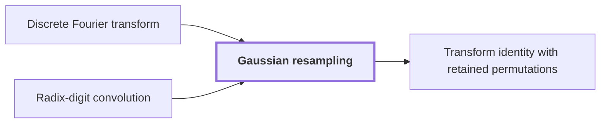

# Gaussian resampling

!!! info "Before this page"

    Gaussian resampling *replaces* [Discrete Fourier transform](discrete-fourier-transform.md "Gaussian resampling is a technique that replaces a Discrete Fourier transform of arbitrary length by transforms whose axis lengths are powers of two.") and *is applied to* [Radix-digit convolution](radix-digit-convolution.md "Gaussian resampling is applied to a radix-digit convolution: it replaces the Fourier transforms needed for that convolution by transforms whose axis lengths are powers of two.").

!!! abstract "Where this fits"

    1. With both coordinate permutations kept in the formula, $P_sF_s = 2^{2\alpha^2}B_0P_tF_tA$, and the retained source permutation cancels across a convolution, so no sort is executed. — how: keep the permutations in the Gaussian resampling identity, then cancel the source permutation through the convolution ([Transform identity with retained permutations](transform-identity.md "The Gaussian resampling identity in which the source and target coordinate permutations are kept as part of the formula, so that they cancel across a convolution instead of being executed as sorts."))
    2. **This page:** The one-dimensional Gaussian resampling identity $P_sF_s = 2^{2\alpha^2}B_0P_tF_tA$ holds with contractions $A$ and $B_0$.

Gaussian resampling is a technique that replaces a [Discrete Fourier transform](discrete-fourier-transform.md "The map sending a vector of q values to its q values weighted by powers of a q-th root of unity, normalized by 1/q.") of arbitrary length by transforms whose axis lengths are powers of two. It moves values between the two sets of frequencies with Gaussian weights, which are exponential factors that decay quadratically with distance.

Gaussian resampling is applied to a [radix-digit convolution](radix-digit-convolution.md "Writing both integers as polynomials in a power of two whose coefficients are their digits, so that their product is a polynomial convolution of short coefficients."): it replaces the Fourier transforms needed for that convolution by transforms whose axis lengths are powers of two. The integer product needs pairwise coprime transform lengths, while the synthetic transforms use powers of two.<cite class="exegenius-ref" data-source="paper" data-locator="§2 M (3ℓ + 1)2-p, p. 48" data-quote="Gaussian resampling connects these two shapes" title="Gaussian resampling connects these two shapes"> (see §2 M (3ℓ + 1)2-p, p. 48)</cite>.

Here $s$ is the number of coordinates of a source vector, and $t$ is the number of coordinates of a target vector, with $s<t$ and $\gcd(s,t)=1$. The integer $\alpha$ is the width parameter of the Gaussian weights. $F_s$ and $F_t$ are the normalized Fourier transforms of length $s$ and $t$. $P_s$ and $P_t$ are the coordinate permutations $(P_s g)_i=g_{ti}$ and $(P_t h)_m=h_{-sm}$ on vectors $g$ of length $s$ and $h$ of length $t$, where $i$ is the source coordinate index, $0\le i<s$, and $m$ is the target coordinate index, $0\le m<t$. Subscripts are taken modulo the length. $I$ is the identity map. $\|\cdot\|$ is the operator norm, the largest factor by which a linear map stretches a vector, where the size of a vector is its largest absolute coordinate. A map is a contraction when its operator norm is at most $1$.

The identity rests on two Gaussian-weighted maps $S$ and $T$ from vectors of length $s$ to vectors of length $t$. $D$ is the diagonal map on vectors of length $s$ that multiplies coordinate $i$ by a Gaussian factor. $C$ selects from a vector of length $t$ the coordinates at the indices nearest $ti/s$, for $0\le i<s$; for $s=3$ and $t=4$ it picks indices $0$, $1$ and $3$, nearest to $0$, $4/3$ and $8/3$. Put $N=CTD$, a map close to $I$.

First, $TP_sF_s=P_tF_tS$ holds before normalization. This is the Gaussian-resampling reduction of Harvey and van der Hoeven.

Second, $\|N-I\|<1/2$<cite class="exegenius-ref" data-source="paper" data-locator="§1 X -πα-2 (j-sk/t)2, p. 49" data-quote="∥N − I∥ &lt; 1/2" title="∥N − I∥ &lt; 1/2"> (see §1 X -πα-2 (j-sk/t)2, p. 49)</cite>, so $N$ is invertible by a Neumann series. Its inverse is $N^{-1}=\sum_{r\ge 0}(I-N)^r$, where $r$ is the summation index, the exponent of $I-N$ in each term. This is the matrix analogue of a geometric series. Since $\|I-N\|<1/2$, the $r$-th term has norm at most $2^{-r}$, so the series converges.

Third, $D$ is invertible because its Gaussian factors are nonzero, and $CT=ND^{-1}$. Hence $(DN^{-1}C)T=DN^{-1}ND^{-1}=I$. A left inverse of $T$ is a map that undoes $T$ from the left, and $(DN^{-1}C)T=I$ says that $DN^{-1}C$ is one. Applying it to the first identity gives $DN^{-1}CP_tF_tS=P_sF_s$.

Fourth, the maps $A=S/2$ and $B_0=2^{-(2\alpha^2-2)}DN^{-1}C/2$ are the two contractions of the identity. The scale factors multiply to $2^{-2\alpha^2}$, so $B_0P_tF_tA=2^{-2\alpha^2}P_sF_s$. Multiplying by $2^{2\alpha^2}$ gives $P_sF_s=2^{2\alpha^2}B_0P_tF_tA$.

Both are contractions, and the paper proves this for its parameter choices. $N-I$ is small because $D$ cancels the Gaussian factor at each selected coordinate, leaving only the small Gaussian weights of the other coordinates. The paper bounds $\|S/2\|<3/4$ and $\|N^{-1}/2\|<7/8$, and $\|2^{-(2\alpha^2-2)}D\|<1$<cite class="exegenius-ref" data-source="paper" data-locator="§1 X -πα-2 (j-sk/t)2, p. 49" data-quote="∥D′ ∥ &lt; 1" title="∥D′ ∥ &lt; 1"> (see §1 X -πα-2 (j-sk/t)2, p. 49)</cite>. So $A$ is a contraction. Since $\|C\|=1$, $\|B_0\|\le\|2^{-(2\alpha^2-2)}D\|\,\|N^{-1}/2\|\,\|C\|<7/8$, so $B_0$ is a contraction.

## Connections

Used by:

- [Transform identity with retained permutations](transform-identity.md "The transform identity rests on Gaussian resampling.") *rests on* Gaussian resampling

??? quote "From the sources"

    > it replaces the Fourier transforms needed for this convolution by multidimensional transforms whose
    >
    > — Integer multiplication below n log n (OpenAI, 2026)
