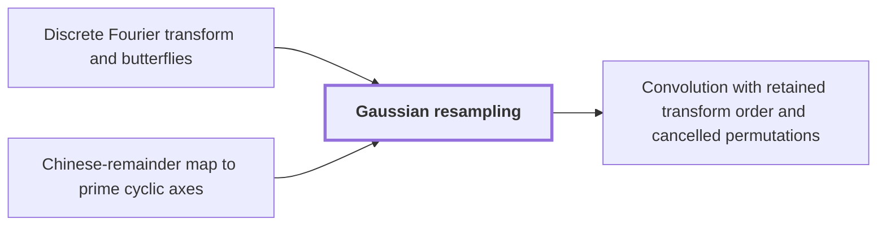

# Gaussian resampling

!!! info "Before this page"

    Gaussian resampling *computes its transforms by* [Discrete Fourier transform and butterflies](dft-fft.md "Gaussian resampling thus computes its transforms by the butterfly layers of Discrete Fourier transform and butterflies, since a transform of length $Q$ has $\lg Q$ layers, each linear in the array size.") and *acts on the axes placed by* [Chinese-remainder map to prime cyclic axes](crt-address-map.md "Gaussian resampling acts on the axes placed by the Chinese-remainder map to prime cyclic axes.").

!!! abstract "Where this fits"

    1. An $n$-bit integer product is computed by a fixed-tape machine in $O(n(\lg n)^{1-\kappa})$ time, $\kappa=2^{-182}$. — how: reduce multiplication to ring convolution and speed up its address moves and butterfly layers ([Integer multiplication in O(n(lg n)^{1-κ}) time](main-theorem.md "Deterministic fixed-tape Turing machine multiplying n-bit integers in O(n(lg n)^{1-κ}), κ=2^{-182}, by reducing to ring convolution with fast address interchanges and simultaneous butterfly layers, disproving the n log n conjecture in this model."))
    2. **This page:** Gaussian resampling expresses each source Fourier transform through a power-of-two tensor transform.

??? note "Symbols from earlier pages"

    - $j$ — index j: An index into the entries of the input list $b$. (on [Convolution](convolution.md "Product of polynomials / combination of coefficient lists where entries sum by index (cyclic if indices wrap)."))
    - $k$ — output index: An index into the entries of the output list $c$. (on [Convolution](convolution.md "Product of polynomials / combination of coefficient lists where entries sum by index (cyclic if indices wrap)."))
    - $I$ — identity operator: The identity operator, which leaves every array unchanged. (on [Finite linear network with roles and frames](linear-network-roles.md "Fixed linear network exchanging two banks of values with prescribed signs and restoring auxiliary values; wires have roles, rows are distributed cyclically among roles, and invertible frame operators cancel along routes leaving an endpoint operator."))

Gaussian resampling is the reduction of Harvey and van der Hoeven that replaces each Fourier transform needed for a convolution<cite class="exegenius-ref" data-source="paper" data-locator="§1.1 The two tape operations" data-quote="it replaces the Fourier transforms needed for this convolution by multidimensional transforms whose axis lengths are powers of two" title="it replaces the Fourier transforms needed for this convolution by multidimensional transforms whose axis lengths are powers of two"> (see §1.1 The two tape operations)</cite>.

A standard FFT of length $2m$ splits into two transforms of length $m$. A prime-length transform has no such split.

Let $P$ be the length of a prime axis, the number of entries in a list on that axis, and let $Q$ be a power of two, the number of entries in the list that replaces it, chosen slightly above $P$. Let $p$ be the integer precision in bits. Here $f$ is a list, not the network's bound logical array, and its entries are read modulo $P$. Let $\pi_P$ and $\pi_Q$ be the coordinate reorderings used in the paper's identity, $(\pi_Pu)_j=u_{Qj}$ and $(\pi_Qv)_k=v_{-Pk}$. Let $F_P$ and $F_Q$ be the normalized discrete Fourier transforms, $(F_P f)_k=\frac1P\sum_{j=0}^{P-1}f_j e^{-2\pi i jk/P}$ and likewise $F_Q$. A contraction is a linear map that does not increase the largest modulus of an entry. Each normalized transform is a contraction<cite class="exegenius-ref" data-source="paper" data-locator="§8 Resampling with the permutations left in the transform" data-quote="since each output averages inputs multiplied by complex numbers of modulus one" title="since each output averages inputs multiplied by complex numbers of modulus one"> (see §8 Resampling with the permutations left in the transform)</cite>.

For an integer $\lambda$ with $2\le\lambda<\sqrt p$, the identity is
$$\pi_PF_P=2^{2\lambda^2}\,K\,\pi_QF_Q\,U,$$
where $U$ maps lists of length $P$ to lists of length $Q$, $K$ maps back, and $\lambda$ is the width parameter of the Gaussian weights below. Both $U$ and $K$ are built from two Gaussian-weighted sums $\mathsf S$ and $\mathsf T$, each mapping lists of length $P$ to lists of length $Q$:
$$(\mathsf Sf)_k=\frac1\lambda\sum_{j\in\mathbb Z}e^{-\pi\lambda^{-2}(j-Pk/Q)^2}f_j,\qquad(\mathsf Tf)_k=\sum_{j\in\mathbb Z}e^{-\pi\lambda^{2}(Qj/P-k)^2}f_j,$$
where entries $f_j$ are read modulo $P$, and $j$ and $k$ are entry indices. Each weight is a Gaussian centred on a point of the other grid. Harvey and van der Hoeven prove the Gaussian identity $\mathsf T\pi_PF_P=\pi_QF_Q\mathsf S$ (their Theorem 4.2); it holds because the Fourier transform maps a Gaussian to a Gaussian.

$\mathsf T$ alone is not invertible, so we compensate. Put $\vartheta=Q/P-1$, which is assumed to satisfy $\vartheta>p/\lambda^4$. Let $\chi_j$ be the integer nearest $Qj/P$. Let $\Gamma$ read the entries $\chi_j$ from a list of length $Q$, let $\Lambda$ multiply entry $j$ by $e^{\pi\lambda^2(Qj/P-\chi_j)^2}$, and set $\Phi=\Gamma\mathsf T\Lambda$, a map from length $P$ to length $P$. In the $j$th entry of $\Phi f$, the summand with input index $j$ is exactly $f_j$, since $\Lambda$ cancels the Gaussian weight at $\chi_j$. The paper's Lemma 4.6 gives $\|\Phi-I\|<2^{-\lambda^2\vartheta}$. Since $\lambda^2\vartheta>p/\lambda^2>1$, we have $\|\Phi-I\|<1/2$, so $\Phi$ is invertible by a Neumann series.

Since $\Gamma\mathsf T=\Phi\Lambda^{-1}$, the map $\Lambda\Phi^{-1}\Gamma$ is a left inverse of $\mathsf T$. Applying it to the Gaussian identity gives $\Lambda\Phi^{-1}\Gamma\,\pi_QF_Q\mathsf S=\pi_PF_P$. Set $U=\frac12\mathsf S$ and $K=2^{1-2\lambda^2}\Lambda\Phi^{-1}\Gamma$. Then $2^{2\lambda^2}K\pi_QF_QU=\pi_PF_P$, which is the identity. The paper's Proposition 4.7(i) bounds $\|U\|<3/4$, $\|\tfrac12\Phi^{-1}\|<7/8$ and $\|2^{2-2\lambda^2}\Lambda\|<1$. Since $\|\Gamma\|=1$, $U$ and $K$ are contractions. Contractions keep composed approximation errors from growing.

To evaluate $F_P$ on a list $f$, apply $U$, then $\pi_QF_Q$, then $K$, multiply by $2^{2\lambda^2}$, and undo $\pi_P$.

Gaussian resampling acts on the axes placed by the [Chinese-remainder map to prime cyclic axes](crt-address-map.md "Places the coefficient list on a product of distinct prime cyclic axes by a map preserving convolution, implemented via triangular controlled shifts and axis moves."). Gaussian resampling thus computes its transforms by the butterfly layers of [Discrete Fourier transform and butterflies](dft-fft.md "Evaluation of a coefficient list at roots of unity, computed in log-many levels of two-point butterfly operations; turns convolution into pointwise product."), since a transform of length $Q$ has $\lg Q$ layers, each linear in the array size. The speedups of [Fast simultaneous butterfly layers](fast-butterfly-layers.md "Applies H0(u,v)=((u+v)/2,(u-v)/2) on selected address bits of polynomial-valued arrays with exact Gaussian dyadics in O(V d^λ') with λ'<1, one truncation at the end.") and [Fast interchange of address fields](fast-address-interchange.md "Interchange two disjoint contiguous u-bit address fields in an array in O(V u^τ) for fixed τ<1, via XOR combinations that end as an exact permutation.") therefore apply to these transforms.

## Connections

Used by:

- [Convolution with retained transform order and cancelled permutations](ring-convolution-retained-order.md "This convolution is applied after Gaussian resampling, which writes each source transform through a power-of-two tensor transform.") *is applied after* Gaussian resampling

??? quote "From the sources"

    > it replaces the Fourier transforms needed for
    >
    > — [Integer multiplication below n log n (OpenAI, 2026)](https://github.com/openai/math/tree/fd4aeeb2ee4fc729c18d98444fed42fd0529eeeb/preprints/Integer-multiplication-below-n-log-n-September-23-2026)
