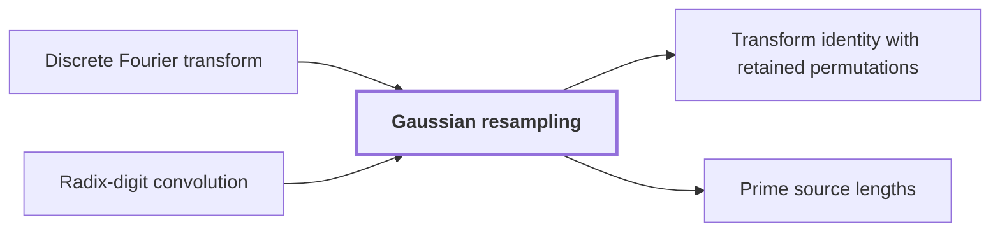

# Gaussian resampling

!!! info "Before this page"

    Gaussian resampling *expresses* [Discrete Fourier transform](discrete-fourier-transform.md "Gaussian resampling expresses each source Discrete Fourier transform through a power-of-two tensor transform, meaning a transform over several axes at once in which each axis length is a power of two.") and *is applied to* [Radix-digit convolution](radix-digit-convolution.md "Gaussian resampling is applied to the Radix-digit convolution of the two integers' digit coefficients, so the Fourier transforms it replaces are those of that convolution.").

!!! abstract "Where this fits"

    1. A deterministic fixed-tape machine multiplies two $n$-bit integers exactly in $O(n(\lg n)^{1-\kappa})$ time, with $\kappa=2^{-182}$, below the $n\lg n$ conjecture in this model. — how: bound the cost of an exact multiplication whose transform layers are made cheap by two tape procedures, then fix parameters so every cost term fits ([Integer multiplication below n log n](main-theorem.md "A deterministic fixed-tape machine that multiplies two n-bit integers exactly in O(n (lg n)^(1−κ)) time with κ = 2^−182, which disproves the n log n optimality conjecture in this model."))
    2. The exact product of two $n$-bit integers is obtained from the convolution of their radix-digit coefficients, computed by transforms on a fixed tape layout and then recovered and carried. — how: reduce the convolution by a Chinese-remainder map, Gaussian resampling, Bluestein's identity and a phase twist to a convolution over a polynomial ring, then recover coefficients and propagate carries ([Radix-digit convolution](radix-digit-convolution.md "Writing both integers as polynomials in a power of two whose coefficients are their digits, so that their product is a polynomial convolution of short coefficients."))
    3. **This page:** Gaussian resampling expresses each source Fourier transform through a power-of-two tensor transform.

Gaussian resampling is a reduction that replaces a Fourier transform of arbitrary length by transforms whose axis lengths are powers of two, which is what makes the transforms of the multiplier cheap. Gaussian resampling expresses each source [Discrete Fourier transform](discrete-fourier-transform.md "The map sending a vector of q values to its q values weighted by powers of a q-th root of unity, normalized by 1/q.") through a power-of-two tensor transform, meaning a transform over several axes at once in which each axis length is a power of two.

Here $q$ is the number of values in one source transform. A transform of length $q$ is not directly served by the fast radix-2 method, which needs power-of-two lengths, so the reduction moves the work to lengths that are powers of two. The move between the two sets of frequencies uses Gaussian weights, which are factors whose exponent is quadratic in the frequency index. The construction is the one of Harvey and van der Hoeven; this page states its effect and does not re-derive the identity behind it.

Gaussian resampling is applied to the [Radix-digit convolution](radix-digit-convolution.md "Writing both integers as polynomials in a power of two whose coefficients are their digits, so that their product is a polynomial convolution of short coefficients.") of the two integers' digit coefficients, so the Fourier transforms it replaces are those of that convolution. Each such transform becomes a multidimensional transform whose axis lengths are powers of two.<cite class="exegenius-ref" data-source="paper" data-locator="§11 A consequence for matrix transposition, p. 3" data-quote="it replaces the Fourier transforms needed for this convolution by multidimensional transforms whose" title="it replaces the Fourier transforms needed for this convolution by multidimensional transforms whose"> (see §11 A consequence for matrix transposition, p. 3)</cite>

## Connections

Used by:

- [Transform identity with retained permutations](transform-identity.md "The transform identity with retained permutations rewrites Gaussian resampling so that the source and target coordinate permutations stay inside the formula.") *rewrites* Gaussian resampling
- [Prime source lengths](prime-source-lengths.md "Second, the ratio $T_\nu/s_\nu$ must leave enough separation for Gaussian resampling, which moves between transforms of length $s_\nu$ and of length $T_\nu$.") *leave enough separation for* Gaussian resampling

??? quote "From the sources"

    > it replaces the Fourier transforms needed for this convolution by multidimensional transforms whose
    >
    > — Integer multiplication below n log n (OpenAI, 2026)
