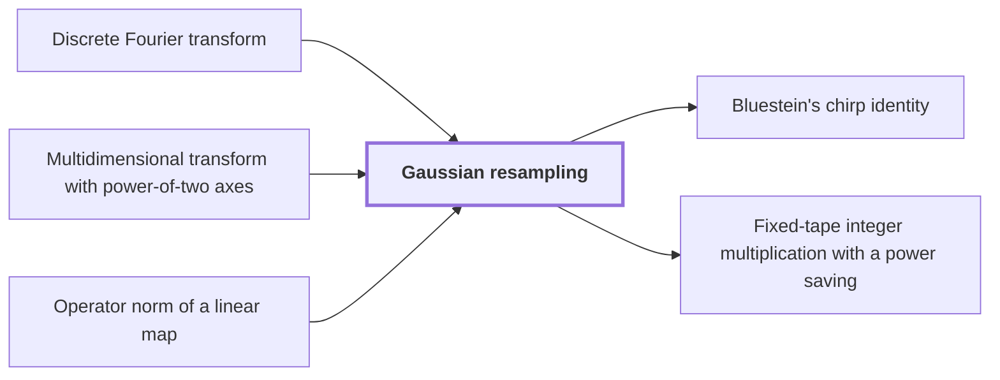

# Gaussian resampling

!!! info "Before this page"

    Gaussian resampling *rewrites* [Discrete Fourier transform](fourier-transform.md "Gaussian resampling rewrites a Discrete Fourier transform of length $s$, the number of its coordinates, as a transform of a longer length $t$, keeping both coordinate permutations inside the transform identity."), *expresses each source transform through* [Multidimensional transform with power-of-two axes](multidim-transform.md "Thus Gaussian resampling expresses each source transform through a Multidimensional transform with power-of-two axes.") and *is measured by* [Operator norm of a linear map](glossary.md#operator-norm "Gaussian resampling is measured by the Operator norm of a linear map, $\|L\|=\sup_{\|u\|\le1}\|Lu\|$, so a linear map $L$ is a contraction when $\|L\|\le1$.").

!!! abstract "Where this fits"

    1. The integer product is computed exactly on one fixed-tape machine in $O(n(\lg n)^{1-\kappa})$ worst-case time, for $\kappa=2^{-182}$. — how: reduce exact multiplication to convolution of radix digits on distinct prime axes, compute the convolution by synthetic transforms on tape layouts, and bound the total tape cost with a power saving ([Fixed-tape integer multiplication with a power saving](fixed-tape-multiplication.md "A deterministic fixed-tape Turing machine that multiplies two n-bit integers exactly in O(n(lg n)^(1−κ)) worst-case time, for a fixed κ = 2^(−182), disproving the n log n optimality conjecture in this model."))
    2. **This page:** Each prime-length Fourier transform is expressed through a tensor transform with power-of-two axis lengths, keeping the source and target permutations inside the identity.

??? note "Symbols from earlier pages"

    - $u$ — input vector: The complex vector of length $q$ that the transform acts on. (on [Discrete Fourier transform](fourier-transform.md "The map sending a vector u of length q to the vector whose k-th entry is (1/q) times the sum over j of u_j times exp(−2πijk/q)."))
    - $k$ — output index: The index of an entry of $\hat u$, running from $0$ to $q-1$. (on [Discrete Fourier transform](fourier-transform.md "The map sending a vector u of length q to the vector whose k-th entry is (1/q) times the sum over j of u_j times exp(−2πijk/q)."))
    - $j$ — input index: The index of an entry of $u$, running from $0$ to $q-1$. (on [Discrete Fourier transform](fourier-transform.md "The map sending a vector u of length q to the vector whose k-th entry is (1/q) times the sum over j of u_j times exp(−2πijk/q)."))

Gaussian resampling rewrites a [Discrete Fourier transform](fourier-transform.md "The map sending a vector u of length q to the vector whose k-th entry is (1/q) times the sum over j of u_j times exp(−2πijk/q).") of length $s$, the number of its coordinates, as a transform of a longer length $t$, keeping both coordinate permutations inside the transform identity. The integer product needs pairwise coprime transform lengths, while the synthetic transforms use powers of two; this rewriting joins the two.

Let $F_q$ be the normalized transform of length $q$: $(F_q u)_k=\frac1q\sum_{j=0}^{q-1}u_j e^{-2\pi i jk/q}$. The norm $\|u\|$ of a vector is its largest entry modulus. Gaussian resampling is measured by the [Operator norm of a linear map](glossary.md#operator-norm "The operator norm of a linear map T is the largest factor by which T stretches a vector, the supremum of ‖Tv‖ over all vectors v with ‖v‖ ≤ 1, for a chosen vector norm."), $\|L\|=\sup_{\|u\|\le1}\|Lu\|$, so a linear map $L$ is a *contraction* when $\|L\|\le1$.

Fix an integer width $\sigma\ge2$, the Gaussian width. Let $K$ and $M$ map $\mathbb C^s$ to $\mathbb C^t$ by
$$(Ku)_k=\frac1\sigma\sum_{j\in\mathbb Z}e^{-\pi\sigma^{-2}(j-sk/t)^2}u_j,\qquad (Mu)_k=\sum_{j\in\mathbb Z}e^{-\pi\sigma^{2}(tj/s-k)^2}u_j,$$
with $u_j$ read modulo $s$. Let $P_s$ and $P_t$ be the coordinate permutations $(P_su)_j=u_{tj}$ and $(P_tv)_k=v_{-sk}$, with $v$ of length $t$ (here $v$ is new). Since $\gcd(s,t)=1$, both only rearrange coordinates. Harvey and van der Hoeven prove $MP_sF_s=P_tF_tK$ (their Theorem 4.2). The hypotheses are $p>100$, $2\le\sigma<\sqrt p$, $s<t<2^p$ and $\theta>p/\sigma^4$, where $p$ is the integer precision and $\theta=t/s-1$.

Let $\rho_j=\lfloor tj/s+\tfrac12\rfloor$ be the integer nearest $tj/s$, with ties rounded up. Let $\delta_j=tj/s-\rho_j$, so $|\delta_j|\le\tfrac12$. Let $\Lambda:\mathbb C^t\to\mathbb C^s$ select coordinate $\rho_j$, $(\Lambda v)_j=v_{\rho_j}$. Let $\Delta$ multiply entry $j$ by $e^{\pi\sigma^2\delta_j^2}$. Let $\Gamma=\Lambda M\Delta$ be the map from $\mathbb C^s$ to itself.

In $(\Gamma u)_j$ the term with index $j$ is exactly $u_j$, because $e^{\pi\sigma^2\delta_j^2}$ cancels the Gaussian factor at $k=\rho_j$. The other terms form $((\Gamma-I)u)_j$, where $I$ is the identity map. Their size is bounded by $\|I-\Gamma\|<2^{-\sigma^2\theta}$, as in Harvey and van der Hoeven's Theorem 4.2 and Lemma 4.6.

Since $\sigma^2<p$ and $\theta>p/\sigma^4$, we get $\sigma^2\theta>p/\sigma^2>1$, so $\|I-\Gamma\|<\tfrac12$. The Neumann series $\sum_{m\ge0}(I-\Gamma)^m$ converges, since $\|(I-\Gamma)^m\|\le\|I-\Gamma\|^m$, by submultiplicativity of the operator norm. It inverts $\Gamma$, because $\Gamma$ times the partial sum $\sum_{m<J}(I-\Gamma)^m$ equals $I-(I-\Gamma)^J$, which tends to $I$ as $J\to\infty$. Hence $\|\Gamma^{-1}\|\le\frac1{1-\|I-\Gamma\|}<2$.

The norm of a diagonal map is its largest diagonal modulus, so $\|\Delta\|\le e^{\pi\sigma^2/4}\le2^{2\sigma^2-2}$ for $\sigma\ge2$. The map $\Lambda$ only copies coordinates, so $\|\Lambda\|\le1$.

Since $\Lambda M=\Gamma\Delta^{-1}$, the product $\Delta\Gamma^{-1}\Lambda M$ is the identity. Multiplying $MP_sF_s=P_tF_tK$ on the left by $\Delta\Gamma^{-1}\Lambda$ gives $P_sF_s=\Delta\Gamma^{-1}\Lambda P_tF_tK$. Put $K_1=\tfrac12K$ and $K_2=2^{1-2\sigma^2}\Delta\Gamma^{-1}\Lambda$. Then $P_sF_s=2^{2\sigma^2}K_2P_tF_tK_1$.

Both are contractions. The proof of Harvey and van der Hoeven's Proposition 4.7(i) gives $\|K\|<\tfrac32$, so $\|K_1\|<\tfrac34$. Also $\|K_2\|\le2^{1-2\sigma^2}\cdot2^{2\sigma^2-2}\cdot2\cdot1=1$.

In the application $t=2^{\nu}$, where $\nu$ is a positive integer, so $F_t$ has power-of-two length. Thus Gaussian resampling expresses each source transform through a [Multidimensional transform with power-of-two axes](multidim-transform.md "A transform on an array indexed by several coordinates, each with length a power of two, obtained as a tensor product of one-dimensional Fourier transforms.").

## Connections

Used by:

- [Bluestein's chirp identity](bluestein.md "Bluestein's chirp identity acts on the middle transform of the paper's multiplication algorithm, including its target permutation.") *acts on* Gaussian resampling
- [Fixed-tape integer multiplication with a power saving](fixed-tape-multiplication.md "It rewrites its prime-length transforms by Gaussian resampling.") *rewrites its prime-length transforms by* Gaussian resampling

??? quote "From the sources"

    > Gaussian resampling then expresses each source Fourier transform through a
    >
    > — [Integer multiplication below n log n (OpenAI, 2026)](https://github.com/openai/math/tree/fd4aeeb2ee4fc729c18d98444fed42fd0529eeeb/preprints/Integer-multiplication-below-n-log-n-September-23-2026)
