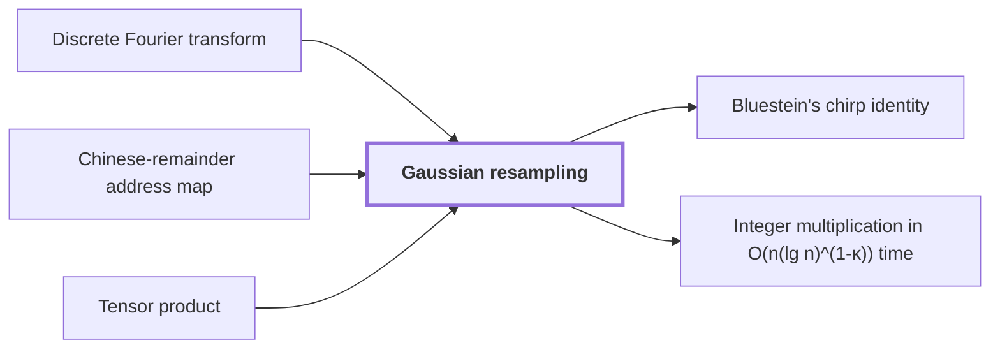

# Gaussian resampling

!!! info "Before this page"

    Gaussian resampling *rewrites* [Discrete Fourier transform](fourier-transform.md "Gaussian resampling rewrites the normalized discrete Fourier transform $F_q$ of length $q$ as a transform over power-of-two axes."), *operates on* [Chinese-remainder address map](chinese-remainder-address-map.md "Gaussian resampling operates on the axes produced by the Chinese-remainder address map.") and *is carried over by* [Tensor product](glossary.md#tensor-product "Gaussian resampling is carried over by Tensor product to several axes: tensor products give the same identity for multidimensional transforms.").

!!! abstract "Where this fits"

    1. Two $n$-bit integers can be multiplied exactly in $O(n(\lg n)^{1-\kappa})$ worst-case time on a deterministic multitape Turing machine, for a fixed $\kappa=2^{-182}$. — how: reduce the product to a digit convolution, compute that convolution through transform layers whose tape cost saves a power, and recover the exact product by rounding ([Integer multiplication in O(n(lg n)^(1-κ)) time](integer-multiplication-target.md "A deterministic multitape Turing machine that multiplies two n-bit integers exactly in O(n(lg n)^(1-κ)) worst-case time for a fixed κ = 2^(-182) > 0, beating the n log n conjecture in this model."))
    2. **This page:** A Fourier transform of prime length is a multidimensional transform whose axis lengths are powers of two.

??? note "Symbols from earlier pages"

    - $k$ — output position: The index of an output entry $\hat a_k$, running from $0$ to $n-1$; on this page it is not the power exponent it denotes on the roots-of-unity page. (on [Discrete Fourier transform](fourier-transform.md "The map sending a length-n sequence to its values at the n-th roots of unity, i.e. the sums of the sequence weighted by powers of a root of unity."))
    - $j$ — input position: The index of an input entry $a_j$, running from $0$ to $n-1$; on this page it is not the power exponent it denotes on the roots-of-unity page. (on [Discrete Fourier transform](fourier-transform.md "The map sending a length-n sequence to its values at the n-th roots of unity, i.e. the sums of the sequence weighted by powers of a root of unity."))
    - $r$ — coefficient count: The number of complex coefficients in the list of one element of the ring, a power of two. (on [Polynomial ring modulo yʳ + 1](polynomial-ring-y.md "The ring of complex polynomials in y reduced modulo y^r + 1, where multiplying by a power of y is a signed cyclic shift of the coefficient list."))
    - $y$ — ring indeterminate: The variable of the polynomial ring, an indeterminate that is not evaluated at any number. (on [Polynomial ring modulo yʳ + 1](polynomial-ring-y.md "The ring of complex polynomials in y reduced modulo y^r + 1, where multiplying by a power of y is a signed cyclic shift of the coefficient list."))
    - $w$ — unreduced product: The product fg before reduction modulo y^r+1, whose coefficients are w_k. (on [Signed Kronecker packing](kronecker-packing.md "Encoding a polynomial with bounded signed coefficients as an integer by evaluating it at a large power of two, so that polynomial products become integer products."))

Gaussian resampling is an identity that rewrites a Fourier transform of prime length as a transform over power-of-two axes. An axis is one index dimension of an array; a transform over several axes applies a one-dimensional transform along each axis in turn.

The integer product needs transform lengths that are pairwise coprime<cite class="exegenius-ref" data-source="paper" data-locator="§8 Resampling with the permutations left in the transform" data-quote="The transform lengths needed for the integer product are pairwise coprime" title="The transform lengths needed for the integer product are pairwise coprime"> (see §8 Resampling with the permutations left in the transform)</cite>, while synthetic transforms need powers of two. Gaussian resampling operates on the axes produced by the [Chinese-remainder address map](chinese-remainder-address-map.md "A rearrangement that places a digit sequence on a product of distinct prime cyclic axes while preserving convolution, implemented with address interchanges.").

Let $q$ be a prime, the length of a sequence $z=(z_0,\dots,z_{q-1})$ of complex numbers. Gaussian resampling rewrites the normalized [discrete Fourier transform](fourier-transform.md "The map sending a length-n sequence to its values at the n-th roots of unity, i.e. the sums of the sequence weighted by powers of a root of unity.") $F_q$ of length $q$ as a transform over power-of-two axes. Its values are
$$(F_q z)_k=\frac1q\sum_{j=0}^{q-1}z_j e^{-2\pi i jk/q}, \qquad 0\le k<q.$$

Let $n_0<n_1$ be integers, the lengths of the source and target transforms, with $\gcd(n_0,n_1)=1$ and $n_1$ a power of two. Let $F_{n_0}$ and $F_{n_1}$ be their normalized transforms, and let $P_s$ and $P_t$ be the source and target coordinate permutations, which reorder the outputs of $F_{n_0}$ and $F_{n_1}$. Let $K=2^{2\alpha^2}$ be a power of two, where $\alpha\ge 2$ is an integer parameter of the construction. Here $M_1:\mathbb C^{n_0}\to\mathbb C^{n_1}$ and $M_2:\mathbb C^{n_1}\to\mathbb C^{n_0}$ are linear contractions, maps that do not increase the size of a vector. Such contractions exist<cite class="exegenius-ref" data-source="paper" data-locator="§8.1 The one-dimensional interface" data-quote="There are linear contractions" title="There are linear contractions"> (see §8.1 The one-dimensional interface)</cite>, and the identity is
$$P_sF_{n_0}=K\,M_2\,P_tF_{n_1}\,M_1$$

The identity keeps $P_s$ and $P_t$ as factors, so the reordering they describe is not run as a separate full sort. The approximate maps for $M_1$ and $M_2$ take and return entries in increasing coordinate order<cite class="exegenius-ref" data-source="paper" data-locator="§8.1 The one-dimensional interface" data-quote="occur in increasing coordinate order" title="occur in increasing coordinate order"> (see §8.1 The one-dimensional interface)</cite>.

Gaussian resampling is carried over by [Tensor product](glossary.md#tensor-product "The tensor product V ⊗ W of two vector spaces, whose basis consists of all pairs of basis vectors of V and W, together with the tensor product A ⊗ B of linear maps, which acts on each coordinate separately.") to several axes: tensor products give the same identity for multidimensional transforms.

Power-of-two axes are cheap because of the [polynomial ring modulo $y^r+1$](polynomial-ring-y.md "The ring of complex polynomials in y reduced modulo y^r + 1, where multiplying by a power of y is a signed cyclic shift of the coefficient list."), where $r$ is a power of two. Since $y^r=-1$, $y^{j+r}=-y^j$, so multiplying a coefficient list by $y^j$ shifts it $j$ places, with wrapped coefficients changing sign. For $r=4$, the list $(w_0,w_1,w_2,w_3)$ multiplied by $y$ becomes $(-w_3,w_0,w_1,w_2)$. Since $y^{2r}=1$, the powers of $y$ are roots of unity of order $2r$, and multiplying by them is a signed shift.

## Connections

Used by:

- [Bluestein's chirp identity](bluestein-chirp.md "The identity is applied to the middle transform produced by Gaussian resampling.") *is applied to* Gaussian resampling
- [Integer multiplication in O(n(lg n)^(1-κ)) time](integer-multiplication-target.md "It computes its transforms by Gaussian resampling, which expresses each prime-length transform through power-of-two axes.") *computes its transforms by* Gaussian resampling

??? quote "From the sources"

    > Gaussian resampling then expresses each source Fourier transform through a
    >
    > — [Integer multiplication below n log n (OpenAI, 2026)](https://github.com/openai/math/tree/fd4aeeb2ee4fc729c18d98444fed42fd0529eeeb/preprints/Integer-multiplication-below-n-log-n-September-23-2026)
