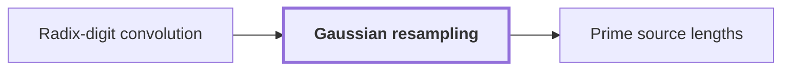

# Gaussian resampling

!!! info "Before this page"

    Gaussian resampling *is applied to* [Radix-digit convolution](radix-digit-convolution.md "Gaussian resampling is applied to the Radix-digit convolution of two integers, which needs transforms of lengths that are not powers of two."). Assumed known: Discrete Fourier transform.

!!! abstract "Where this fits"

    - Relied on to show: Distinct odd primes $s_1,\dots,s_d$ exist with $(1-2\eta)t_i<s_i\le(1-\eta)t_i$ for every axis $i$, and their product $S=\prod_i s_i$ satisfies $T/2<S<T$. ([Prime source lengths](prime-source-lengths.md "Distinct odd primes chosen close to the powers of two that are the padded axis lengths, so that their product fills a fixed fraction of the padded box."))

Gaussian resampling is a technique for computing a Fourier transform of arbitrary length by transforms whose axis lengths are powers of two. It lets the integer product use power-of-two transforms, which have simple butterfly networks: layered circuits that combine pairs of values a fixed distance apart. Here $L$ is the number of points along one axis of the transform. Here $i$ is the imaginary unit, with $i^2=-1$. Here $u$ and $v$ are indices of points along an axis, running over $0,\dots,L-1$.

Gaussian resampling is applied to the [Radix-digit convolution](radix-digit-convolution.md "Writing both integers as polynomials in a power of two whose coefficients are their digits, so that their product is a polynomial convolution of short coefficients.") of two integers, which needs transforms of lengths that are not powers of two. The reduction of Harvey and van der Hoeven replaces these transforms by multidimensional transforms<cite class="exegenius-ref" data-source="paper" data-locator="§11 A consequence for matrix transposition, p. 3" data-quote="whose axis lengths are powers of two" title="whose axis lengths are powers of two"> (see §11 A consequence for matrix transposition, p. 3)</cite>. We call this array of power-of-two axis lengths the power-of-two box.

The difficulty is that a transform of length 3 needs cube roots of unity, which a radix-2 butterfly network cannot supply. The reduction therefore moves between two sets of frequencies: the frequencies $e^{2\pi i u/L}$ of the original length, and the frequencies of the box.

The move uses Gaussian weights, the chirps $e^{\pi i u^2/L}$, one for each index $u$. They are unit-modulus complex numbers, not Gaussian integers. They work because $uv = \tfrac{1}{2}\bigl(u^2+v^2-(u-v)^2\bigr)$, so

$$e^{2\pi i uv/L} = e^{\pi i u^2/L}\,e^{\pi i v^2/L}\,e^{-\pi i (u-v)^2/L}.$$

Multiplying the values by the outer factors before and after a convolution with the kernel $e^{-\pi i (u-v)^2/L}$ gives the transform, and the power-of-two transforms compute that convolution.

## Connections

Used by:

- [Prime source lengths](prime-source-lengths.md "The primes are sized for Gaussian resampling, which needs each ratio $t_a/s_a$ to leave separation.") *are sized for* Gaussian resampling

??? quote "From the sources"

    > it replaces the Fourier transforms needed for this convolution by multidimensional transforms whose
    >
    > — Integer multiplication below n log n (OpenAI, 2026)
