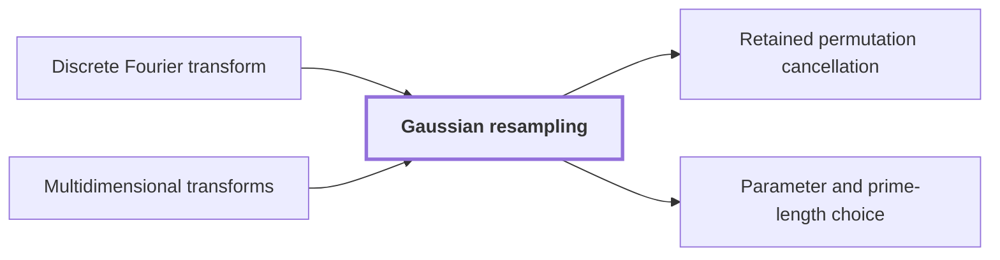

# Gaussian resampling

!!! info "Before this page"

    Gaussian resampling *re-expresses* [Discrete Fourier transform](dft.md "Here $F_q$ is the normalised Discrete Fourier transform of length $q$, and the resampling re-expresses $F_s$ through $F_t$.") and *is applied along each axis of* [Multidimensional transforms](multidim-transform.md "The identity is applied along each axis of a Multidimensional transforms transform.").

!!! abstract "Where this fits"

    1. A single deterministic Turing machine with a fixed finite alphabet and a fixed finite number of one-dimensional tapes multiplies two $n$-bit integers exactly in $O(n(\lg n)^{1-\kappa})$ worst-case time with $\kappa=2^{-182}$, disproving the $n\log n$ optimality conjecture of Sch\"onhage and Strassen in this model. — how: Build two power-saving tape procedures (chunk interchange and simultaneous butterfly layer) from fixed finite linear networks; use them to accelerate the synthetic polynomial transforms and ring convolution; use Gaussian resampling with retained permutations and chirps to reduce the prime-length cyclic convolution of the radix-digit coefficients to those power-of-two transforms; assemble the exact product with a proof that the error is below $1/2$; and total the cost to show a power of $\log n$ is saved. ([Power-saving integer multiplication](main-result.md "A deterministic fixed-tape Turing machine multiplying two n-bit integers exactly in O(n(lg n)^{1−κ}) time with κ = 2^{−182}, disproving the n log n optimality conjecture in this model."))
    2. The Fourier transforms of pairwise coprime prime lengths $s_i$ that the integer product needs are computed through power-of-two lengths $t_i$ by Gaussian resampling and Bluestein chirps, with the source and target coordinate permutations left inside the transform identities, so that none is executed as a sort. — how: Retain both permutations of Gaussian resampling in the transform formula: the target permutation $Q$ is absorbed by the chirp convolution, and the source permutation $R$ cancels across the two forward transforms, their pointwise product and the opposite transform. ([Retained permutation cancellation](retained-permutations.md "Leaving the coordinate permutations of resampling inside the transform identity, so the source permutation cancels across the two forward transforms and the opposite one and none is executed as a sort."))
    3. **This page:** For coprime $s<t$ with $\theta=t/s-1>p/\alpha^4$ and permutations $(P_su)_j=u_{tj}$, $(P_tv)_k=v_{-sk}$ there are linear contractions $A$, $B_0$ with $P_sF_s=2^{2\alpha^2}B_0P_tF_tA$, computed with error less than $p^2$ in time $O(tp^{3/2+\delta}\alpha)$ without executing $P_s$ or $P_t$.

??? note "Symbols from earlier pages"

    - $p$ — fractional bits: The number of fractional bits of the grid on which stored values lie. (on [Fixed-point Gaussian dyadic records](fixed-point.md "Complex values stored as signed two's-complement integers over a power-of-two denominator 2^{-p}; intermediate values are exact and one truncation Q_p rounds back to the p-bit grid."))
    - $u$ — input sequence: A sequence of q complex numbers. (on [Discrete Fourier transform](dft.md "The normalized transform (F_q u)_k = (1/q) Σ u_j e^{−2πi jk/q}, which turns convolution into pointwise multiplication."))
    - $L$ — linear map: A linear map whose norm bound is being defined. (on [Contractions and bilinear contractions](contraction-maps.md "A linear map that never increases the norm of a vector, and a bilinear map whose output norm is at most the product of the input norms, so errors in the inputs do not grow beyond a controlled bound."))
    - $\delta$ — exponent slack: A fixed constant with 0 < delta < 1/8 that sets the slack in the exponent of p in the time bound. (on [Multidimensional transforms](multidim-transform.md "A transform over several axes at once, the tensor product of one-dimensional transforms, applied to an array one axis at a time."))

Gaussian resampling expresses the Fourier transform of a source length $s$ through the transform of a nearby larger power-of-two length $t$, so that only power-of-two transforms need a fast algorithm. Here $j$ and $k$ are single coordinate indices.

Let $s<t<2^p$ be coprime integers, where $p>100$ counts the fractional bits of each component, and let $\alpha$, the width parameter of the Gaussian weights, be an integer with $2\le\alpha<\sqrt p$. Assume $\theta:=t/s-1>p/\alpha^4$. Here $F_q$ is the normalised [Discrete Fourier transform](dft.md "The normalized transform (F_q u)_k = (1/q) Σ u_j e^{−2πi jk/q}, which turns convolution into pointwise multiplication.") of length $q$, and the resampling re-expresses $F_s$ through $F_t$. Define the permutations $(P_su)_j=u_{tj}$ and $(P_tv)_k=v_{-sk}$, with indices taken modulo $s$ and $t$. They are kept inside the identity, never executed: carrying them out would sort $t$ records of about $p$ bits on a tape, costing about $tp\log t$, which would cancel the power saving. The result is that there are linear contractions $A$ from length-$s$ to length-$t$ vectors and $B_0$ from length-$t$ to length-$s$ vectors, with $P_sF_s=2^{2\alpha^2}B_0P_tF_tA$. The identity is applied along each axis of a [Multidimensional transforms](multidim-transform.md "A transform over several axes at once, the tensor product of one-dimensional transforms, applied to an array one axis at a time.") transform.

## Exact construction

Harvey and van der Hoeven's resampling maps $\mathsf S$ and $\mathsf T$ (see [Established O(n log n) multiplier](hvdh-multiplier.md "The earlier Harvey–van der Hoeven multitape algorithm multiplying N-bit integers in O(N log N) time, used here only as an ordinary subroutine.")) send length-$s$ vectors to length-$t$ vectors. For $0\le k<t$, with $u$ extended periodically and $j$ over all integers,
$$(\mathsf Su)_k=\frac1\alpha\sum_j e^{-\pi\alpha^{-2}(j-sk/t)^2}u_j,\qquad (\mathsf Tu)_k=\sum_j e^{-\pi\alpha^2(tj/s-k)^2}u_j.$$
Both smear the data with a Gaussian. A Gaussian is its own Fourier transform, so a wide smear before a transform equals a narrow one after it. This is a proved result of that paper (its Theorem 4.2 and Lemma 4.6), imported here without proof: $\mathsf TP_sF_s=P_tF_t\mathsf S$<cite class="exegenius-ref" data-source="paper" data-locator="§8.1 The one-dimensional interface" data-quote="\mathsf T P_sF_s=P_tF_t\mathsf S," title="\mathsf T P_sF_s=P_tF_t\mathsf S,"> (see §8.1 The one-dimensional interface)</cite>.

We want $P_sF_s$ itself, so we must undo $\mathsf T$. In $(\mathsf Tu)_k$ the weight of $u_j$ is large only for $k$ within about $1/\alpha$ of $tj/s$, and these centres are $1+\theta>1$ apart. For each $j$ let $q_j$ be the integer nearest $tj/s$, and $\beta_j=tj/s-q_j$. Let $C$ select coordinates from length-$t$ to length-$s$ vectors, $(Cv)_j=v_{q_j}$, and $(\mathsf Du)_j=e^{\pi\alpha^2\beta_j^2}u_j$. Put $N=C\mathsf T\mathsf D$. In $(Nu)_j$ the summand with index $j$ is exactly $u_j$: the factor in $\mathsf D$ cancels the Gaussian weight at the selected coordinate. The other summands, which form $((N-I)u)_j$, are damped because their centres lie at least $1+\theta$ from each other while $|\beta_j|\le1/2$. The exact bound, proved by Harvey and van der Hoeven, is $\|N-I\|<2.01e^{-\pi\alpha^2\theta/2}<2^{-\alpha^2\theta}$<cite class="exegenius-ref" data-source="paper" data-locator="§8.1 The one-dimensional interface" data-quote="\|N-I\|&lt;2.01e^{-\pi\alpha^2\theta/2}&lt;2^{-\alpha^2\theta}." title="\|N-I\|&lt;2.01e^{-\pi\alpha^2\theta/2}&lt;2^{-\alpha^2\theta}."> (see §8.1 The one-dimensional interface)</cite>.

Since $\alpha^2<p$ and $\theta>p/\alpha^4$, $\alpha^2\theta>p/\alpha^2>1$, so $\|N-I\|<1/2$ and $N$ is invertible by the Neumann series $N^{-1}=\sum_i(-1)^i(N-I)^i$.

Set $\mathsf S'=\mathsf S/2$, $\mathsf J'=N^{-1}/2$, $\mathsf D'=2^{-(2\alpha^2-2)}\mathsf D$, which are contractions with norms below $3/4$, $7/8$, $1$<cite class="exegenius-ref" data-source="paper" data-locator="§8.1 The one-dimensional interface" data-quote="\|\mathsf S'\|&lt;\frac34,\qquad \|\mathsf J'\|&lt;\frac78,\qquad \|\mathsf D'\|&lt;1." title="\|\mathsf S'\|&lt;\frac34,\qquad \|\mathsf J'\|&lt;\frac78,\qquad \|\mathsf D'\|&lt;1."> (see §8.1 The one-dimensional interface)</cite>. Put $A=\mathsf S'$ and $B_0=\mathsf D'\mathsf J'C$; as $\|C\|=1$, both are contractions.

As $C\mathsf T=N\mathsf D^{-1}$, the map $\mathsf DN^{-1}C$ is a left inverse of $\mathsf T$. Applying it to the identity gives $\mathsf DN^{-1}CP_tF_t\mathsf S=P_sF_s$. The normalizations multiply to $2^{-(2\alpha^2-2)}2^{-1}2^{-1}=2^{-2\alpha^2}$, so $B_0P_tF_tA=2^{-2\alpha^2}P_sF_s$.

## Computing it

Let $\mathbb D_p$ be the grid of [Fixed-point Gaussian dyadic records](fixed-point.md "Complex values stored as signed two's-complement integers over a power-of-two denominator 2^{-p}; intermediate values are exact and one truncation Q_p rounds back to the p-bit grid."). An approximation $\widetilde L$ of a contraction $L$ has error below a bound if $2^p\|\widetilde Lu-Lu\|$ is less than it. Fix $0<\delta<1/8$. Harvey and van der Hoeven's algorithms give approximations $\widetilde{\mathsf S}'$, $\widetilde{\mathsf J}'$, $\widetilde{\mathsf D}'$ with errors $16p$, $3p^2/4$, $4$ and times $O(tp^{3/2+\delta}\alpha)$, $O(tp^{3/2+\delta}\alpha)$, $O(tp^{1+\delta})$<cite class="exegenius-ref" data-source="paper" data-locator="§8.1 The one-dimensional interface" data-quote="\widetilde{\mathsf S}'&amp;16p&amp;O(tp^{3/2+\delta}\alpha)\\" title="\widetilde{\mathsf S}'&amp;16p&amp;O(tp^{3/2+\delta}\alpha)\\"> (see §8.1 The one-dimensional interface)</cite><cite class="exegenius-ref" data-source="paper" data-locator="§8.1 The one-dimensional interface" data-quote="\widetilde{\mathsf J}'&amp;3p^2/4&amp;O(tp^{3/2+\delta}\alpha)\\" title="\widetilde{\mathsf J}'&amp;3p^2/4&amp;O(tp^{3/2+\delta}\alpha)\\"> (see §8.1 The one-dimensional interface)</cite><cite class="exegenius-ref" data-source="paper" data-locator="§8.1 The one-dimensional interface" data-quote="\widetilde{\mathsf D}'&amp;4&amp;O(tp^{1+\delta})." title="\widetilde{\mathsf D}'&amp;4&amp;O(tp^{1+\delta})."> (see §8.1 The one-dimensional interface)</cite>.

The selection $C$ picks an ordered subsequence (since $t/s>1$), and the indices are generated in order with $O(p)$ work each. So $C$ takes $O(tp)$ time with zero error<cite class="exegenius-ref" data-source="paper" data-locator="§8.1 The one-dimensional interface" data-quote="also cost $O(tp)$, so $C$ takes $O(tp)$ time with zero numerical error." title="also cost $O(tp)$, so $C$ takes $O(tp)$ time with zero numerical error."> (see §8.1 The one-dimensional interface)</cite>.

Take $\widetilde A=\widetilde{\mathsf S}'$ and $\widetilde B_0=\widetilde{\mathsf D}'\widetilde{\mathsf J}'C$. Contraction of the exact maps yields errors less than $16p<p^2$ and $4+3p^2/4<p^2$ (as $p>100$), and the costs add to $O(tp^{3/2+\delta}\alpha)$.

Let $E=N-I$ and $K=\lceil p/(\alpha^2\theta)\rceil$, the number of series terms kept. Let $\widetilde E$ be the approximation of $E$ on $\mathbb D_p$ from Harvey and van der Hoeven's Lemma 4.11: for every $z\in\mathbb D_p^s$, $\widetilde Ez\in\mathbb D_p^s$ and $\|\widetilde Ez\|<0.42\|z\|+(p/3)2^{-p}<1$<cite class="exegenius-ref" data-source="paper" data-locator="§8.1 The one-dimensional interface" data-quote="\|\widetilde E z\|&lt;0.42\|z\|+(p/3)2^{-p}&lt;1" title="\|\widetilde E z\|&lt;0.42\|z\|+(p/3)2^{-p}&lt;1"> (see §8.1 The one-dimensional interface)</cite>. Start from $\widetilde v^{(0)}$, the rounding of $u/2$, and set $\widetilde v^{(i)}=\widetilde E\widetilde v^{(i-1)}$, so by induction every iterate stays in $\mathbb D_p^s$. The Neumann series is then evaluated as $\widetilde{\mathsf J}'u=\sum_{i=0}^{K-1}(-1)^i\widetilde v^{(i)}$, with every iterate kept in $\mathbb D_p$.

## Connections

Used by:

- [Retained permutation cancellation](retained-permutations.md "Each prime-length transform is computed through a power-of-two one by Gaussian resampling.") *computes prime-length transforms through* Gaussian resampling
- [Parameter and prime-length choice](parameter-choice.md "This page fixes every exponent and size for $n$-bit inputs so that the hypotheses of the butterfly-layer lemma and of Gaussian resampling hold at once.") *fixes size for hypotheses of* Gaussian resampling

??? quote "From the sources"

    > Gaussian resampling then expresses each source Fourier transform through a
    >
    > — [Integer multiplication below n log n (OpenAI, 2026)](https://github.com/openai/math/tree/fd4aeeb2ee4fc729c18d98444fed42fd0529eeeb/preprints/Integer-multiplication-below-n-log-n-September-23-2026)

    > Resampling without executing the two permutations
    >
    > — [Integer multiplication below n log n (OpenAI, 2026)](https://github.com/openai/math/tree/fd4aeeb2ee4fc729c18d98444fed42fd0529eeeb/preprints/Integer-multiplication-below-n-log-n-September-23-2026)
