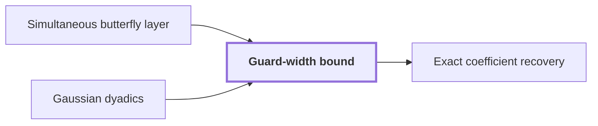

# Guard-width bound

!!! info "Before this page"

    Guard-width bound *bounds the intermediate coefficients of* [Simultaneous butterfly layer](simultaneous-butterfly-layer.md "A guard-width bound is an explicit number of extra bits that bounds the intermediate coefficients of a simultaneous butterfly layer and makes them exact, so that one truncation at the end suffices.") and *limits the denominators of* [Gaussian dyadics](glossary.md#gaussian-dyadics "So the guard count limits the denominators of the Gaussian dyadics that appear as intermediate coefficients.").

!!! abstract "Where this fits"

    - Relied on to show: The recovered coefficient error is strictly below $1/2$, so rounding recovers the integer coefficients exactly. ([Exact coefficient recovery](recovery-and-error.md "The error analysis showing that the computed convolution coefficients are within a half of their true integer values, so rounding recovers them exactly."))
    - Relied on to show: A compatible choice of rational parameters makes every term of the cost table fit the bound of Theorem 1.

A guard-width bound is an explicit number of extra bits that bounds the intermediate coefficients of a [simultaneous butterfly layer](simultaneous-butterfly-layer.md "The tensor product of the two-point map H0 applied to several selected address bits at once, computed exactly in one pass rather than one axis at a time.") and makes them exact, so that one truncation at the end suffices. It lets the layer run without rounding in the middle, so the later error analysis sees exact values.

Inside a layer, each value comes from complex addition and subtraction, halving, sign change, and multiplication by $i$. Let the depth $\eta$ of an intermediate coefficient be the number of these operations on its longest chain, where a chain starts at an input coefficient and follows an operand into each result that uses it. Let $C_0$ and $C_1$ be constants fixed by the network construction, and let $D$ be the number of selected address chunks of the layer (the paper writes $d$). Let the guard count $\Delta = \lceil C_0 D^{C_1} \rceil$ be the number of extra bits that bounds every depth. The paper's calculation charges both denominator and magnitude growth to this count.<cite class="exegenius-ref" data-source="paper" data-locator="§11 A consequence for matrix transposition, p. 38" data-quote="The guard-width calculation above bounds both denominator and magnitude growth by ⌈C0 dC1 ⌉." title="The guard-width calculation above bounds both denominator and magnitude growth by ⌈C0 dC1 ⌉."> (see §11 A consequence for matrix transposition, p. 38)</cite>

Take inputs in $2^{-\kappa}\mathbb{Z}[i]$, the Gaussian integers divided by $2^{\kappa}$, with modulus at most $1$, where $\kappa$ is the number of fractional bits in each input coefficient. A value of depth $\eta$ then lies in $2^{-(\kappa+\eta)}\mathbb{Z}[i]$ and has modulus at most $2^{\eta}$. This holds by induction on depth. A sum or difference has depth one more than its deeper operand and at most twice the larger operand modulus. Halving adds one denominator bit and halves the modulus. Sign changes and multiplication by $i$ change neither. So the guard count limits the denominators of the [Gaussian dyadics](glossary.md#gaussian-dyadics "Complex numbers whose real and imaginary parts are integers divided by a power of two, with the Gaussian integer part also an integer.") that appear as intermediate coefficients.

For example, let $\alpha = 1$ and $\beta = i$ be inputs of depth 0. Then $\alpha+\beta = 1+i$ has depth 1, and $(\alpha+\beta)/2 = (1+i)/2$ has depth 2. Its modulus $1/\sqrt{2}$ is at most $2^{2}$, as the bound says.

With every depth at most $\Delta$, each intermediate coefficient has at most $\kappa+\Delta$ fractional bits, and each real component has absolute value at most $2^{\Delta}$. That magnitude takes $\Delta+1$ bits, and a sign bit makes $\Delta+2$. The paper reserves one more, $\Delta+3$ integer and sign bits per real component.<cite class="exegenius-ref" data-source="paper" data-locator="§11 A consequence for matrix transposition, p. 37" data-quote="⌈C0 dC1 ⌉ + 3 integer and sign bits per real component internally" title="⌈C0 dC1 ⌉ + 3 integer and sign bits per real component internally"> (see §11 A consequence for matrix transposition, p. 37)</cite> Halving shifts the numerator into reserved zero fractional bits, so no bit is lost. The whole layer is evaluated exactly, and one truncation toward zero, which drops the extra fractional bits, is applied at the end.<cite class="exegenius-ref" data-source="paper" data-locator="§11 A consequence for matrix transposition, p. 37" data-quote="The procedure evaluates the entire layer exactly before this final truncation." title="The procedure evaluates the entire layer exactly before this final truncation."> (see §11 A consequence for matrix transposition, p. 37)</cite>

## Connections

Used by:

- [Exact coefficient recovery](recovery-and-error.md "Exact recovery is secured by the Guard-width bound, which fixes enough extra bits that a single final truncation, discarding those bits, suffices.") *is secured by* Guard-width bound

??? quote "From the sources"

    > An explicit guard-width bound
    >
    > — Integer multiplication below n log n (OpenAI, 2026)
