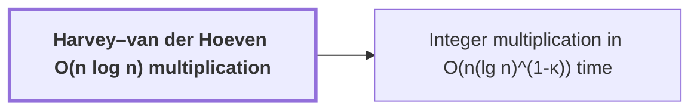

# Harvey–van der Hoeven O(n log n) multiplication

!!! info "Before this page"

    Assumed known: Big-O notation.

!!! abstract "Where this fits"

    - Relied on to show: Polynomial products over the ring are computed by signed packing and the $O(n\log n)$ multiplier. ([Signed Kronecker packing](kronecker-packing.md "Encoding a polynomial with bounded signed coefficients as an integer by evaluating it at a large power of two, so that polynomial products become integer products."))

??? note "Symbols from earlier pages"

    - $n$ — input bit length: The number of bits in each input integer; the count of bits in one operand. (on [Schönhage–Strassen n log n conjecture](nlogn-conjecture.md "The conjecture of Schönhage and Strassen that n log n is the optimal order of growth of the time to multiply two n-bit integers on a multitape Turing machine."))
    - $\kappa$ — exponent gap: A fixed positive constant, the gap $\kappa = 2^{-182}$ in the exponent of the logarithm. (on [Schönhage–Strassen n log n conjecture](nlogn-conjecture.md "The conjecture of Schönhage and Strassen that n log n is the optimal order of growth of the time to multiply two n-bit integers on a multitape Turing machine."))

The Harvey–van der Hoeven multiplier is a deterministic algorithm that multiplies two $n$-bit integers in worst-case time $O(n\log n)$ on a multitape Turing machine, a machine with several tapes, each read and written by its own head. It is the<cite class="exegenius-ref" data-source="paper" data-locator="§1 Introduction" data-quote="unconditional $O(n\log n)$ upper bound" title="unconditional $O(n\log n)$ upper bound"> (see §1 Introduction)</cite> for integer multiplication, so it needs no unproven hypothesis.

It matches the $n\log n$ order proposed as optimal by [Schönhage–Strassen n log n conjecture](nlogn-conjecture.md "The conjecture of Schönhage and Strassen that n log n is the optimal order of growth of the time to multiply two n-bit integers on a multitape Turing machine."). It is the baseline the target improves on, not the new bound.

The target's bound is $O(n(\lg n)^{1-\kappa})$ for a fixed constant $\kappa>0$. Its value is $2^{-182}$<cite class="exegenius-ref" data-source="paper" data-locator="" data-quote="$\kappa=2^{-182}$" title="$\kappa=2^{-182}$"> (see Integer multiplication below n log n (OpenAI, 2026))</cite>. Since $(\lg n)^{1-\kappa}/\lg n=(\lg n)^{-\kappa}$ tends to $0$ as $n\to\infty$, the target's bound grows strictly slower than $n\log n$.

## Connections

Used by:

- [Integer multiplication in O(n(lg n)^(1-κ)) time](integer-multiplication-target.md "It computes its polynomial products by the Harvey–van der Hoeven O(n log n) multiplication on packed integers from Signed Kronecker packing.") *computes its polynomial products by* Harvey–van der Hoeven O(n log n) multiplication

??? quote "From the sources"

    > Harvey and van der Hoeven reached the unconditional $O(n\log n)$ upper
    >
    > — [Integer multiplication below n log n (OpenAI, 2026)](https://github.com/openai/math/tree/fd4aeeb2ee4fc729c18d98444fed42fd0529eeeb/preprints/Integer-multiplication-below-n-log-n-September-23-2026)
