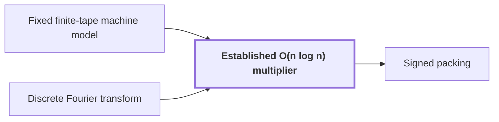

# Established O(n log n) multiplier

!!! info "Before this page"

    Established O(n log n) multiplier *runs in* [Fixed finite-tape machine model](machine-model.md "The multiplier runs in the Fixed finite-tape machine model, the same model as the main result, so a call costs its $O(N\log N)$ steps with no change of machine to account for.") and *is called once the algorithm reduces* [Discrete Fourier transform](dft.md "The multiplier is called on the first kind once the new algorithm reduces its Fourier transforms to polynomial products over $\mathbb C[y]/(y^r+1)$."). Assumed known: Big-O notation.

!!! abstract "Where this fits"

    - Relied on to show: A single deterministic Turing machine with a fixed finite alphabet and a fixed finite number of one-dimensional tapes multiplies two $n$-bit integers exactly in $O(n(\lg n)^{1-\kappa})$ worst-case time with $\kappa=2^{-182}$, disproving the $n\log n$ optimality conjecture of Sch\"onhage and Strassen in this model. ([Power-saving integer multiplication](main-result.md "A deterministic fixed-tape Turing machine multiplying two n-bit integers exactly in O(n(lg n)^{1−κ}) time with κ = 2^{−182}, disproving the n log n optimality conjecture in this model."))
    - Relied on to show: Normalized cyclic convolution over the polynomial ring $\mathbb C[y]/(y^r+1)$ on the remaining $d-1$ axes is computed from two forward synthetic transforms in retained order, $M$ pointwise polynomial products and the opposite transform, in $O(Tp[dK+pK^{\tau-1}+\ell d^{\lambda'}+\log(rp)])$ time with error less than $\sqrt2\,M(3\ell+1)2^{-p}$. ([Convolution from the retained transform layout](ring-convolution.md "Convolution over the ring modulo y^r + 1 on the remaining axes by two forward synthetic transforms, pointwise polynomial products and the opposite transform, normalized by 1/(rM)."))
    - Relied on to show: For disk-grid polynomials $f,g\in\mathcal R_r$ the exact Gaussian-integer numerators of $fg$, and then $Q_p(fg/r)$, are computed in $O(rp\log(rp))$ time using four integer products by the established multiplier at packing base $B_0=2^{4p}$. ([Signed packing](signed-packing.md "A signed Kronecker substitution that evaluates polynomials with signed coefficients at 2^{4p} to form large integers, multiplies them with the O(n log n) multiplier, and recovers the product coefficients."))
    - Relied on to show: The Fourier transforms of pairwise coprime prime lengths $s_i$ that the integer product needs are computed through power-of-two lengths $t_i$ by Gaussian resampling and Bluestein chirps, with the source and target coordinate permutations left inside the transform identities, so that none is executed as a sort. ([Retained permutation cancellation](retained-permutations.md "Leaving the coordinate permutations of resampling inside the transform identity, so the source permutation cancels across the two forward transforms and the opposite one and none is executed as a sort."))
    - Relied on to show: For coprime $s<t$ with $\theta=t/s-1>p/\alpha^4$ and permutations $(P_su)_j=u_{tj}$, $(P_tv)_k=v_{-sk}$ there are linear contractions $A$, $B_0$ with $P_sF_s=2^{2\alpha^2}B_0P_tF_tA$, computed with error less than $p^2$ in time $O(tp^{3/2+\delta}\alpha)$ without executing $P_s$ or $P_t$. ([Gaussian resampling](gaussian-resampling.md "Re-expressing a Fourier transform of prime length s through a transform of nearby power-of-two length t using Gaussian weights, so that only power-of-two transforms are needed."))
    - Relied on to show: The three ordered numerical maps $\widetilde{\mathsf S}'$, $\widetilde{\mathsf J}'$, $\widetilde{\mathsf D}'$ have errors $16p$, $3p^2/4$, $4$ and times $O(tp^{3/2+\delta}\alpha)$, $O(tp^{3/2+\delta}\alpha)$, $O(tp^{1+\delta})$.

??? note "Symbols from earlier pages"

    - $y$ — ring variable: The indeterminate of the polynomials; it satisfies y^r = -1 in the ring. (on [Polynomial ring modulo y^r + 1](ring-y.md "Polynomials of degree below r over the complex numbers with y^r = −1, so multiplying by a power of y is a signed shift of the coefficient list."))
    - $r$ — record length: The number of complex coefficients in a polynomial of the ring, always a power of two. (on [Polynomial ring modulo y^r + 1](ring-y.md "Polynomials of degree below r over the complex numbers with y^r = −1, so multiplying by a power of y is a signed shift of the coefficient list."))
    - $p$ — fractional bits: The number of fractional bits of the grid on which stored values lie. (on [Fixed-point Gaussian dyadic records](fixed-point.md "Complex values stored as signed two's-complement integers over a power-of-two denominator 2^{-p}; intermediate values are exact and one truncation Q_p rounds back to the p-bit grid."))

The established multiplier is the earlier Harvey–van der Hoeven algorithm, which multiplies two integers of $N$ bits each in $O(N\log N)$ time (this $N$ is not the bank size of the exchange network); the new algorithm calls it as an ordinary subroutine for the integer products it cannot avoid.

The multiplier runs in the [Fixed finite-tape machine model](machine-model.md "The computation model of the main theorem: one fixed finite alphabet and a fixed number of one-dimensional tapes, each head moving at most one cell per step."), the same model as the main result, so a call costs its $O(N\log N)$ steps with no change of machine to account for. The paper takes this bound from Harvey and van der Hoeven<cite class="exegenius-ref" data-source="paper" data-locator="§8 Resampling with the permutations left in the transform" data-quote="We use the established $O(N\log N)$ integer multiplier of" title="We use the established $O(N\log N)$ integer multiplier of"> (see §8 Resampling with the permutations left in the transform)</cite>; its proof is in their paper and is not reproduced here. It is the bound that Schönhage and Strassen conjectured optimal ([Schönhage–Strassen optimality conjecture](conjecture.md "The 1971 proposal that n log n is the optimal order of growth for multiplying n-bit integers on a multitape Turing machine.")), so it is the benchmark the main result beats.

## How it is used

The multiplier is not the source of the saving. It is called on two kinds of product.

The multiplier is called on the first kind once the new algorithm reduces its [Fourier transforms](dft.md "The normalized transform (F_q u)_k = (1/q) Σ u_j e^{−2πi jk/q}, which turns convolution into pointwise multiplication.") to polynomial products over $\mathbb C[y]/(y^r+1)$. These ring products go through signed packing<cite class="exegenius-ref" data-source="paper" data-locator="§1.3 From transforms to the exact product" data-quote="use signed packing and the established $O(n\log n)$ multiplier as an" title="use signed packing and the established $O(n\log n)$ multiplier as an"> (see §1.3 From transforms to the exact product)</cite>: [Signed packing](signed-packing.md "A signed Kronecker substitution that evaluates polynomials with signed coefficients at 2^{4p} to form large integers, multiplies them with the O(n log n) multiplier, and recovers the product coefficients.") turns each into four integer products on $O(rp)$ bits, where $r$ is the record length and $p$ the number of fractional bits.

The second kind is the chirp numerators, which have $O(p)$ bits and are squared and multiplied directly<cite class="exegenius-ref" data-source="paper" data-locator="§9.8 The complete time bound" data-quote="Computing their squares and products with the previously established $O(N\log(2N))$ multiplier" title="Computing their squares and products with the previously established $O(N\log(2N))$ multiplier"> (see §9.8 The complete time bound)</cite>.

## Why the calls add no recursion

The new algorithm has recursion of its own, in its layer and address-layout recursions. The multiplier calls contribute none of it, for two reasons.

First, each call is an ordinary subroutine call on records of $O(rp)$ bits, fewer than the input, so it is not a call of the improved algorithm on a smaller input<cite class="exegenius-ref" data-source="paper" data-locator="§9.8 The complete time bound" data-quote="they do not call the improved algorithm being constructed." title="they do not call the improved algorithm being constructed."> (see §9.8 The complete time bound)</cite> Hence no recurrence for the new algorithm passes through the multiplier.

Second, whatever recursion the Harvey–van der Hoeven algorithm uses internally is already paid for by its $O(N\log N)$ bound<cite class="exegenius-ref" data-source="paper" data-locator="§9.8 The complete time bound" data-quote="The internal recursion of the established integer" title="The internal recursion of the established integer"> (see §9.8 The complete time bound)</cite>. Its cost is therefore charged as a separate term, not folded into a recurrence<cite class="exegenius-ref" data-source="paper" data-locator="§9.8 The complete time bound" data-quote="already included in their separately charged running times." title="already included in their separately charged running times."> (see §9.8 The complete time bound)</cite>

## Connections

Used by:

- [Signed packing](signed-packing.md "The multiplier takes nonnegative integers, so signed packing multiplies the four pairs of absolute values with the Established O(n log n) multiplier, restoring each sign, to obtain $A_aA_c,A_bA_e,A_aA_e,A_bA_c$.") *multiplies absolute values with* Established O(n log n) multiplier

??? quote "From the sources"

    > the established $O(n\log n)$ multiplier as an ordinary subroutine
    >
    > — [Integer multiplication below n log n (OpenAI, 2026)](https://github.com/openai/math/tree/fd4aeeb2ee4fc729c18d98444fed42fd0529eeeb/preprints/Integer-multiplication-below-n-log-n-September-23-2026)

    > Calls to the established $O(n\log n)$ multiplier are ordinary subroutine
    >
    > — [Integer multiplication below n log n (OpenAI, 2026)](https://github.com/openai/math/tree/fd4aeeb2ee4fc729c18d98444fed42fd0529eeeb/preprints/Integer-multiplication-below-n-log-n-September-23-2026)
