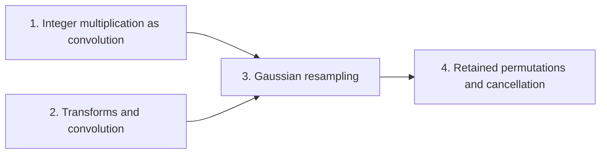

# Integer multiplication below n log n

This wiki explains the transform identity with retained permutations, a form of the Gaussian resampling identity in which the source and target coordinate permutations stay inside the formula. The point is that the source permutation cancels across a cyclic convolution, so the product of two retained transforms gives the convolution in natural order without executing a sort. This serves exact integer multiplication: an $n$-bit product is computed as a convolution of radix-digit coefficients, and the transforms that evaluate it need power-of-two axis lengths, which the classical construction does not supply directly.

The first part sets up the problem. [Exact integer multiplication](exact-integer-multiplication.md "Given binary strings x and y of length n, output the 2n-bit binary representation of their product.") is reduced to a polynomial product in [radix-digit convolution](radix-digit-convolution.md "Writing both integers as polynomials in a power of two whose coefficients are their digits, so that their product is a polynomial convolution of short coefficients."). The second part supplies the tools: the [discrete Fourier transform](discrete-fourier-transform.md "The map sending a vector of q values to its q values weighted by powers of a q-th root of unity, normalized by 1/q.") and [cyclic convolution](cyclic-convolution.md "The product of two sequences in which indices wrap around modulo the sequence length."). The third part presents [Gaussian resampling](gaussian-resampling.md "A technique that replaces a Fourier transform of arbitrary length by transforms whose axis lengths are powers of two, using Gaussian weights to move between the two sets of frequencies."), which replaces a transform of arbitrary length by transforms of power-of-two lengths, using Gaussian weights to move between the two sets of frequencies, and gives the one-dimensional identity $P_sF_s = 2^{2\alpha^2}B_0P_tF_tA$ with contractions $A$ and $B_0$. The final part proves the [transform identity with retained permutations](transform-identity.md "The Gaussian resampling identity in which the source and target coordinate permutations are kept as part of the formula, so that they cancel across a convolution instead of being executed as sorts."), showing that $RF_s^{+}R(F_sf\cdot F_sg)=(f\ast g)/M^2$, so the retained source permutation is undone inside the opposite transform.

!!! tip "How to read this wiki"

    Written for a reader who knows: Undergraduate computer science: big-O notation, polynomials, complex numbers, basic Turing machines and tapes. The 6 pages, in 4 parts, lead to [Transform identity with retained permutations](transform-identity.md "The Gaussian resampling identity in which the source and target coordinate permutations are kept as part of the formula, so that they cancel across a convolution instead of being executed as sorts."). Read them in order with the links at the bottom of each page, or start anywhere: each page opens with what it builds on. Hover over a link to see a one-line definition. For reference, the [notation](notation.md) page lists the symbols.

## The argument

**Main result:** With both coordinate permutations kept in the formula, $P_sF_s = 2^{2\alpha^2}B_0P_tF_tA$, and the retained source permutation cancels across a convolution, so no sort is executed.

**How:** keep the permutations in the Gaussian resampling identity, then cancel the source permutation through the convolution **Why:** Keeping the permutations in the formula lets the two sorts disappear instead of being executed as full passes over each coordinate.

1. The one-dimensional Gaussian resampling identity $P_sF_s = 2^{2\alpha^2}B_0P_tF_tA$ holds with contractions $A$ and $B_0$. — how: resample Fourier transform through Gaussian weights onto the other length, invert the near-identity factor by a Neumann series, and absorb the normalizations ([Gaussian resampling](gaussian-resampling.md "A technique that replaces a Fourier transform of arbitrary length by transforms whose axis lengths are powers of two, using Gaussian weights to move between the two sets of frequencies."))
2. The retained source permutation cancels: $RF_s^{+}R(F_su\cdot F_sv)=(u\ast v)/S^2$ with $S=\prod_i s_i$. — how: use that the permutation is its own inverse against the opposite transform, commute it through pointwise products, then apply the normalized convolution rule ([Cyclic convolution](cyclic-convolution.md "The product of two sequences in which indices wrap around modulo the sequence length."))

## Contents

### 1. [Integer multiplication as convolution](integer-multiplication-as-convolution/index.md)

This part fixes the target problem and the first reduction. [Exact integer multiplication](exact-integer-multiplication.md "Given binary strings x and y of length n, output the 2n-bit binary representation of their product.") is the goal, and [radix-digit convolution](radix-digit-convolution.md "Writing both integers as polynomials in a power of two whose coefficients are their digits, so that their product is a polynomial convolution of short coefficients.") rewrites it as a product of polynomials whose coefficients are digits. The reader needs this framing to see why the later transforms must compute convolutions.

[Exact integer multiplication](exact-integer-multiplication.md "Given binary strings x and y of length n, output the 2n-bit binary representation of their product.") · [Radix-digit convolution](radix-digit-convolution.md "Writing both integers as polynomials in a power of two whose coefficients are their digits, so that their product is a polynomial convolution of short coefficients.")

### 2. [Transforms and convolution](transforms-and-convolution/index.md)

This part introduces the two operations the identity relies on. The [discrete Fourier transform](discrete-fourier-transform.md "The map sending a vector of q values to its q values weighted by powers of a q-th root of unity, normalized by 1/q.") maps a vector to its weighted values at roots of unity, and [cyclic convolution](cyclic-convolution.md "The product of two sequences in which indices wrap around modulo the sequence length.") is the product with indices wrapped modulo the length. Both are needed to state the Gaussian resampling identity and to see how a permutation can cancel across a convolution.

[Discrete Fourier transform](discrete-fourier-transform.md "The map sending a vector of q values to its q values weighted by powers of a q-th root of unity, normalized by 1/q.") · [Cyclic convolution](cyclic-convolution.md "The product of two sequences in which indices wrap around modulo the sequence length.")

### 3. [Gaussian resampling](gaussian-resampling-2/index.md)

This part gives the technique that replaces a transform of arbitrary length by transforms with power-of-two axis lengths. [Gaussian resampling](gaussian-resampling.md "A technique that replaces a Fourier transform of arbitrary length by transforms whose axis lengths are powers of two, using Gaussian weights to move between the two sets of frequencies.") shows that the two sets of frequencies are related by contractions, which is the identity the retained-permutation form starts from. The reader needs it before the permutations can be kept in the formula.

[Gaussian resampling](gaussian-resampling.md "A technique that replaces a Fourier transform of arbitrary length by transforms whose axis lengths are powers of two, using Gaussian weights to move between the two sets of frequencies.")

### 4. [Retained permutations and cancellation](retained-permutations-and-cancellation/index.md)

This part states the main result and its proof. The [transform identity with retained permutations](transform-identity.md "The Gaussian resampling identity in which the source and target coordinate permutations are kept as part of the formula, so that they cancel across a convolution instead of being executed as sorts.") keeps the source and target permutations in the formula, so no sort is executed. Its argument shows that the retained source permutation cancels inside the opposite transform, leaving the convolution scaled by $1/M^2$.

[Transform identity with retained permutations](transform-identity.md "The Gaussian resampling identity in which the source and target coordinate permutations are kept as part of the formula, so that they cancel across a convolution instead of being executed as sorts.")

### [Notation](notation.md)

The symbols used across the pages, with where each is introduced.

## Map of the parts

## Assumed known

- Polynomials — Finite sums of powers of a variable with coefficients, multiplied and reduced in the usual way.
- Complex numbers — Numbers a + bi with real a and b and imaginary unit i, with i² = −1.
- Turing machines and tapes — A finite-state machine that reads and writes symbols on one or more tapes, each with a movable head.

## Sources

- Integer multiplication below n log n (OpenAI, 2026)
