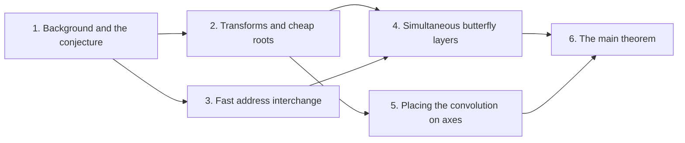

# Integer multiplication below n log n

The target result is an integer multiplication algorithm for a deterministic fixed-tape Turing machine. It multiplies two $n$-bit integers in $O(n(\lg n)^{1-\kappa})$ time, where $\kappa = 2^{-182}$. Schönhage and Strassen proposed that $n \log n$ is the optimal order of cost for multiplication, so the result disproves that conjecture in this model.

The first part sets out the [n log n optimality conjecture](nlogn-conjecture.md "Schönhage–Strassen's proposal that n log n is the optimal order of cost for multiplying n-bit integers."), the [fixed-tape machine model](fixed-tape-model.md "Machine with one fixed finite alphabet and a fixed number of one-dimensional tapes; each step touches one cell per tape, so data movement (scans, shifts, permutations) is the cost to minimize."), and the [convolution](convolution.md "Product of polynomials / combination of coefficient lists where entries sum by index (cyclic if indices wrap).") that integer products reduce to. [Radix digit reduction](radix-digit-reduction.md "Splitting the inputs into radix digits turns the integer product into a convolution of short integer coefficients, followed by carry propagation.") turns the product into a convolution of short coefficients followed by carry propagation, and [address fields](address-fields.md "Arrays stored in tape order with addresses forming a Cartesian product of digit fields; rearranging fields costs time.") describe how arrays are laid out on tapes. The second part introduces the [discrete Fourier transform](dft-fft.md "Evaluation of a coefficient list at roots of unity, computed in log-many levels of two-point butterfly operations; turns convolution into pointwise product."), the [polynomial ring modulo $y^r+1$](poly-ring-y-r.md "Complex-coefficient polynomials in y reduced by y^r = -1, so multiplying by a power of y is a signed shift of the coefficient list and powers of y serve as roots of unity."), the [multitape background](ss-hh-background.md "Chain of multitape algorithms from O(n log n log log n) to the unconditional O(n log n) bound, using transforms over rings with cheap roots of unity."), and [synthetic transforms](synthetic-transforms.md "Nussbaumer-style transforms over the polynomial ring where root multiplications are signed shifts, leaving address rearrangements, shifts and butterflies."), which need no multiplications by roots of unity.

The third part builds a [fast interchange of address fields](fast-address-interchange.md "Interchange two disjoint contiguous u-bit address fields in an array in O(V u^τ) for fixed τ<1, via XOR combinations that end as an exact permutation.") from a linear network with roles, scratch restoration, a shear factorization, and a recursive saving from subset intersections. The fourth part adds [fixed-point precision](fixed-point-precision.md "Complex fixed-point coefficients; bounding error below 1/2 so rounding recovers exact integer coefficients and carry propagation yields the product.") and the [simultaneous butterfly layers](fast-butterfly-layers.md "Applies H0(u,v)=((u+v)/2,(u-v)/2) on selected address bits of polynomial-valued arrays with exact Gaussian dyadics in O(V d^λ') with λ'<1, one truncation at the end.") that use the interchange. The fifth part places the coefficients on prime cyclic axes with the [Chinese-remainder address map](crt-address-map.md "Places the coefficient list on a product of distinct prime cyclic axes by a map preserving convolution, implemented via triangular controlled shifts and axis moves."), and reduces the remaining transforms through [Gaussian resampling](gaussian-resampling.md "Harvey–van der Hoeven reduction expressing each Fourier transform of prime-length axes through a multidimensional transform with power-of-two axis lengths."), [Bluestein's identity](bluestein-chirp.md "Rewrites a discrete Fourier transform as a cyclic convolution via chirp phases."), a [phase twist](phase-twist-convolution.md "Twisting the last cyclic coordinate into a polynomial modulo y^r+1 whose negative wrap equals the original cyclic wrap after untwisting."), and [signed packing](signed-packing.md "Packs polynomial coefficients into one integer so polynomial products are done by an ordinary n log n integer multiplier."). The last part combines these into the [main theorem](main-theorem.md "Deterministic fixed-tape Turing machine multiplying n-bit integers in O(n(lg n)^{1-κ}), κ=2^{-182}, by reducing to ring convolution with fast address interchanges and simultaneous butterfly layers, disproving the n log n conjecture in this model.").

!!! tip "How to read this wiki"

    Written for a reader who knows: Undergraduate computer science: big-O notation, polynomials, complex numbers, basic Turing machines and tapes. The 24 pages, in 6 parts, lead to [Integer multiplication in O(n(lg n)^{1-κ}) time](main-theorem.md "Deterministic fixed-tape Turing machine multiplying n-bit integers in O(n(lg n)^{1-κ}), κ=2^{-182}, by reducing to ring convolution with fast address interchanges and simultaneous butterfly layers, disproving the n log n conjecture in this model."). Read them in order with the links at the bottom of each page, or start anywhere: each page opens with what it builds on. Hover over a link to see a one-line definition. For reference, the [glossary](glossary.md) defines minor terms and the [notation](notation.md) page lists the symbols.

## The argument

**Main result:** An $n$-bit integer product is computed by a fixed-tape machine in $O(n(\lg n)^{1-\kappa})$ time, $\kappa=2^{-182}$.

**How:** reduce multiplication to ring convolution and speed up its address moves and butterfly layers **Why:** The n log n cost comes from moving data and applying butterflies at every transform level, so faster versions of exactly these operations lower the whole bound.

1. Splitting the inputs into radix digits reduces the integer product to a convolution of short integer coefficients. ([Reduction of integer product to digit convolution](radix-digit-reduction.md "Splitting the inputs into radix digits turns the integer product into a convolution of short integer coefficients, followed by carry propagation."))
2. Two fixed-tape procedures, an address interchange and a simultaneous butterfly layer, cost $O(Vu^\tau)$ and $O(Vd^{\lambda'})$ for fixed exponents below 1, where $V$ is the stored bit volume. — how: build both procedures from one finite linear network and a recursion that saves a power
3. The radix-digit coefficient list is placed on a product of distinct prime cyclic axes by a convolution-preserving Chinese-remainder map. ([Chinese-remainder map to prime cyclic axes](crt-address-map.md "Places the coefficient list on a product of distinct prime cyclic axes by a map preserving convolution, implemented via triangular controlled shifts and axis moves."))
4. Gaussian resampling expresses each source Fourier transform through a power-of-two tensor transform. ([Gaussian resampling](gaussian-resampling.md "Harvey–van der Hoeven reduction expressing each Fourier transform of prime-length axes through a multidimensional transform with power-of-two axis lengths."))
5. Bluestein's chirp identity converts the middle transform into normalized cyclic convolution. ([Bluestein's chirp identity](bluestein-chirp.md "Rewrites a discrete Fourier transform as a cyclic convolution via chirp phases."))
6. A phase twist turns the last cyclic coordinate into a polynomial modulo $y^r+1$, whose negative wrap gives the original cyclic wrap after untwisting. ([Last-coordinate phase twist](phase-twist-convolution.md "Twisting the last cyclic coordinate into a polynomial modulo y^r+1 whose negative wrap equals the original cyclic wrap after untwisting."))
7. Convolution over $\mathbb C[y]/(y^r+1)$ on the remaining axes is computed by synthetic transforms and packed polynomial products. — how: use two forward transforms, a pointwise product and the opposite transform, with retained frequency order ([Convolution with retained transform order and cancelled permutations](ring-convolution-retained-order.md "Two forward synthetic transforms keep the same frequency order through the pointwise product, and the opposite transform consumes it, so retained permutations cancel without separate sorts."))
8. Known rescalings and rounding recover the coefficients since the error is below $1/2$, and carry propagation gives the exact product. ([Fixed-point precision and exact recovery](fixed-point-precision.md "Complex fixed-point coefficients; bounding error below 1/2 so rounding recovers exact integer coefficients and carry propagation yields the product."))

## Contents

### 1. [Background and the conjecture](background-and-the-conjecture/index.md)

This part fixes the conjectured bound, the machine model, and the reduction of integer products to convolution. The reader needs these to see what the main theorem beats and how the cost is measured. Radix digit reduction and [address fields](address-fields.md "Arrays stored in tape order with addresses forming a Cartesian product of digit fields; rearranging fields costs time.") prepare the data layout used later.

[The n log n optimality conjecture](nlogn-conjecture.md "Schönhage–Strassen's proposal that n log n is the optimal order of cost for multiplying n-bit integers.") · [Convolution](convolution.md "Product of polynomials / combination of coefficient lists where entries sum by index (cyclic if indices wrap).") · [Reduction of integer product to digit convolution](radix-digit-reduction.md "Splitting the inputs into radix digits turns the integer product into a convolution of short integer coefficients, followed by carry propagation.") · [Fixed-tape machine model and stream operations](fixed-tape-model.md "Machine with one fixed finite alphabet and a fixed number of one-dimensional tapes; each step touches one cell per tape, so data movement (scans, shifts, permutations) is the cost to minimize.") · [Address fields and array layout on tapes](address-fields.md "Arrays stored in tape order with addresses forming a Cartesian product of digit fields; rearranging fields costs time.")

### 2. [Transforms and cheap roots](transforms-and-cheap-roots/index.md)

The [discrete Fourier transform](dft-fft.md "Evaluation of a coefficient list at roots of unity, computed in log-many levels of two-point butterfly operations; turns convolution into pointwise product.") turns convolution into a pointwise product, which is the basis of the fast multiplication route. [Polynomial rings modulo $y^r+1$](poly-ring-y-r.md "Complex-coefficient polynomials in y reduced by y^r = -1, so multiplying by a power of y is a signed shift of the coefficient list and powers of y serve as roots of unity.") make roots of unity into signed shifts, and [synthetic transforms](synthetic-transforms.md "Nussbaumer-style transforms over the polynomial ring where root multiplications are signed shifts, leaving address rearrangements, shifts and butterflies.") exploit this. The [Schönhage–Strassen to Harvey–van der Hoeven chain](ss-hh-background.md "Chain of multitape algorithms from O(n log n log log n) to the unconditional O(n log n) bound, using transforms over rings with cheap roots of unity.") shows what these transforms achieve in the multitape setting.

[Polynomial ring modulo $y^r+1$](poly-ring-y-r.md "Complex-coefficient polynomials in y reduced by y^r = -1, so multiplying by a power of y is a signed shift of the coefficient list and powers of y serve as roots of unity.") · [Discrete Fourier transform and butterflies](dft-fft.md "Evaluation of a coefficient list at roots of unity, computed in log-many levels of two-point butterfly operations; turns convolution into pointwise product.") · [Schönhage–Strassen to Harvey–van der Hoeven multiplication](ss-hh-background.md "Chain of multitape algorithms from O(n log n log log n) to the unconditional O(n log n) bound, using transforms over rings with cheap roots of unity.") · [Synthetic polynomial transforms](synthetic-transforms.md "Nussbaumer-style transforms over the polynomial ring where root multiplications are signed shifts, leaving address rearrangements, shifts and butterflies.")

### 3. [Fast address interchange](fast-address-interchange-2/index.md)

The main construction needs to exchange two address fields on a tape at sub-linear cost per volume. This part builds that procedure from a linear network with roles, scratch restoration, and a shear factorization. It also shows that subset-intersection gathering yields a recursive power saving, which the later butterfly layers reuse.

[Finite linear network with roles and frames](linear-network-roles.md "Fixed linear network exchanging two banks of values with prescribed signs and restoring auxiliary values; wires have roles, rows are distributed cyclically among roles, and invertible frame operators cancel along routes leaving an endpoint operator.") · [Restoring auxiliary scratch values](scratch-restoration.md "Subtract initial register value, compute, add result, reverse, so the permutation is exact for arbitrary initial auxiliary values.") · [Address shear and lower-triangular factorization](address-shear-factorization.md "Endpoint operator (H,D)->(H+D,D) over a residue ring, with rank reduction via a singular-matrix Bruhat factorization into lower-triangular factors.") · [Three-element subset intersection construction](subset-intersection-construction.md "Gather/scatter with auxiliary wires cancelling unwanted coefficients, using indicator-vector orthogonality to assign subspaces; gives s<Wm smaller calls.") · [Recursive power saving from s<Wm](recursive-power-saving.md "Recursive call at parameter mf uses s calls at parameter f on streams of volume V/W; since s/W<m the volume-normalized cost grows as a power, giving a fixed power saving.") · [Fast interchange of address fields](fast-address-interchange.md "Interchange two disjoint contiguous u-bit address fields in an array in O(V u^τ) for fixed τ<1, via XOR combinations that end as an exact permutation.")

### 4. [Simultaneous butterfly layers](simultaneous-butterfly-layers/index.md)

A butterfly layer acts on many address bits at once, and the cost must be kept below a linear multiple of the data volume. [Fixed-point precision](fixed-point-precision.md "Complex fixed-point coefficients; bounding error below 1/2 so rounding recovers exact integer coefficients and carry propagation yields the product.") guarantees that rounding recovers exact coefficients despite the arithmetic. The [fast butterfly layers](fast-butterfly-layers.md "Applies H0(u,v)=((u+v)/2,(u-v)/2) on selected address bits of polynomial-valued arrays with exact Gaussian dyadics in O(V d^λ') with λ'<1, one truncation at the end.") combine this with the interchange from the previous part.

[Fixed-point precision and exact recovery](fixed-point-precision.md "Complex fixed-point coefficients; bounding error below 1/2 so rounding recovers exact integer coefficients and carry propagation yields the product.") · [Fast simultaneous butterfly layers](fast-butterfly-layers.md "Applies H0(u,v)=((u+v)/2,(u-v)/2) on selected address bits of polynomial-valued arrays with exact Gaussian dyadics in O(V d^λ') with λ'<1, one truncation at the end.")

### 5. [Placing the convolution on axes](placing-the-convolution-on-axes/index.md)

The coefficient list is moved onto a product of prime cyclic axes, where the transforms become simpler. The [Chinese-remainder map](crt-address-map.md "Places the coefficient list on a product of distinct prime cyclic axes by a map preserving convolution, implemented via triangular controlled shifts and axis moves.") preserves convolution, and [Gaussian resampling](gaussian-resampling.md "Harvey–van der Hoeven reduction expressing each Fourier transform of prime-length axes through a multidimensional transform with power-of-two axis lengths.") and [Bluestein's identity](bluestein-chirp.md "Rewrites a discrete Fourier transform as a cyclic convolution via chirp phases.") rewrite the transforms on those axes. The [phase twist](phase-twist-convolution.md "Twisting the last cyclic coordinate into a polynomial modulo y^r+1 whose negative wrap equals the original cyclic wrap after untwisting."), [signed packing](signed-packing.md "Packs polynomial coefficients into one integer so polynomial products are done by an ordinary n log n integer multiplier."), and [retained-order convolution](ring-convolution-retained-order.md "Two forward synthetic transforms keep the same frequency order through the pointwise product, and the opposite transform consumes it, so retained permutations cancel without separate sorts.") finish the reduction to packed polynomial products.

[Chinese-remainder map to prime cyclic axes](crt-address-map.md "Places the coefficient list on a product of distinct prime cyclic axes by a map preserving convolution, implemented via triangular controlled shifts and axis moves.") · [Gaussian resampling](gaussian-resampling.md "Harvey–van der Hoeven reduction expressing each Fourier transform of prime-length axes through a multidimensional transform with power-of-two axis lengths.") · [Bluestein's chirp identity](bluestein-chirp.md "Rewrites a discrete Fourier transform as a cyclic convolution via chirp phases.") · [Last-coordinate phase twist](phase-twist-convolution.md "Twisting the last cyclic coordinate into a polynomial modulo y^r+1 whose negative wrap equals the original cyclic wrap after untwisting.") · [Signed coefficient packing (Kronecker substitution)](signed-packing.md "Packs polynomial coefficients into one integer so polynomial products are done by an ordinary n log n integer multiplier.") · [Convolution with retained transform order and cancelled permutations](ring-convolution-retained-order.md "Two forward synthetic transforms keep the same frequency order through the pointwise product, and the opposite transform consumes it, so retained permutations cancel without separate sorts.")

### 6. [The main theorem](the-main-theorem/index.md)

This part states the target result and assembles the cost bounds from the earlier parts. It shows that the total time is $O(n(\lg n)^{1-\kappa})$ and that this disproves the $n \log n$ conjecture in the fixed-tape model. The reader should check each prerequisite against the parts above.

[Integer multiplication in O(n(lg n)^{1-κ}) time](main-theorem.md "Deterministic fixed-tape Turing machine multiplying n-bit integers in O(n(lg n)^{1-κ}), κ=2^{-182}, by reducing to ring convolution with fast address interchanges and simultaneous butterfly layers, disproving the n log n conjecture in this model.")

### [Glossary](glossary.md)

[Tensor product of vector spaces](glossary.md#tensor-product-of-vector-spaces "The space built from tuples of vectors whose dimension is the product of the factors' dimensions, so (Q^h)^{⊗3} has dimension h^3.")

### [Notation](notation.md)

The symbols used across the pages, with where each is introduced.

## Map of the parts

## Assumed known

- Big-O notation — Asymptotic upper bound on growth.
- Polynomials — Sums of powers of a variable with coefficients.
- Complex numbers — Numbers a+bi, with roots of unity.
- Multitape Turing machine — Finite-state machine with tapes read and written one cell per step.
- Vectors, matrices and inverses — Finite-dimensional vectors, matrices acting as linear maps, invertibility, and orthogonality via dot products.
- Cartesian product and tuples — Ordered tuples of coordinates drawn from several index sets, used to index multidimensional arrays.

## Sources

- [Integer multiplication below n log n (OpenAI, 2026)](https://github.com/openai/math/tree/fd4aeeb2ee4fc729c18d98444fed42fd0529eeeb/preprints/Integer-multiplication-below-n-log-n-September-23-2026)
