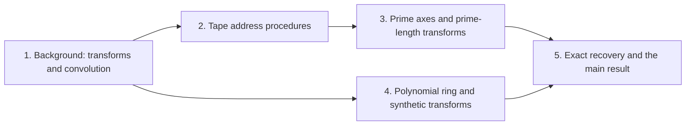

# Integer multiplication below n log n

This wiki explains how a deterministic multitape Turing machine multiplies two $n$-bit integers in $O(n(\lg n)^{1-\kappa})$ worst-case time, for a fixed $\kappa = 2^{-182} > 0$. The result matters because the Schönhage–Strassen conjecture, discussed on [its page](nlogn-conjecture.md "The conjecture of Schönhage and Strassen that n log n is the optimal order of growth of the time to multiply two n-bit integers on a multitape Turing machine."), holds that $n\log n$ is the optimal growth for multiplication in this model. The bound beats that conjecture, so it is a counterexample to it.

The route has five parts. The first reduces integer multiplication to a carried cyclic convolution of radix-$2^b$ digits, using [the Fourier transform](fourier-transform.md "The map sending a length-n sequence to its values at the n-th roots of unity, i.e. the sums of the sequence weighted by powers of a root of unity."), [cyclic convolution](cyclic-convolution.md "The product of two sequences in which indices are taken modulo a fixed length, so each coefficient of the result is a sum of products over residues.") and [convolution reduction](convolution-reduction.md "Writing each integer in radix 2^b digits so that the integer product becomes a convolution of the digit sequences, which is then carried back to binary."), with the $O(n\log n)$ [multiplier](harvey-hoeven-multiplier.md "The unconditional O(n log n) multiplication algorithm on a multitape Turing machine, used in this result as an ordinary subroutine.") as a subroutine. The second builds the tape procedures that move data, namely [linear network exchange](linear-network-exchange.md "A fixed linear network that exchanges banks of values with prescribed signs and restores every auxiliary value, with each gate acting on the stored array through a frame operator that cancels between edges."), [address interchange](address-interchange.md "A tape procedure that swaps two disjoint contiguous address fields of an array in time O(V u^τ) for width u, computed through XOR combinations of intermediate data.") and [simultaneous butterfly layers](simultaneous-butterfly-layer.md "A butterfly operation applied at once on one selected address bit of every record, with exact Gaussian dyadic intermediates and a single truncation after the layer."), whose cost is a power of their parameter below one; [recursive power saving](recursive-power-saving.md "The mechanism in which a network with s smaller calls on W roles and parameter m gives a recursion with cost ratio s/W < m, so that repeated recursion saves a power of the parameter.") turns that into the exponent. The third places the digits on distinct prime cyclic axes with the [Chinese-remainder address map](chinese-remainder-address-map.md "A rearrangement that places a digit sequence on a product of distinct prime cyclic axes while preserving convolution, implemented with address interchanges.") and rewrites prime-length transforms through [Gaussian resampling](gaussian-resampling.md "An identity that expresses a Fourier transform of length given by a prime as a multidimensional transform with power-of-two axis lengths, with the source and target permutations kept in the identity.") and [Bluestein's chirp identity](bluestein-chirp.md "The identity that converts a Fourier transform into a cyclic convolution by multiplying by chirp factors before and after it."). The fourth lifts the last cyclic coordinate into the [polynomial ring modulo $y^r+1$](polynomial-ring-y.md "The ring of complex polynomials in y reduced modulo y^r + 1, where multiplying by a power of y is a signed cyclic shift of the coefficient list."), where wrap-around is a signed shift, and computes transforms there with the [synthetic polynomial transform](synthetic-transform.md "A transform over a polynomial ring in which the roots of unity are powers of y, so that each transform stage uses only signed shifts and butterfly additions.") and [signed Kronecker packing](kronecker-packing.md "Encoding a polynomial with bounded signed coefficients as an integer by evaluating it at a large power of two, so that polynomial products become integer products."). The fifth recovers the exact product by [rounding](rounding-recovery.md "The step in which the approximate convolution coefficients are rounded to integers, provided the error is strictly below 1/2, and carries are then propagated to give the exact binary product.") the approximate coefficients, whose error is below $1/2$, and then propagating carries.

!!! tip "How to read this wiki"

    Written for a reader who knows: Undergraduate computer science: big-O notation, polynomials, complex numbers, basic Turing machines and tapes. The 20 pages, in 5 parts, lead to [Integer multiplication in O(n(lg n)^(1-κ)) time](integer-multiplication-target.md "A deterministic multitape Turing machine that multiplies two n-bit integers exactly in O(n(lg n)^(1-κ)) worst-case time for a fixed κ = 2^(-182) > 0, beating the n log n conjecture in this model."). Read them in order with the links at the bottom of each page, or start anywhere: each page opens with what it builds on. Hover over a link to see a one-line definition. For reference, the [glossary](glossary.md) defines minor terms and the [notation](notation.md) page lists the symbols.

## The argument

**Main result:** Two $n$-bit integers can be multiplied exactly in $O(n(\lg n)^{1-\kappa})$ worst-case time on a deterministic multitape Turing machine, for a fixed $\kappa=2^{-182}$.

**How:** reduce the product to a digit convolution, compute that convolution through transform layers whose tape cost saves a power, and recover the exact product by rounding **Why:** Each transform level scans $\Theta(n)$ bits, so only savings in both movement and arithmetic beat $n\log n$.

1. The integer product is the carried convolution of the radix-$2^b$ digit sequences of the two inputs. — how: write each input in radix digits, convolve the digit sequences, and carry the result back to binary ([Multiplication as convolution of digits](convolution-reduction.md "Writing each integer in radix 2^b digits so that the integer product becomes a convolution of the digit sequences, which is then carried back to binary."))
2. Both tape procedures cost $O(V)$ times a power of their parameter whose exponent is strictly below one. — how: give each procedure a fixed linear network with fewer smaller calls than roles, and iterate the resulting recursion ([Recursive power saving](recursive-power-saving.md "The mechanism in which a network with s smaller calls on W roles and parameter m gives a recursion with cost ratio s/W < m, so that repeated recursion saves a power of the parameter."))
3. The radix-digit coefficient list is placed on a product of distinct prime cyclic axes, preserving convolution. — how: apply a Chinese-remainder split of the cyclic index, realized by controlled cyclic shifts and address interchanges ([Chinese-remainder address map](chinese-remainder-address-map.md "A rearrangement that places a digit sequence on a product of distinct prime cyclic axes while preserving convolution, implemented with address interchanges."))
4. A Fourier transform of prime length is a multidimensional transform whose axis lengths are powers of two. — how: apply Gaussian resampling and keep the source and target permutations inside the transform identity ([Gaussian resampling](gaussian-resampling.md "An identity that expresses a Fourier transform of length given by a prime as a multidimensional transform with power-of-two axis lengths, with the source and target permutations kept in the identity."))
5. The middle transform, with its target permutation, becomes normalized cyclic convolution. — how: Bluestein's chirp identity with chirp factors before and after the transform ([Bluestein's chirp identity](bluestein-chirp.md "The identity that converts a Fourier transform into a cyclic convolution by multiplying by chirp factors before and after it."))
6. The last cyclic coordinate becomes a polynomial modulo $y^r+1$, so that its wrap is a signed shift. — how: apply a phase twist to the last cyclic coordinate ([Polynomial ring modulo yʳ + 1](polynomial-ring-y.md "The ring of complex polynomials in y reduced modulo y^r + 1, where multiplying by a power of y is a signed cyclic shift of the coefficient list."))
7. The two forward synthetic transforms keep the same frequency order through their pointwise product, and the opposite transform consumes that order. — how: run synthetic transforms whose roots of unity are powers of $y$ and whose layers use signed shifts and butterflies ([Synthetic polynomial transform](synthetic-transform.md "A transform over a polynomial ring in which the roots of unity are powers of y, so that each transform stage uses only signed shifts and butterfly additions."))
8. Polynomial products over the ring are computed by signed packing and the $O(n\log n)$ multiplier. — how: signed Kronecker packing of the coefficients, followed by the established multiplier as a subroutine ([Signed Kronecker packing](kronecker-packing.md "Encoding a polynomial with bounded signed coefficients as an integer by evaluating it at a large power of two, so that polynomial products become integer products."))
9. The exact product is recovered: the source permutation cancels, and the coefficient error is below $1/2$, so rounding and carries give the binary product. — how: cancel the retained source permutation, then round the approximate coefficients and propagate carries ([Exact recovery by rounding](rounding-recovery.md "The step in which the approximate convolution coefficients are rounded to integers, provided the error is strictly below 1/2, and carries are then propagated to give the exact binary product."))

## Contents

### 1. [Background: transforms and convolution](background-transforms-and-convolution/index.md)

The reader needs the conjecture that the target beats, the $O(n\log n)$ multiplier used as a black box, and the transform vocabulary. [The discrete Fourier transform](fourier-transform.md "The map sending a length-n sequence to its values at the n-th roots of unity, i.e. the sums of the sequence weighted by powers of a root of unity.") and [the butterfly operation](butterfly-operation.md "The two-point map (u, v) ↦ ((u + v)/2, (u − v)/2) applied to a pair of values, the basic step of a fast transform.") give the basic fast-transform step, and [cyclic convolution](cyclic-convolution.md "The product of two sequences in which indices are taken modulo a fixed length, so each coefficient of the result is a sum of products over residues.") is the operation the whole argument reduces to. [Multiplication as convolution of digits](convolution-reduction.md "Writing each integer in radix 2^b digits so that the integer product becomes a convolution of the digit sequences, which is then carried back to binary.") shows that the integer product is a carried convolution, which is the first main step.

[Schönhage–Strassen n log n conjecture](nlogn-conjecture.md "The conjecture of Schönhage and Strassen that n log n is the optimal order of growth of the time to multiply two n-bit integers on a multitape Turing machine.") · [Harvey–van der Hoeven O(n log n) multiplication](harvey-hoeven-multiplier.md "The unconditional O(n log n) multiplication algorithm on a multitape Turing machine, used in this result as an ordinary subroutine.") · [Discrete Fourier transform](fourier-transform.md "The map sending a length-n sequence to its values at the n-th roots of unity, i.e. the sums of the sequence weighted by powers of a root of unity.") · [Butterfly operation](butterfly-operation.md "The two-point map (u, v) ↦ ((u + v)/2, (u − v)/2) applied to a pair of values, the basic step of a fast transform.") · [Cyclic convolution](cyclic-convolution.md "The product of two sequences in which indices are taken modulo a fixed length, so each coefficient of the result is a sum of products over residues.") · [Multiplication as convolution of digits](convolution-reduction.md "Writing each integer in radix 2^b digits so that the integer product becomes a convolution of the digit sequences, which is then carried back to binary.")

### 2. [Tape address procedures](tape-address-procedures/index.md)

These procedures move data on a multitape machine at cost $O(V)$ times a power of their parameter, and they are the only source of the saving in running time. [Linear network exchange](linear-network-exchange.md "A fixed linear network that exchanges banks of values with prescribed signs and restores every auxiliary value, with each gate acting on the stored array through a frame operator that cancels between edges.") and [lower-triangular factorization](lower-triangular-factorization.md "The factorization A = E₁ΠE₂ of a rational matrix into invertible lower-triangular factors and a partial permutation matrix with one 1 per pivot.") supply the linear-algebra core, and [address shear](address-shear.md "The permutation (H, D) ↦ (H + AD, D) on two ordered groups of address fields, which is performed with as many pairwise interchanges as the rank of A.") turns it into an exchange of address fields. [Address interchange](address-interchange.md "A tape procedure that swaps two disjoint contiguous address fields of an array in time O(V u^τ) for width u, computed through XOR combinations of intermediate data.") and [simultaneous butterfly layers](simultaneous-butterfly-layer.md "A butterfly operation applied at once on one selected address bit of every record, with exact Gaussian dyadic intermediates and a single truncation after the layer.") use these to swap fields and apply butterflies to all records at once, and [recursive power saving](recursive-power-saving.md "The mechanism in which a network with s smaller calls on W roles and parameter m gives a recursion with cost ratio s/W < m, so that repeated recursion saves a power of the parameter.") combines them into the recursion that gives an exponent below one.

[Linear network with restored auxiliary values](linear-network-exchange.md "A fixed linear network that exchanges banks of values with prescribed signs and restores every auxiliary value, with each gate acting on the stored array through a frame operator that cancels between edges.") · [Lower-triangular factorization](lower-triangular-factorization.md "The factorization A = E₁ΠE₂ of a rational matrix into invertible lower-triangular factors and a partial permutation matrix with one 1 per pivot.") · [Address shear](address-shear.md "The permutation (H, D) ↦ (H + AD, D) on two ordered groups of address fields, which is performed with as many pairwise interchanges as the rank of A.") · [Fast address interchange](address-interchange.md "A tape procedure that swaps two disjoint contiguous address fields of an array in time O(V u^τ) for width u, computed through XOR combinations of intermediate data.") · [Simultaneous butterfly layer](simultaneous-butterfly-layer.md "A butterfly operation applied at once on one selected address bit of every record, with exact Gaussian dyadic intermediates and a single truncation after the layer.") · [Recursive power saving](recursive-power-saving.md "The mechanism in which a network with s smaller calls on W roles and parameter m gives a recursion with cost ratio s/W < m, so that repeated recursion saves a power of the parameter.")

### 3. [Prime axes and prime-length transforms](prime-axes-and-prime-length-transforms/index.md)

The digit sequence must be placed where a cyclic convolution can be computed with transforms of convenient length. The [Chinese-remainder address map](chinese-remainder-address-map.md "A rearrangement that places a digit sequence on a product of distinct prime cyclic axes while preserving convolution, implemented with address interchanges.") places it on distinct prime cyclic axes using address interchanges. [Gaussian resampling](gaussian-resampling.md "An identity that expresses a Fourier transform of length given by a prime as a multidimensional transform with power-of-two axis lengths, with the source and target permutations kept in the identity.") then rewrites a prime-length transform as a multidimensional transform with power-of-two axes, and [Bluestein's chirp identity](bluestein-chirp.md "The identity that converts a Fourier transform into a cyclic convolution by multiplying by chirp factors before and after it.") turns the middle transform into a normalized cyclic convolution.

[Chinese-remainder address map](chinese-remainder-address-map.md "A rearrangement that places a digit sequence on a product of distinct prime cyclic axes while preserving convolution, implemented with address interchanges.") · [Gaussian resampling](gaussian-resampling.md "An identity that expresses a Fourier transform of length given by a prime as a multidimensional transform with power-of-two axis lengths, with the source and target permutations kept in the identity.") · [Bluestein's chirp identity](bluestein-chirp.md "The identity that converts a Fourier transform into a cyclic convolution by multiplying by chirp factors before and after it.")

### 4. [Polynomial ring and synthetic transforms](polynomial-ring-and-synthetic-transforms/index.md)

The last cyclic coordinate is lifted into a polynomial ring in which multiplying by a power of $y$ is a signed shift, so wrap-around costs no multiplication. The [polynomial ring modulo $y^r+1$](polynomial-ring-y.md "The ring of complex polynomials in y reduced modulo y^r + 1, where multiplying by a power of y is a signed cyclic shift of the coefficient list.") provides this ring, and the [synthetic transform](synthetic-transform.md "A transform over a polynomial ring in which the roots of unity are powers of y, so that each transform stage uses only signed shifts and butterfly additions.") over it uses only signed shifts and butterfly additions. [Signed Kronecker packing](kronecker-packing.md "Encoding a polynomial with bounded signed coefficients as an integer by evaluating it at a large power of two, so that polynomial products become integer products.") then turns products over the ring into integer products that the $O(n\log n)$ multiplier can compute.

[Polynomial ring modulo yʳ + 1](polynomial-ring-y.md "The ring of complex polynomials in y reduced modulo y^r + 1, where multiplying by a power of y is a signed cyclic shift of the coefficient list.") · [Synthetic polynomial transform](synthetic-transform.md "A transform over a polynomial ring in which the roots of unity are powers of y, so that each transform stage uses only signed shifts and butterfly additions.") · [Signed Kronecker packing](kronecker-packing.md "Encoding a polynomial with bounded signed coefficients as an integer by evaluating it at a large power of two, so that polynomial products become integer products.")

### 5. [Exact recovery and the main result](exact-recovery-and-the-main-result/index.md)

This part closes the argument. [Rounding recovery](rounding-recovery.md "The step in which the approximate convolution coefficients are rounded to integers, provided the error is strictly below 1/2, and carries are then propagated to give the exact binary product.") shows that the coefficient error is below $1/2$, so rounding and carries give the exact binary product. [The target page](integer-multiplication-target.md "A deterministic multitape Turing machine that multiplies two n-bit integers exactly in O(n(lg n)^(1-κ)) worst-case time for a fixed κ = 2^(-182) > 0, beating the n log n conjecture in this model.") then assembles the earlier pages into the $O(n(\lg n)^{1-\kappa})$ bound and states the result in full.

[Exact recovery by rounding](rounding-recovery.md "The step in which the approximate convolution coefficients are rounded to integers, provided the error is strictly below 1/2, and carries are then propagated to give the exact binary product.") · [Integer multiplication in O(n(lg n)^(1-κ)) time](integer-multiplication-target.md "A deterministic multitape Turing machine that multiplies two n-bit integers exactly in O(n(lg n)^(1-κ)) worst-case time for a fixed κ = 2^(-182) > 0, beating the n log n conjecture in this model.")

### [Glossary](glossary.md)

[Primitive roots of unity](glossary.md#roots-of-unity "A complex number ω is a primitive n-th root of unity when ω^n = 1 and no smaller positive power equals 1.") · [Matrix rank](glossary.md#matrix-rank "The rank of a matrix is the maximum number of linearly independent rows or columns; the number of nonzero pivots in elimination.") · [Tensor product](glossary.md#tensor-product "The tensor product V ⊗ W of two vector spaces, whose basis consists of all pairs of basis vectors of V and W, together with the tensor product A ⊗ B of linear maps, which acts on each coordinate separately.")

### [Notation](notation.md)

The symbols used across the pages, with where each is introduced.

## Map of the parts

## Assumed known

- Big-O notation — Notation O(g) for the set of functions bounded above by a constant multiple of g for all sufficiently large inputs.
- Multitape Turing machine — A Turing machine with a fixed finite alphabet and a fixed finite number of one-dimensional tapes, each with its own head that moves at most one cell per step.
- Complex numbers — Numbers a + bi with a, b real and i² = −1, used for the roots of unity and the coefficients of the transforms.
- Polynomials — Expressions a₀ + a₁y + … + a_k y^k over a coefficient ring, with the usual addition and multiplication.
- Vector spaces, subspaces, bases and dimension — A vector space is a set closed under addition and scalar multiplication; a basis is a linearly independent spanning set, and the dimension is the number of vectors in any basis.
- Linear maps, matrix operations and invertibility — A linear map sends sums to sums and scalar multiples to scalar multiples and is represented by a matrix; a square matrix is invertible when it has a two-sided inverse, and the kernel is the set of vectors sent to zero.

## Sources

- [Integer multiplication below n log n (OpenAI, 2026)](https://github.com/openai/math/tree/fd4aeeb2ee4fc729c18d98444fed42fd0529eeeb/preprints/Integer-multiplication-below-n-log-n-September-23-2026)
