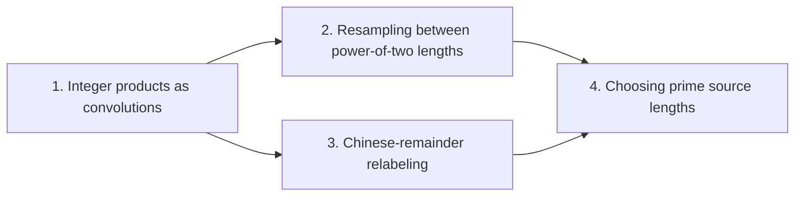

# Integer multiplication below n log n

This wiki explains how to compute a cyclic convolution of arbitrary length with Fourier transforms whose axis lengths are all powers of two. The target result is the choice of prime source lengths: for padded axis lengths $t_1,\dots,t_d$, each a power of two, pick distinct odd primes $s_i$ just below each $t_i$ so that $S=\prod_i s_i$ and $T=\prod_i t_i$ satisfy $T/2<S<T$. The source length then fills a fixed fraction of the padded box, so the padding is at most a factor of two.

The route has four parts. The first, [Exact integer multiplication](exact-integer-multiplication.md "Given binary strings x and y of length n, output the 2n-bit binary representation of their product.") and [Radix-digit convolution](radix-digit-convolution.md "Writing both integers as polynomials in a power of two whose coefficients are their digits, so that their product is a polynomial convolution of short coefficients."), recasts an integer product as a polynomial convolution of short digit coefficients. The second part introduces [Gaussian resampling](gaussian-resampling.md "A technique that replaces a Fourier transform of arbitrary length by transforms whose axis lengths are powers of two, using Gaussian weights to move between the two sets of frequencies."), which handles a transform of length $S$ through transforms of power-of-two lengths by moving between two sets of frequencies with Gaussian weights. The third part presents the [Chinese-remainder map](chinese-remainder-map.md "A relabeling of coefficient positions by mixed-radix digits for pairwise coprime lengths, which turns one cyclic convolution into a multidimensional cyclic convolution."), which relabels coefficient positions by mixed-radix digits so that one cyclic convolution over pairwise coprime lengths becomes a multidimensional cyclic convolution. The final part, [Prime source lengths](prime-source-lengths.md "Distinct odd primes chosen close to the powers of two that are the padded axis lengths, so that their product fills a fixed fraction of the padded box."), selects the $s_i$ in windows $(1-2\eta)t_i<s_i\le(1-\eta)t_i$ with $\eta=1/(4d)$. Prime counting guarantees that each window holds more than $d$ primes, disjoint windows for $x$ and $2x$ keep the choices apart, and a Bernoulli bound turns the per-axis ratios into $T/2<S<T$.

!!! tip "How to read this wiki"

    Written for a reader who knows: Undergraduate computer science: big-O notation, polynomials, complex numbers, basic Turing machines and tapes. The 5 pages, in 4 parts, lead to [Prime source lengths](prime-source-lengths.md "Distinct odd primes chosen close to the powers of two that are the padded axis lengths, so that their product fills a fixed fraction of the padded box."). Read them in order with the links at the bottom of each page, or start anywhere: each page opens with what it builds on. Hover over a link to see a one-line definition.

## The argument

**Main result:** Distinct odd primes $s_1,\dots,s_d$ exist with $(1-2\eta)t_i<s_i\le(1-\eta)t_i$ for every axis $i$, and their product $S=\prod_i s_i$ satisfies $T/2<S<T$.

**How:** pick each $s_i$ as a prime in a prime-dense interval just below the padded length $t_i$, then bound the product of the ratios **Why:** Each prime must be close to its power of two so that the product fills a fixed fraction of the padded box, and each ratio must leave room for resampling; a prime in a dense interval below $t_i$ meets both.

1. For $x\in\{r/2,r\}$ the interval $((1-2\eta)x,(1-\eta)x]$ contains more than $d$ primes. — how: apply the prime-interval bound to each interval and compare its prime count with $d$
2. Distinct odd primes $s_i$ with $(1-2\eta)t_i<s_i\le(1-\eta)t_i$ can be chosen, one for each axis $i$, because the two intervals are disjoint and lie above $2$.
3. Each $\gcd(s_i,t_i)$ equals one, since $t_i$ is a power of two.
4. The product $S=\prod_i s_i$ satisfies $T/2<S<T$. — how: multiply the lower bounds on the $s_i$ and bound the result by Bernoulli's inequality, then use $s_i<t_i$ for the upper bound

## Contents

### 1. [Integer products as convolutions](integer-products-as-convolutions/index.md)

[Exact integer multiplication](exact-integer-multiplication.md "Given binary strings x and y of length n, output the 2n-bit binary representation of their product.") fixes the problem: the $2n$-bit product of two $n$-bit strings. [Radix-digit convolution](radix-digit-convolution.md "Writing both integers as polynomials in a power of two whose coefficients are their digits, so that their product is a polynomial convolution of short coefficients.") writes both integers as polynomials in a power of two, so that the product becomes a convolution of short digit coefficients that a transform can compute. Later parts reduce the transform lengths to the source lengths, so the reader needs this reduction first.

[Exact integer multiplication](exact-integer-multiplication.md "Given binary strings x and y of length n, output the 2n-bit binary representation of their product.") · [Radix-digit convolution](radix-digit-convolution.md "Writing both integers as polynomials in a power of two whose coefficients are their digits, so that their product is a polynomial convolution of short coefficients.")

### 2. [Resampling between power-of-two lengths](resampling-between-power-of-two-lengths/index.md)

[Gaussian resampling](gaussian-resampling.md "A technique that replaces a Fourier transform of arbitrary length by transforms whose axis lengths are powers of two, using Gaussian weights to move between the two sets of frequencies.") replaces a Fourier transform of arbitrary length by transforms whose axis lengths are powers of two. It uses Gaussian weights to move between the two sets of frequencies. The prime source lengths are sized so that this resampling has enough separation to work.

[Gaussian resampling](gaussian-resampling.md "A technique that replaces a Fourier transform of arbitrary length by transforms whose axis lengths are powers of two, using Gaussian weights to move between the two sets of frequencies.")

### 3. [Chinese-remainder relabeling](chinese-remainder-relabeling/index.md)

The [Chinese-remainder map](chinese-remainder-map.md "A relabeling of coefficient positions by mixed-radix digits for pairwise coprime lengths, which turns one cyclic convolution into a multidimensional cyclic convolution.") relabels coefficient positions by mixed-radix digits when the lengths are pairwise coprime. This turns one cyclic convolution into a multidimensional cyclic convolution over those lengths. The reader needs it because the prime source lengths are pairwise coprime, so the map applies to them.

[Chinese-remainder map](chinese-remainder-map.md "A relabeling of coefficient positions by mixed-radix digits for pairwise coprime lengths, which turns one cyclic convolution into a multidimensional cyclic convolution.")

### 4. [Choosing prime source lengths](choosing-prime-source-lengths/index.md)

This part chooses one odd prime $s_i$ just below each padded length $t_i$, with distinct primes across axes. For $\eta=1/(4d)$, prime counting shows that each window holds more than $d$ primes, and the windows for $x$ and $2x$ are disjoint. A Bernoulli bound then gives $T/2<S<T$ for the product $S=\prod_i s_i$, which is the result the wiki is built to reach.

[Prime source lengths](prime-source-lengths.md "Distinct odd primes chosen close to the powers of two that are the padded axis lengths, so that their product fills a fixed fraction of the padded box.")

## Map of the parts

## Assumed known

- Polynomials — Finite sums of powers of a variable with coefficients, multiplied and reduced in the usual way.
- Turing machines and tapes — A finite-state machine that reads and writes symbols on one or more tapes, each with a movable head.
- Discrete Fourier transform — The map sending a vector of q values to its q values weighted by powers of a q-th root of unity, normalized by 1/q.
- Cyclic convolution — The product of two sequences in which indices wrap around modulo the sequence length.

## Sources

- Integer multiplication below n log n (OpenAI, 2026)
