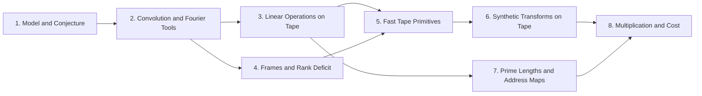

# Integer multiplication below n log n

The target is a deterministic Turing machine, with a fixed alphabet and a fixed number of tapes, that multiplies two $n$-bit integers exactly in $O(n(\lg n)^{1-\kappa})$ time with $\kappa = 2^{-182}$. This disproves the [Schönhage–Strassen optimality conjecture](conjecture.md "The 1971 proposal that n log n is the optimal order of growth for multiplying n-bit integers on a multitape Turing machine.") that $n\log n$ is the best possible in the [fixed-tape model](machine-model.md "The computation model of the main theorem: one fixed finite alphabet and a fixed number of one-dimensional tapes, each head moving at most one cell per step."). The result is stated in [Power-saving integer multiplication](main-result.md "A deterministic fixed-tape Turing machine multiplying two n-bit integers exactly in O(n(lg n)^{1−κ}) time with κ = 2^{−182}, disproving the n log n optimality conjecture in this model.").

The wiki starts with the model and the conjecture, then builds the Fourier tools. [Cyclic convolution](convolution.md "The product of two sequences (or elements of a polynomial quotient ring) where indices wrap around: (f∗g)_k = Σ f_j g_{k−j}.") is turned into pointwise multiplication by the [discrete Fourier transform](dft.md "The normalized transform (F_q u)_k = (1/q) Σ u_j e^{−2πi jk/q}, which turns convolution into pointwise multiplication."), which [butterflies](butterfly.md "A two-point averaging/differencing step H₀(u,v) = ((u+v)/2, (u−v)/2) whose repeated use over address bits, with twiddle multiplications, computes a transform in log t layers.") compute in $\log t$ layers. The [synthetic transform](synthetic-transform.md "A transform over the ring modulo y^r + 1 whose roots of unity are powers of y, so every twiddle multiplication is a signed shift of a coefficient list.") works over the ring modulo $y^r+1$ ([ring-y](ring-y.md "Polynomials of degree below r over the complex numbers with y^r = −1, so multiplying by a power of y is a signed shift of the coefficient list.")), where twiddle factors are signed shifts.

The saving comes from the tape. After the [stream operations](stream-ops.md "Linear-time scans on arrays stored in lexicographic order: swapping two digits, moving a digit, splitting into streams, applying a pointwise map and merging back.") and [controlled shifts](controlled-shifts.md "Updating a target address field by an offset computed from earlier control fields, or multiplying it by a unit, in time linear in the array volume."), the wiki builds [frames on wire arrays](array-frames.md "Replacing each wire scalar by an array and assigning an invertible operator D_v (a frame) at each gate so the pointwise gate commutes with the frame and only the endpoint frames matter.") and [nested subspace labels](subspace-labels.md "Assigning nondegenerate subspaces of an m-dimensional space to gates so adjacent labels are nested; the total dimension change over edges, the number s of smaller calls, is strictly less than W·m."). The [recursive power saving](rank-recurrence.md "Each call at parameter m·f makes s calls at parameter f on streams of 1/W the volume, so cost per unit volume grows by s/W < m per factor m, giving a power saving.") then makes [address-chunk interchange](address-interchange.md "The first tape procedure: exchanging two disjoint equal-width address fields of u digits in time O(V·u^τ) for a fixed τ < 1, using XOR combinations of intermediate data.") and the [simultaneous butterfly layer](simultaneous-layer.md "The second tape procedure: applying H₀ coefficientwise on the same bit of up to d address chunks in time O(V·d^λ′) for a fixed λ′ < 1, instead of d passes.") cost the volume times a power below one of their width. These give the [tape layout for synthetic transforms](transform-layout.md "Placing the selected bits of the participating axes at a common offset in K-bit chunks so each round of the synthetic transform is one simultaneous layer, costing less than log t passes.") and [ring convolution](ring-convolution.md "Convolution over the ring modulo y^r + 1 on the remaining axes by two forward synthetic transforms, pointwise polynomial products and the opposite transform, normalized by 1/(rM).").

Prime-length transforms are reduced to power-of-two ones by [Gaussian resampling](gaussian-resampling.md "Re-expressing a Fourier transform of prime length s through a transform of nearby power-of-two length t using Gaussian weights, so that only power-of-two transforms are needed.") and the [Bluestein chirp](chirp.md "An identity that rewrites a (permuted) Fourier transform as a pointwise chirp phase, a cyclic convolution, and another chirp phase."), and the [Chinese-remainder address map](crt-map.md "An isomorphism that places a cyclic convolution of length S = s₁⋯s_d on pairwise coprime prime axes, implemented as triangular controlled shifts.") places the convolution on prime axes. The [multiplication algorithm](multiplication-algorithm.md "Digits, then the CRT map, two forward transforms with resampling and chirps, a pointwise product, the opposite transform, rescaling, rounding and carry propagation yield the exact 2n-bit product.") chains these steps, [error tracking](precision-recovery.md "Each normalized transform and product is a contraction with a bounded rounding error, and the total error on the recovered convolution coefficients is below 1/2, so rounding gives exact integers.") shows that rounding recovers exact integers, and [cost accounting](cost-accounting.md "Dividing each cost by V = Tp, the dominant terms are powers of p below one with minimum margin 2^{-181} = 2κ, giving total time O(n(lg n)^{1−κ}).") gives the exponent $\kappa$.

!!! tip "How to read this wiki"

    Written for a reader who knows: Undergraduate computer science: big-O notation, polynomials, complex numbers, basic Turing machines and tapes. The 39 pages, in 8 parts, lead to [Power-saving integer multiplication](main-result.md "A deterministic fixed-tape Turing machine multiplying two n-bit integers exactly in O(n(lg n)^{1−κ}) time with κ = 2^{−182}, disproving the n log n optimality conjecture in this model."). Read them in order with the links at the bottom of each page, or start anywhere: each page opens with what it builds on. Hover over a link to see a one-line definition. For reference, the [notation](notation.md) page lists the symbols.

## The argument

**Main result:** A single deterministic Turing machine with a fixed finite alphabet and a fixed finite number of one-dimensional tapes multiplies two $n$-bit integers exactly in $O(n(\lg n)^{1-\kappa})$ worst-case time with $\kappa=2^{-182}$, disproving the $n\log n$ optimality conjecture of Sch\"onhage and Strassen in this model.

**How:** Build two power-saving tape procedures (chunk interchange and simultaneous butterfly layer) from fixed finite linear networks; use them to accelerate the synthetic polynomial transforms and ring convolution; use Gaussian resampling with retained permutations and chirps to reduce the prime-length cyclic convolution of the radix-digit coefficients to those power-of-two transforms; assemble the exact product with a proof that the error is below $1/2$; and total the cost to show a power of $\log n$ is saved. **Why:** Scanning an array of $\Theta(n)$ stored bits at each of $\Theta(\log n)$ transform levels already costs $\Theta(n\log n)$, so the logarithmic factor can only be beaten by cheaper address movement and cheaper butterfly arithmetic.

1. Both tape primitives (the interchange of two address chunks of $u$ digits and the simultaneous butterfly layer on up to $d$ axes) cost the volume times a power below one of their width, because a call at parameter $mf$ makes $s$ calls at parameter $f$ on streams of volume $V/W$ with $s<Wm$, so the cost per unit volume grows by $s/W<m$ per factor $m$ of the parameter. — how: Build a fixed finite linear network of $W$ wires that exchanges two banks and restores all scratch values, make the representation of each wire's array vary along the network through frames so that an edge costs one smaller call per unit of rank, show the total rank $s$ is below $Wm$, fix an exponent, and solve the recurrence in the bit variant (interchange) and the complex variant (butterfly layer). ([Recursive power saving](rank-recurrence.md "Each call at parameter m·f makes s calls at parameter f on streams of 1/W the volume, so cost per unit volume grows by s/W < m per factor m, giving a power saving."))
2. Synthetic transforms over $\mathcal R_r$ on $d-1$ axes of lengths $t_i\in\{2^{\ell-1},2^\ell\}$ with outputs kept in a retained layout $LB$ cost $O(Tp[dK+pK^{\tau-1}+\ell d^{\lambda'}])$ with error less than $\sqrt2\ell\,2^{-p}$. — how: Use the radix-two synthetic (Nussbaumer) transform, whose twiddles are signed shifts, and lay out the selected bits of all participating axes at a common offset in $K$-bit chunks so that every round is one simultaneous butterfly layer, with fewer than $\log t$ passes. ([Tape layout for synthetic transforms](transform-layout.md "Placing the selected bits of the participating axes at a common offset in K-bit chunks so each round of the synthetic transform is one simultaneous layer, costing less than log t passes."))
3. Normalized cyclic convolution over the polynomial ring $\mathbb C[y]/(y^r+1)$ on the remaining $d-1$ axes is computed from two forward synthetic transforms in retained order, $M$ pointwise polynomial products and the opposite transform, in $O(Tp[dK+pK^{\tau-1}+\ell d^{\lambda'}+\log(rp)])$ time with error less than $\sqrt2\,M(3\ell+1)2^{-p}$. — how: Convolve by transform, pointwise product, inverse transform, using the established $O(N\log N)$ multiplier as an ordinary subroutine for the polynomial products via signed Kronecker substitution, and keep the transforms' frequency order between the forward and opposite passes. ([Convolution from the retained transform layout](ring-convolution.md "Convolution over the ring modulo y^r + 1 on the remaining axes by two forward synthetic transforms, pointwise polynomial products and the opposite transform, normalized by 1/(rM)."))
4. The Fourier transforms of pairwise coprime prime lengths $s_i$ that the integer product needs are computed through power-of-two lengths $t_i$ by Gaussian resampling and Bluestein chirps, with the source and target coordinate permutations left inside the transform identities, so that none is executed as a sort. — how: Retain both permutations of Gaussian resampling in the transform formula: the target permutation $Q$ is absorbed by the chirp convolution, and the source permutation $R$ cancels across the two forward transforms, their pointwise product and the opposite transform. ([Retained permutation cancellation](retained-permutations.md "Leaving the coordinate permutations of resampling inside the transform identity, so the source permutation cancels across the two forward transforms and the opposite one and none is executed as a sort."))
5. The exact $2n$-bit product of the two inputs is obtained from the radix-digit convolution by the chain: radix digits, Chinese-remainder address map to a product of prime cyclic axes, two forward source transforms (resampling and chirps), pointwise product, opposite transform, rescaling, rounding, and carry propagation, with total error below $1/2$. — how: Reduce the integer product to a cyclic convolution of $S$ short coefficients and compute it through the chain of reductions (digits, CRT address map, Gaussian resampling with chirps, twist to the polynomial ring, synthetic-transform convolution); recover exact integers because the accumulated error is below $1/2$. ([The multiplication algorithm](multiplication-algorithm.md "Digits, then the CRT map, two forward transforms with resampling and chirps, a pointwise product, the opposite transform, rescaling, rounding and carry propagation yield the exact 2n-bit product."))
6. The total time of the machine is $O(n(\lg n)^{1-\kappa})$ with $\kappa=2^{-182}$: after dividing each cost by $V=Tp=\Theta(n)$ the dominant terms are powers of $p$ below one, with minimum margin $2^{-181}=2\kappa$. — how: Divide each cost by the volume, list the dominant terms with their powers of $p$, compute their margins below one from the fixed rational parameters, justify each row from the lemmas, show setup is negligible, and add. ([Cost accounting and the exponent κ](cost-accounting.md "Dividing each cost by V = Tp, the dominant terms are powers of p below one with minimum margin 2^{-181} = 2κ, giving total time O(n(lg n)^{1−κ})."))

## Contents

### 1. [Model and Conjecture](model-and-conjecture/index.md)

This part fixes the computation model of the main theorem, a Turing machine with a fixed alphabet and a fixed number of tapes whose heads move one cell per step. It then states the [Schönhage–Strassen optimality conjecture](conjecture.md "The 1971 proposal that n log n is the optimal order of growth for multiplying n-bit integers on a multitape Turing machine.") that the result disproves. Every cost bound later in the wiki is a statement about this model.

[Fixed finite-tape machine model](machine-model.md "The computation model of the main theorem: one fixed finite alphabet and a fixed number of one-dimensional tapes, each head moving at most one cell per step.") · [Schönhage–Strassen optimality conjecture](conjecture.md "The 1971 proposal that n log n is the optimal order of growth for multiplying n-bit integers on a multitape Turing machine.")

### 2. [Convolution and Fourier Tools](convolution-and-fourier-tools/index.md)

Multiplying integers reduces to [cyclic convolution](convolution.md "The product of two sequences (or elements of a polynomial quotient ring) where indices wrap around: (f∗g)_k = Σ f_j g_{k−j}."), and the [discrete Fourier transform](dft.md "The normalized transform (F_q u)_k = (1/q) Σ u_j e^{−2πi jk/q}, which turns convolution into pointwise multiplication.") turns convolution into a pointwise product. This part covers [butterflies](butterfly.md "A two-point averaging/differencing step H₀(u,v) = ((u+v)/2, (u−v)/2) whose repeated use over address bits, with twiddle multiplications, computes a transform in log t layers."), [multidimensional transforms](multidim-transform.md "A transform over several axes at once, the tensor product of one-dimensional transforms, applied to an array one axis at a time."), the [ring modulo $y^r+1$](ring-y.md "Polynomials of degree below r over the complex numbers with y^r = −1, so multiplying by a power of y is a signed shift of the coefficient list.") with its [synthetic transform](synthetic-transform.md "A transform over the ring modulo y^r + 1 whose roots of unity are powers of y, so every twiddle multiplication is a signed shift of a coefficient list."), [contractions](contraction-maps.md "A linear map that never increases the norm of a vector, and a bilinear map whose output norm is at most the product of the input norms, so errors in the inputs do not grow beyond a controlled bound.") for bounding error, and [fixed-point records](fixed-point.md "Complex values stored as signed two's-complement integers over a power-of-two denominator 2^{-p}; intermediate values are exact and one truncation Q_p rounds back to the p-bit grid.") for storing complex values. The later tape and error arguments assume all of these.

[Polynomial ring modulo y^r + 1](ring-y.md "Polynomials of degree below r over the complex numbers with y^r = −1, so multiplying by a power of y is a signed shift of the coefficient list.") · [Fixed-point Gaussian dyadic records](fixed-point.md "Complex values stored as signed two's-complement integers over a power-of-two denominator 2^{-p}; intermediate values are exact and one truncation Q_p rounds back to the p-bit grid.") · [Cyclic convolution](convolution.md "The product of two sequences (or elements of a polynomial quotient ring) where indices wrap around: (f∗g)_k = Σ f_j g_{k−j}.") · [Discrete Fourier transform](dft.md "The normalized transform (F_q u)_k = (1/q) Σ u_j e^{−2πi jk/q}, which turns convolution into pointwise multiplication.") · [Butterflies and the fast transform](butterfly.md "A two-point averaging/differencing step H₀(u,v) = ((u+v)/2, (u−v)/2) whose repeated use over address bits, with twiddle multiplications, computes a transform in log t layers.") · [Synthetic polynomial transform](synthetic-transform.md "A transform over the ring modulo y^r + 1 whose roots of unity are powers of y, so every twiddle multiplication is a signed shift of a coefficient list.") · [Contractions and bilinear contractions](contraction-maps.md "A linear map that never increases the norm of a vector, and a bilinear map whose output norm is at most the product of the input norms, so errors in the inputs do not grow beyond a controlled bound.") · [Multidimensional transforms](multidim-transform.md "A transform over several axes at once, the tensor product of one-dimensional transforms, applied to an array one axis at a time.")

### 3. [Linear Operations on Tape](linear-operations-on-tape/index.md)

This part shows what a machine with a few tapes can do in time linear in the array volume. [Stream operations](stream-ops.md "Linear-time scans on arrays stored in lexicographic order: swapping two digits, moving a digit, splitting into streams, applying a pointwise map and merging back.") give scans, splits and merges, [controlled shifts](controlled-shifts.md "Updating a target address field by an offset computed from earlier control fields, or multiplying it by a unit, in time linear in the array volume.") update an address field by a computed offset, and the [matrix shear](matrix-shear.md "Factoring a rational matrix as A = E₁ΠE₂ with lower triangular E₁, E₂ and partial permutation Π lets the shear (H,D)→(H+AD,D) be done with exactly rank(A) field interchanges.") uses a triangular factorization to do a shear with few field interchanges. The tape procedures in the next parts are assembled from these.

[Elementary stream operations](stream-ops.md "Linear-time scans on arrays stored in lexicographic order: swapping two digits, moving a digit, splitting into streams, applying a pointwise map and merging back.") · [Controlled shifts and rational scalings](controlled-shifts.md "Updating a target address field by an offset computed from earlier control fields, or multiplying it by a unit, in time linear in the array volume.") · [Matrix shear by triangular factorization](matrix-shear.md "Factoring a rational matrix as A = E₁ΠE₂ with lower triangular E₁, E₂ and partial permutation Π lets the shear (H,D)→(H+AD,D) be done with exactly rank(A) field interchanges.")

### 4. [Frames and Rank Deficit](frames-and-rank-deficit/index.md)

This part develops the abstract source of the power saving. A [linear exchange network](exchange-network.md "A fixed network of linear gates on wires holding values that swaps two banks with a prescribed sign while undoing the effect of arbitrary initial scratch values, built from three-element subsets.") with restored scratch wires, [frames on wire arrays](array-frames.md "Replacing each wire scalar by an array and assigning an invertible operator D_v (a frame) at each gate so the pointwise gate commutes with the frame and only the endpoint frames matter."), [tensor products of subspaces](tensor-product-of-spaces.md "The space built from two spaces whose dimension is the product of their dimensions, in which operators and bilinear forms act factorwise.") and [nested subspace labels](subspace-labels.md "Assigning nondegenerate subspaces of an m-dimensional space to gates so adjacent labels are nested; the total dimension change over edges, the number s of smaller calls, is strictly less than W·m.") show that a call at parameter $mf$ needs only $s<Wm$ smaller calls. The [recursive power saving](rank-recurrence.md "Each call at parameter m·f makes s calls at parameter f on streams of 1/W the volume, so cost per unit volume grows by s/W < m per factor m, giving a power saving.") turns that count into a cost bound.

[Linear exchange network with restored scratch wires](exchange-network.md "A fixed network of linear gates on wires holding values that swaps two banks with a prescribed sign while undoing the effect of arbitrary initial scratch values, built from three-element subsets.") · [Frames on wire arrays](array-frames.md "Replacing each wire scalar by an array and assigning an invertible operator D_v (a frame) at each gate so the pointwise gate commutes with the frame and only the endpoint frames matter.") · [Tensor products of subspaces](tensor-product-of-spaces.md "The space built from two spaces whose dimension is the product of their dimensions, in which operators and bilinear forms act factorwise.") · [Nested subspace labels and rank deficit](subspace-labels.md "Assigning nondegenerate subspaces of an m-dimensional space to gates so adjacent labels are nested; the total dimension change over edges, the number s of smaller calls, is strictly less than W·m.") · [Recursive power saving](rank-recurrence.md "Each call at parameter m·f makes s calls at parameter f on streams of 1/W the volume, so cost per unit volume grows by s/W < m per factor m, giving a power saving.")

### 5. [Fast Tape Primitives](fast-tape-primitives/index.md)

This part applies the recursion to the two tape procedures the algorithm needs. The [address-chunk interchange](address-interchange.md "The first tape procedure: exchanging two disjoint equal-width address fields of u digits in time O(V·u^τ) for a fixed τ < 1, using XOR combinations of intermediate data.") and [packed selected-bit addition](packed-bit-addition.md "XORing selected bits between two address chunks (with a third chunk as restored scratch) using cyclic shifts of whole chunk ranges plus a repair of explicitly bounded exceptional addresses.") move and combine address fields. The [two-point kernel](phase-kernel.md "The matrix C = aI + bX with a = (1+i)/2, b = (1−i)/2, a square root of the bit flip, linked to the butterfly by H₀ = b·S·C·S with S = diag(1, i).") and [binary phase frames](phase-frames.md "Frames C_U = H^{⊗m} diag(i^{wt(P_U x) mod 4}) H^{⊗m} whose edge differences are products of translation kernels aI + bX_v, one per vector of an orthonormal residual basis.") give the [simultaneous butterfly layer](simultaneous-layer.md "The second tape procedure: applying H₀ coefficientwise on the same bit of up to d address chunks in time O(V·d^λ′) for a fixed λ′ < 1, instead of d passes.") that does several transform layers at once.

[Two-point kernel C](phase-kernel.md "The matrix C = aI + bX with a = (1+i)/2, b = (1−i)/2, a square root of the bit flip, linked to the butterfly by H₀ = b·S·C·S with S = diag(1, i).") · [Fast address-chunk interchange](address-interchange.md "The first tape procedure: exchanging two disjoint equal-width address fields of u digits in time O(V·u^τ) for a fixed τ < 1, using XOR combinations of intermediate data.") · [Binary phase frames](phase-frames.md "Frames C_U = H^{⊗m} diag(i^{wt(P_U x) mod 4}) H^{⊗m} whose edge differences are products of translation kernels aI + bX_v, one per vector of an orthonormal residual basis.") · [Packed selected-bit addition](packed-bit-addition.md "XORing selected bits between two address chunks (with a third chunk as restored scratch) using cyclic shifts of whole chunk ranges plus a repair of explicitly bounded exceptional addresses.") · [Simultaneous butterfly layer](simultaneous-layer.md "The second tape procedure: applying H₀ coefficientwise on the same bit of up to d address chunks in time O(V·d^λ′) for a fixed λ′ < 1, instead of d passes.")

### 6. [Synthetic Transforms on Tape](synthetic-transforms-on-tape/index.md)

This part puts the fast primitives to work on ring convolution. The [retained frequency order](frequency-order.md "The forward synthetic transform writes its outputs in bit-reversed order, the pointwise product keeps that order, and the opposite transform consumes it, so no reordering is executed.") avoids reordering, and the [tape layout](transform-layout.md "Placing the selected bits of the participating axes at a common offset in K-bit chunks so each round of the synthetic transform is one simultaneous layer, costing less than log t passes.") makes each transform round one simultaneous layer. The [established $O(n\log n)$ multiplier](hvdh-multiplier.md "The earlier Harvey–van der Hoeven multitape algorithm multiplying N-bit integers in O(N log N) time, used here only as an ordinary subroutine.") and [signed packing](signed-packing.md "A signed Kronecker substitution that evaluates polynomials with signed coefficients at 2^{4p} to form large integers, multiplies them with the O(n log n) multiplier, and recovers the product coefficients.") handle the pointwise polynomial products, which gives [ring convolution](ring-convolution.md "Convolution over the ring modulo y^r + 1 on the remaining axes by two forward synthetic transforms, pointwise polynomial products and the opposite transform, normalized by 1/(rM).").

[Established O(n log n) multiplier](hvdh-multiplier.md "The earlier Harvey–van der Hoeven multitape algorithm multiplying N-bit integers in O(N log N) time, used here only as an ordinary subroutine.") · [Signed packing](signed-packing.md "A signed Kronecker substitution that evaluates polynomials with signed coefficients at 2^{4p} to form large integers, multiplies them with the O(n log n) multiplier, and recovers the product coefficients.") · [Retained frequency order](frequency-order.md "The forward synthetic transform writes its outputs in bit-reversed order, the pointwise product keeps that order, and the opposite transform consumes it, so no reordering is executed.") · [Tape layout for synthetic transforms](transform-layout.md "Placing the selected bits of the participating axes at a common offset in K-bit chunks so each round of the synthetic transform is one simultaneous layer, costing less than log t passes.") · [Convolution from the retained transform layout](ring-convolution.md "Convolution over the ring modulo y^r + 1 on the remaining axes by two forward synthetic transforms, pointwise polynomial products and the opposite transform, normalized by 1/(rM).")

### 7. [Prime Lengths and Address Maps](prime-lengths-and-address-maps/index.md)

The integer product needs Fourier transforms of pairwise coprime prime lengths, but the fast transform handles powers of two. This part covers the [Bluestein chirp](chirp.md "An identity that rewrites a (permuted) Fourier transform as a pointwise chirp phase, a cyclic convolution, and another chirp phase."), [Gaussian resampling](gaussian-resampling.md "Re-expressing a Fourier transform of prime length s through a transform of nearby power-of-two length t using Gaussian weights, so that only power-of-two transforms are needed.") and [retained permutation cancellation](retained-permutations.md "Leaving the coordinate permutations of resampling inside the transform identity, so the source permutation cancels across the two forward transforms and the opposite one and none is executed as a sort."), which together avoid executing any sort. It also covers the [Chinese-remainder address map](crt-map.md "An isomorphism that places a cyclic convolution of length S = s₁⋯s_d on pairwise coprime prime axes, implemented as triangular controlled shifts.") that places a long convolution on prime axes.

[Bluestein chirp identity](chirp.md "An identity that rewrites a (permuted) Fourier transform as a pointwise chirp phase, a cyclic convolution, and another chirp phase.") · [Chinese-remainder address map](crt-map.md "An isomorphism that places a cyclic convolution of length S = s₁⋯s_d on pairwise coprime prime axes, implemented as triangular controlled shifts.") · [Gaussian resampling](gaussian-resampling.md "Re-expressing a Fourier transform of prime length s through a transform of nearby power-of-two length t using Gaussian weights, so that only power-of-two transforms are needed.") · [Retained permutation cancellation](retained-permutations.md "Leaving the coordinate permutations of resampling inside the transform identity, so the source permutation cancels across the two forward transforms and the opposite one and none is executed as a sort.")

### 8. [Multiplication and Cost](multiplication-and-cost/index.md)

This part assembles the algorithm. [Radix digits](radix-digit-reduction.md "Splitting each integer into radix-2^b digits turns the product into a convolution of short integer coefficients, which carry propagation turns back into a binary number."), the [phase twist](phase-twist.md "Multiplying coefficient k by e^{πik/r}, which converts the cyclic coordinate modulo x^r − 1 into the negacyclic ring modulo y^r + 1 and is removed afterwards."), the [parameter choice](parameter-choice.md "Fixed rational exponents and sizes (precision p = 6b, d axes, K = d^c, T and r powers of two, prime lengths s_i just below t_i) making every hypothesis of the lemmas hold.") and [error tracking](precision-recovery.md "Each normalized transform and product is a contraction with a bounded rounding error, and the total error on the recovered convolution coefficients is below 1/2, so rounding gives exact integers.") feed the [multiplication algorithm](multiplication-algorithm.md "Digits, then the CRT map, two forward transforms with resampling and chirps, a pointwise product, the opposite transform, rescaling, rounding and carry propagation yield the exact 2n-bit product."). [Cost accounting](cost-accounting.md "Dividing each cost by V = Tp, the dominant terms are powers of p below one with minimum margin 2^{-181} = 2κ, giving total time O(n(lg n)^{1−κ}).") then gives the exponent $\kappa$, which yields the [main result](main-result.md "A deterministic fixed-tape Turing machine multiplying two n-bit integers exactly in O(n(lg n)^{1−κ}) time with κ = 2^{−182}, disproving the n log n optimality conjecture in this model.").

[Multiplication as radix-digit convolution](radix-digit-reduction.md "Splitting each integer into radix-2^b digits turns the product into a convolution of short integer coefficients, which carry propagation turns back into a binary number.") · [Phase twist](phase-twist.md "Multiplying coefficient k by e^{πik/r}, which converts the cyclic coordinate modulo x^r − 1 into the negacyclic ring modulo y^r + 1 and is removed afterwards.") · [Error tracking and exact recovery](precision-recovery.md "Each normalized transform and product is a contraction with a bounded rounding error, and the total error on the recovered convolution coefficients is below 1/2, so rounding gives exact integers.") · [Parameter and prime-length choice](parameter-choice.md "Fixed rational exponents and sizes (precision p = 6b, d axes, K = d^c, T and r powers of two, prime lengths s_i just below t_i) making every hypothesis of the lemmas hold.") · [The multiplication algorithm](multiplication-algorithm.md "Digits, then the CRT map, two forward transforms with resampling and chirps, a pointwise product, the opposite transform, rescaling, rounding and carry propagation yield the exact 2n-bit product.") · [Cost accounting and the exponent κ](cost-accounting.md "Dividing each cost by V = Tp, the dominant terms are powers of p below one with minimum margin 2^{-181} = 2κ, giving total time O(n(lg n)^{1−κ}).") · [Power-saving integer multiplication](main-result.md "A deterministic fixed-tape Turing machine multiplying two n-bit integers exactly in O(n(lg n)^{1−κ}) time with κ = 2^{−182}, disproving the n log n optimality conjecture in this model.")

### [Notation](notation.md)

The symbols used across the pages, with where each is introduced.

## Map of the parts

## Assumed known

- Big-O notation — Asymptotic upper bounds on running time such as O(n log n).
- Polynomials — Sums of powers of a variable with coefficients, added and multiplied term by term.
- Complex numbers — Numbers a + bi with i² = −1, with modulus and unit-modulus phases e^{iθ}.
- Turing machines and tapes — Machines with a finite control reading and writing cells on tapes, one step at a time.
- Vector spaces, subspaces, dimension and rank — The core linear algebra notions of vector space, subspace, basis, dimension and the rank of a matrix or linear map.
- Matrices and linear operators — Matrices as linear maps on finite-dimensional spaces, with products, inverses, diagonal, triangular and permutation matrices and the notion of two operators commuting.
- Norms and the triangle inequality — A size function on vectors, such as the maximum absolute coordinate, satisfying the triangle inequality and scaling, used to bound errors.

## Sources

- [Integer multiplication below n log n (OpenAI, 2026)](https://github.com/openai/math/tree/fd4aeeb2ee4fc729c18d98444fed42fd0529eeeb/preprints/Integer-multiplication-below-n-log-n-September-23-2026)
