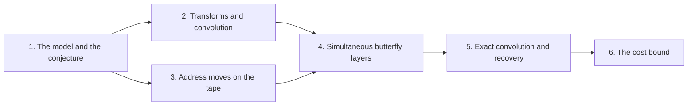

# Integer multiplication below n log n

The target result is a deterministic fixed-tape machine that multiplies two $n$-bit integers exactly in $O(n (\lg n)^{1-\kappa})$ time, with $\kappa = 2^{-182}$. Under the model in [Fixed-tape machine model](fixed-tape-model.md "A Turing machine with one fixed finite alphabet and one fixed finite number of one-dimensional tapes, whose size does not grow with the input."), this beats the $n \log n$ growth proposed in [The n log n optimality conjecture](n-log-n-conjecture.md "The conjecture that n log n is the optimal order of growth of the time needed to multiply two n-bit integers."), so it disproves that conjecture for this model. The wiki builds the result in six parts.

The first part fixes the model and the problem, [Exact integer multiplication](exact-integer-multiplication.md "Given binary strings x and y of length n, output the 2n-bit binary representation of their product."). The second part develops transforms and their algebra: the [Discrete Fourier transform](discrete-fourier-transform.md "The map sending a vector of q values to its q values weighted by powers of a q-th root of unity, normalized by 1/q."), [Bluestein's chirp identity](bluestein-chirp-identity.md "An identity that rewrites a Fourier transform as a cyclic convolution multiplied by chirp factors, so that it can be computed with convolution."), [Synthetic polynomial transforms](synthetic-transforms.md "Fourier-type transforms whose roots of unity are powers of y in a polynomial ring, so that multiplying by a root is a signed shift of coefficients."), and [Radix-digit convolution](radix-digit-convolution.md "Writing both integers as polynomials in a power of two whose coefficients are their digits, so that their product is a polynomial convolution of short coefficients."), which writes integers as polynomials in a power of two. The third part covers how a tape can exchange address fields cheaply, through [Address-field interchange](address-interchange.md "A tape procedure that swaps two disjoint contiguous address fields of an array in time that grows like a power of the field width, rather than linearly.") and [Rank-saving recursion](rank-saving-recursion.md "The recursion in which each call splits into s smaller calls on streams of 1/W of the volume, where s < W m, so that the cost grows by the strictly smaller factor s/W per level."), built on [Linear networks and frames](linear-network-frames.md "A fixed linear network that exchanges two banks of values while restoring scratch values, in which each vertex carries an invertible operator called its frame.") and [Subset-intersection network](subset-intersection-network.md "A linear network on the three-element subsets of a ground set, whose wires carry scalars and whose gates combine them by intersection size, so that it swaps two banks while cancelling arbitrary scratch values."). The fourth part gives the [Simultaneous butterfly layer](simultaneous-butterfly-layer.md "The tensor product of the two-point map H0 applied to several selected address bits at once, computed exactly in one pass rather than one axis at a time.") and its fixed layout in [Transform layout](transform-layout.md "A permutation of address bits that places the selected bits of all participating axes at a common offset in consecutive chunks, so that a simultaneous butterfly layer applies to each transform round."), together with [Packed selected-bit addition](packed-bit-addition.md "An operation that adds one selected bit position across several address chunks at once, using cyclic shifts and a small deterministic correction for exceptional addresses."). The fifth part handles the exact arithmetic: the [Convolution over the polynomial ring](polynomial-ring-convolution.md "The normalized product of two arrays of records in the polynomial ring, computed by two forward synthetic transforms, a pointwise product, and an opposite transform."), [Exact coefficient recovery](recovery-and-error.md "The error analysis showing that the computed convolution coefficients are within a half of their true integer values, so rounding recovers them exactly."), and [Carry propagation](carry-propagation.md "Converting the recovered integer radix-digit coefficients into a binary string by adding each coefficient to a carry from the previous position.") back to binary. The last part states the [Integer multiplication below n log n](main-theorem.md "A deterministic fixed-tape machine that multiplies two n-bit integers exactly in O(n (lg n)^(1−κ)) time with κ = 2^−182, which disproves the n log n optimality conjecture in this model.") theorem and checks that every cost term fits its bound.

!!! tip "How to read this wiki"

    Written for a reader who knows: Undergraduate computer science: big-O notation, polynomials, complex numbers, basic Turing machines and tapes. The 29 pages, in 6 parts, lead to [Integer multiplication below n log n](main-theorem.md "A deterministic fixed-tape machine that multiplies two n-bit integers exactly in O(n (lg n)^(1−κ)) time with κ = 2^−182, which disproves the n log n optimality conjecture in this model."). Read them in order with the links at the bottom of each page, or start anywhere: each page opens with what it builds on. Hover over a link to see a one-line definition. For reference, the [glossary](glossary.md) defines minor terms and the [notation](notation.md) page lists the symbols.

## The argument

**Main result:** A deterministic fixed-tape machine multiplies two $n$-bit integers exactly in $O(n(\lg n)^{1-\kappa})$ time, with $\kappa=2^{-182}$, below the $n\lg n$ conjecture in this model.

**How:** bound the cost of an exact multiplication whose transform layers are made cheap by two tape procedures, then fix parameters so every cost term fits **Why:** Each transform level scans $\Theta(n)$ stored bits, so the transform layers alone cost $\Theta(n\log n)$; the savings must come from both address movement and arithmetic.

1. A simultaneous normalized butterfly layer on $d$ selected chunks of stored volume $V$ costs $O(V d^{\lambda'})$. — how: realize the tensor product of the two-point kernel by an exact complex phase network with dyadic frame changes, then convert it to the normalized $H_0$ layer ([Simultaneous butterfly layer](simultaneous-butterfly-layer.md "The tensor product of the two-point map H0 applied to several selected address bits at once, computed exactly in one pass rather than one axis at a time."))
2. Two disjoint equal address fields of $u$ bits in an array of stored volume $V$ can be interchanged in $O(V u^{\tau})$ time. — how: apply a fixed linear network that exchanges two banks while restoring scratch values, recursively on streams of $1/W$ of the volume, so each level costs a strictly smaller power ([Address-field interchange](address-interchange.md "A tape procedure that swaps two disjoint contiguous address fields of an array in time that grows like a power of the field width, rather than linearly."))
3. The exact product of two $n$-bit integers is obtained from the convolution of their radix-digit coefficients, computed by transforms on a fixed tape layout and then recovered and carried. — how: reduce the convolution by a Chinese-remainder map, Gaussian resampling, Bluestein's identity and a phase twist to a convolution over a polynomial ring, then recover coefficients and propagate carries ([Radix-digit convolution](radix-digit-convolution.md "Writing both integers as polynomials in a power of two whose coefficients are their digits, so that their product is a polynomial convolution of short coefficients."))
4. A compatible choice of rational parameters makes every term of the cost table fit the bound of Theorem 1.
5. The total cost is $O(n(\lg n)^{1-\kappa})$ for every large input, with $\kappa=2^{-182}$.

## Contents

### 1. [The model and the conjecture](the-model-and-the-conjecture/index.md)

This part fixes the machine model and the problem being solved. The reader needs the [Fixed-tape machine model](fixed-tape-model.md "A Turing machine with one fixed finite alphabet and one fixed finite number of one-dimensional tapes, whose size does not grow with the input.") to know what counts as a step, and the [Exact integer multiplication](exact-integer-multiplication.md "Given binary strings x and y of length n, output the 2n-bit binary representation of their product.") problem to know what must be output. The [n log n optimality conjecture](n-log-n-conjecture.md "The conjecture that n log n is the optimal order of growth of the time needed to multiply two n-bit integers.") is the claim the result refutes.

[Fixed-tape machine model](fixed-tape-model.md "A Turing machine with one fixed finite alphabet and one fixed finite number of one-dimensional tapes, whose size does not grow with the input.") · [Exact integer multiplication](exact-integer-multiplication.md "Given binary strings x and y of length n, output the 2n-bit binary representation of their product.") · [The n log n optimality conjecture](n-log-n-conjecture.md "The conjecture that n log n is the optimal order of growth of the time needed to multiply two n-bit integers.")

### 2. [Transforms and convolution](transforms-and-convolution/index.md)

This part builds the transform machinery that the rest of the wiki uses for fast convolution. It starts from the [Discrete Fourier transform](discrete-fourier-transform.md "The map sending a vector of q values to its q values weighted by powers of a q-th root of unity, normalized by 1/q.") and extends it to [Synthetic polynomial transforms](synthetic-transforms.md "Fourier-type transforms whose roots of unity are powers of y in a polynomial ring, so that multiplying by a root is a signed shift of coefficients.") and to the [Polynomial ring modulo $y^r + 1$](polynomial-ring-mod-yr-plus-1.md "The ring of polynomials with complex coefficients in which y^r is identified with −1, so that y has order 2r and wrap-around flips a sign."). The [Radix-digit convolution](radix-digit-convolution.md "Writing both integers as polynomials in a power of two whose coefficients are their digits, so that their product is a polynomial convolution of short coefficients.") and [Gaussian resampling](gaussian-resampling.md "A technique that replaces a Fourier transform of arbitrary length by transforms whose axis lengths are powers of two, using Gaussian weights to move between the two sets of frequencies.") then connect these transforms to integer multiplication.

[Discrete Fourier transform](discrete-fourier-transform.md "The map sending a vector of q values to its q values weighted by powers of a q-th root of unity, normalized by 1/q.") · [Radix-digit convolution](radix-digit-convolution.md "Writing both integers as polynomials in a power of two whose coefficients are their digits, so that their product is a polynomial convolution of short coefficients.") · [Gaussian resampling](gaussian-resampling.md "A technique that replaces a Fourier transform of arbitrary length by transforms whose axis lengths are powers of two, using Gaussian weights to move between the two sets of frequencies.") · [Synthetic polynomial transforms](synthetic-transforms.md "Fourier-type transforms whose roots of unity are powers of y in a polynomial ring, so that multiplying by a root is a signed shift of coefficients.") · [Polynomial ring modulo y^r + 1](polynomial-ring-mod-yr-plus-1.md "The ring of polynomials with complex coefficients in which y^r is identified with −1, so that y has order 2r and wrap-around flips a sign.") · [Bluestein's chirp identity](bluestein-chirp-identity.md "An identity that rewrites a Fourier transform as a cyclic convolution multiplied by chirp factors, so that it can be computed with convolution.") · [Transform identity with retained permutations](transform-identity.md "The Gaussian resampling identity in which the source and target coordinate permutations are kept as part of the formula, so that they cancel across a convolution instead of being executed as sorts.")

### 3. [Address moves on the tape](address-moves-on-the-tape/index.md)

This part explains how a fixed-tape machine can exchange two address fields of an array at a cost that grows sublinearly in the field width. The [Linear networks and frames](linear-network-frames.md "A fixed linear network that exchanges two banks of values while restoring scratch values, in which each vertex carries an invertible operator called its frame.") and [Subspace labels](subspace-labels.md "Nondegenerate subspaces of a fixed bilinear space attached to each wire of a network, whose inclusions control how much work a change of representation costs.") supply the algebra, and the [Subset-intersection network](subset-intersection-network.md "A linear network on the three-element subsets of a ground set, whose wires carry scalars and whose gates combine them by intersection size, so that it swaps two banks while cancelling arbitrary scratch values.") realises the exchange. The [Address-field interchange](address-interchange.md "A tape procedure that swaps two disjoint contiguous address fields of an array in time that grows like a power of the field width, rather than linearly.") and [Rank-saving recursion](rank-saving-recursion.md "The recursion in which each call splits into s smaller calls on streams of 1/W of the volume, where s < W m, so that the cost grows by the strictly smaller factor s/W per level.") give its cost, which later parts rely on.

[Linear networks and frames](linear-network-frames.md "A fixed linear network that exchanges two banks of values while restoring scratch values, in which each vertex carries an invertible operator called its frame.") · [Address-field interchange](address-interchange.md "A tape procedure that swaps two disjoint contiguous address fields of an array in time that grows like a power of the field width, rather than linearly.") · [Address shear](address-shear.md "The map that updates two address fields H, D to H + D, D, which is implemented by a small number of field interchanges.") · [Subspace labels](subspace-labels.md "Nondegenerate subspaces of a fixed bilinear space attached to each wire of a network, whose inclusions control how much work a change of representation costs.") · [Subset-intersection network](subset-intersection-network.md "A linear network on the three-element subsets of a ground set, whose wires carry scalars and whose gates combine them by intersection size, so that it swaps two banks while cancelling arbitrary scratch values.") · [Rank-saving recursion](rank-saving-recursion.md "The recursion in which each call splits into s smaller calls on streams of 1/W of the volume, where s < W m, so that the cost grows by the strictly smaller factor s/W per level.")

### 4. [Simultaneous butterfly layers](simultaneous-butterfly-layers/index.md)

This part gives the main cost step: a butterfly layer applied to several selected address bits at once. The [Complex phase network](complex-phase-network.md "A subset-intersection network whose frame change on each edge is a product of two-point kernels aI + bX on Gaussian dyadic values.") provides the frame changes, and the [Simultaneous butterfly layer](simultaneous-butterfly-layer.md "The tensor product of the two-point map H0 applied to several selected address bits at once, computed exactly in one pass rather than one axis at a time.") applies them in one pass. The [Transform layout](transform-layout.md "A permutation of address bits that places the selected bits of all participating axes at a common offset in consecutive chunks, so that a simultaneous butterfly layer applies to each transform round.") places the selected bits so that each transform round can use this layer, and [Guard-width bound](guard-width-bound.md "An explicit number of extra fractional and integer bits that makes every intermediate coefficient of a butterfly layer exact, so that a single final truncation suffices.") controls the precision it needs.

[Complex phase network](complex-phase-network.md "A subset-intersection network whose frame change on each edge is a product of two-point kernels aI + bX on Gaussian dyadic values.") · [Simultaneous butterfly layer](simultaneous-butterfly-layer.md "The tensor product of the two-point map H0 applied to several selected address bits at once, computed exactly in one pass rather than one axis at a time.") · [Guard-width bound](guard-width-bound.md "An explicit number of extra fractional and integer bits that makes every intermediate coefficient of a butterfly layer exact, so that a single final truncation suffices.") · [Transform layout](transform-layout.md "A permutation of address bits that places the selected bits of all participating axes at a common offset in consecutive chunks, so that a simultaneous butterfly layer applies to each transform round.") · [Packed selected-bit addition](packed-bit-addition.md "An operation that adds one selected bit position across several address chunks at once, using cyclic shifts and a small deterministic correction for exceptional addresses.")

### 5. [Exact convolution and recovery](exact-convolution-and-recovery/index.md)

This part assembles the full exact convolution from the earlier transforms and layouts. The [Signed coefficient packing](signed-packing.md "Encoding polynomial coefficients, including negative ones, as one large integer by fixed-width blocks, so that polynomial multiplication becomes integer multiplication.") and the [Chinese-remainder map](chinese-remainder-map.md "A relabeling of coefficient positions by mixed-radix digits for pairwise coprime lengths, which turns one cyclic convolution into a multidimensional cyclic convolution."), with [Prime source lengths](prime-source-lengths.md "Distinct odd primes chosen close to the powers of two that are the padded axis lengths, so that their product fills a fixed fraction of the padded box."), set up the transform lengths. The [Convolution over the polynomial ring](polynomial-ring-convolution.md "The normalized product of two arrays of records in the polynomial ring, computed by two forward synthetic transforms, a pointwise product, and an opposite transform."), [Phase twist](phase-twist.md "A coefficientwise multiplication by roots of unity that converts the last cyclic coordinate into a polynomial ring, so its wrap-around becomes the negative wrap of that ring."), and [Exact coefficient recovery](recovery-and-error.md "The error analysis showing that the computed convolution coefficients are within a half of their true integer values, so rounding recovers them exactly.") show that rounding returns the true coefficients, and [Carry propagation](carry-propagation.md "Converting the recovered integer radix-digit coefficients into a binary string by adding each coefficient to a carry from the previous position.") turns them into binary.

[Signed coefficient packing](signed-packing.md "Encoding polynomial coefficients, including negative ones, as one large integer by fixed-width blocks, so that polynomial multiplication becomes integer multiplication.") · [Chinese-remainder map](chinese-remainder-map.md "A relabeling of coefficient positions by mixed-radix digits for pairwise coprime lengths, which turns one cyclic convolution into a multidimensional cyclic convolution.") · [Phase twist](phase-twist.md "A coefficientwise multiplication by roots of unity that converts the last cyclic coordinate into a polynomial ring, so its wrap-around becomes the negative wrap of that ring.") · [Convolution over the polynomial ring](polynomial-ring-convolution.md "The normalized product of two arrays of records in the polynomial ring, computed by two forward synthetic transforms, a pointwise product, and an opposite transform.") · [Exact coefficient recovery](recovery-and-error.md "The error analysis showing that the computed convolution coefficients are within a half of their true integer values, so rounding recovers them exactly.") · [Prime source lengths](prime-source-lengths.md "Distinct odd primes chosen close to the powers of two that are the padded axis lengths, so that their product fills a fixed fraction of the padded box.") · [Carry propagation](carry-propagation.md "Converting the recovered integer radix-digit coefficients into a binary string by adding each coefficient to a carry from the previous position.")

### 6. [The cost bound](the-cost-bound/index.md)

This final part checks that the whole construction meets the claimed bound. It combines the layers, interchanges, and convolution from the earlier parts into one cost table. The [Integer multiplication below n log n](main-theorem.md "A deterministic fixed-tape machine that multiplies two n-bit integers exactly in O(n (lg n)^(1−κ)) time with κ = 2^−182, which disproves the n log n optimality conjecture in this model.") page states the theorem and shows that a compatible choice of parameters makes every term fit $O(n(\lg n)^{1-\kappa})$.

[Integer multiplication below n log n](main-theorem.md "A deterministic fixed-tape machine that multiplies two n-bit integers exactly in O(n (lg n)^(1−κ)) time with κ = 2^−182, which disproves the n log n optimality conjecture in this model.")

### [Glossary](glossary.md)

[Gaussian dyadics](glossary.md#gaussian-dyadics "Complex numbers whose real and imaginary parts are integers divided by a power of two, with the Gaussian integer part also an integer.") · [Established O(n log n) multiplier](glossary.md#established-multiplier "The known fixed-tape integer multiplier running in O(n log n) time, used here only as a black-box subroutine.") · [Bilinear form](glossary.md#bilinear-form "A function of two vectors that is linear in each argument; a form is nondegenerate when no nonzero vector is orthogonal to every vector of the space.") · [Tensor product](glossary.md#tensor-product "The product of vector spaces, whose basis is formed by pairing basis vectors of the factors, so that a tensor power of a space collects several copies of it.") · [Cyclic convolution](glossary.md#cyclic-convolution "The product of two sequences in which indices wrap around modulo the sequence length.")

### [Notation](notation.md)

The symbols used across the pages, with where each is introduced.

## Map of the parts

## Assumed known

- Big-O notation — A way of comparing growth rates of functions, ignoring constant factors.
- Polynomials — Finite sums of powers of a variable with coefficients, multiplied and reduced in the usual way.
- Complex numbers — Numbers a + bi with real a and b and imaginary unit i, with i² = −1.
- Turing machines and tapes — A finite-state machine that reads and writes symbols on one or more tapes, each with a movable head.
- Vector spaces and subspaces — A vector space is a set closed under addition and scalar multiplication, and a subspace is a subset that is itself a vector space; a basis is a linearly independent spanning set and the dimension is the size of any basis.
- Dot product and orthogonality — The dot product of two vectors is the sum of the products of their corresponding coordinates, and two vectors are orthogonal when their dot product is zero.

## Sources

- Integer multiplication below n log n (OpenAI, 2026)
