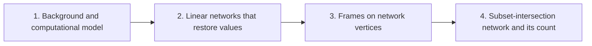

# Integer multiplication below n log n

This wiki explains the subset-intersection network. It is a linear network whose subspace labels come from intersection sizes of three-element subsets, and its target result is that the total number of smaller calls is less than the number of wires times the dimension, written $s<Wm$ in the bit network. The bound says the network makes fewer smaller calls than a naive count of wires times dimension would suggest, and the argument behind it, not the bare count, is what the wiki develops.

The route starts with background. [Linear algebra over a field](linear-algebra.md "The theory of vector spaces, linear maps, invertible operators, subspaces, and the rank of a linear map.") supplies vector spaces, linear maps, subspaces and rank. [Fixed-tape machine model](fixed-tape-machine.md "A Turing machine with one fixed finite alphabet and one fixed finite number of one-dimensional tapes, where a step moves each head by at most one cell.") fixes the computational model: a Turing machine with one finite alphabet and a fixed number of one-dimensional tapes, where each head moves at most one cell per step.

The second part builds the basic device. [Linear network that restores auxiliary values](linear-network.md "A fixed network of linear gates that exchanges two banks of values with prescribed signs and returns every auxiliary value to its starting state.") is a fixed network of linear gates that exchanges two banks of values with prescribed signs and returns every auxiliary value to its starting state.

The third part introduces [Frame of a network vertex](frame.md "An invertible linear operator attached to a vertex of a linear network that changes how the array stored on each wire is represented."), an invertible linear operator attached to each vertex that changes how the array on each wire is represented. On every route through the network the operator on each role is $D_{\mathrm{sink}}D_{\mathrm{source}}^{-1}$, so only the endpoint frames determine it.

The final part assembles these into the [Subset-intersection network](subset-network.md "A linear network whose subspace labels come from intersection sizes of three-element subsets, so that the total number of smaller calls is less than the number of wires times the dimension.") and proves the count. It tracks the subspace labels and their rank, showing the total for the bit network is below $Wm$ and the total phase-translation rank for the complex network is strictly below $W_{\rm c}m$.

!!! tip "How to read this wiki"

    Written for a reader who knows: Undergraduate computer science: big-O notation, polynomials, complex numbers, basic Turing machines and tapes. The 5 pages, in 4 parts, lead to [Subset-intersection network](subset-network.md "A linear network whose subspace labels come from intersection sizes of three-element subsets, so that the total number of smaller calls is less than the number of wires times the dimension."). Read them in order with the links at the bottom of each page, or start anywhere: each page opens with what it builds on. Hover over a link to see a one-line definition. For reference, the [notation](notation.md) page lists the symbols.

## The argument

**Main result:** The subset-intersection network has a total number $s$ of smaller calls with $s<Wm$, where $W$ is its wire count and $m$ the dimension of its label space.

**How:** exchange the two banks with a scalar network whose gates carry subspace labels from triples, then bound the total dimension change of the labels by counting dimension losses **Why:** Each edge's dimension change counts the smaller operations on that edge, so the total number of smaller calls is the sum of absolute label changes; a bound of that sum below $Wm$ gives the saving.

1. A fixed linear network of three-element-subset gates exchanges the banks $X_a$ and $Y_a$ with signs and restores every scratch wire. — how: a three-stage bank exchange built from copy, gather, scatter and side-injection rows, with the inverse schedule at the middle stage ([Linear network that restores auxiliary values](linear-network.md "A fixed network of linear gates that exchanges two banks of values with prescribed signs and returns every auxiliary value to its starting state."))
2. On every route of the network the operator on each role is $D_{\mathrm{sink}}D_{\mathrm{source}}^{-1}$, so only the endpoint frames determine it. — how: pass a common frame through each pointwise linear gate, so the intermediate frames cancel ([Frame of a network vertex](frame.md "An invertible linear operator attached to a vertex of a linear network that changes how the array stored on each wire is represented."))
3. The subspace labels satisfy $L=Ich$ and the sum of absolute label changes equals $Wm-2N+2L$, with loss $L<N/2$. — how: choose nested labels from triple indicator vectors and count the dimension lost at the gates that decrease
4. For the bit network the total rational rank $s$ of the edge differences satisfies $s<Wm$. — how: express each edge difference of frame matrices as a projection difference whose rank is the dimension change, and add the $N$ extra source ranks
5. For the complex network the total rank of the phase translation factors, $s_{\rm c}$, is strictly below $W_{\rm c}m$.

## Contents

### 1. [Background and computational model](background-and-computational-model/index.md)

This part fixes the vocabulary and the machine model used throughout. [Linear algebra over a field](linear-algebra.md "The theory of vector spaces, linear maps, invertible operators, subspaces, and the rank of a linear map.") gives the spaces, maps and rank that every later object is built from. [Fixed-tape machine model](fixed-tape-machine.md "A Turing machine with one fixed finite alphabet and one fixed finite number of one-dimensional tapes, where a step moves each head by at most one cell.") states the Turing-machine model whose step costs the network is meant to count.

[Linear algebra over a field](linear-algebra.md "The theory of vector spaces, linear maps, invertible operators, subspaces, and the rank of a linear map.") · [Fixed-tape machine model](fixed-tape-machine.md "A Turing machine with one fixed finite alphabet and one fixed finite number of one-dimensional tapes, where a step moves each head by at most one cell.")

### 2. [Linear networks that restore values](linear-networks-that-restore-values/index.md)

The main construction starts from a fixed network of linear gates. [Linear network that restores auxiliary values](linear-network.md "A fixed network of linear gates that exchanges two banks of values with prescribed signs and returns every auxiliary value to its starting state.") shows how banks of values can be exchanged with prescribed signs while every scratch wire returns to its starting state. The later analysis depends on this restoration property.

[Linear network that restores auxiliary values](linear-network.md "A fixed network of linear gates that exchanges two banks of values with prescribed signs and returns every auxiliary value to its starting state.")

### 3. [Frames on network vertices](frames-on-network-vertices/index.md)

Each vertex of the network carries an invertible operator that changes how the stored array is represented. [Frame of a network vertex](frame.md "An invertible linear operator attached to a vertex of a linear network that changes how the array stored on each wire is represented.") defines these operators and shows that on every route the effective operator depends only on the endpoint frames. This reduction is needed to control the rank computations in the final part.

[Frame of a network vertex](frame.md "An invertible linear operator attached to a vertex of a linear network that changes how the array stored on each wire is represented.")

### 4. [Subset-intersection network and its count](subset-intersection-network-and-its-count/index.md)

This part defines the main object and proves the bound on smaller calls. [Subset-intersection network](subset-network.md "A linear network whose subspace labels come from intersection sizes of three-element subsets, so that the total number of smaller calls is less than the number of wires times the dimension.") uses the gates and frames from the previous parts, with labels given by intersection sizes of three-element subsets. The proof bounds the total rank of the edge differences for the bit network and the phase-translation factors for the complex network.

[Subset-intersection network](subset-network.md "A linear network whose subspace labels come from intersection sizes of three-element subsets, so that the total number of smaller calls is less than the number of wires times the dimension.")

### [Notation](notation.md)

The symbols used across the pages, with where each is introduced.

## Map of the parts

## Assumed known

- Multitape Turing machine — An abstract machine with a finite control and a fixed number of tapes, each with its own head that reads and writes one cell per step.

## Sources

- [Integer multiplication below n log n (OpenAI, 2026)](https://github.com/openai/math/tree/fd4aeeb2ee4fc729c18d98444fed42fd0529eeeb/preprints/Integer-multiplication-below-n-log-n-September-23-2026)
