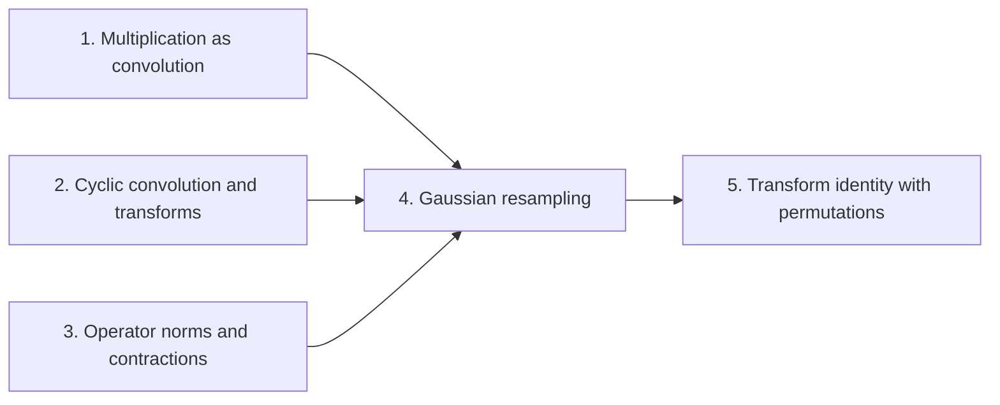

# Integer multiplication below n log n

The target result is the transform identity with retained permutations. It is an identity relating a discrete Fourier transform of arbitrary length $s$ to transforms whose axis lengths are powers of two, with the coordinate permutations $P_s$ and $P_t$ kept explicit in the formula. Because the permutations stay in the formula, they cancel across a convolution rather than being executed as sorts, which is the purpose of the construction.

The wiki reaches the result in five parts. The first, [Exact integer multiplication](exact-integer-multiplication.md "Given binary strings x and y of length n, output the 2n-bit binary representation of their product.") and [Radix-digit convolution](radix-digit-convolution.md "Writing both integers as polynomials in a power of two whose coefficients are their digits, so that their product is a polynomial convolution of short coefficients."), recasts integer multiplication as a polynomial convolution of digit sequences. The second, [Cyclic convolution](cyclic-convolution.md "The product of two sequences in which indices wrap around modulo the sequence length.") and [Discrete Fourier transform](discrete-fourier-transform.md "The map sending a vector of q values to its q values weighted by powers of a q-th root of unity, normalized by 1/q."), defines the convolution that transforms compute and the transform itself. The third, [Operator norm](operator-norm.md "The norm of a linear map L is the supremum of ‖Lu‖ over vectors u with ‖u‖ ≤ 1, where the vector norm of a complex vector is the largest modulus among its coordinates; a linear contraction is a linear map of norm at most one."), supplies the bounds on linear maps that the error analysis needs. The fourth, [Gaussian resampling](gaussian-resampling.md "A technique that replaces a Fourier transform of arbitrary length by transforms whose axis lengths are powers of two, using Gaussian weights to move between the two sets of frequencies."), replaces a transform of arbitrary length by transforms of power-of-two length, using Gaussian weights to move between the two sets of frequencies. The last part, [Transform identity with retained permutations](transform-identity.md "The Gaussian resampling identity in which the source and target coordinate permutations are kept as part of the formula, so that they cancel across a convolution instead of being executed as sorts."), keeps the permutations in the Gaussian identity, shows the outer resampling maps are contractions, and fixes the normalization by a power of two.

!!! tip "How to read this wiki"

    Written for a reader who knows: Undergraduate computer science: big-O notation, polynomials, complex numbers, basic Turing machines and tapes. The 7 pages, in 5 parts, lead to [Transform identity with retained permutations](transform-identity.md "The Gaussian resampling identity in which the source and target coordinate permutations are kept as part of the formula, so that they cancel across a convolution instead of being executed as sorts."). Read them in order with the links at the bottom of each page, or start anywhere: each page opens with what it builds on. Hover over a link to see a one-line definition. For reference, the [notation](notation.md) page lists the symbols.

## The argument

**Main result:** The transform identity $P_s F_s = 2^{2\alpha^2} B_0 P_t F_t A$ holds with linear contractions $A$ and $B_0$, so the source permutation $P_s$ and target permutation $P_t$ stay in the formula instead of being executed as sorts.

**How:** invert the Gaussian resampling identity, which keeps both permutations, to a pair of contractions and normalize the constants **Why:** The usual implementation sorts twice on each coordinate, so keeping both permutations in the transform formula and computing that formula directly avoids those sorts and lets the permutations cancel across a convolution.

1. The Gaussian identity $TP_sF_s = P_tF_tS$ holds, with $S$ and $T$ Gaussian-weighted maps from length-$s$ to length-$t$ vectors, and the near-identity operator $N = CTD$ is invertible. — how: write both transforms through a Gaussian-weighted resampling operator $N=CTD$ whose error from the identity is small ([Gaussian resampling](gaussian-resampling.md "A technique that replaces a Fourier transform of arbitrary length by transforms whose axis lengths are powers of two, using Gaussian weights to move between the two sets of frequencies."))
2. The maps $A=S'$ and $B_0=D'J'C$ are linear contractions, since $\|C\|=1$ and $\|S'\|$, $\|J'\|$, $\|D'\|$ are below their stated bounds.
3. The left inverse $DN^{-1}C$ of $TD^{-1}$ applied to the Gaussian identity gives $DN^{-1}CP_tF_tS = P_sF_s$.
4. The normalizations $2^{-2\alpha^2}$ give $B_0P_tF_tA = 2^{-2\alpha^2}P_sF_s$, which is the transform identity (33) with the power of two $2^{2\alpha^2}$.

## Contents

### 1. [Multiplication as convolution](multiplication-as-convolution/index.md)

This part recasts multiplication of binary integers as a convolution of their digit sequences. [Exact integer multiplication](exact-integer-multiplication.md "Given binary strings x and y of length n, output the 2n-bit binary representation of their product.") states the problem: the $2n$-bit product of two $n$-bit strings. [Radix-digit convolution](radix-digit-convolution.md "Writing both integers as polynomials in a power of two whose coefficients are their digits, so that their product is a polynomial convolution of short coefficients.") writes both integers as polynomials in a power of two, so that the product becomes a convolution of short coefficient sequences that a transform can compute.

[Exact integer multiplication](exact-integer-multiplication.md "Given binary strings x and y of length n, output the 2n-bit binary representation of their product.") · [Radix-digit convolution](radix-digit-convolution.md "Writing both integers as polynomials in a power of two whose coefficients are their digits, so that their product is a polynomial convolution of short coefficients.")

### 2. [Cyclic convolution and transforms](cyclic-convolution-and-transforms/index.md)

Cyclic convolution is the operation that the transform computes efficiently, since the discrete Fourier transform turns it into pointwise multiplication. [Cyclic convolution](cyclic-convolution.md "The product of two sequences in which indices wrap around modulo the sequence length.") defines it with indices wrapping modulo the sequence length. [Discrete Fourier transform](discrete-fourier-transform.md "The map sending a vector of q values to its q values weighted by powers of a q-th root of unity, normalized by 1/q.") defines the transform over a $q$-th root of unity, normalized by $1/q$, which the rest of the wiki uses at arbitrary length $s$ and at power-of-two lengths.

[Cyclic convolution](cyclic-convolution.md "The product of two sequences in which indices wrap around modulo the sequence length.") · [Discrete Fourier transform](discrete-fourier-transform.md "The map sending a vector of q values to its q values weighted by powers of a q-th root of unity, normalized by 1/q.")

### 3. [Operator norms and contractions](operator-norms-and-contractions/index.md)

The error analysis must bound how much a linear map can enlarge a vector. [Operator norm](operator-norm.md "The norm of a linear map L is the supremum of ‖Lu‖ over vectors u with ‖u‖ ≤ 1, where the vector norm of a complex vector is the largest modulus among its coordinates; a linear contraction is a linear map of norm at most one.") defines the norm of a linear map as a supremum over unit vectors, using the largest coordinate modulus as the vector norm. A linear contraction is a map of norm at most one, and the final part needs this notion to show that its resampling maps are contractions.

[Operator norm](operator-norm.md "The norm of a linear map L is the supremum of ‖Lu‖ over vectors u with ‖u‖ ≤ 1, where the vector norm of a complex vector is the largest modulus among its coordinates; a linear contraction is a linear map of norm at most one.")

### 4. [Gaussian resampling](gaussian-resampling-2/index.md)

This part presents the construction that the target result refines. [Gaussian resampling](gaussian-resampling.md "A technique that replaces a Fourier transform of arbitrary length by transforms whose axis lengths are powers of two, using Gaussian weights to move between the two sets of frequencies.") replaces a Fourier transform of arbitrary length by transforms whose axis lengths are powers of two, with Gaussian weights moving between the two sets of frequencies. It relies on the transforms, the digit convolution and the operator norm from the earlier parts.

[Gaussian resampling](gaussian-resampling.md "A technique that replaces a Fourier transform of arbitrary length by transforms whose axis lengths are powers of two, using Gaussian weights to move between the two sets of frequencies.")

### 5. [Transform identity with permutations](transform-identity-with-permutations/index.md)

This part gives the target result. [Transform identity with retained permutations](transform-identity.md "The Gaussian resampling identity in which the source and target coordinate permutations are kept as part of the formula, so that they cancel across a convolution instead of being executed as sorts.") keeps the permutations inside the Gaussian identity so that they cancel across the convolution. The argument inverts the near-identity operator to isolate the transform, checks that the outer maps are contractions, and absorbs the normalization into a power of two.

[Transform identity with retained permutations](transform-identity.md "The Gaussian resampling identity in which the source and target coordinate permutations are kept as part of the formula, so that they cancel across a convolution instead of being executed as sorts.")

### [Notation](notation.md)

The symbols used across the pages, with where each is introduced.

## Map of the parts

## Assumed known

- Polynomials — Finite sums of powers of a variable with coefficients, multiplied and reduced in the usual way.
- Complex numbers — Numbers a + bi with real a and b and imaginary unit i, with i² = −1.
- Turing machines and tapes — A finite-state machine that reads and writes symbols on one or more tapes, each with a movable head.
- Matrix, linear map, rank and invertibility — A matrix represents a linear map between finite-dimensional vector spaces; its rank is the dimension of its image, and it is invertible exactly when it has full rank and a two-sided inverse.

## Sources

- Integer multiplication below n log n (OpenAI, 2026)
