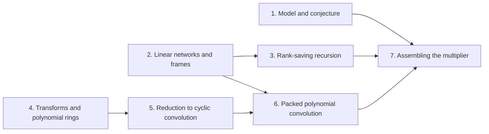

# Integer multiplication below n log n

The target result is a deterministic [fixed-tape machine](fixed-tape-model.md "A multitape Turing machine with one fixed finite alphabet and a fixed finite number of one-dimensional tapes, the same for every input length.") that multiplies two $n$-bit integers exactly in worst-case time $O(n(\lg n)^{1-\kappa})$, for a fixed $\kappa = 2^{-182}$. It disproves the [Schonhage-Strassen optimality conjecture](schonhage-strassen-conjecture.md "The conjecture that n log n is the optimal order of growth of the time needed to multiply two n-bit integers on a multitape Turing machine."), which asserts that $n\log n$ is the best order of growth for multiplication in this model. The gain is a [power saving](power-saving.md "A bound of the form n times (lg n) raised to the power 1 − κ for a fixed κ > 0, which is smaller than n log n by a polynomial factor in log n.") in the logarithmic factor, a polynomial saving in $\lg n$ rather than a change to the leading term.

The route runs through seven parts. The first fixes the model and the conjecture. The second builds a [linear network](linear-network.md "A fixed network of wires with gates that apply fixed linear maps to the values on their wires, used here to exchange two banks of values while restoring all auxiliary values.") with [sources and sinks](network-terminal.md "A source or sink of a linear network is an end vertex of a wire, where data enter the network or leave it, and the terminals are the sources and sinks at which the network meets its banks of values.") and [frames](frame.md "An invertible linear operator attached to a gate or terminal that sets how the array on each wire there is stored; changing frames along an edge cancels between the two ends of a route.") that fix how each array is stored, together with [role streams](role-streams.md "Splitting the rows of an array cyclically among the W fixed wire roles of a network, so that each role carries an equal share of the volume and gates act pointwise on matching addresses.") and the [address shear](address-shear.md "The address permutation that replaces the first of two address fields H by H + D, leaving D fixed, which is the endpoint operator of the bit network on arrays."). The third adds [subset-intersection networks](subset-network.md "A linear network over three-element subsets of a fixed ground set, whose gather, scatter, copy and side wires implement the scalar exchange of two banks by intersection-size coefficients over F_2 or Z[i,1/2]."), [nested subspace labels](subspace-labels.md "Assignments of subspaces of a fixed space to the gates and terminals of a network, nested along edges, whose dimension drops measure the smaller operations needed on each edge.") and the [rank-saving recursion](recursive-saving.md "A recursive scheme in which an edge matrix of rank a costs a smaller calls and the total number s of smaller calls over W roles satisfies s < Wm, so that multiplying the parameter by m multiplies the cost by less than m per unit volume."), which gives the saving. The fourth sets up [cyclic convolution](cyclic-convolution.md "The product of two coefficient lists in the ring of polynomials modulo x^S − 1, in which exponents wrap around modulo S."), the [Fourier transform](fourier-transform.md "The map sending a vector u of length q to the vector whose k-th entry is (1/q) times the sum over j of u_j times exp(−2πijk/q)."), [tensor products](tensor-product.md "The tensor product V ⊗ W of vector spaces is the space spanned by pairs of basis vectors, and the tensor product of linear maps acts on each factor separately, so one-dimensional operations on several coordinates combine into one operation on the product space."), [roots of unity](roots-of-unity.md "A number whose some positive integer power equals one; here powers of y in the polynomial ring play this role."), the [polynomial ring](polynomial-ring.md "The ring of complex polynomials of degree less than r, with multiplication reduced modulo y^r + 1; multiplication by a power of y permutes and sign-changes the coefficient list.") and the [quotient ring](quotient-ring.md "The quotient ring of a polynomial ring by several relations is the ring obtained by identifying two polynomials whenever their difference lies in the ideal generated by those relations."). The fifth reduces integer multiplication to convolution through [radix digits](radix-digit-convolution.md "Writing each n-bit input as a polynomial in 2^b with about n/b nonnegative digits, so that integer multiplication becomes a convolution whose coefficients are bounded by a fixed power of two.") and a [Chinese-remainder axis map](crt-axis-map.md "The bijection sending a coefficient index written in mixed radix with pairwise coprime lengths to coordinates on a product of cyclic axes, which turns one cyclic convolution into a multidimensional one."), then rewrites the transforms by [Gaussian resampling](gaussian-resampling.md "A rewriting of a Fourier transform of prime length as a transform with power-of-two axis lengths, with source and target coordinate permutations kept inside the transform identity.") and [Bluestein's identity](bluestein.md "An identity writing a Fourier transform as a cyclic convolution sandwiched between pointwise multiplications by chirp sequences exp(−πi s j² / t)."). The sixth computes packed polynomial products with [butterfly layers](butterfly-layer.md "The map H₀(u,v) = ((u+v)/2, (u−v)/2) applied at once to a selected coordinate bit of every chunk, a two-point butterfly acting coefficientwise on polynomial records."), [synthetic transforms](synthetic-transform.md "A discrete Fourier transform whose roots of unity are powers of y in the polynomial ring, so that each twiddle multiplication is a signed shift and the transform is computed by simultaneous butterfly layers.") and [signed packing](signed-packing.md "Encoding a polynomial with signed integer coefficients as one integer by placing coefficients at fixed bit offsets, so that a polynomial product becomes an integer product."), and recovers exact coefficients by [rounding and carries](exact-recovery.md "Recovering the exact integer coefficients of a convolution by rounding the computed values, whose error is below one half, and then propagating carries in radix 2^b."). The last part adds the [fast interchange of address chunks](tape-interchange.md "A fixed-tape procedure that swaps two disjoint equal-width address fields of an array in time O(V u^τ) for a fixed τ < 1, where V is the stored volume and u the field width, using XOR combinations of intermediate data.") and assembles the [fixed-tape multiplier](fixed-tape-multiplication.md "A deterministic fixed-tape Turing machine that multiplies two n-bit integers exactly in O(n(lg n)^(1−κ)) worst-case time, for a fixed κ = 2^(−182), disproving the n log n optimality conjecture in this model.").

!!! tip "How to read this wiki"

    Written for a reader who knows: Undergraduate computer science: big-O notation, polynomials, complex numbers, basic Turing machines and tapes. The 29 pages, in 7 parts, lead to [Fixed-tape integer multiplication with a power saving](fixed-tape-multiplication.md "A deterministic fixed-tape Turing machine that multiplies two n-bit integers exactly in O(n(lg n)^(1−κ)) worst-case time, for a fixed κ = 2^(−182), disproving the n log n optimality conjecture in this model."). Read them in order with the links at the bottom of each page, or start anywhere: each page opens with what it builds on. Hover over a link to see a one-line definition. For reference, the [glossary](glossary.md) defines minor terms and the [notation](notation.md) page lists the symbols.

## The argument

**Main result:** The integer product is computed exactly on one fixed-tape machine in $O(n(\lg n)^{1-\kappa})$ worst-case time, for $\kappa=2^{-182}$.

**How:** reduce exact multiplication to convolution of radix digits on distinct prime axes, compute the convolution by synthetic transforms on tape layouts, and bound the total tape cost with a power saving **Why:** Scanning the stored bits at each transform level already costs $\Theta(n\log n)$, so savings in both movement and arithmetic are needed.

1. Splitting the inputs into radix digits reduces multiplication to convolution of short integer coefficients. ([Radix-digit convolution](radix-digit-convolution.md "Writing each n-bit input as a polynomial in 2^b with about n/b nonnegative digits, so that integer multiplication becomes a convolution whose coefficients are bounded by a fixed power of two."))
2. The radix-digit coefficient list is placed on distinct prime cyclic axes by a Chinese-remainder map that preserves convolution. ([Chinese-remainder axis map](crt-axis-map.md "The bijection sending a coefficient index written in mixed radix with pairwise coprime lengths to coordinates on a product of cyclic axes, which turns one cyclic convolution into a multidimensional one."))
3. Each prime-length Fourier transform is expressed through a tensor transform with power-of-two axis lengths, keeping the source and target permutations inside the identity. — how: Gaussian resampling, computing the transform formula directly with both permutations retained ([Gaussian resampling](gaussian-resampling.md "A rewriting of a Fourier transform of prime length as a transform with power-of-two axis lengths, with source and target coordinate permutations kept inside the transform identity."))
4. Bluestein's chirp identity turns the middle transform, with its target permutation, into normalized cyclic convolution. ([Bluestein's chirp identity](bluestein.md "An identity writing a Fourier transform as a cyclic convolution sandwiched between pointwise multiplications by chirp sequences exp(−πi s j² / t)."))
5. Normalized cyclic convolution on the power-of-two axes is computed over the polynomial ring $\mathbb C[y]/(y^r+1)$ by synthetic transforms and packed polynomial products. — how: phase twist of the last coordinate into the polynomial ring, synthetic transforms on retained layouts, pointwise product, then signed packing with the established multiplier ([Synthetic polynomial transform](synthetic-transform.md "A discrete Fourier transform whose roots of unity are powers of y in the polynomial ring, so that each twiddle multiplication is a signed shift and the transform is computed by simultaneous butterfly layers."))
6. The recovered coefficient error is strictly below $1/2$, so rounding and carry propagation give the exact binary product. ([Exact recovery by rounding and carries](exact-recovery.md "Recovering the exact integer coefficients of a convolution by rounding the computed values, whose error is below one half, and then propagating carries in radix 2^b."))
7. The tape operations of the algorithm cost $O(V(\lg n)^{1-\kappa})$ in total, for stored volume $V=\Theta(n)$. — how: bound the cost of each tape procedure by a fixed power of its width below linear, then choose compatible fixed rational parameters

## Contents

### 1. [Model and conjecture](model-and-conjecture/index.md)

The target is a bound against a conjecture about the best growth rate in this model, so the reader needs the [fixed-tape machine](fixed-tape-model.md "A multitape Turing machine with one fixed finite alphabet and a fixed finite number of one-dimensional tapes, the same for every input length.") and the [Schonhage-Strassen conjecture](schonhage-strassen-conjecture.md "The conjecture that n log n is the optimal order of growth of the time needed to multiply two n-bit integers on a multitape Turing machine."). [Power saving](power-saving.md "A bound of the form n times (lg n) raised to the power 1 − κ for a fixed κ > 0, which is smaller than n log n by a polynomial factor in log n.") names the form of improvement sought, a bound $n(\lg n)^{1-\kappa}$ smaller than $n\log n$ by a polynomial factor in $\lg n$. The [established $O(n\log n)$ multiplier](multiplier-subroutine.md "The known deterministic O(n log n) multiplication algorithm of Harvey and van der Hoeven, used as a black-box subroutine on shorter integers.") is the black-box subroutine the construction calls on shorter integers.

[Fixed-tape machine model](fixed-tape-model.md "A multitape Turing machine with one fixed finite alphabet and a fixed finite number of one-dimensional tapes, the same for every input length.") · [Schonhage-Strassen optimality conjecture](schonhage-strassen-conjecture.md "The conjecture that n log n is the optimal order of growth of the time needed to multiply two n-bit integers on a multitape Turing machine.") · [Power saving in the logarithmic factor](power-saving.md "A bound of the form n times (lg n) raised to the power 1 − κ for a fixed κ > 0, which is smaller than n log n by a polynomial factor in log n.") · [Established fast multiplier](multiplier-subroutine.md "The known deterministic O(n log n) multiplication algorithm of Harvey and van der Hoeven, used as a black-box subroutine on shorter integers.")

### 2. [Linear networks and frames](linear-networks-and-frames/index.md)

The construction moves values between two banks through a fixed [linear network](linear-network.md "A fixed network of wires with gates that apply fixed linear maps to the values on their wires, used here to exchange two banks of values while restoring all auxiliary values."), whose wires end at [sources and sinks](network-terminal.md "A source or sink of a linear network is an end vertex of a wire, where data enter the network or leave it, and the terminals are the sources and sinks at which the network meets its banks of values."). A [frame](frame.md "An invertible linear operator attached to a gate or terminal that sets how the array on each wire there is stored; changing frames along an edge cancels between the two ends of a route.") at each vertex records how the array on each wire is stored, so frame changes cancel between the two ends of a route. [Role streams](role-streams.md "Splitting the rows of an array cyclically among the W fixed wire roles of a network, so that each role carries an equal share of the volume and gates act pointwise on matching addresses.") and the [address shear](address-shear.md "The address permutation that replaces the first of two address fields H by H + D, leaving D fixed, which is the endpoint operator of the bit network on arrays.") give the concrete storage layout that the later parts rely on.

[Linear network](linear-network.md "A fixed network of wires with gates that apply fixed linear maps to the values on their wires, used here to exchange two banks of values while restoring all auxiliary values.") · [Role streams from a cyclic row split](role-streams.md "Splitting the rows of an array cyclically among the W fixed wire roles of a network, so that each role carries an equal share of the volume and gates act pointwise on matching addresses.") · [Source, sink and terminal of a network](network-terminal.md "A source or sink of a linear network is an end vertex of a wire, where data enter the network or leave it, and the terminals are the sources and sinks at which the network meets its banks of values.") · [Frame of a vertex](frame.md "An invertible linear operator attached to a gate or terminal that sets how the array on each wire there is stored; changing frames along an edge cancels between the two ends of a route.") · [Address shear](address-shear.md "The address permutation that replaces the first of two address fields H by H + D, leaving D fixed, which is the endpoint operator of the bit network on arrays.")

### 3. [Rank-saving recursion](rank-saving-recursion/index.md)

This part gives the combinatorial core. [Subset-intersection networks](subset-network.md "A linear network over three-element subsets of a fixed ground set, whose gather, scatter, copy and side wires implement the scalar exchange of two banks by intersection-size coefficients over F_2 or Z[i,1/2].") realise the scalar exchange of two banks by intersection sizes, and [nested subspace labels](subspace-labels.md "Assignments of subspaces of a fixed space to the gates and terminals of a network, nested along edges, whose dimension drops measure the smaller operations needed on each edge.") bound the work on each edge by dimension drops. The [rank-saving recursion](recursive-saving.md "A recursive scheme in which an edge matrix of rank a costs a smaller calls and the total number s of smaller calls over W roles satisfies s < Wm, so that multiplying the parameter by m multiplies the cost by less than m per unit volume.") turns these bounds into a cost that grows by less than $m$ when the parameter grows by $m$, which is the source of the saving.

[Subset-intersection finite network](subset-network.md "A linear network over three-element subsets of a fixed ground set, whose gather, scatter, copy and side wires implement the scalar exchange of two banks by intersection-size coefficients over F_2 or Z[i,1/2].") · [Nested subspace labels](subspace-labels.md "Assignments of subspaces of a fixed space to the gates and terminals of a network, nested along edges, whose dimension drops measure the smaller operations needed on each edge.") · [Rank-saving recursion](recursive-saving.md "A recursive scheme in which an edge matrix of rank a costs a smaller calls and the total number s of smaller calls over W roles satisfies s < Wm, so that multiplying the parameter by m multiplies the cost by less than m per unit volume.")

### 4. [Transforms and polynomial rings](transforms-and-polynomial-rings/index.md)

Multiplication is reduced to convolution and transforms, so the reader needs [cyclic convolution](cyclic-convolution.md "The product of two coefficient lists in the ring of polynomials modulo x^S − 1, in which exponents wrap around modulo S.") and the [discrete Fourier transform](fourier-transform.md "The map sending a vector u of length q to the vector whose k-th entry is (1/q) times the sum over j of u_j times exp(−2πijk/q).") first. [Tensor products](tensor-product.md "The tensor product V ⊗ W of vector spaces is the space spanned by pairs of basis vectors, and the tensor product of linear maps acts on each factor separately, so one-dimensional operations on several coordinates combine into one operation on the product space.") and [multidimensional transforms](multidim-transform.md "A transform on an array indexed by several coordinates, each with length a power of two, obtained as a tensor product of one-dimensional Fourier transforms.") express one-dimensional operations on several coordinates as a single operation. [Roots of unity](roots-of-unity.md "A number whose some positive integer power equals one; here powers of y in the polynomial ring play this role.") in the [polynomial ring](polynomial-ring.md "The ring of complex polynomials of degree less than r, with multiplication reduced modulo y^r + 1; multiplication by a power of y permutes and sign-changes the coefficient list.") and its [quotient by several relations](quotient-ring.md "The quotient ring of a polynomial ring by several relations is the ring obtained by identifying two polynomials whenever their difference lies in the ideal generated by those relations.") supply the algebra used by the Chinese-remainder step.

[Cyclic convolution](cyclic-convolution.md "The product of two coefficient lists in the ring of polynomials modulo x^S − 1, in which exponents wrap around modulo S.") · [Discrete Fourier transform](fourier-transform.md "The map sending a vector u of length q to the vector whose k-th entry is (1/q) times the sum over j of u_j times exp(−2πijk/q).") · [Tensor product](tensor-product.md "The tensor product V ⊗ W of vector spaces is the space spanned by pairs of basis vectors, and the tensor product of linear maps acts on each factor separately, so one-dimensional operations on several coordinates combine into one operation on the product space.") · [Multidimensional transform with power-of-two axes](multidim-transform.md "A transform on an array indexed by several coordinates, each with length a power of two, obtained as a tensor product of one-dimensional Fourier transforms.") · [Root of unity](roots-of-unity.md "A number whose some positive integer power equals one; here powers of y in the polynomial ring play this role.") · [Polynomial ring modulo yʳ + 1](polynomial-ring.md "The ring of complex polynomials of degree less than r, with multiplication reduced modulo y^r + 1; multiplication by a power of y permutes and sign-changes the coefficient list.") · [Quotient ring by several relations](quotient-ring.md "The quotient ring of a polynomial ring by several relations is the ring obtained by identifying two polynomials whenever their difference lies in the ideal generated by those relations.")

### 5. [Reduction to cyclic convolution](reduction-to-cyclic-convolution/index.md)

Each $n$-bit input is split into [radix digits](radix-digit-convolution.md "Writing each n-bit input as a polynomial in 2^b with about n/b nonnegative digits, so that integer multiplication becomes a convolution whose coefficients are bounded by a fixed power of two."), so that multiplication becomes a convolution with small coefficients. The [Chinese-remainder axis map](crt-axis-map.md "The bijection sending a coefficient index written in mixed radix with pairwise coprime lengths to coordinates on a product of cyclic axes, which turns one cyclic convolution into a multidimensional one.") places these coefficients on pairwise coprime cyclic axes, turning one cyclic convolution into a multidimensional one. [Gaussian resampling](gaussian-resampling.md "A rewriting of a Fourier transform of prime length as a transform with power-of-two axis lengths, with source and target coordinate permutations kept inside the transform identity.") and [Bluestein's identity](bluestein.md "An identity writing a Fourier transform as a cyclic convolution sandwiched between pointwise multiplications by chirp sequences exp(−πi s j² / t).") then rewrite the prime-length transforms as normalized cyclic convolutions.

[Radix-digit convolution](radix-digit-convolution.md "Writing each n-bit input as a polynomial in 2^b with about n/b nonnegative digits, so that integer multiplication becomes a convolution whose coefficients are bounded by a fixed power of two.") · [Gaussian resampling](gaussian-resampling.md "A rewriting of a Fourier transform of prime length as a transform with power-of-two axis lengths, with source and target coordinate permutations kept inside the transform identity.") · [Bluestein's chirp identity](bluestein.md "An identity writing a Fourier transform as a cyclic convolution sandwiched between pointwise multiplications by chirp sequences exp(−πi s j² / t).") · [Chinese-remainder axis map](crt-axis-map.md "The bijection sending a coefficient index written in mixed radix with pairwise coprime lengths to coordinates on a product of cyclic axes, which turns one cyclic convolution into a multidimensional one.")

### 6. [Packed polynomial convolution](packed-polynomial-convolution/index.md)

The normalized convolution is computed over $\mathbb{C}[y]/(y^r+1)$ by [butterfly layers](butterfly-layer.md "The map H₀(u,v) = ((u+v)/2, (u−v)/2) applied at once to a selected coordinate bit of every chunk, a two-point butterfly acting coefficientwise on polynomial records.") and [synthetic transforms](synthetic-transform.md "A discrete Fourier transform whose roots of unity are powers of y in the polynomial ring, so that each twiddle multiplication is a signed shift and the transform is computed by simultaneous butterfly layers."), in which twiddle multiplications become signed shifts. [Signed coefficient packing](signed-packing.md "Encoding a polynomial with signed integer coefficients as one integer by placing coefficients at fixed bit offsets, so that a polynomial product becomes an integer product.") turns the polynomial products into integer products. [Exact recovery](exact-recovery.md "Recovering the exact integer coefficients of a convolution by rounding the computed values, whose error is below one half, and then propagating carries in radix 2^b.") rounds the computed values, whose error is below $1/2$, and then propagates carries to give the binary product.

[Simultaneous butterfly layer H₀](butterfly-layer.md "The map H₀(u,v) = ((u+v)/2, (u−v)/2) applied at once to a selected coordinate bit of every chunk, a two-point butterfly acting coefficientwise on polynomial records.") · [Synthetic polynomial transform](synthetic-transform.md "A discrete Fourier transform whose roots of unity are powers of y in the polynomial ring, so that each twiddle multiplication is a signed shift and the transform is computed by simultaneous butterfly layers.") · [Signed coefficient packing](signed-packing.md "Encoding a polynomial with signed integer coefficients as one integer by placing coefficients at fixed bit offsets, so that a polynomial product becomes an integer product.") · [Exact recovery by rounding and carries](exact-recovery.md "Recovering the exact integer coefficients of a convolution by rounding the computed values, whose error is below one half, and then propagating carries in radix 2^b.")

### 7. [Assembling the multiplier](assembling-the-multiplier/index.md)

The procedure must permute stored addresses cheaply, which the [fast interchange of address chunks](tape-interchange.md "A fixed-tape procedure that swaps two disjoint equal-width address fields of an array in time O(V u^τ) for a fixed τ < 1, where V is the stored volume and u the field width, using XOR combinations of intermediate data.") does in time $O(V u^{\tau})$ for a fixed $\tau<1$. The [fixed-tape multiplier](fixed-tape-multiplication.md "A deterministic fixed-tape Turing machine that multiplies two n-bit integers exactly in O(n(lg n)^(1−κ)) worst-case time, for a fixed κ = 2^(−182), disproving the n log n optimality conjecture in this model.") combines the earlier parts into the main theorem, with $\kappa=2^{-182}$ and worst-case time $O(n(\lg n)^{1-\kappa})$.

[Fast interchange of address chunks](tape-interchange.md "A fixed-tape procedure that swaps two disjoint equal-width address fields of an array in time O(V u^τ) for a fixed τ < 1, where V is the stored volume and u the field width, using XOR combinations of intermediate data.") · [Fixed-tape integer multiplication with a power saving](fixed-tape-multiplication.md "A deterministic fixed-tape Turing machine that multiplies two n-bit integers exactly in O(n(lg n)^(1−κ)) worst-case time, for a fixed κ = 2^(−182), disproving the n log n optimality conjecture in this model.")

### [Glossary](glossary.md)

[Gaussian dyadic numbers](glossary.md#gaussian-dyadic "Complex numbers whose real and imaginary parts are both dyadic rationals, that is, have power-of-two denominators.") · [Order of an element](glossary.md#order-of-element "The order of an element x of a multiplicative group is the least positive integer k with x^k equal to the identity, when such k exists.") · [Operator norm of a linear map](glossary.md#operator-norm "The operator norm of a linear map T is the largest factor by which T stretches a vector, the supremum of ‖Tv‖ over all vectors v with ‖v‖ ≤ 1, for a chosen vector norm.")

### [Notation](notation.md)

The symbols used across the pages, with where each is introduced.

## Map of the parts

## Assumed known

- Big-O notation — Notation bounding how a function grows asymptotically, up to a constant factor, as its input grows.
- Polynomials — Expressions sum of constant multiples of powers of a variable, whose coefficients can be listed in order.
- Complex numbers — Numbers a + ib with real a and b and imaginary unit i satisfying i² = −1.
- Multitape Turing machine — A Turing machine with several tapes, each with its own head, that reads and writes at most one cell per tape per step.
- Modular arithmetic — Arithmetic on integers in which two integers are identified when a fixed modulus m divides their difference, giving the residue classes Z/mZ, with division with remainder and modular inverses where they exist.
- Directed graph — A directed graph consists of vertices and edges, each edge having a tail vertex and a head vertex, and a network of wires and gates forms such a graph.
- Vector space, subspace, basis and dimension — A vector space over a field such as R, C or F_2 is a set closed under addition and scalar multiplication, a subspace is a subset that is itself a vector space, a basis is a linearly independent spanning set, and the dimension is the number of vectors in a basis.
- Linear map and matrix — A linear map preserves addition and scalar multiplication and is represented by a matrix relative to chosen bases, the matrix being invertible when it has an inverse and its transpose swapping rows and columns.
- Vector norm and maximum norm — A norm assigns each vector a nonnegative length satisfying the triangle inequality, and the maximum norm of a vector is the largest absolute value of its coordinates.

## Sources

- [Integer multiplication below n log n (OpenAI, 2026)](https://github.com/openai/math/tree/fd4aeeb2ee4fc729c18d98444fed42fd0529eeeb/preprints/Integer-multiplication-below-n-log-n-September-23-2026)
