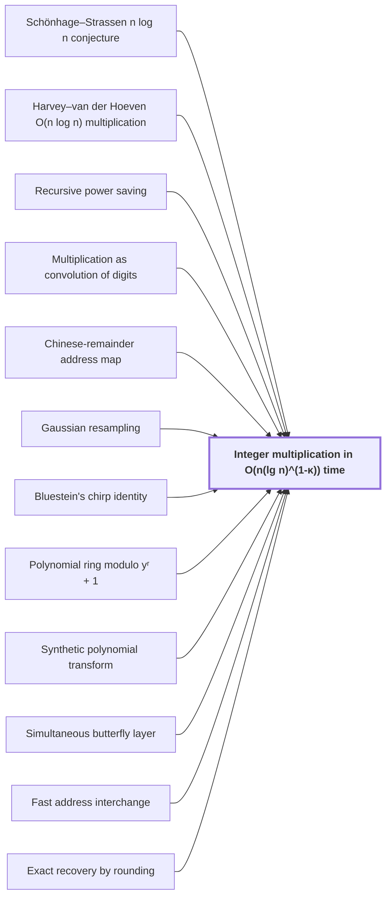

# Integer multiplication in $O(n(\lg n)^{1-\kappa})$ time

!!! info "Before this page"

    Integer multiplication in O(n(lg n)^(1-κ)) time *disproves* [Schönhage–Strassen n log n conjecture](nlogn-conjecture.md "Integer multiplication in $O(n(\lg n)^{1-\kappa})$ time disproves the Schönhage–Strassen n log n conjecture in this model."), *computes its polynomial products by* [Harvey–van der Hoeven O(n log n) multiplication](harvey-hoeven-multiplier.md "It computes its polynomial products by the Harvey–van der Hoeven O(n log n) multiplication on packed integers from Signed Kronecker packing."), *follows from* [Recursive power saving](recursive-power-saving.md "The power saving follows from Recursive power saving."), *is reduced to* [Multiplication as convolution of digits](convolution-reduction.md "The integer product is reduced to a convolution of radix-$2^b$ digit sequences, with carries restored to binary, as in Multiplication as convolution of digits."), *arranges its digits by* [Chinese-remainder address map](chinese-remainder-address-map.md "The algorithm arranges its digits by the Chinese-remainder address map on distinct prime cyclic axes."), *computes its transforms by* [Gaussian resampling](gaussian-resampling.md "It computes its transforms by Gaussian resampling, which expresses each prime-length transform through power-of-two axes."), *converts its middle transform by* [Bluestein's chirp identity](bluestein-chirp.md "It converts its middle transform by Bluestein's chirp identity into a normalized cyclic convolution."), *places its last cyclic coordinate in* [Polynomial ring modulo yʳ + 1](polynomial-ring-y.md "It places its last cyclic coordinate in the Polynomial ring modulo yʳ + 1, where its wrap is a signed shift."), *computes its forward transforms by* [Synthetic polynomial transform](synthetic-transform.md "It computes its forward transforms by Synthetic polynomial transform, which keep frequency order through their pointwise product."), *builds each transform level from* [Simultaneous butterfly layer](simultaneous-butterfly-layer.md "The algorithm builds each transform level from a Simultaneous butterfly layer, which acts on one address bit of every record, and whose cost is $O(V d^{\lambda'})$ for $\lambda'<1$."), *performs its address permutations by* [Fast address interchange](address-interchange.md "The algorithm performs its address permutations by Fast address interchange, whose cost is $O(V u^\tau)$ for $\tau<1$.") and *recovers its exact product by* [Exact recovery by rounding](rounding-recovery.md "The algorithm recovers its exact product by Exact recovery by rounding, which rounds the approximate coefficients to integers and propagates carries."). Assumed known: Big-O notation and Multitape Turing machine.

??? note "Symbols from earlier pages"

    - $n$ — input bit length: The number of bits in each input integer; the count of bits in one operand. (on [Schönhage–Strassen n log n conjecture](nlogn-conjecture.md "The conjecture of Schönhage and Strassen that n log n is the optimal order of growth of the time to multiply two n-bit integers on a multitape Turing machine."))
    - $b$ — digit width: The number of bits in one digit, a count of bits. (on [Multiplication as convolution of digits](convolution-reduction.md "Writing each integer in radix 2^b digits so that the integer product becomes a convolution of the digit sequences, which is then carried back to binary."))
    - $V$ — stored bit volume: The number of data bits the array holds. (on [Fast address interchange](address-interchange.md "A tape procedure that swaps two disjoint contiguous address fields of an array in time O(V u^τ) for width u, computed through XOR combinations of intermediate data."))
    - $u$ — field width: The number of address bits in one field. (on [Fast address interchange](address-interchange.md "A tape procedure that swaps two disjoint contiguous address fields of an array in time O(V u^τ) for width u, computed through XOR combinations of intermediate data."))
    - $\tau$ — width exponent: A fixed exponent with 0 < tau < 1 in the cost bound O(V u^tau). (on [Fast address interchange](address-interchange.md "A tape procedure that swaps two disjoint contiguous address fields of an array in time O(V u^τ) for width u, computed through XOR combinations of intermediate data."))
    - $d$ — chunk bound: The largest number of equal-width address chunks that one layer acts on, a count. (on [Simultaneous butterfly layer](simultaneous-butterfly-layer.md "A butterfly operation applied at once on one selected address bit of every record, with exact Gaussian dyadic intermediates and a single truncation after the layer."))
    - $\lambda'$ — layer exponent: A fixed exponent below one in the layer's cost bound, so that the cost grows in d more slowly than d itself. (on [Simultaneous butterfly layer](simultaneous-butterfly-layer.md "A butterfly operation applied at once on one selected address bit of every record, with exact Gaussian dyadic intermediates and a single truncation after the layer."))
    - $s$ — smaller-call count: The number of smaller calls that one call makes. (on [Recursive power saving](recursive-power-saving.md "The mechanism in which a network with s smaller calls on W roles and parameter m gives a recursion with cost ratio s/W < m, so that repeated recursion saves a power of the parameter."))
    - $W$ — input role count: The number of input roles of the network, which counts the places where it takes in values, not counting scratch wires. (on [Recursive power saving](recursive-power-saving.md "The mechanism in which a network with s smaller calls on W roles and parameter m gives a recursion with cost ratio s/W < m, so that repeated recursion saves a power of the parameter."))
    - $m$ — parameter growth factor: The fixed factor, greater than 1, by which the parameter of a call exceeds the parameter of the smaller calls it makes. (on [Recursive power saving](recursive-power-saving.md "The mechanism in which a network with s smaller calls on W roles and parameter m gives a recursion with cost ratio s/W < m, so that repeated recursion saves a power of the parameter."))

Here $O(g)$ means at most a constant times $g$ for all large inputs. $\lg n = \max\{\lceil \log_2 n\rceil, 1\}$ is the base-2 logarithm rounded up and at least 1.

The target theorem is that one fixed deterministic multitape Turing machine multiplies two $n$-bit integers exactly in $O(n(\lg n)^{1-\kappa})$ worst-case time, and the rest of the argument proves this claim. The constant $\kappa = 2^{-182}$ is the power-saving exponent, the amount by which the power of $\lg n$ falls below one.

Integer multiplication in $O(n(\lg n)^{1-\kappa})$ time disproves the [Schönhage–Strassen n log n conjecture](nlogn-conjecture.md "The conjecture of Schönhage and Strassen that n log n is the optimal order of growth of the time to multiply two n-bit integers on a multitape Turing machine.") in this model. Its running time is below $n\log n$ by the factor $(\lg n)^{\kappa}$, which grows without bound.

The integer product is reduced to a convolution of radix-$2^b$ digit sequences, with carries restored to binary, as in [Multiplication as convolution of digits](convolution-reduction.md "Writing each integer in radix 2^b digits so that the integer product becomes a convolution of the digit sequences, which is then carried back to binary."). The second step computes that convolution by transforms. Each transform level scans $\Theta(n)$ bits, so only savings in both movement and arithmetic beat $n\log n$<cite class="exegenius-ref" data-source="paper" data-locator="§1.1 The two tape operations" data-quote="We therefore need savings in both movement and arithmetic." title="We therefore need savings in both movement and arithmetic."> (see §1.1 The two tape operations)</cite>.

Two tape procedures supply these savings. The algorithm performs its address permutations by [Fast address interchange](address-interchange.md "A tape procedure that swaps two disjoint contiguous address fields of an array in time O(V u^τ) for width u, computed through XOR combinations of intermediate data."), whose cost is $O(V u^\tau)$ for $\tau<1$. The algorithm builds each transform level from a [Simultaneous butterfly layer](simultaneous-butterfly-layer.md "A butterfly operation applied at once on one selected address bit of every record, with exact Gaussian dyadic intermediates and a single truncation after the layer."), which acts on one address bit of every record, and whose cost is $O(V d^{\lambda'})$ for $\lambda'<1$.

The power saving follows from [Recursive power saving](recursive-power-saving.md "The mechanism in which a network with s smaller calls on W roles and parameter m gives a recursion with cost ratio s/W < m, so that repeated recursion saves a power of the parameter."). A network with $s$ smaller calls on $W$ roles and parameter $m$ multiplies the cost by $s/W$ at each level of recursion while dividing the parameter by $m$. Since $s/W<m$, the cost is a power of the parameter with exponent $\log_m(s/W)<1$.

The algorithm arranges its digits by the [Chinese-remainder address map](chinese-remainder-address-map.md "A rearrangement that places a digit sequence on a product of distinct prime cyclic axes while preserving convolution, implemented with address interchanges.") on distinct prime cyclic axes. It computes its transforms by [Gaussian resampling](gaussian-resampling.md "An identity that expresses a Fourier transform of length given by a prime as a multidimensional transform with power-of-two axis lengths, with the source and target permutations kept in the identity."), which expresses each prime-length transform through power-of-two axes. It converts its middle transform by [Bluestein's chirp identity](bluestein-chirp.md "The identity that converts a Fourier transform into a cyclic convolution by multiplying by chirp factors before and after it.") into a [normalized cyclic convolution](cyclic-convolution.md "The product of two sequences in which indices are taken modulo a fixed length, so each coefficient of the result is a sum of products over residues."). It places its last cyclic coordinate in the [Polynomial ring modulo yʳ + 1](polynomial-ring-y.md "The ring of complex polynomials in y reduced modulo y^r + 1, where multiplying by a power of y is a signed cyclic shift of the coefficient list."), where its wrap is a signed shift. It computes its forward transforms by [Synthetic polynomial transform](synthetic-transform.md "A transform over a polynomial ring in which the roots of unity are powers of y, so that each transform stage uses only signed shifts and butterfly additions."), which keep frequency order through their pointwise product. It computes its polynomial products by the [Harvey–van der Hoeven O(n log n) multiplication](harvey-hoeven-multiplier.md "The unconditional O(n log n) multiplication algorithm on a multitape Turing machine, used in this result as an ordinary subroutine.") on packed integers from [Signed Kronecker packing](kronecker-packing.md "Encoding a polynomial with bounded signed coefficients as an integer by evaluating it at a large power of two, so that polynomial products become integer products.").

The algorithm recovers its exact product by [Exact recovery by rounding](rounding-recovery.md "The step in which the approximate convolution coefficients are rounded to integers, provided the error is strictly below 1/2, and carries are then propagated to give the exact binary product."), which rounds the approximate coefficients to integers and propagates carries.

## Connections

??? quote "From the sources"

    > We give a deterministic algorithm that multiplies two $n$-bit integers
    >
    > — [Integer multiplication below n log n (OpenAI, 2026)](https://github.com/openai/math/tree/fd4aeeb2ee4fc729c18d98444fed42fd0529eeeb/preprints/Integer-multiplication-below-n-log-n-September-23-2026)
