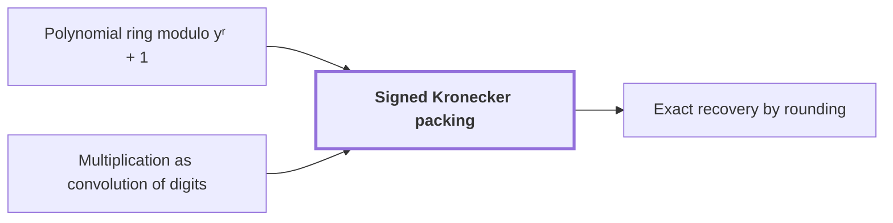

# Signed Kronecker packing

!!! info "Before this page"

    Signed Kronecker packing *maps each element of* [Polynomial ring modulo yʳ + 1](polynomial-ring-y.md "Signed Kronecker packing maps each element of Polynomial ring modulo yʳ + 1 to a single integer, by evaluating it at a large power of two.") and *is an instance of* [Multiplication as convolution of digits](convolution-reduction.md "Signed Kronecker packing is an instance of Multiplication as convolution of digits: the coefficients act as digits and the evaluation point as the radix.").

!!! abstract "Where this fits"

    1. Two $n$-bit integers can be multiplied exactly in $O(n(\lg n)^{1-\kappa})$ worst-case time on a deterministic multitape Turing machine, for a fixed $\kappa=2^{-182}$. — how: reduce the product to a digit convolution, compute that convolution through transform layers whose tape cost saves a power, and recover the exact product by rounding ([Integer multiplication in O(n(lg n)^(1-κ)) time](integer-multiplication-target.md "A deterministic multitape Turing machine that multiplies two n-bit integers exactly in O(n(lg n)^(1-κ)) worst-case time for a fixed κ = 2^(-182) > 0, beating the n log n conjecture in this model."))
    2. **This page:** Polynomial products over the ring are computed by signed packing and the $O(n\log n)$ multiplier.

??? note "Symbols from earlier pages"

    - $n$ — input bit length: The number of bits in each input integer; the count of bits in one operand. (on [Schönhage–Strassen n log n conjecture](nlogn-conjecture.md "The conjecture of Schönhage and Strassen that n log n is the optimal order of growth of the time to multiply two n-bit integers on a multitape Turing machine."))
    - $r$ — coefficient count: The number of complex coefficients in the list of one element of the ring, a power of two. (on [Polynomial ring modulo yʳ + 1](polynomial-ring-y.md "The ring of complex polynomials in y reduced modulo y^r + 1, where multiplying by a power of y is a signed cyclic shift of the coefficient list."))
    - $y$ — ring indeterminate: The variable of the polynomial ring, an indeterminate that is not evaluated at any number. (on [Polynomial ring modulo yʳ + 1](polynomial-ring-y.md "The ring of complex polynomials in y reduced modulo y^r + 1, where multiplying by a power of y is a signed cyclic shift of the coefficient list."))

Signed Kronecker packing maps each element of [Polynomial ring modulo yʳ + 1](polynomial-ring-y.md "The ring of complex polynomials in y reduced modulo y^r + 1, where multiplying by a power of y is a signed cyclic shift of the coefficient list.") to a single integer, by evaluating it at a large power of two. It turns products in the ring into integer products, which the established $O(n\log n)$ multiplier computes as an ordinary subroutine.

Signed Kronecker packing is an instance of [Multiplication as convolution of digits](convolution-reduction.md "Writing each integer in radix 2^b digits so that the integer product becomes a convolution of the digit sequences, which is then carried back to binary."): the coefficients act as digits and the evaluation point as the radix. This evaluation trick is called Kronecker substitution, and signed packing is a form of it<cite class="exegenius-ref" data-source="paper" data-locator="§1.5 Historical context and inherited methods" data-quote="Signed coefficient packing is a form of Kronecker substitution" title="Signed coefficient packing is a form of Kronecker substitution"> (see §1.5 Historical context and inherited methods)</cite>.

The index $j$ runs over the $r$ coefficient positions, $0 \le j < r$. Let $f$ and $g$ be ring elements with integer coefficients $f_j$ and $g_j$. Let $M$ be a bound on the absolute value of every such coefficient. Here $k$ also indexes coefficient positions, not transform positions.

Fix a power of two $B$ with $B > 2rM^2$, and call $B$ the packing base. The packed integer of $f$ is $F = \sum_j f_j B^j$, which may be negative because the digits are signed. Packing $g$ the same way gives the packed integer $G = \sum_j g_j B^j$.

Let $w = fg$ be the unreduced product, that is, before reduction modulo $y^r+1$, with coefficients $w_k = \sum_j f_j g_{k-j}$, where $k$ is the power of $y$ and the sum runs over $0 \le k-j < r$. Each $w_k$ is a sum of at most $r$ products, each at most $M^2$ in absolute value, so $|w_k| \le rM^2 < B/2$.

Evaluation at $B$ respects sums and products, so $FG = w(B) = \sum_k w_k B^k$. The integer product thus carries the product $w$, and the question is how to read its digits back.

Uniqueness. If $\sum_k e_k B^k = \sum_k e'_k B^k$ with integers satisfying $|e_k|, |e'_k| < B/2$, then $e_k = e'_k$ for all $k$. Each difference $e_k - e'_k$ has absolute value below $B$. Let $m$ be the least index with $e_m \ne e'_m$. Then $e_m - e'_m = -B\sum_{k>m} (e_k - e'_k) B^{k-m-1}$ is divisible by $B$, impossible since $0 < |e_m - e'_m| < B$.

Read-back. $FG - w_0 = B\sum_{k\ge 1} w_k B^{k-1}$ is divisible by $B$, and $|w_0| < B/2$. Since $B$ is even, $(-B/2, B/2]$ holds exactly one integer from each residue class modulo $B$, so $w_0$ is the balanced remainder of $FG$ modulo $B$. Subtracting $w_0$ and dividing by $B$ leaves an expansion of the same form, so repeating the step gives $w_1, w_2, \dots$; uniqueness shows no other digits could give $FG$.

For example, take $r=2$, $B=128$, $f=3-2y$ and $g=1+4y$. Then $M=4$ and $B>2rM^2=64$, $w=3+10y-8y^2$, and $FG=(-253)(513)=-129789$. The balanced remainders are $3$, $10$, $-8$, since $-129789=3+128\bigl(10+128\cdot(-8)\bigr)$.

Finally, $y^r=-1$ gives $y^{k+r}=-y^k$, so $fg$ modulo $y^r+1$ has coefficients $w_k-w_{k+r}$ for $0\le k<r$, where $w_m=0$ for $m>2r-2$. These are recovered exactly from the packed product.

## Connections

Used by:

- [Exact recovery by rounding](rounding-recovery.md "Exact recovery by rounding inverts the Signed Kronecker packing, which evaluates the coefficients at $2^b$.") *inverts* Signed Kronecker packing

??? quote "From the sources"

    > Signed coefficient packing is a form of Kronecker substitution
    >
    > — [Integer multiplication below n log n (OpenAI, 2026)](https://github.com/openai/math/tree/fd4aeeb2ee4fc729c18d98444fed42fd0529eeeb/preprints/Integer-multiplication-below-n-log-n-September-23-2026)
