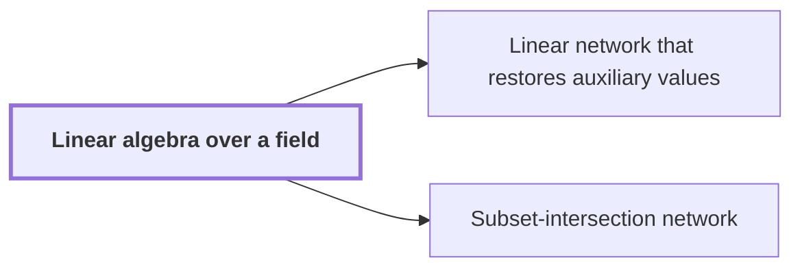

# Linear algebra over a field

!!! abstract "Where this fits"

    - Relied on to show: A fixed linear network of three-element-subset gates exchanges the banks $X_a$ and $Y_a$ with signs and restores every scratch wire. ([Linear network that restores auxiliary values](linear-network.md "A fixed network of linear gates that exchanges two banks of values with prescribed signs and returns every auxiliary value to its starting state."))
    - Relied on to show: On every route of the network the operator on each role is $D_{\mathrm{sink}}D_{\mathrm{source}}^{-1}$, so only the endpoint frames determine it. ([Frame of a network vertex](frame.md "An invertible linear operator attached to a vertex of a linear network that changes how the array stored on each wire is represented."))
    - Relied on to show: The subspace labels satisfy $L=Ich$ and the sum of absolute label changes equals $Wm-2N+2L$, with loss $L<N/2$.
    - Relied on to show: For the bit network the total rational rank $s$ of the edge differences satisfies $s<Wm$.

Linear algebra over a field is the theory of vector spaces, linear maps, invertible operators, subspaces and rank, with scalars taken from any field rather than only the reals. It is needed here because the main argument's network, a fixed wiring of gates in which each gate applies a linear rule to the arrays on its wires, changes how each array is stored from one gate to the next by invertible linear maps.

Let $F$ be a field, the set of scalars. The reader's cases are the real numbers and the field of two elements $F_2$.

A vector space over $F$ is a set $V$ of vectors with an addition and with multiplication by scalars from $F$, obeying the usual rules. For vectors $u,v$ in $V$ and a scalar $c$ in $F$, one such rule is $c(u+v)=cu+cv$. A subspace of $V$ is a subset that contains $0$ and is closed under addition and under multiplication by scalars; it is a vector space in its own right.

A linear map $L\colon V\to V$ is a map of $V$ into itself with $L(u+v)=L(u)+L(v)$ and $L(cu)=cL(u)$. Its image $L(V)$ is a subspace. The rank of $L$ is the dimension of this image, the number of vectors in a basis of it; for a matrix, it is the largest number of linearly independent columns.

The map $L$ is invertible when some linear map $L^{-1}\colon V\to V$ satisfies $L^{-1}L=LL^{-1}=\mathrm{id}$, the identity map; this $L^{-1}$ is the inverse of $L$. On a finite-dimensional space, $L$ is invertible exactly when its rank equals $\dim V$, the dimension of $V$. A composite of invertible maps is invertible.

Example: over $F_2$, the matrix $\begin{pmatrix}1&1\\0&1\end{pmatrix}$ acts on $F_2^2$ with columns $(1,0)$ and $(1,1)$, which are linearly independent. So it has rank $2=\dim F_2^2$ and is invertible. Its square is the identity matrix over $F_2$, so it is its own inverse.

This gives the cancellation the network needs. A route through the network multiplies the operators met along it, and each intermediate operator is followed by its inverse, so only the operators at the two endpoints remain.

## Connections

Used by:

- [Linear network that restores auxiliary values](linear-network.md "The network is a linear operator in Linear algebra over a field.") *is a linear operator in* Linear algebra over a field
- [Subset-intersection network](subset-network.md "Each gate and terminal carries a subspace label of one fixed space, so the network is built on Linear algebra over a field.") *is built on* Linear algebra over a field

??? quote "From the sources"

    > choose an invertible linear operator
    >
    > — [Integer multiplication below n log n (OpenAI, 2026)](https://github.com/openai/math/tree/fd4aeeb2ee4fc729c18d98444fed42fd0529eeeb/preprints/Integer-multiplication-below-n-log-n-September-23-2026)
