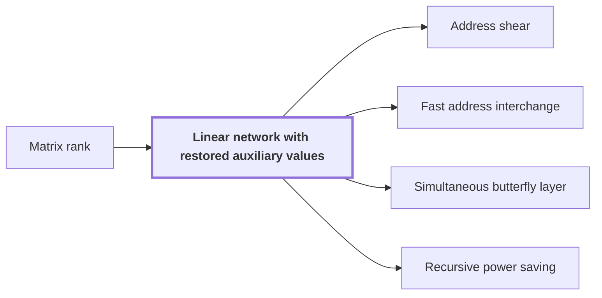

# Linear network with restored auxiliary values

!!! info "Before this page"

    Linear network with restored auxiliary values *has frames of full* [Matrix rank](glossary.md#matrix-rank "Each frame $D_v$ is invertible, so the network has frames of full matrix rank on $\Omega$.").

!!! abstract "Where this fits"

    1. Two $n$-bit integers can be multiplied exactly in $O(n(\lg n)^{1-\kappa})$ worst-case time on a deterministic multitape Turing machine, for a fixed $\kappa=2^{-182}$. — how: reduce the product to a digit convolution, compute that convolution through transform layers whose tape cost saves a power, and recover the exact product by rounding ([Integer multiplication in O(n(lg n)^(1-κ)) time](integer-multiplication-target.md "A deterministic multitape Turing machine that multiplies two n-bit integers exactly in O(n(lg n)^(1-κ)) worst-case time for a fixed κ = 2^(-182) > 0, beating the n log n conjecture in this model."))
    2. Both tape procedures cost $O(V)$ times a power of their parameter whose exponent is strictly below one. — how: give each procedure a fixed linear network with fewer smaller calls than roles, and iterate the resulting recursion ([Recursive power saving](recursive-power-saving.md "The mechanism in which a network with s smaller calls on W roles and parameter m gives a recursion with cost ratio s/W < m, so that repeated recursion saves a power of the parameter."))
    3. **This page:** Each tape procedure is a fixed linear network that exchanges two banks of values and restores every auxiliary value.

A linear network with restored auxiliary values is a fixed network of linear gates (operations that combine the values on wires) that exchanges two banks of values, with prescribed signs, and returns every auxiliary (scratch) value to its starting content. Each tape procedure of the target is built from one such network<cite class="exegenius-ref" data-source="paper" data-locator="§1.2 Linear networks and the recursive saving" data-quote="Each procedure arises from its own fixed linear network" title="Each procedure arises from its own fixed linear network"> (see §1.2 Linear networks and the recursive saving)</cite>.

Each wire has a fixed place in the network, its *role*. The values on a wire form an array indexed by a finite address set $\Omega$, the set of addresses at which the network stores values. A gate acts pointwise: at each address it replaces the values on the wires it touches by linear combinations of them with scalar coefficients. An input role is written $w$, and the network carries it to an output role $\rho(w)$. Its prescribed sign is $\varepsilon_w$.

The network is a directed graph whose vertices are sources, gates and sinks, and whose edges run from one vertex to another. Each source, gate and sink $v$ carries an invertible linear operator $D_v$ on arrays indexed by $\Omega$, its *frame*. Each frame $D_v$ is invertible, so the network has frames of full [matrix rank](glossary.md#matrix-rank "The rank of a matrix is the maximum number of linearly independent rows or columns; the number of nonzero pivots in elimination.") on $\Omega$. The stored array at $v$ is $D_v$ applied to the logical array, the array the network computes with. For vertices $\alpha$ and $\beta$, an edge from $\alpha$ to $\beta$ changes the stored array by $D_\beta D_\alpha^{-1}$ and leaves the logical array fixed.

Gates commute with a common frame. If every input of a gate is stored in frame $D_v$, the gate's output is a combination of those inputs with scalar coefficients that are the same at every address. By linearity, applying $D_v$ to such a combination gives the same combination of its images, so the output is stored in frame $D_v$ too. The frame acts across addresses and the gate across wires, so the two commute and the frames on intermediate vertices cancel.

Here $\mathrm{source}(w)$ is the source vertex where role $w$ enters, and $\mathrm{sink}(\rho(w))$ is the sink vertex where output role $\rho(w)$ leaves; the wiring fixes both. So a route from input role $w$ to output role $\rho(w)$ with sign $\varepsilon_w$ applies $\varepsilon_w D_{\mathrm{sink}(\rho(w))}D_{\mathrm{source}(w)}^{-1}$ to the array. Only the two end frames remain after cancellation, so the effect of a route is read off from its ends.

Example. Let $\xi$ be one address, and let the two wires carry the values $\lambda$ and $\mu$ at $\xi$. Three gates act: add the first value to the second, subtract the second from the first, then add the first to the second. They take $(\lambda,\mu)$ to $(\lambda,\lambda+\mu)$, then to $(-\mu,\lambda+\mu)$, then to $(-\mu,\lambda)$. So the schedule exchanges the two banks at $\xi$, with the first bank receiving $-\mu$ and the second receiving $\lambda$.

## Connections

Used by:

- [Address shear](address-shear.md "The shear is realized in a Linear network with restored auxiliary values, which restores every auxiliary value it uses, so the array holds only the updated fields when the shear ends.") *is realized in* Linear network with restored auxiliary values
- [Fast address interchange](address-interchange.md "The shear is realized by running the Linear network with restored auxiliary values, whose gates act pointwise on the array.") *is realized by running* Linear network with restored auxiliary values
- [Simultaneous butterfly layer](simultaneous-butterfly-layer.md "The layer computes its chunk moves by the linear network with restored auxiliary values, which carries each input role to an output role with a prescribed sign and restores every auxiliary value.") *computes its chunk moves by* Linear network with restored auxiliary values
- [Recursive power saving](recursive-power-saving.md "It is built from a Linear network with restored auxiliary values, a fixed network that exchanges two banks of values and restores every auxiliary value.") *is built from* Linear network with restored auxiliary values

??? quote "From the sources"

    > Each procedure arises from its own fixed linear network that exchanges two
    >
    > — [Integer multiplication below n log n (OpenAI, 2026)](https://github.com/openai/math/tree/fd4aeeb2ee4fc729c18d98444fed42fd0529eeeb/preprints/Integer-multiplication-below-n-log-n-September-23-2026)
