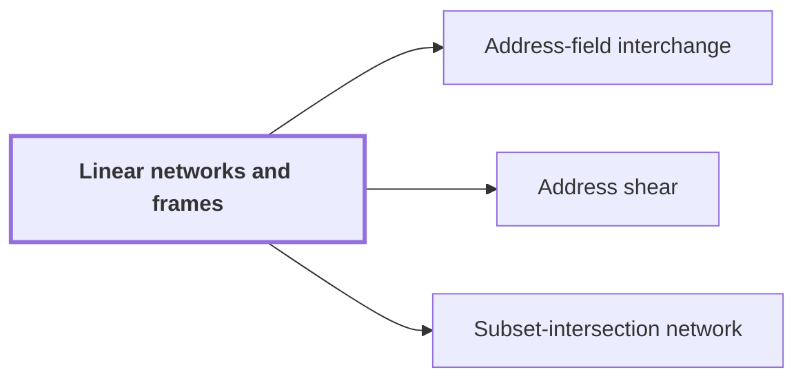

# Linear networks and frames

!!! abstract "Where this fits"

    - Relied on to show: Two disjoint equal address fields of $u$ bits in an array of stored volume $V$ can be interchanged in $O(V u^{\tau})$ time. ([Address-field interchange](address-interchange.md "A tape procedure that swaps two disjoint contiguous address fields of an array in time that grows like a power of the field width, rather than linearly."))
    - Relied on to show: A fixed linear network on three-element subsets exchanges two banks of scalars and restores every scratch wire. ([Subset-intersection network](subset-intersection-network.md "A linear network on the three-element subsets of a ground set, whose wires carry scalars and whose gates combine them by intersection size, so that it swaps two banks while cancelling arbitrary scratch values."))

A linear network is a fixed wiring diagram of gates that transforms stored values by linear operations. It is the device the paper uses to rearrange data inside an array without losing any of it. Each gate combines the values on its input wires linearly. The wires carry *banks* of values, one value per wire, and each vertex (a node of the diagram) carries an invertible linear operator called its *frame*.

The network is fixed in two senses: its wiring does not depend on the data, and each wire has a fixed place in it, which the paper calls its role<cite class="exegenius-ref" data-source="paper" data-locator="§11 A consequence for matrix transposition, p. 4" data-quote="A wire’s fixed place in the network is called its role." title="A wire’s fixed place in the network is called its role."> (see §11 A consequence for matrix transposition, p. 4)</cite>. Each procedure in the paper uses its own fixed linear network, which exchanges two banks of values and restores every auxiliary value. The auxiliary wires are scratch space: they may hold arbitrary values during the computation, but they end with the values they started with.

Because every gate is linear, composing the gates gives a linear map from the input values to the output values. The input and output have the same wires, so this map is a square matrix acting on the stacked banks (all values listed as one column).

The smallest case shows the exchange. Take two banks of one value each, with a network whose only gate swaps them. Its matrix is

$$
\begin{pmatrix} 0 & 1 \\ 1 & 0 \end{pmatrix},
$$

which sends the pair of values to the same pair in reversed order.

The network acts on whole arrays. An *address* is the binary label of one entry of the array. A *scalar gate* applies one fixed linear rule to the values at each address on the wires it touches, the same rule at every address. Rows of the array are distributed among the roles, so one operator acts identically on every address.

## Connections

Used by:

- [Address-field interchange](address-interchange.md "The procedure is built from a fixed Linear networks and frames network that exchanges two banks of values.") *is built from* Linear networks and frames
- [Address shear](address-shear.md "For the bit procedure, the address shear is the endpoint operator of a route through a Linear networks and frames.") *is the endpoint operator of* Linear networks and frames
- [Subset-intersection network](subset-intersection-network.md "The network is based on linear networks and frames, so its wires carry scalars and its gates combine them.") *is based on* Linear networks and frames

??? quote "From the sources"

    > Each procedure arises from its own fixed linear network that exchanges two banks of values
    >
    > — Integer multiplication below n log n (OpenAI, 2026)
