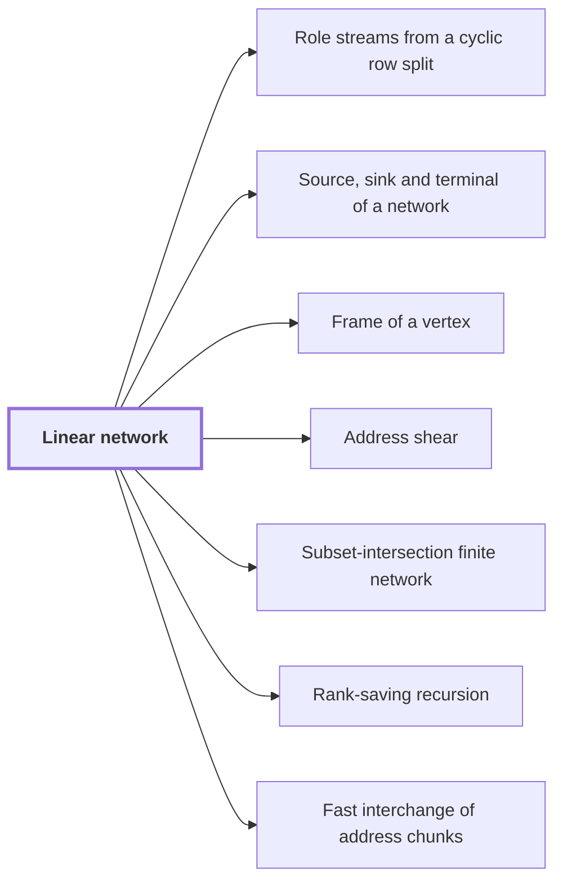

# Linear network

!!! abstract "Where this fits"

    - Relied on to show: Interchanging two equal address fields of width $u$ costs less than linear in $u$ per unit volume. ([Fast interchange of address chunks](tape-interchange.md "A fixed-tape procedure that swaps two disjoint equal-width address fields of an array in time O(V u^τ) for a fixed τ < 1, where V is the stored volume and u the field width, using XOR combinations of intermediate data."))

A linear network is a fixed arrangement of wires and gates that transforms the values on the wires by fixed linear maps. The argument uses it to exchange two banks of values while restoring every auxiliary value. Interchanging address chunks, that is, two equal-width groups of address bits of an array, is built from such exchanges, so the exchange is the piece to understand first.

A *wire* carries one value. A *gate* reads some input wires and writes to each output wire a fixed linear combination of the input values, with coefficients chosen in advance. A *bank* is a group of values held on one side of an exchange. An *auxiliary value* is a value on an extra wire that takes no part in the exchange and starts at a known value, such as zero. A network *restores* its auxiliary values if they hold their starting values again when it finishes.

Because the wires and coefficients are fixed, the network performs the same computation on every input. It has no data-dependent branching, and it moves no data as a tape machine does.

Example. Let $x$ be the value of the first bank and $y$ the value of the second, each on one wire. A gate that outputs $y$ on the first wire and $x$ on the second exchanges the banks:
$$\begin{pmatrix}0&1\\1&0\end{pmatrix}\begin{pmatrix}x\\y\end{pmatrix}=\begin{pmatrix}y\\x\end{pmatrix}.$$
Applying this map twice returns $(x,y)$, so no value is lost.

The exchanges in the sources also use coefficients $\pm 1$. The gate $(x,y)\mapsto(y,-x)$, with matrix $\begin{pmatrix}0&1\\-1&0\end{pmatrix}$, is invertible: applying it twice gives $(x,y)\mapsto(-x,-y)$, and applying it four times returns the input. Its inverse $(x,y)\mapsto(-y,x)$ is again a gate with coefficients $\pm 1$, so a coefficient $-1$ never destroys a value.

In the sources, each procedure is a fixed linear network of this kind.<cite class="exegenius-ref" data-source="paper" data-locator="§1.2 Linear networks and the recursive saving" data-quote="Each procedure arises from its own fixed linear network that exchanges two banks of values, with prescribed signs, and restores every auxiliary value." title="Each procedure arises from its own fixed linear network that exchanges two banks of values, with prescribed signs, and restores every auxiliary value."> (see §1.2 Linear networks and the recursive saving)</cite>

## Connections

Used by:

- [Role streams from a cyclic row split](role-streams.md "Role streams are carried by the wires of a Linear network: each role is one wire place of it.") *are carried by* Linear network
- [Source, sink and terminal of a network](network-terminal.md "A source or sink of a Linear network is an end vertex of a wire, where data enter the network or leave it.") *is a source or sink of* Linear network
- [Frame of a vertex](frame.md "A frame of a vertex is an invertible linear operator attached to a gate of a Linear network, or to a Source, sink and terminal of a network of it, that fixes how the array on each wire there is stored.") *is attached to a gate of* Linear network
- [Address shear](address-shear.md "The shear is applied in the linear network of the bit procedure, at its endpoint.") *is applied in* Linear network
- [Subset-intersection finite network](subset-network.md "The subset-intersection finite network is built as a linear network that exchanges two banks of scalars indexed by three-element subsets of a ground set.") *is built as a* Linear network
- [Rank-saving recursion](recursive-saving.md "Rank-saving recursion is a recursive scheme that runs on a linear network.") *runs on* Linear network
- [Fast interchange of address chunks](tape-interchange.md "The shear is carried by a bit network, a Linear network whose wires each carry one bit.") *is carried by* Linear network

??? quote "From the sources"

    > Each procedure arises from its own fixed linear network that exchanges two
    >
    > — [Integer multiplication below n log n (OpenAI, 2026)](https://github.com/openai/math/tree/fd4aeeb2ee4fc729c18d98444fed42fd0529eeeb/preprints/Integer-multiplication-below-n-log-n-September-23-2026)
