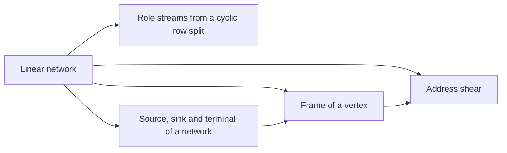

# Linear networks and frames

The construction moves values between two banks through a fixed [linear network](../linear-network.md "A fixed network of wires with gates that apply fixed linear maps to the values on their wires, used here to exchange two banks of values while restoring all auxiliary values."), whose wires end at [sources and sinks](../network-terminal.md "A source or sink of a linear network is an end vertex of a wire, where data enter the network or leave it, and the terminals are the sources and sinks at which the network meets its banks of values."). A [frame](../frame.md "An invertible linear operator attached to a gate or terminal that sets how the array on each wire there is stored; changing frames along an edge cancels between the two ends of a route.") at each vertex records how the array on each wire is stored, so frame changes cancel between the two ends of a route. [Role streams](../role-streams.md "Splitting the rows of an array cyclically among the W fixed wire roles of a network, so that each role carries an equal share of the volume and gates act pointwise on matching addresses.") and the [address shear](../address-shear.md "The address permutation that replaces the first of two address fields H by H + D, leaving D fixed, which is the endpoint operator of the bit network on arrays.") give the concrete storage layout that the later parts rely on.

## Pages

1. [Linear network](../linear-network.md "A fixed network of wires with gates that apply fixed linear maps to the values on their wires, used here to exchange two banks of values while restoring all auxiliary values.") — A fixed network of wires with gates that apply fixed linear maps to the values on their wires, used here to exchange two banks of values while restoring all auxiliary values.
2. [Role streams from a cyclic row split](../role-streams.md "Splitting the rows of an array cyclically among the W fixed wire roles of a network, so that each role carries an equal share of the volume and gates act pointwise on matching addresses.") — Splitting the rows of an array cyclically among the W fixed wire roles of a network, so that each role carries an equal share of the volume and gates act pointwise on matching addresses.
3. [Source, sink and terminal of a network](../network-terminal.md "A source or sink of a linear network is an end vertex of a wire, where data enter the network or leave it, and the terminals are the sources and sinks at which the network meets its banks of values.") — A source or sink of a linear network is an end vertex of a wire, where data enter the network or leave it, and the terminals are the sources and sinks at which the network meets its banks of values.
4. [Frame of a vertex](../frame.md "An invertible linear operator attached to a gate or terminal that sets how the array on each wire there is stored; changing frames along an edge cancels between the two ends of a route.") — An invertible linear operator attached to a gate or terminal that sets how the array on each wire there is stored; changing frames along an edge cancels between the two ends of a route.
5. [Address shear](../address-shear.md "The address permutation that replaces the first of two address fields H by H + D, leaving D fixed, which is the endpoint operator of the bit network on arrays.") — The address permutation that replaces the first of two address fields H by H + D, leaving D fixed, which is the endpoint operator of the bit network on arrays.

## Map

Arrows point from a page to the pages that build on it.

