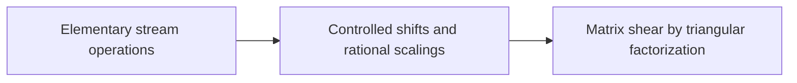

# Linear Operations on Tape

This part shows what a machine with a few tapes can do in time linear in the array volume. [Stream operations](../stream-ops.md "Linear-time scans on arrays stored in lexicographic order: swapping two digits, moving a digit, splitting into streams, applying a pointwise map and merging back.") give scans, splits and merges, [controlled shifts](../controlled-shifts.md "Updating a target address field by an offset computed from earlier control fields, or multiplying it by a unit, in time linear in the array volume.") update an address field by a computed offset, and the [matrix shear](../matrix-shear.md "Factoring a rational matrix as A = E₁ΠE₂ with lower triangular E₁, E₂ and partial permutation Π lets the shear (H,D)→(H+AD,D) be done with exactly rank(A) field interchanges.") uses a triangular factorization to do a shear with few field interchanges. The tape procedures in the next parts are assembled from these.

## Pages

1. [Elementary stream operations](../stream-ops.md "Linear-time scans on arrays stored in lexicographic order: swapping two digits, moving a digit, splitting into streams, applying a pointwise map and merging back.") — Linear-time scans on arrays stored in lexicographic order: swapping two digits, moving a digit, splitting into streams, applying a pointwise map and merging back.
2. [Controlled shifts and rational scalings](../controlled-shifts.md "Updating a target address field by an offset computed from earlier control fields, or multiplying it by a unit, in time linear in the array volume.") — Updating a target address field by an offset computed from earlier control fields, or multiplying it by a unit, in time linear in the array volume.
3. [Matrix shear by triangular factorization](../matrix-shear.md "Factoring a rational matrix as A = E₁ΠE₂ with lower triangular E₁, E₂ and partial permutation Π lets the shear (H,D)→(H+AD,D) be done with exactly rank(A) field interchanges.") — Factoring a rational matrix as A = E₁ΠE₂ with lower triangular E₁, E₂ and partial permutation Π lets the shear (H,D)→(H+AD,D) be done with exactly rank(A) field interchanges.

## Map

Arrows point from a page to the pages that build on it.

