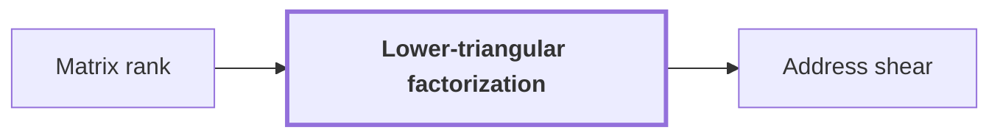

# Lower-triangular factorization

!!! info "Before this page"

    Lower-triangular factorization *is set by* [Matrix rank](glossary.md#matrix-rank "The number $a$ of ones in $\Pi$ is set by the Matrix rank of $A$.").

!!! abstract "Where this fits"

    - Relied on to show: Both tape procedures cost $O(V)$ times a power of their parameter whose exponent is strictly below one. ([Recursive power saving](recursive-power-saving.md "The mechanism in which a network with s smaller calls on W roles and parameter m gives a recursion with cost ratio s/W < m, so that repeated recursion saves a power of the parameter."))

Lower-triangular factorization writes a rational matrix as a product of two invertible lower-triangular matrices and a partial permutation matrix. It is used for the [Address shear](address-shear.md "The permutation (H, D) ↦ (H + AD, D) on two ordered groups of address fields, which is performed with as many pairwise interchanges as the rank of A.").

Let $A$ be a rational $m\times m$ matrix, where $m$ is the number of rows of $A$ (here the letter $m$ changes meaning from the earlier digit count). Rational means every entry is a rational number.

The factorization is $A=E_1\Pi E_2$, where $E_1$ and $E_2$ are invertible lower-triangular matrices, with zeros above the diagonal and nonzero diagonal entries, and $\Pi$ is a partial permutation matrix: each row and each column holds at most one $1$, and all other entries are $0$. Every rational matrix has such a factorization<cite class="exegenius-ref" data-source="paper" data-locator="§4.1 A matrix decomposition adapted to tape order" data-quote="Every rational $m\times m$ matrix $A$ of rank $a$ has a factorization" title="Every rational $m\times m$ matrix $A$ of rank $a$ has a factorization"> (see §4.1 A matrix decomposition adapted to tape order)</cite>.

The number $a$ of ones in $\Pi$ is set by the [Matrix rank](glossary.md#matrix-rank "The rank of a matrix is the maximum number of linearly independent rows or columns; the number of nonzero pivots in elimination.") of $A$. Multiplying by an invertible matrix does not change rank, so $\operatorname{rank}A=\operatorname{rank}\Pi$. The rows of $\Pi$ that hold a $1$ hold it in distinct columns, so they are distinct unit vectors, and the other rows are zero. Hence $\operatorname{rank}\Pi=a$, which is the count the lemma fixes.

For example, let $A=\begin{pmatrix}1&0\\1&0\end{pmatrix}$, with $m=2$ and rank $a=1$. Take $\Pi=\begin{pmatrix}1&0\\0&0\end{pmatrix}$, $E_1=\begin{pmatrix}1&0\\1&1\end{pmatrix}$ and $E_2=I$, the identity matrix. Then $E_1\Pi=\begin{pmatrix}1&0\\1&0\end{pmatrix}=A$, so $\Pi$ holds one $1$, matching the rank.

## Connections

Used by:

- [Address shear](address-shear.md "The shear is based on Lower-triangular factorization, which writes $A = E_1\Pi E_2$ with $E_1$ and $E_2$ invertible lower-triangular and $\Pi$ a partial permutation matrix with one 1 per pivot.") *is based on* Lower-triangular factorization

??? quote "From the sources"

    > Every rational $m\times m$ matrix $A$ of rank $a$ has a factorization
    >
    > — [Integer multiplication below n log n (OpenAI, 2026)](https://github.com/openai/math/tree/fd4aeeb2ee4fc729c18d98444fed42fd0529eeeb/preprints/Integer-multiplication-below-n-log-n-September-23-2026)
