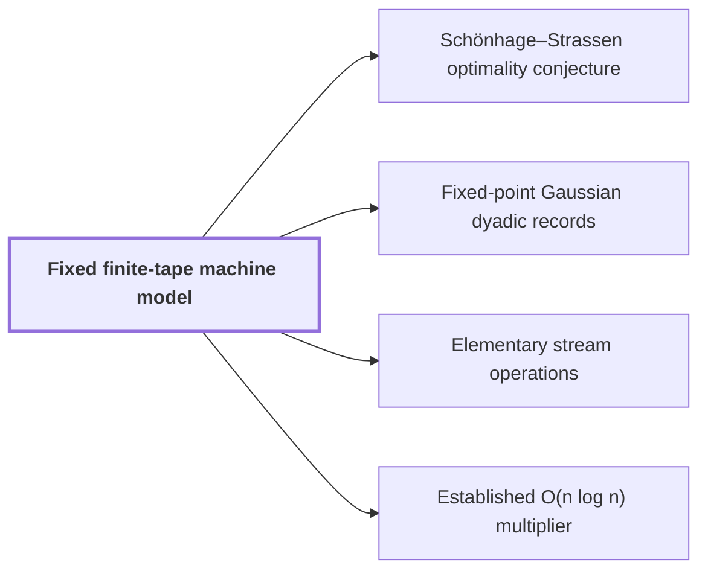

# Fixed finite-tape machine model

!!! info "Before this page"

    Assumed known: Turing machines and tapes and Big-O notation.

!!! abstract "Where this fits"

    - Relied on to show: A single deterministic Turing machine with a fixed finite alphabet and a fixed finite number of one-dimensional tapes multiplies two $n$-bit integers exactly in $O(n(\lg n)^{1-\kappa})$ worst-case time with $\kappa=2^{-182}$, disproving the $n\log n$ optimality conjecture of Sch\"onhage and Strassen in this model. ([Power-saving integer multiplication](main-result.md "A deterministic fixed-tape Turing machine multiplying two n-bit integers exactly in O(n(lg n)^{1−κ}) time with κ = 2^{−182}, disproving the n log n optimality conjecture in this model."))
    - Relied on to show: Bit variant: two disjoint address chunks of $u$ bits can be interchanged on a fixed number of tapes in $O(Vu^\tau)$ time, $\tau=1-2^{-50}$, although the intermediate steps form XOR combinations of data. ([Fast address-chunk interchange](address-interchange.md "The first tape procedure: exchanging two disjoint equal-width address fields of u digits in time O(V·u^τ) for a fixed τ < 1, using XOR combinations of intermediate data."))
    - Relied on to show: Fixed rational exponents and sizes make every hypothesis of the lemmas hold: $b=\lceil\log_2n\rceil$, $p=6b$, $d=\lfloor b^\epsilon\rfloor$, $K=\lfloor d^c\rfloor$, a power of two $T\in[4n/b,8n/b)$, $r=2^{\lceil(\log_2T)/d\rceil}$, axis lengths $t_i\in\{r/2,r\}$ with $\prod t_i=T$, $t_d=r$, and distinct odd primes $s_i\in((1-2\eta)t_i,(1-\eta)t_i]$. ([Parameter and prime-length choice](parameter-choice.md "Fixed rational exponents and sizes (precision p = 6b, d axes, K = d^c, T and r powers of two, prime lengths s_i just below t_i) making every hypothesis of the lemmas hold."))

The fixed finite-tape machine model is the multitape Turing machine in which all running times of the main theorem are measured; fixing the model is what gives the statement "multiplication in fewer than $n\log n$ steps" a precise meaning.

A machine has a single finite alphabet and a finite number of one-dimensional tapes, both fixed independently of the input<cite class="exegenius-ref" data-source="paper" data-locator="§2 The machine model and elementary streams" data-quote="A machine has one fixed finite alphabet and one fixed finite number of one-dimensional tapes." title="A machine has one fixed finite alphabet and one fixed finite number of one-dimensional tapes."> (see §2 The machine model and elementary streams)</cite>. Each tape is a one-way or two-way infinite line of cells, each holding one symbol, with one head per tape. In one step the machine reads and writes at most one cell on each tape and moves each head by at most one cell. Time is the number of steps.

Two consequences matter for the rest of the wiki.

**Constant factors are free, structure is not.** Splitting each cell into a fixed number of tracks, or adding finitely many work tapes, changes the running time only by a fixed factor<cite class="exegenius-ref" data-source="paper" data-locator="§2 The machine model and elementary streams" data-quote="Fixed tracks and finitely many work tapes change time by a fixed factor." title="Fixed tracks and finitely many work tapes change time by a fixed factor."> (see §2 The machine model and elementary streams)</cite> Since the target bound is an exponent saving, not a constant improvement, such factors do not matter, and an algorithm may keep several arrays side by side on separate tapes or tracks.

**Data movement costs time.** A head crosses one cell per step, so reaching a distant cell costs the distance. A linear pass over an array is cheap, but an arbitrary rearrangement of an array is not. The pages on [elementary stream operations](stream-ops.md "Linear-time scans on arrays stored in lexicographic order: swapping two digits, moving a digit, splitting into streams, applying a pointwise map and merging back.") list the scans that cost linear time, and every such scan is charged for its counters and for returning its heads. Moving one digit in a fixed radix takes a bounded number of scans, whereas interchanging fields whose digit counts grow is a genuine permutation problem, handled in [fast address-chunk interchange](address-interchange.md "The first tape procedure: exchanging two disjoint equal-width address fields of u digits in time O(V·u^τ) for a fixed τ < 1, using XOR combinations of intermediate data.").

The model is the one in which the [Schönhage–Strassen optimality conjecture](conjecture.md "The 1971 proposal that n log n is the optimal order of growth for multiplying n-bit integers on a multitape Turing machine.") was posed, and it is the setting of the [main result](main-result.md "A deterministic fixed-tape Turing machine multiplying two n-bit integers exactly in O(n(lg n)^{1−κ}) time with κ = 2^{−182}, disproving the n log n optimality conjecture in this model."). It is also the setting in which the earlier [established $O(n\log n)$ multiplier](hvdh-multiplier.md "The earlier Harvey–van der Hoeven multitape algorithm multiplying N-bit integers in O(N log N) time, used here only as an ordinary subroutine.") runs, so that algorithm can be used here as an ordinary subroutine.

## Connections

Used by:

- [Schönhage–Strassen optimality conjecture](conjecture.md "The conjecture is stated for the Fixed finite-tape machine model: a multitape Turing machine with a fixed alphabet and a fixed number of one-dimensional tapes.") *is stated for* Fixed finite-tape machine model
- [Fixed-point Gaussian dyadic records](fixed-point.md "A record is laid out on the tapes of the Fixed finite-tape machine model as $2r$ consecutive fixed-width integers, so it is read and moved by ordinary tape scans.") *is laid out on* Fixed finite-tape machine model
- [Elementary stream operations](stream-ops.md "All four operations below run on the Fixed finite-tape machine model, where each head moves at most one cell per step, so one pass over the array costs time proportional to $V$.") *runs on* Fixed finite-tape machine model
- [Established O(n log n) multiplier](hvdh-multiplier.md "The multiplier runs in the Fixed finite-tape machine model, the same model as the main result, so a call costs its $O(N\log N)$ steps with no change of machine to account for.") *runs in* Fixed finite-tape machine model

??? quote "From the sources"

    > A machine has one fixed finite alphabet and one fixed finite number of one-dimensional tapes.
    >
    > — [Integer multiplication below n log n (OpenAI, 2026)](https://github.com/openai/math/tree/fd4aeeb2ee4fc729c18d98444fed42fd0529eeeb/preprints/Integer-multiplication-below-n-log-n-September-23-2026)
