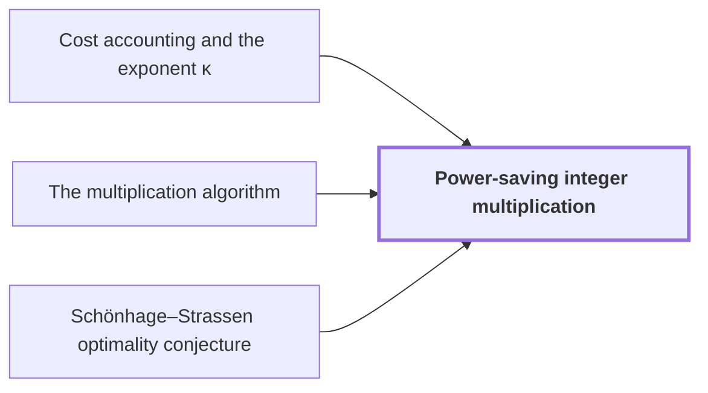

# Power-saving integer multiplication

!!! info "Before this page"

    Power-saving integer multiplication *is totalled by* [Cost accounting and the exponent κ](cost-accounting.md "The running time is totalled by Cost accounting and the exponent κ after dividing every cost by $V=Tp=\Theta(n)$, where $T$ counts the complex coefficients and $p$, of order $\lg n$, is the number of fractional bits of each."), *is assembled by* [The multiplication algorithm](multiplication-algorithm.md "The exact $2n$-bit product is assembled by The multiplication algorithm from radix digits, two forward transforms, a pointwise product, the opposite transform, rescaling, rounding and carries, with total error below $1/2$.") and *refutes* [Schönhage–Strassen optimality conjecture](conjecture.md "Power-saving integer multiplication is the main result: for $n$, the number of bits in each input, and $\kappa=2^{-182}$, the exponent saved from the power of $\lg n$, one fixed Turing machine multiplies two $n$-bit integers exactly in time $O(n(\lg n)^{1-\kappa})$, which is $o(n\log n)$, so it refutes the Schönhage–Strassen optimality conjecture in this model.").

??? note "Symbols from earlier pages"

    - $n$ — bit length: The number of bits in each of the two integers being multiplied. (on [Schönhage–Strassen optimality conjecture](conjecture.md "The 1971 proposal that n log n is the optimal order of growth for multiplying n-bit integers on a multitape Turing machine."))
    - $y$ — ring variable: The indeterminate of the polynomials; it satisfies y^r = -1 in the ring. (on [Polynomial ring modulo y^r + 1](ring-y.md "Polynomials of degree below r over the complex numbers with y^r = −1, so multiplying by a power of y is a signed shift of the coefficient list."))
    - $r$ — record length: The number of complex coefficients in a polynomial of the ring, always a power of two. (on [Polynomial ring modulo y^r + 1](ring-y.md "Polynomials of degree below r over the complex numbers with y^r = −1, so multiplying by a power of y is a signed shift of the coefficient list."))
    - $\epsilon$ — axis-count exponent: The exponent of the axis count d=floor(b^epsilon). (on [Parameter and prime-length choice](parameter-choice.md "Fixed rational exponents and sizes (precision p = 6b, d axes, K = d^c, T and r powers of two, prime lengths s_i just below t_i) making every hypothesis of the lemmas hold."))
    - $c$ — chunk-width exponent: The exponent of the address-chunk width K=floor(d^c). (on [Parameter and prime-length choice](parameter-choice.md "Fixed rational exponents and sizes (precision p = 6b, d axes, K = d^c, T and r powers of two, prime lengths s_i just below t_i) making every hypothesis of the lemmas hold."))
    - $\tau$ — interchange exponent: The exponent in the cost of a chunk interchange. (on [Parameter and prime-length choice](parameter-choice.md "Fixed rational exponents and sizes (precision p = 6b, d axes, K = d^c, T and r powers of two, prime lengths s_i just below t_i) making every hypothesis of the lemmas hold."))
    - $\lambda'$ — layer exponent: The final exponent of the layer cost V d^{lambda'}. (on [Parameter and prime-length choice](parameter-choice.md "Fixed rational exponents and sizes (precision p = 6b, d axes, K = d^c, T and r powers of two, prime lengths s_i just below t_i) making every hypothesis of the lemmas hold."))

Power-saving integer multiplication is the main result: for $n$, the number of bits in each input, and $\kappa=2^{-182}$, the exponent saved from the power of $\lg n$, one fixed Turing machine multiplies two $n$-bit integers exactly in time $O(n(\lg n)^{1-\kappa})$, which is $o(n\log n)$, so it refutes the [Schönhage–Strassen optimality conjecture](conjecture.md "The 1971 proposal that n log n is the optimal order of growth for multiplying n-bit integers on a multitape Turing machine.") in this model.

The machine is deterministic, with a fixed finite alphabet and a fixed finite number of one-dimensional tapes, and is correct for every $n\ge1$<cite class="exegenius-ref" data-source="paper" data-locator="§1 Introduction" data-quote="There is one deterministic Turing machine $A$, with a fixed finite" title="There is one deterministic Turing machine $A$, with a fixed finite"> (see §1 Introduction)</cite>. The saving is positive, however small: $(\lg n)^{1-\kappa}=\lg n/(\lg n)^{\kappa}$ and $(\lg n)^{\kappa}\to\infty$, so the ratio to $n\lg n$ tends to $0$.

## Why movement and arithmetic must get cheaper

The multiplication reduces to transforms on arrays of polynomials over $\mathbb C[y]/(y^r+1)$, whose calculation consists of address rearrangements, signed shifts and two-point butterflies<cite class="exegenius-ref" data-source="paper" data-locator="§1.1 The two tape operations" data-quote="In this representation, the transform calculation consists of address" title="In this representation, the transform calculation consists of address"> (see §1.1 The two tape operations)</cite>. A transform has $\Theta(\log n)$ levels, and each level must bring the partners of every butterfly together and then combine them. On a tape machine that is one pass over the whole stored volume of $\Theta(n)$ bits per level, so the levels cost $\Theta(n\log n)$<cite class="exegenius-ref" data-source="paper" data-locator="§1.1 The two tape operations" data-quote="Scanning an array of $\Theta(n)$ stored bits at each of" title="Scanning an array of $\Theta(n)$ stored bits at each of"> (see §1.1 The two tape operations)</cite>. The remedy is to let one pass do the work of many levels, which needs cheaper movement and cheaper arithmetic together<cite class="exegenius-ref" data-source="paper" data-locator="§1.1 The two tape operations" data-quote="We therefore need savings in both movement and arithmetic." title="We therefore need savings in both movement and arithmetic."> (see §1.1 The two tape operations)</cite>

Two tape primitives do this, where $V$ is the stored bit volume. Interchanging two address chunks of $u$ bits moves $u$ address bits at once for $O(Vu^\tau)$ with fixed $\tau<1$<cite class="exegenius-ref" data-source="paper" data-locator="§1.1 The two tape operations" data-quote="Its cost is $O(Vu^\tau)$ for a fixed $\tau&lt;1$." title="Its cost is $O(Vu^\tau)$ for a fixed $\tau&lt;1$."> (see §1.1 The two tape operations)</cite> The [simultaneous butterfly layer](simultaneous-layer.md "The second tape procedure: applying H₀ coefficientwise on the same bit of up to d address chunks in time O(V·d^λ′) for a fixed λ′ < 1, instead of d passes.") does one round of butterflies on up to $d$ axes at once for $O(Vd^{\lambda'})$ with $\lambda'<1$, instead of $d$ separate passes.

## How the saving is built

1. Both primitives are built from fixed finite linear networks and are power-saving by [Recursive power saving](rank-recurrence.md "Each call at parameter m·f makes s calls at parameter f on streams of 1/W the volume, so cost per unit volume grows by s/W < m per factor m, giving a power saving.").
2. They speed up the synthetic transforms ([Tape layout for synthetic transforms](transform-layout.md "Placing the selected bits of the participating axes at a common offset in K-bit chunks so each round of the synthetic transform is one simultaneous layer, costing less than log t passes.")) and the ring convolution built on them ([Convolution from the retained transform layout](ring-convolution.md "Convolution over the ring modulo y^r + 1 on the remaining axes by two forward synthetic transforms, pointwise polynomial products and the opposite transform, normalized by 1/(rM).")).
3. [Gaussian resampling](gaussian-resampling.md "Re-expressing a Fourier transform of prime length s through a transform of nearby power-of-two length t using Gaussian weights, so that only power-of-two transforms are needed.") and Bluestein chirps turn prime-length transforms into these power-of-two ones, with permutations cancelled rather than sorted ([Retained permutation cancellation](retained-permutations.md "Leaving the coordinate permutations of resampling inside the transform identity, so the source permutation cancels across the two forward transforms and the opposite one and none is executed as a sort.")).
4. The exact $2n$-bit product is assembled by [The multiplication algorithm](multiplication-algorithm.md "Digits, then the CRT map, two forward transforms with resampling and chirps, a pointwise product, the opposite transform, rescaling, rounding and carry propagation yield the exact 2n-bit product.") from radix digits, two forward transforms, a pointwise product, the opposite transform, rescaling, rounding and carries, with total error below $1/2$.

## Where $\kappa$ comes from

The running time is totalled by [Cost accounting and the exponent κ](cost-accounting.md "Dividing each cost by V = Tp, the dominant terms are powers of p below one with minimum margin 2^{-181} = 2κ, giving total time O(n(lg n)^{1−κ}).") after dividing every cost by $V=Tp=\Theta(n)$, where $T$ counts the complex coefficients and $p$, of order $\lg n$, is the number of fractional bits of each. Every dominant normalized cost is a power $p^{1-g_i}$ with margin $g_i>0$. The margins come from the fixed exponents of [Parameter and prime-length choice](parameter-choice.md "Fixed rational exponents and sizes (precision p = 6b, d axes, K = d^c, T and r powers of two, prime lengths s_i just below t_i) making every hypothesis of the lemmas hold."): $\tau=1-2^{-50}$, chunk width $K=\lfloor d^{c}\rfloor$ with $c=2^{-56}$, and $d=\Theta(p^{\epsilon})$ axes with $\epsilon=2^{-75}$<cite class="exegenius-ref" data-source="paper" data-locator="§9.1 A fixed rational choice" data-quote="\epsilon=2^{-75},\qquad \kappa=2^{-182}." title="\epsilon=2^{-75},\qquad \kappa=2^{-182}."> (see §9.1 A fixed rational choice)</cite>

The smallest margin belongs to the chunk exchanges, which cost $p$ levels times $K^{\tau-1}$ per bit, that is $p^{1-g_2}$ with
$$g_2=\epsilon c(1-\tau)=2^{-75}\cdot2^{-56}\cdot2^{-50}=2^{-181}=2\kappa.$$
All other margins are larger<cite class="exegenius-ref" data-source="paper" data-locator="§9.8 The complete time bound" data-quote="Thus $\min_i g_i=2^{-181}=2\kappa$." title="Thus $\min_i g_i=2^{-181}=2\kappa$."> (see §9.8 The complete time bound)</cite> The chunk is only a tiny power $K=p^{\epsilon c}$ of $p$ and the exchange beats the straightforward cost by only $K^{1-\tau}$, so this margin is a product of three tiny exponents.

Each dominant term is thus at most $p^{1-2\kappa}$. The terms also carry fixed powers of $\log p$, for example the $O(p\log p)$ cost of multiplying two $p$-bit numbers, a normalized factor $\log p$. Half the margin pays for them: any fixed power of $\log p$ is at most $p^\kappa$ for large $p$<cite class="exegenius-ref" data-source="paper" data-locator="§9.8 The complete time bound" data-quote="Any fixed power of $\log p$ is at most $p^\kappa$" title="Any fixed power of $\log p$ is at most $p^\kappa$"> (see §9.8 The complete time bound)</cite>, so $p^{1-2\kappa}\cdot p^{\kappa}=p^{1-\kappa}$. The time is then $O(Vp^{1-\kappa})=O(n(\lg n)^{1-\kappa})$, with the finitely many small lengths handled by schoolbook multiplication. Any positive $\kappa$ would refute the conjecture; $2^{-182}$ is what these parameters yield.

## Connections

??? quote "From the sources"

    > There is one deterministic Turing machine $A$, with a fixed finite
    >
    > — [Integer multiplication below n log n (OpenAI, 2026)](https://github.com/openai/math/tree/fd4aeeb2ee4fc729c18d98444fed42fd0529eeeb/preprints/Integer-multiplication-below-n-log-n-September-23-2026)

    > disproves the $n\log n$ optimality conjecture
    >
    > — [Integer multiplication below n log n (OpenAI, 2026)](https://github.com/openai/math/tree/fd4aeeb2ee4fc729c18d98444fed42fd0529eeeb/preprints/Integer-multiplication-below-n-log-n-September-23-2026)
