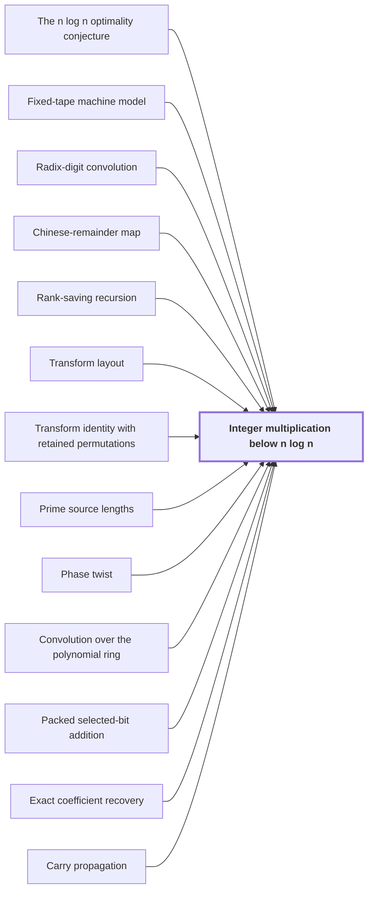

# Integer multiplication below n log n

!!! info "Before this page"

    Integer multiplication below n log n *refutes* [The n log n optimality conjecture](n-log-n-conjecture.md "It refutes the n log n optimality conjecture in this model."), *runs in* [Fixed-tape machine model](fixed-tape-model.md "Integer multiplication below $n\lg n$ is the main theorem: a single deterministic Turing machine that runs in the fixed-tape machine model multiplies two $n$-bit integers exactly, with its logarithmic factor reduced by a fixed power."), *is reduced to* [Radix-digit convolution](radix-digit-convolution.md "Multiplication is reduced to the radix-digit convolution of the two integers' digit coefficients."), *relabels its axis positions by* [Chinese-remainder map](chinese-remainder-map.md "It relabels its axis positions by the Chinese-remainder map."), *is organized by* [Rank-saving recursion](rank-saving-recursion.md "Its movement is organized by rank-saving recursion."), *computes its transforms on* [Transform layout](transform-layout.md "It computes its transforms on a transform layout that places the selected bits of each axis at a common offset."), *is based on* [Transform identity with retained permutations](transform-identity.md "The transform identity is based on the transform identity with retained permutations, so permutations cancel instead of being sorted."), *chooses its source lengths as* [Prime source lengths](prime-source-lengths.md "It chooses its source lengths as prime source lengths."), *converts the last cyclic coordinate by* [Phase twist](phase-twist.md "It converts the last cyclic coordinate by a phase twist."), *multiplies its records by* [Convolution over the polynomial ring](polynomial-ring-convolution.md "It multiplies its records by convolution over the polynomial ring."), *adds selected bits with* [Packed selected-bit addition](packed-bit-addition.md "It adds selected bits with packed selected-bit addition."), *recovers its coefficients by* [Exact coefficient recovery](recovery-and-error.md "It recovers its coefficients by exact coefficient recovery, which rounds them to integers.") and *ends with* [Carry propagation](carry-propagation.md "The result ends with carry propagation.").

??? note "Symbols from earlier pages"

    - $n$ — input length: The number of bits in each of the two inputs, the common length of x and y. (on [Exact integer multiplication](exact-integer-multiplication.md "Given binary strings x and y of length n, output the 2n-bit binary representation of their product."))
    - $u$ — field width: The number of bits in each address field. (on [Address-field interchange](address-interchange.md "A tape procedure that swaps two disjoint contiguous address fields of an array in time that grows like a power of the field width, rather than linearly."))
    - $V$ — stored volume: The number of bits the array stores. (on [Address-field interchange](address-interchange.md "A tape procedure that swaps two disjoint contiguous address fields of an array in time that grows like a power of the field width, rather than linearly."))
    - $\tau$ — cost exponent: A fixed constant less than 1 in the cost bound $O(V u^{\tau})$. (on [Address-field interchange](address-interchange.md "A tape procedure that swaps two disjoint contiguous address fields of an array in time that grows like a power of the field width, rather than linearly."))
    - $\lambda'$ — cost exponent: A fixed exponent below 1 in the layer's cost bound O(V d^{\lambda'}). (on [Simultaneous butterfly layer](simultaneous-butterfly-layer.md "The tensor product of the two-point map H0 applied to several selected address bits at once, computed exactly in one pass rather than one axis at a time."))

Integer multiplication below $n\lg n$ is the main theorem: a single deterministic Turing machine that runs in the [fixed-tape machine model](fixed-tape-model.md "A Turing machine with one fixed finite alphabet and one fixed finite number of one-dimensional tapes, whose size does not grow with the input.") multiplies two $n$-bit integers exactly, with its logarithmic factor reduced by a fixed power. The power is $\kappa=2^{-182}$, a fixed positive number, so the time is $O(n(\lg n)^{1-\kappa})$. It refutes the [n log n optimality conjecture](n-log-n-conjecture.md "The conjecture that n log n is the optimal order of growth of the time needed to multiply two n-bit integers.") in this model.

Without its constant factor, $n(\lg n)^{1-\kappa}=n\lg n\cdot(\lg n)^{-\kappa}$ is below $n\lg n$ for every $n\ge 3$. There $\lg n>1$ (since $\lg 3\approx 1.58$), so $(\lg n)^{-\kappa}<1$. The ratio to $n\lg n$ tends to $0$, so the order is strictly smaller.

The obstacle is the transform layers, the rounds of the transform.<cite class="exegenius-ref" data-source="paper" data-locator="§11 A consequence for matrix transposition, p. 3" data-quote="Scanning an array of Θ(n) stored bits at each of Θ(log n) transform levels already costs Θ(n log n)." title="Scanning an array of Θ(n) stored bits at each of Θ(log n) transform levels already costs Θ(n log n)."> (see §11 A consequence for matrix transposition, p. 3)</cite> The transform calculation consists of address rearrangements, signed shifts and butterfly operations.<cite class="exegenius-ref" data-source="paper" data-locator="§11 A consequence for matrix transposition, p. 3" data-quote="We therefore need savings in both movement and arithmetic." title="We therefore need savings in both movement and arithmetic."> (see §11 A consequence for matrix transposition, p. 3)</cite> Two tape procedures supply them.

A field is a block of consecutive address bits. The first procedure interchanges two disjoint equal address fields of $u$ bits in an array of stored volume $V$, in time $O(Vu^{\tau})$.<cite class="exegenius-ref" data-source="paper" data-locator="§11 A consequence for matrix transposition, p. 3" data-quote="Its cost is O(V uτ ) for a fixed τ &lt; 1." title="Its cost is O(V uτ ) for a fixed τ &lt; 1."> (see §11 A consequence for matrix transposition, p. 3)</cite>

The second applies a [simultaneous butterfly layer](simultaneous-butterfly-layer.md "The tensor product of the two-point map H0 applied to several selected address bits at once, computed exactly in one pass rather than one axis at a time.") to $d$ selected chunks, in time $O(Vd^{\lambda'})$.

Multiplication is reduced to the [radix-digit convolution](radix-digit-convolution.md "Writing both integers as polynomials in a power of two whose coefficients are their digits, so that their product is a polynomial convolution of short coefficients.") of the two integers' digit coefficients. It computes its transforms on a [transform layout](transform-layout.md "A permutation of address bits that places the selected bits of all participating axes at a common offset in consecutive chunks, so that a simultaneous butterfly layer applies to each transform round.") that places the selected bits of each axis at a common offset. It relabels its axis positions by the [Chinese-remainder map](chinese-remainder-map.md "A relabeling of coefficient positions by mixed-radix digits for pairwise coprime lengths, which turns one cyclic convolution into a multidimensional cyclic convolution."). Its movement is organized by [rank-saving recursion](rank-saving-recursion.md "The recursion in which each call splits into s smaller calls on streams of 1/W of the volume, where s < W m, so that the cost grows by the strictly smaller factor s/W per level."). The transform identity is based on the [transform identity with retained permutations](transform-identity.md "The Gaussian resampling identity in which the source and target coordinate permutations are kept as part of the formula, so that they cancel across a convolution instead of being executed as sorts."), so permutations cancel instead of being sorted. It chooses its source lengths as [prime source lengths](prime-source-lengths.md "Distinct odd primes chosen close to the powers of two that are the padded axis lengths, so that their product fills a fixed fraction of the padded box."). It converts the last cyclic coordinate by a [phase twist](phase-twist.md "A coefficientwise multiplication by roots of unity that converts the last cyclic coordinate into a polynomial ring, so its wrap-around becomes the negative wrap of that ring."). It multiplies its records by [convolution over the polynomial ring](polynomial-ring-convolution.md "The normalized product of two arrays of records in the polynomial ring, computed by two forward synthetic transforms, a pointwise product, and an opposite transform."). It adds selected bits with [packed selected-bit addition](packed-bit-addition.md "An operation that adds one selected bit position across several address chunks at once, using cyclic shifts and a small deterministic correction for exceptional addresses.").

It recovers its coefficients by [exact coefficient recovery](recovery-and-error.md "The error analysis showing that the computed convolution coefficients are within a half of their true integer values, so rounding recovers them exactly."), which rounds them to integers. The result ends with [carry propagation](carry-propagation.md "Converting the recovered integer radix-digit coefficients into a binary string by adding each coefficient to a carry from the previous position.").

Rational parameters are then chosen so that every term of the cost table fits the bound, and the total cost is $O(n(\lg n)^{1-\kappa})$.<cite class="exegenius-ref" data-source="paper" data-locator="§11 A consequence for matrix transposition, p. 5" data-quote="A compatible choice of rational parameters makes all terms in its cost table fit Theorem 1." title="A compatible choice of rational parameters makes all terms in its cost table fit Theorem 1."> (see §11 A consequence for matrix transposition, p. 5)</cite>

## Connections

??? quote "From the sources"

    > There is one deterministic Turing machine A
    >
    > — Integer multiplication below n log n (OpenAI, 2026)
