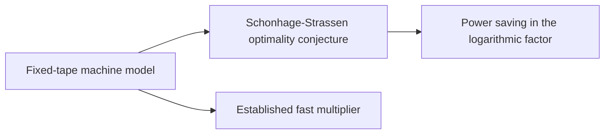

# Model and conjecture

The target is a bound against a conjecture about the best growth rate in this model, so the reader needs the [fixed-tape machine](../fixed-tape-model.md "A multitape Turing machine with one fixed finite alphabet and a fixed finite number of one-dimensional tapes, the same for every input length.") and the [Schonhage-Strassen conjecture](../schonhage-strassen-conjecture.md "The conjecture that n log n is the optimal order of growth of the time needed to multiply two n-bit integers on a multitape Turing machine."). [Power saving](../power-saving.md "A bound of the form n times (lg n) raised to the power 1 − κ for a fixed κ > 0, which is smaller than n log n by a polynomial factor in log n.") names the form of improvement sought, a bound $n(\lg n)^{1-\kappa}$ smaller than $n\log n$ by a polynomial factor in $\lg n$. The [established $O(n\log n)$ multiplier](../multiplier-subroutine.md "The known deterministic O(n log n) multiplication algorithm of Harvey and van der Hoeven, used as a black-box subroutine on shorter integers.") is the black-box subroutine the construction calls on shorter integers.

## Pages

1. [Fixed-tape machine model](../fixed-tape-model.md "A multitape Turing machine with one fixed finite alphabet and a fixed finite number of one-dimensional tapes, the same for every input length.") — A multitape Turing machine with one fixed finite alphabet and a fixed finite number of one-dimensional tapes, the same for every input length.
2. [Schonhage-Strassen optimality conjecture](../schonhage-strassen-conjecture.md "The conjecture that n log n is the optimal order of growth of the time needed to multiply two n-bit integers on a multitape Turing machine.") — The conjecture that n log n is the optimal order of growth of the time needed to multiply two n-bit integers on a multitape Turing machine.
3. [Power saving in the logarithmic factor](../power-saving.md "A bound of the form n times (lg n) raised to the power 1 − κ for a fixed κ > 0, which is smaller than n log n by a polynomial factor in log n.") — A bound of the form n times (lg n) raised to the power 1 − κ for a fixed κ > 0, which is smaller than n log n by a polynomial factor in log n.
4. [Established fast multiplier](../multiplier-subroutine.md "The known deterministic O(n log n) multiplication algorithm of Harvey and van der Hoeven, used as a black-box subroutine on shorter integers.") — The known deterministic O(n log n) multiplication algorithm of Harvey and van der Hoeven, used as a black-box subroutine on shorter integers.

## Map

Arrows point from a page to the pages that build on it.

