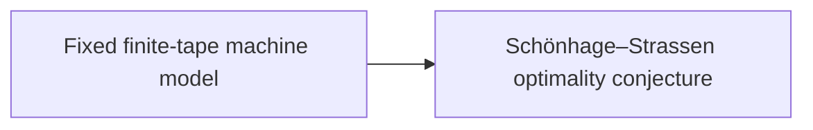

# Model and Conjecture

This part fixes the computation model of the main theorem, a Turing machine with a fixed alphabet and a fixed number of tapes whose heads move one cell per step. It then states the [Schönhage–Strassen optimality conjecture](../conjecture.md "The 1971 proposal that n log n is the optimal order of growth for multiplying n-bit integers on a multitape Turing machine.") that the result disproves. Every cost bound later in the wiki is a statement about this model.

## Pages

1. [Fixed finite-tape machine model](../machine-model.md "The computation model of the main theorem: one fixed finite alphabet and a fixed number of one-dimensional tapes, each head moving at most one cell per step.") — The computation model of the main theorem: one fixed finite alphabet and a fixed number of one-dimensional tapes, each head moving at most one cell per step.
2. [Schönhage–Strassen optimality conjecture](../conjecture.md "The 1971 proposal that n log n is the optimal order of growth for multiplying n-bit integers on a multitape Turing machine.") — The 1971 proposal that n log n is the optimal order of growth for multiplying n-bit integers on a multitape Turing machine.

## Map

Arrows point from a page to the pages that build on it.

