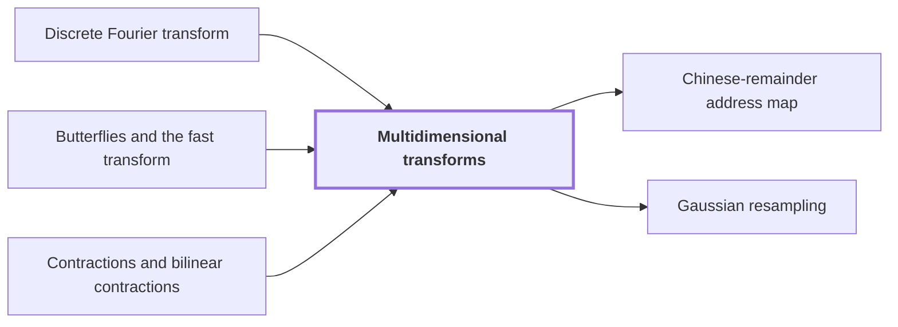

# Multidimensional transforms

!!! info "Before this page"

    Multidimensional transforms *is the tensor product of* [Discrete Fourier transform](dft.md "The transform $F_{\boldsymbol q}$ is the tensor product of the one-dimensional normalized Discrete Fourier transform matrices $F_{q_i}$ of lengths $q_i$."), *computes each line transform by* [Butterflies and the fast transform](butterfly.md "Each line transform is computed by the Butterflies and the fast transform in $O(t_i\log t_i)$ operations.") and *has input errors bounded as in* [Contractions and bilinear contractions](contraction-maps.md "Both maps are contractions, so each has input errors bounded as in Contractions and bilinear contractions.").

!!! abstract "Where this fits"

    - Relied on to show: Synthetic transforms over $\mathcal R_r$ on $d-1$ axes of lengths $t_i\in\{2^{\ell-1},2^\ell\}$ with outputs kept in a retained layout $LB$ cost $O(Tp[dK+pK^{\tau-1}+\ell d^{\lambda'}])$ with error less than $\sqrt2\ell\,2^{-p}$. ([Tape layout for synthetic transforms](transform-layout.md "Placing the selected bits of the participating axes at a common offset in K-bit chunks so each round of the synthetic transform is one simultaneous layer, costing less than log t passes."))
    - Relied on to show: The Fourier transforms of pairwise coprime prime lengths $s_i$ that the integer product needs are computed through power-of-two lengths $t_i$ by Gaussian resampling and Bluestein chirps, with the source and target coordinate permutations left inside the transform identities, so that none is executed as a sort. ([Retained permutation cancellation](retained-permutations.md "Leaving the coordinate permutations of resampling inside the transform identity, so the source permutation cancels across the two forward transforms and the opposite one and none is executed as a sort."))
    - Relied on to show: For coprime $s<t$ with $\theta=t/s-1>p/\alpha^4$ and permutations $(P_su)_j=u_{tj}$, $(P_tv)_k=v_{-sk}$ there are linear contractions $A$, $B_0$ with $P_sF_s=2^{2\alpha^2}B_0P_tF_tA$, computed with error less than $p^2$ in time $O(tp^{3/2+\delta}\alpha)$ without executing $P_s$ or $P_t$. ([Gaussian resampling](gaussian-resampling.md "Re-expressing a Fourier transform of prime length s through a transform of nearby power-of-two length t using Gaussian weights, so that only power-of-two transforms are needed."))
    - Relied on to show: Applied one coordinate line at a time to a padded box of $T=\prod_it_i$ entries, with $\gamma=2d\alpha^2$, $R F_{\boldsymbol s}=2^\gamma\mathcal B_0QF_{\boldsymbol t}\mathcal A$, both $\mathcal A$ and $\mathcal B_0$ are contractions with error less than $dp^2$, computed in $O(dTp^{3/2+\delta}\alpha)$ plus $O(Tp\,d^2(1+\ell^\tau))$ for exposing lines.

??? note "Symbols from earlier pages"

    - $T$ — coefficient count: The number of complex coefficients in an array. (on [Cyclic convolution](convolution.md "The product of two sequences (or elements of a polynomial quotient ring) where indices wrap around: (f∗g)_k = Σ f_j g_{k−j}."))
    - $F_{\boldsymbol t}$ — normalized transform: The normalized multidimensional discrete Fourier transform with axis lengths t_1,...,t_d. (on [Bluestein chirp identity](chirp.md "An identity that rewrites a (permuted) Fourier transform as a pointwise chirp phase, a cyclic convolution, and another chirp phase."))

A multidimensional transform is the Fourier transform of an array with several coordinates, computed by transforming along one axis at a time; the argument uses it to replace the long Fourier transforms of the integer product by transforms whose axis lengths are powers of two<cite class="exegenius-ref" data-source="paper" data-locator="§1.1 The two tape operations" data-quote="multidimensional transforms whose axis lengths are powers of two" title="multidimensional transforms whose axis lengths are powers of two"> (see §1.1 The two tape operations)</cite>.

Let $d$ be the number of axes, $i$ an axis index with $1\le i\le d$, and $q_i$ the number of positions along axis $i$, so $\boldsymbol q=(q_1,\dots,q_d)$. An entry of the array $u$ has an index tuple $j=(j_1,\dots,j_d)$ with $0\le j_i<q_i$. A line along axis $i$ is the $q_i$ entries obtained by fixing all other coordinates. For operators $G_i$ on sequences of length $q_i$, the tensor product $\bigotimes_i G_i$ applies each $G_i$ to every line along axis $i$. The transform $F_{\boldsymbol q}$ is the tensor product of the one-dimensional normalized [Discrete Fourier transform](dft.md "The normalized transform (F_q u)_k = (1/q) Σ u_j e^{−2πi jk/q}, which turns convolution into pointwise multiplication.") matrices $F_{q_i}$ of lengths $q_i$. In symbols, $F_{\boldsymbol q}:=\bigotimes_iF_{q_i}$<cite class="exegenius-ref" data-source="paper" data-locator="§8.2 Growing dimension and the padded array" data-quote="F_{\boldsymbol q}:=\bigotimes_iF_{q_i}" title="F_{\boldsymbol q}:=\bigotimes_iF_{q_i}"> (see §8.2 Growing dimension and the padded array)</cite>. With $k$ an output index tuple shaped like $j$,
$$(F_{\boldsymbol q}u)_k=\frac1{\prod_i q_i}\sum_j u_j\,e^{-2\pi i\sum_i j_ik_i/q_i}.$$

## Cost for power-of-two axes

Write $t_i$ for the axis lengths when each is a power of two, and $T=\prod_it_i$ for the number of entries. Each line transform is computed by the [Butterflies and the fast transform](butterfly.md "A two-point averaging/differencing step H₀(u,v) = ((u+v)/2, (u−v)/2) whose repeated use over address bits, with twiddle multiplications, computes a transform in log t layers.") in $O(t_i\log t_i)$ operations. Axis $i$ has $T/t_i$ lines, so its pass costs $O(T\log t_i)$ and all passes $O(T\log T)$. This bound needs power-of-two lengths, so it does not apply directly to the prime lengths $s_i$ of the integer product; the identity below supplies power-of-two transforms instead.

## Lifting the resampling identity

The one-dimensional lemma of [Gaussian resampling](gaussian-resampling.md "Re-expressing a Fourier transform of prime length s through a transform of nearby power-of-two length t using Gaussian weights, so that only power-of-two transforms are needed.") treats coprime $s_i<t_i$, with $t_i$ a power of two sufficiently larger than $s_i$. Let $p$ be the number of fractional bits of the stored values, $\alpha$ an integer resampling parameter with $2\le\alpha<\sqrt p$, and $\delta$ a fixed constant with $0<\delta<1/8$ that sets the slack in the exponent $3/2+\delta$ of $p$ in the time bound. Let $P_{s_i}$ and $P_{t_i}$ be the index permutations of the source and padded axes, and $A_i$ and $B_{0,i}$ the linear input and output maps of axis $i$. The lemma gives
$$P_{s_i}F_{s_i}=2^{2\alpha^2}B_{0,i}P_{t_i}F_{t_i}A_i.$$
Both maps are contractions, so each has input errors bounded as in [Contractions and bilinear contractions](contraction-maps.md "A linear map that never increases the norm of a vector, and a bilinear map whose output norm is at most the product of the input norms, so errors in the inputs do not grow beyond a controlled bound."). Fixed-point algorithms approximate each with error less than $p^2$ in time $O(t_ip^{3/2+\delta}\alpha)$.

Tensor the $d$ identities, with the same $p,\alpha,\delta$ on every axis. Operators on different axes compose axis by axis, so $(\bigotimes_i X_i)(\bigotimes_i Y_i)=\bigotimes_i X_iY_i$ for operators $X_i,Y_i$ on axis $i$, and the scalars multiply. Let $\boldsymbol s=(s_1,\dots,s_d)$ and $\boldsymbol t=(t_1,\dots,t_d)$ be the source and padded axis lengths, $\gamma=2d\alpha^2$ the total exponent of the scalar, and, with $R$ here not the scalar ring, $R=\bigotimes_iP_{s_i}$, $Q=\bigotimes_iP_{t_i}$, $\mathcal A=\bigotimes_iA_i$, $\mathcal B_0=\bigotimes_iB_{0,i}$:
$$RF_{\boldsymbol s}=2^\gamma\mathcal B_0QF_{\boldsymbol t}\mathcal A.$$

A pass applies a line map to every line, so its norm is a maximum over lines; hence $\mathcal A$ and $\mathcal B_0$ are contractions<cite class="exegenius-ref" data-source="paper" data-locator="§8.2 Growing dimension and the padded array" data-quote="Both $\mathcal A$ and $\mathcal B_0$ are contractions." title="Both $\mathcal A$ and $\mathcal B_0$ are contractions."> (see §8.2 Growing dimension and the padded array)</cite>. Each pass has error less than $p^2$, and earlier errors do not grow in later passes, so the $d$ passes give error less than $dp^2$<cite class="exegenius-ref" data-source="paper" data-locator="§8.2 Growing dimension and the padded array" data-quote="The linewise implementations of $\mathcal A$ and $\mathcal B_0$ each have error less than $dp^2$." title="The linewise implementations of $\mathcal A$ and $\mathcal B_0$ each have error less than $dp^2$."> (see §8.2 Growing dimension and the padded array)</cite>. Summing over $T/t_i$ lines per axis, the line algorithms take $O(dTp^{3/2+\delta}\alpha)$<cite class="exegenius-ref" data-source="paper" data-locator="§8.2 Growing dimension and the padded array" data-quote="The total time spent in the one-dimensional algorithms for both maps is $O(dTp^{3/2+\delta}\alpha)$, with a constant independent of $d$." title="The total time spent in the one-dimensional algorithms for both maps is $O(dTp^{3/2+\delta}\alpha)$, with a constant independent of $d$."> (see §8.2 Growing dimension and the padded array)</cite>.

## Connections

Used by:

- [Chinese-remainder address map](crt-map.md "This prepares the data for Multidimensional transforms, which act on one axis at a time.") *prepares the data for* Multidimensional transforms
- [Gaussian resampling](gaussian-resampling.md "The identity is applied along each axis of a Multidimensional transforms transform.") *is applied along each axis of* Multidimensional transforms

??? quote "From the sources"

    > multidimensional transforms whose axis lengths are powers of two
    >
    > — [Integer multiplication below n log n (OpenAI, 2026)](https://github.com/openai/math/tree/fd4aeeb2ee4fc729c18d98444fed42fd0529eeeb/preprints/Integer-multiplication-below-n-log-n-September-23-2026)

    > F_{\boldsymbol q}:=\bigotimes_iF_{q_i}
    >
    > — [Integer multiplication below n log n (OpenAI, 2026)](https://github.com/openai/math/tree/fd4aeeb2ee4fc729c18d98444fed42fd0529eeeb/preprints/Integer-multiplication-below-n-log-n-September-23-2026)
