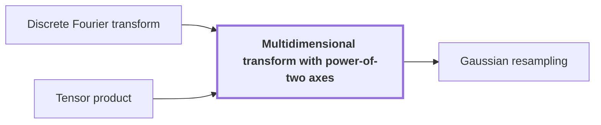

# Multidimensional transform with power-of-two axes

!!! info "Before this page"

    Multidimensional transform with power-of-two axes *applies one on each axis* [Discrete Fourier transform](fourier-transform.md "The transform applies one Discrete Fourier transform on each axis.") and *is built with* [Tensor product](tensor-product.md "It is built with the tensor product of these one-axis maps, so each map acts only along its own axis.").

!!! abstract "Where this fits"

    - Relied on to show: Each prime-length Fourier transform is expressed through a tensor transform with power-of-two axis lengths, keeping the source and target permutations inside the identity. ([Gaussian resampling](gaussian-resampling.md "A rewriting of a Fourier transform of prime length as a transform with power-of-two axis lengths, with source and target coordinate permutations kept inside the transform identity."))
    - Relied on to show: Gaussian resampling expresses each source Fourier transform through a power-of-two tensor transform.

??? note "Symbols from earlier pages"

    - $u$ — input vector: The complex vector of length $q$ that the transform acts on. (on [Discrete Fourier transform](fourier-transform.md "The map sending a vector u of length q to the vector whose k-th entry is (1/q) times the sum over j of u_j times exp(−2πijk/q)."))

A multidimensional transform with power-of-two axes is the [Discrete Fourier transform](fourier-transform.md "The map sending a vector u of length q to the vector whose k-th entry is (1/q) times the sum over j of u_j times exp(−2πijk/q).") applied along every coordinate of an array whose coordinate lengths are powers of two. [Gaussian resampling](gaussian-resampling.md "A rewriting of a Fourier transform of prime length as a transform with power-of-two axis lengths, with source and target coordinate permutations kept inside the transform identity.") rewrites each prime-length Fourier transform as one of these.

Harvey and van der Hoeven's reduction replaces the Fourier transforms needed for this convolution by multidimensional transforms.<cite class="exegenius-ref" data-source="paper" data-locator="§1.1 The two tape operations" data-quote="it replaces the Fourier transforms needed for this convolution by multidimensional transforms whose axis lengths are powers of two" title="it replaces the Fourier transforms needed for this convolution by multidimensional transforms whose axis lengths are powers of two"> (see §1.1 The two tape operations)</cite>

Let $d$ be the number of axes, and index them by $\ell = 1,\dots,d$. Let $r_\ell$, a power of two, be the number of entries along axis $\ell$. A line along axis $\ell$ is a set of entries that differ only in their $\ell$-th index. For each axis, $j_\ell$ and $k_\ell$ are the input and output indices along it, both running over $0,\dots,r_\ell-1$. Let $A$ be the input array, with entries $A_{j_1\cdots j_d}$, and $B$ the transformed array, with entries $B_{k_1\cdots k_d}$.

The transform applies one [Discrete Fourier transform](fourier-transform.md "The map sending a vector u of length q to the vector whose k-th entry is (1/q) times the sum over j of u_j times exp(−2πijk/q).") on each axis. The one-axis map for axis $\ell$ has entry $\frac{1}{r_\ell}\exp(-2\pi\mathrm{i}\,j_\ell k_\ell/r_\ell)$ in row $k_\ell$ and column $j_\ell$. It is built with the [tensor product](tensor-product.md "The tensor product V ⊗ W of vector spaces is the space spanned by pairs of basis vectors, and the tensor product of linear maps acts on each factor separately, so one-dimensional operations on several coordinates combine into one operation on the product space.") of these one-axis maps, so each map acts only along its own axis. The entry of a tensor product of matrices is the product of the factor entries, so the entry in row $(k_1,\dots,k_d)$ and column $(j_1,\dots,j_d)$ is the product over $\ell$ of the one-axis entries, with the factors $1/r_\ell$ multiplying to $1/(r_1\cdots r_d)$. Applying this matrix to $A$ gives $B$:

$$B_{k_1\cdots k_d}=\frac{1}{r_1\cdots r_d}\sum_{j_1=0}^{r_1-1}\cdots\sum_{j_d=0}^{r_d-1}A_{j_1\cdots j_d}\prod_{\ell=1}^{d}\exp\Big(-\frac{2\pi\mathrm{i}\,j_\ell k_\ell}{r_\ell}\Big).$$

Each factor of the product depends on one axis only, so the sum over $j_1$ can be taken first, then $j_2$, and so on. Each such step applies the length-$r_\ell$ transform to every line along axis $\ell$, so the axes can be processed one at a time, in any order.

Take $d=2$ and $r_1=r_2=2$. The length-2 transform sends $(u_0,u_1)$ to $((u_0+u_1)/2,(u_0-u_1)/2)$, since $\exp(-\pi\mathrm{i})=-1$. For $A_{00}=1$, $A_{01}=2$, $A_{10}=3$, $A_{11}=4$, the formula gives $B_{00}=5/2$, $B_{01}=-1/2$, $B_{10}=-1$ and $B_{11}=0$.

## Connections

Used by:

- [Gaussian resampling](gaussian-resampling.md "Thus Gaussian resampling expresses each source transform through a Multidimensional transform with power-of-two axes.") *expresses each source transform through* Multidimensional transform with power-of-two axes

??? quote "From the sources"

    > transforms whose axis lengths are powers of two
    >
    > — [Integer multiplication below n log n (OpenAI, 2026)](https://github.com/openai/math/tree/fd4aeeb2ee4fc729c18d98444fed42fd0529eeeb/preprints/Integer-multiplication-below-n-log-n-September-23-2026)
