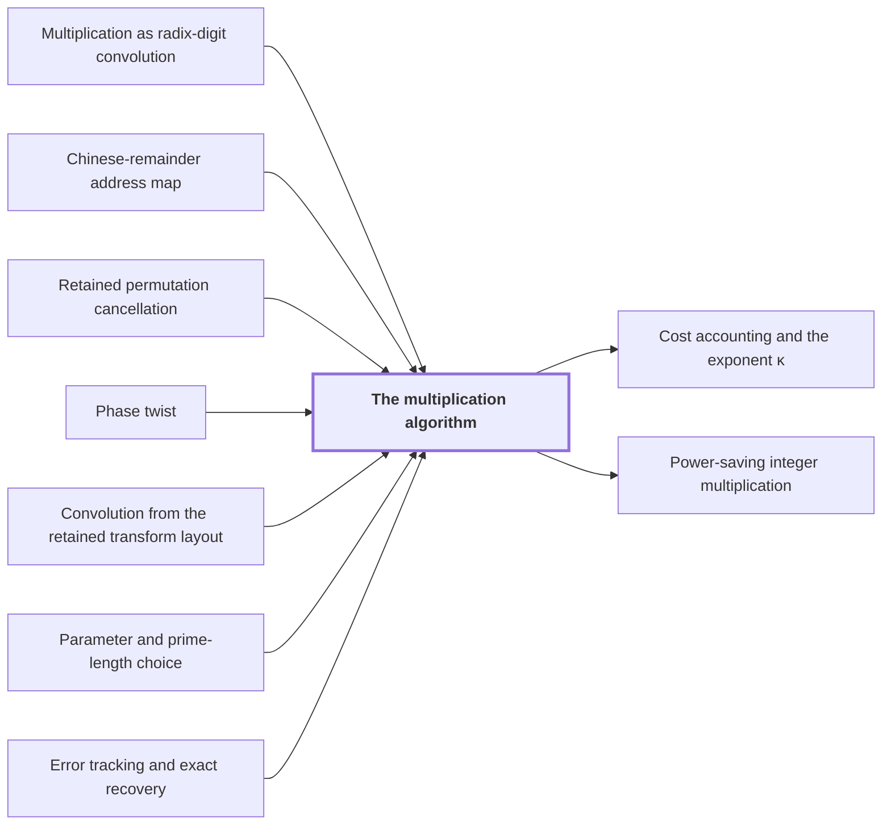

# The multiplication algorithm

!!! info "Before this page"

    The multiplication algorithm *is reduced to* [Multiplication as radix-digit convolution](radix-digit-reduction.md "Their product polynomial has degree below $S$, so the product is reduced to a cyclic convolution modulo $x^S-1$ of digit arrays with integer coefficients below $2^{3b}$, by Multiplication as radix-digit convolution."), *rewrites its coefficient sequence by* [Chinese-remainder address map](crt-map.md "It rewrites a length-$S$ coefficient sequence by the Chinese-remainder address map $\Phi$ as an array with one cyclic axis of each length $s_i$, preserving convolution, so that the Fourier transform acts one short axis at a time."), *drops its permutation by* [Retained permutation cancellation](retained-permutations.md "Permuting both factors commutes with pointwise products, and $RF_{\boldsymbol s}^{+}R=F_{\boldsymbol s}^{+}$ by Retained permutation cancellation, so $R$ drops out."), *computes convolution through* [Phase twist](phase-twist.md "Here $\mathcal M_{\mathbb C}(f,g)=f*g/T$ is normalized cyclic convolution, computed through the Phase twist and Convolution from the retained transform layout."), *computes convolution through* [Convolution from the retained transform layout](ring-convolution.md "Here $\mathcal M_{\mathbb C}(f,g)=f*g/T$ is normalized cyclic convolution, computed through the Phase twist and Convolution from the retained transform layout."), *takes its sizes from* [Parameter and prime-length choice](parameter-choice.md "It takes its sizes from Parameter and prime-length choice: $b=\lceil\log_2 n\rceil$ bits per radix digit, $p=6b$ fractional bits for every stored value, distinct odd primes $s_i$ with product $S$, and powers of two $t_i$ just above $s_i$ with product $T$.") and *is shown exact by* [Error tracking and exact recovery](precision-recovery.md "The error on the recovered coefficients is below $1/2$, as shown by Error tracking and exact recovery from each normalized transform and product being a contraction.").

!!! abstract "Where this fits"

    1. A single deterministic Turing machine with a fixed finite alphabet and a fixed finite number of one-dimensional tapes multiplies two $n$-bit integers exactly in $O(n(\lg n)^{1-\kappa})$ worst-case time with $\kappa=2^{-182}$, disproving the $n\log n$ optimality conjecture of Sch\"onhage and Strassen in this model. — how: Build two power-saving tape procedures (chunk interchange and simultaneous butterfly layer) from fixed finite linear networks; use them to accelerate the synthetic polynomial transforms and ring convolution; use Gaussian resampling with retained permutations and chirps to reduce the prime-length cyclic convolution of the radix-digit coefficients to those power-of-two transforms; assemble the exact product with a proof that the error is below $1/2$; and total the cost to show a power of $\log n$ is saved. ([Power-saving integer multiplication](main-result.md "A deterministic fixed-tape Turing machine multiplying two n-bit integers exactly in O(n(lg n)^{1−κ}) time with κ = 2^{−182}, disproving the n log n optimality conjecture in this model."))
    2. **This page:** The exact $2n$-bit product of the two inputs is obtained from the radix-digit convolution by the chain: radix digits, Chinese-remainder address map to a product of prime cyclic axes, two forward source transforms (resampling and chirps), pointwise product, opposite transform, rescaling, rounding, and carry propagation, with total error below $1/2$.

??? note "Symbols from earlier pages"

    - $n$ — bit length: The number of bits in each of the two integers being multiplied. (on [Schönhage–Strassen optimality conjecture](conjecture.md "The 1971 proposal that n log n is the optimal order of growth for multiplying n-bit integers on a multitape Turing machine."))
    - $x$ — polynomial variable: The variable of the digit polynomials, evaluated at 2^b to recover the integers. (on [Multiplication as radix-digit convolution](radix-digit-reduction.md "Splitting each integer into radix-2^b digits turns the product into a convolution of short integer coefficients, which carry propagation turns back into a binary number."))
    - $\Phi$ — address map: The algebra isomorphism from the cyclic ring of length S to the product of cyclic rings on the axes, sending x to the product of x_i^{mu_i}. (on [Chinese-remainder address map](crt-map.md "An isomorphism that places a cyclic convolution of length S = s₁⋯s_d on pairwise coprime prime axes, implemented as triangular controlled shifts."))
    - $\boldsymbol s$ — source axis lengths: The tuple of source axis lengths. (on [Multidimensional transforms](multidim-transform.md "A transform over several axes at once, the tensor product of one-dimensional transforms, applied to an array one axis at a time."))
    - $\boldsymbol t$ — axis lengths: The tuple of the even axis lengths t_1,...,t_d. (on [Bluestein chirp identity](chirp.md "An identity that rewrites a (permuted) Fourier transform as a pointwise chirp phase, a cyclic convolution, and another chirp phase."))
    - $\mathcal M_{\mathbb C}$ — complex convolution: The normalized complex cyclic convolution, equal to f*g/T. (on [Phase twist](phase-twist.md "Multiplying coefficient k by e^{πik/r}, which converts the cyclic coordinate modulo x^r − 1 into the negacyclic ring modulo y^r + 1 and is removed afterwards."))
    - $f$ — first array: A complex array with d axes, the last of length r. (on [Phase twist](phase-twist.md "Multiplying coefficient k by e^{πik/r}, which converts the cyclic coordinate modulo x^r − 1 into the negacyclic ring modulo y^r + 1 and is removed afterwards."))
    - $g$ — second array: The second complex array, with the same shape as f. (on [Phase twist](phase-twist.md "Multiplying coefficient k by e^{πik/r}, which converts the cyclic coordinate modulo x^r − 1 into the negacyclic ring modulo y^r + 1 and is removed afterwards."))
    - $a$ — chirp: The array of phases a_j = exp(-pi i sum s_i j_i^2 / t_i), not a bank index. (on [Bluestein chirp identity](chirp.md "An identity that rewrites a (permuted) Fourier transform as a pointwise chirp phase, a cyclic convolution, and another chirp phase."))
    - $Q$ — target permutation: The target permutation, a reordering of the output of a power-of-two transform. (on [Bluestein chirp identity](chirp.md "An identity that rewrites a (permuted) Fourier transform as a pointwise chirp phase, a cyclic convolution, and another chirp phase."))
    - $Q_p$ — truncation: The truncation that drops the bits below 2^{-p} in each real and imaginary part, returning a record to the p-bit grid. (on [Fixed-point Gaussian dyadic records](fixed-point.md "Complex values stored as signed two's-complement integers over a power-of-two denominator 2^{-p}; intermediate values are exact and one truncation Q_p rounds back to the p-bit grid."))
    - $\mathcal A$ — input contraction: The tensor product of the axis input maps A_i. (on [Multidimensional transforms](multidim-transform.md "A transform over several axes at once, the tensor product of one-dimensional transforms, applied to an array one axis at a time."))
    - $\mathcal B_0$ — output contraction: The tensor product of the axis output maps B_{0,i}. (on [Multidimensional transforms](multidim-transform.md "A transform over several axes at once, the tensor product of one-dimensional transforms, applied to an array one axis at a time."))

The multiplication algorithm is the full procedure that turns two $n$-bit integers into their exact $2n$-bit product. Key idea: the product is a [cyclic convolution](convolution.md "The product of two sequences (or elements of a polynomial quotient ring) where indices wrap around: (f∗g)_k = Σ f_j g_{k−j}.") of short integer coefficients; a [Discrete Fourier transform](dft.md "The normalized transform (F_q u)_k = (1/q) Σ u_j e^{−2πi jk/q}, which turns convolution into pointwise multiplication.") turns it into pointwise multiplication; prime-length transforms are computed through power-of-two ones by resampling and chirps; and the total error stays below $1/2$, so rounding recovers exact integers.

## Setup

It takes its sizes from [Parameter and prime-length choice](parameter-choice.md "Fixed rational exponents and sizes (precision p = 6b, d axes, K = d^c, T and r powers of two, prime lengths s_i just below t_i) making every hypothesis of the lemmas hold."): $b=\lceil\log_2 n\rceil$ bits per radix digit, $p=6b$ fractional bits for every stored value, distinct odd primes $s_i$ with product $S$, and powers of two $t_i$ just above $s_i$ with product $T$. Each input has $q=\lceil n/b\rceil$ radix-$2^b$ digits $a_j$. Their product polynomial has degree below $S$, so the product is reduced to a cyclic convolution modulo $x^S-1$ of digit arrays with integer coefficients below $2^{3b}$, by [Multiplication as radix-digit convolution](radix-digit-reduction.md "Splitting each integer into radix-2^b digits turns the product into a convolution of short integer coefficients, which carry propagation turns back into a binary number."). It rewrites a length-$S$ coefficient sequence by the [Chinese-remainder address map](crt-map.md "An isomorphism that places a cyclic convolution of length S = s₁⋯s_d on pairwise coprime prime axes, implemented as triangular controlled shifts.") $\Phi$ as an array with one cyclic axis of each length $s_i$, preserving convolution, so that the Fourier transform acts one short axis at a time.

## Computed and exact transforms

A tilde marks what the machine computes in fixed point, truncating with $Q_p$ to $p$ fractional bits; the same symbol without it is the exact map approximated. An *exact counterpart* replaces every numerical subroutine by its exact map and omits truncations; [Error tracking and exact recovery](precision-recovery.md "Each normalized transform and product is a contraction with a bounded rounding error, and the total error on the recovered convolution coefficients is below 1/2, so rounding gives exact integers.") bounds the gap.

By the [Bluestein chirp identity](chirp.md "An identity that rewrites a (permuted) Fourier transform as a pointwise chirp phase, a cyclic convolution, and another chirp phase."), with chirp array $a$ and target permutation $Q$, the transform $F_{\boldsymbol t}$ on the power-of-two axes satisfies, for an array $f$, $QF_{\boldsymbol t}f=\overline a\cdot\mathcal M_{\mathbb C}(a,\overline a\cdot f)$: multiply by a phase, convolve with the chirp, multiply by a phase. Here $\mathcal M_{\mathbb C}(f,g)=f*g/T$ is normalized cyclic convolution, computed through the [Phase twist](phase-twist.md "Multiplying coefficient k by e^{πik/r}, which converts the cyclic coordinate modulo x^r − 1 into the negacyclic ring modulo y^r + 1 and is removed afterwards.") and [Convolution from the retained transform layout](ring-convolution.md "Convolution over the ring modulo y^r + 1 on the remaining axes by two forward synthetic transforms, pointwise polynomial products and the opposite transform, normalized by 1/(rM)."). Take $f$ of norm at most $.6$ and let $\widetilde a$ be $a$ rounded to the $p$-bit grid, within $2\cdot2^{-p}$ of $a$. The computed chirp transform $\widetilde{\mathscr C}$ forms
$$f_0=Q_p(\overline{\widetilde a}\cdot f),\qquad f_1=\widetilde{\mathcal M}_{\mathbb C}(\widetilde a,f_0),\qquad \widetilde{\mathscr C}(f)=Q_p(\overline{\widetilde a}\cdot f_1).$$
Here $f_0$ is the data operand after the first endpoint phase, $f_1$ the computed convolution, and $\widetilde a$ the convolution kernel. Replacing the computed pieces by exact ones and dropping $Q_p$ turns the three lines into the right side of the chirp identity, so the exact counterpart of $\widetilde{\mathscr C}$ is $QF_{\boldsymbol t}$.

The algorithm needs $F_{\boldsymbol s}$, the discrete Fourier transform on the prime axes of lengths $s_i$, normalized by $1/S$. The computed version $\widetilde{\mathscr F}$, with exact counterpart $\mathscr F$, applies the [Gaussian resampling](gaussian-resampling.md "Re-expressing a Fourier transform of prime length s through a transform of nearby power-of-two length t using Gaussian weights, so that only power-of-two transforms are needed.") input map $\mathcal A$, then $\widetilde{\mathscr C}$, then the output map $\mathcal B_0$, then multiplies exactly by $2^\gamma$, the power of two that resampling introduces. Its exact counterpart is $\mathscr F=2^\gamma\mathcal B_0QF_{\boldsymbol t}\mathcal A=RF_{\boldsymbol s}$. The first equality substitutes each stage's exact counterpart; the second is the resampling identity between exact maps, with $R$ a retained permutation of coordinates. For the opposite sign, on an array $z$, $\widetilde{\mathscr F}^{+}(z)=\overline{\widetilde{\mathscr F}(\overline z)}$ has exact counterpart $RF_{\boldsymbol s}^{+}$, since $R$ is real and conjugation flips the exponent sign.

## The algorithm

Digit $a_j$ is stored with numerator $a_j2^{p-b-2}$ in a signed real word followed by a zero imaginary word, representing $a_j2^{-b-2}$, so the inputs have norm below $1/4$; $S-q$ zero records pad each array. Then:

1. Apply $\Phi$ to obtain arrays $u,v$ of exact $p$-bit values (the scaled digit arrays, not the integers).
2. Compute $\widetilde{\mathscr F}(u)$ and $\widetilde{\mathscr F}(v)$.
3. Multiply corresponding coefficients exactly and truncate toward zero to $p$ fractional bits, obtaining the array $z$.
4. Compute $\widetilde{\mathscr F}^{+}(z)$ and multiply by $S$, obtaining $\widetilde w$, which approximates the exact array $w$ defined below.
5. Multiply by $2^{2b+4}S$, round to the nearest integers, write each as a signed $(3b+1)$-bit word, and apply $\Phi^{-1}$ removing the padding.
6. Propagate radix-$2^b$ carries in increasing coefficient order and output exactly $2n$ bits.

The two scalings by $S$ undo different normalizations. Both $F_{\boldsymbol s}$ and $F_{\boldsymbol s}^{+}$ carry $1/S$, so $F_{\boldsymbol s}(u*v)=S\,F_{\boldsymbol s}u\cdot F_{\boldsymbol s}v$ and $F_{\boldsymbol s}^{+}F_{\boldsymbol s}$ is the identity divided by $S$. Permuting both factors commutes with pointwise products, and $RF_{\boldsymbol s}^{+}R=F_{\boldsymbol s}^{+}$ by [Retained permutation cancellation](retained-permutations.md "Leaving the coordinate permutations of resampling inside the transform identity, so the source permutation cancels across the two forward transforms and the opposite one and none is executed as a sort."), so $R$ drops out. The exact counterpart after the three transforms is $(u*v)/S^2$, so after the first scale it is $w=(u*v)/S$. The second scale gives $2^{2b+4}(u*v)$. The factor $2^{2b+4}$ cancels the $2^{-b-2}$ carried by each stored operand, and the inverse image under $\Phi$ is the original integer coefficient convolution<cite class="exegenius-ref" data-source="paper" data-locator="§9.6 The multiplication algorithm" data-quote="The second scale gives $2^{2b+4}(u*v)$, whose inverse image under $\Phi$ is the original integer coefficient convolution." title="The second scale gives $2^{2b+4}(u*v)$, whose inverse image under $\Phi$ is the original integer coefficient convolution."> (see §9.6 The multiplication algorithm)</cite>.

The error on the recovered coefficients is below $1/2$, as shown by [Error tracking and exact recovery](precision-recovery.md "Each normalized transform and product is a contraction with a bounded rounding error, and the total error on the recovered convolution coefficients is below 1/2, so rounding gives exact integers.") from each normalized transform and product being a contraction. Rounding in step 5 therefore gives the exact integer coefficients, and carry propagation the exact binary product.

## Connections

Used by:

- [Cost accounting and the exponent κ](cost-accounting.md "Cost accounting totals the running time of every step of The multiplication algorithm and shows that it is $O(n(\lg n)^{1-\kappa})$, with $\kappa=2^{-182}$ fixed by the smallest margin below.") *totals the running time of* The multiplication algorithm
- [Power-saving integer multiplication](main-result.md "The exact $2n$-bit product is assembled by The multiplication algorithm from radix digits, two forward transforms, a pointwise product, the opposite transform, rescaling, rounding and carries, with total error below $1/2$.") *is assembled by* The multiplication algorithm

??? quote "From the sources"

    > The multiplication algorithm
    >
    > — [Integer multiplication below n log n (OpenAI, 2026)](https://github.com/openai/math/tree/fd4aeeb2ee4fc729c18d98444fed42fd0529eeeb/preprints/Integer-multiplication-below-n-log-n-September-23-2026)

    > The two occurrences of $S$ in this algorithm undo different normalizations.
    >
    > — [Integer multiplication below n log n (OpenAI, 2026)](https://github.com/openai/math/tree/fd4aeeb2ee4fc729c18d98444fed42fd0529eeeb/preprints/Integer-multiplication-below-n-log-n-September-23-2026)
