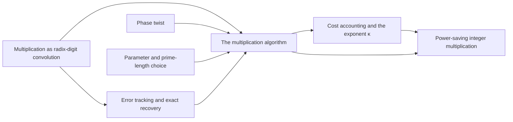

# Multiplication and Cost

This part assembles the algorithm. [Radix digits](../radix-digit-reduction.md "Splitting each integer into radix-2^b digits turns the product into a convolution of short integer coefficients, which carry propagation turns back into a binary number."), the [phase twist](../phase-twist.md "Multiplying coefficient k by e^{πik/r}, which converts the cyclic coordinate modulo x^r − 1 into the negacyclic ring modulo y^r + 1 and is removed afterwards."), the [parameter choice](../parameter-choice.md "Fixed rational exponents and sizes (precision p = 6b, d axes, K = d^c, T and r powers of two, prime lengths s_i just below t_i) making every hypothesis of the lemmas hold.") and [error tracking](../precision-recovery.md "Each normalized transform and product is a contraction with a bounded rounding error, and the total error on the recovered convolution coefficients is below 1/2, so rounding gives exact integers.") feed the [multiplication algorithm](../multiplication-algorithm.md "Digits, then the CRT map, two forward transforms with resampling and chirps, a pointwise product, the opposite transform, rescaling, rounding and carry propagation yield the exact 2n-bit product."). [Cost accounting](../cost-accounting.md "Dividing each cost by V = Tp, the dominant terms are powers of p below one with minimum margin 2^{-181} = 2κ, giving total time O(n(lg n)^{1−κ}).") then gives the exponent $\kappa$, which yields the [main result](../main-result.md "A deterministic fixed-tape Turing machine multiplying two n-bit integers exactly in O(n(lg n)^{1−κ}) time with κ = 2^{−182}, disproving the n log n optimality conjecture in this model.").

## Pages

1. [Multiplication as radix-digit convolution](../radix-digit-reduction.md "Splitting each integer into radix-2^b digits turns the product into a convolution of short integer coefficients, which carry propagation turns back into a binary number.") — Splitting each integer into radix-2^b digits turns the product into a convolution of short integer coefficients, which carry propagation turns back into a binary number.
2. [Phase twist](../phase-twist.md "Multiplying coefficient k by e^{πik/r}, which converts the cyclic coordinate modulo x^r − 1 into the negacyclic ring modulo y^r + 1 and is removed afterwards.") — Multiplying coefficient k by e^{πik/r}, which converts the cyclic coordinate modulo x^r − 1 into the negacyclic ring modulo y^r + 1 and is removed afterwards.
3. [Error tracking and exact recovery](../precision-recovery.md "Each normalized transform and product is a contraction with a bounded rounding error, and the total error on the recovered convolution coefficients is below 1/2, so rounding gives exact integers.") — Each normalized transform and product is a contraction with a bounded rounding error, and the total error on the recovered convolution coefficients is below 1/2, so rounding gives exact integers.
4. [Parameter and prime-length choice](../parameter-choice.md "Fixed rational exponents and sizes (precision p = 6b, d axes, K = d^c, T and r powers of two, prime lengths s_i just below t_i) making every hypothesis of the lemmas hold.") — Fixed rational exponents and sizes (precision p = 6b, d axes, K = d^c, T and r powers of two, prime lengths s_i just below t_i) making every hypothesis of the lemmas hold.
5. [The multiplication algorithm](../multiplication-algorithm.md "Digits, then the CRT map, two forward transforms with resampling and chirps, a pointwise product, the opposite transform, rescaling, rounding and carry propagation yield the exact 2n-bit product.") — Digits, then the CRT map, two forward transforms with resampling and chirps, a pointwise product, the opposite transform, rescaling, rounding and carry propagation yield the exact 2n-bit product.
6. [Cost accounting and the exponent κ](../cost-accounting.md "Dividing each cost by V = Tp, the dominant terms are powers of p below one with minimum margin 2^{-181} = 2κ, giving total time O(n(lg n)^{1−κ}).") — Dividing each cost by V = Tp, the dominant terms are powers of p below one with minimum margin 2^{-181} = 2κ, giving total time O(n(lg n)^{1−κ}).
7. [Power-saving integer multiplication](../main-result.md "A deterministic fixed-tape Turing machine multiplying two n-bit integers exactly in O(n(lg n)^{1−κ}) time with κ = 2^{−182}, disproving the n log n optimality conjecture in this model.") — A deterministic fixed-tape Turing machine multiplying two n-bit integers exactly in O(n(lg n)^{1−κ}) time with κ = 2^{−182}, disproving the n log n optimality conjecture in this model.

## Map

Arrows point from a page to the pages that build on it.

