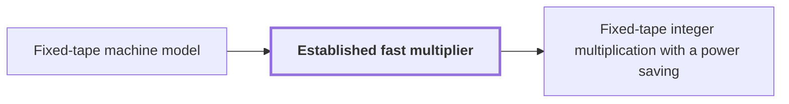

# Established fast multiplier

!!! info "Before this page"

    Established fast multiplier *runs on* [Fixed-tape machine model](fixed-tape-model.md "Within the argument the multiplier runs on a Fixed-tape machine model."). Assumed known: Big-O notation.

!!! abstract "Where this fits"

    - Relied on to show: Normalized cyclic convolution on the power-of-two axes is computed over the polynomial ring $\mathbb C[y]/(y^r+1)$ by synthetic transforms and packed polynomial products. ([Synthetic polynomial transform](synthetic-transform.md "A discrete Fourier transform whose roots of unity are powers of y in the polynomial ring, so that each twiddle multiplication is a signed shift and the transform is computed by simultaneous butterfly layers."))
    - Relied on to show: Polynomial products are computed by signed packing and the established $O(n\log n)$ multiplier used as a subroutine. ([Signed coefficient packing](signed-packing.md "Encoding a polynomial with signed integer coefficients as one integer by placing coefficients at fixed bit offsets, so that a polynomial product becomes an integer product."))

??? note "Symbols from earlier pages"

    - $n$ — input length: The number of bits in each of the two integers being multiplied, which is the length the worst-case time is measured against. (on [Schonhage-Strassen optimality conjecture](schonhage-strassen-conjecture.md "The conjecture that n log n is the optimal order of growth of the time needed to multiply two n-bit integers on a multitape Turing machine."))
    - $\kappa$ — fixed exponent saving: A fixed constant equal to $2^{-182}$, the same for every input length $n$. (on [Fixed-tape machine model](fixed-tape-model.md "A multitape Turing machine with one fixed finite alphabet and a fixed finite number of one-dimensional tapes, the same for every input length."))

The established fast multiplier is the known deterministic algorithm of Harvey and van der Hoeven that multiplies two integers of $n$ bits each in $O(n\log n)$ time. The argument treats it as a black box: it does not reprove the algorithm, but uses only its behaviour (two integers in, their product out) and its time bound, and calls it whenever the product of two shorter integers is needed.

Within the argument the multiplier runs on a [Fixed-tape machine model](fixed-tape-model.md "A multitape Turing machine with one fixed finite alphabet and a fixed finite number of one-dimensional tapes, the same for every input length."). Its calls are ordinary subroutine calls.<cite class="exegenius-ref" data-source="paper" data-locator="§1.5 Historical context and inherited methods" data-quote="they do not invoke the improved theorem recursively." title="they do not invoke the improved theorem recursively."> (see §1.5 Historical context and inherited methods)</cite>

The improved theorem is the result the argument proves: a multiplier with time $O(n(\lg n)^{1-\kappa})$ on the same model. If a call used it, a call on $m$-bit integers would cost on the order of $m(\lg m)^{1-\kappa}$, so the cost of each call would depend on the very bound being proved, and the proof would assume its own conclusion.

The multiplier is needed for polynomial products, which [Signed coefficient packing](signed-packing.md "Encoding a polynomial with signed integer coefficients as one integer by placing coefficients at fixed bit offsets, so that a polynomial product becomes an integer product.") turns into single integer products: packing places each coefficient at its own bit offset, so one product carries a whole polynomial product. The multiplier computes these integer products.

## Connections

Used by:

- [Fixed-tape integer multiplication with a power saving](fixed-tape-multiplication.md "It computes its shorter products by the Established fast multiplier, used as a black box.") *computes its shorter products by* Established fast multiplier

??? quote "From the sources"

    > Calls to the established $O(n\log n)$ multiplier are ordinary subroutine
    >
    > — [Integer multiplication below n log n (OpenAI, 2026)](https://github.com/openai/math/tree/fd4aeeb2ee4fc729c18d98444fed42fd0529eeeb/preprints/Integer-multiplication-below-n-log-n-September-23-2026)
